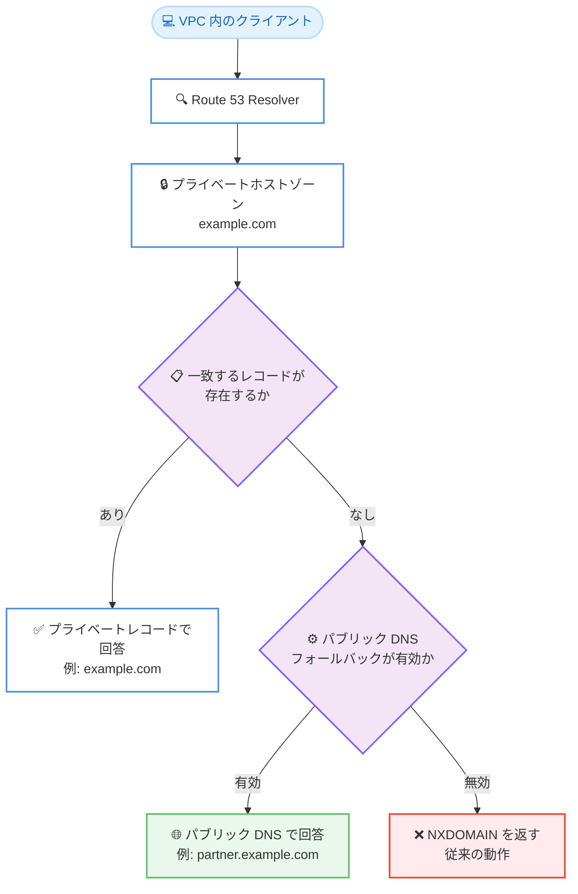

# Amazon Route 53 - プライベートホストゾーンのパブリック DNS フォールバック対応

**リリース日**: 2026 年 11 月 20 日
**サービス**: Amazon Route 53
**機能**: プライベートホストゾーンのパブリック DNS フォールバック (Advanced Hosted Zones)

📊 [このアップデートのインフォグラフィックを見る](https://takech9203.github.io/aws-news-summary/20261120-route-53-public-dns-fallback.html)

## 概要

Amazon Route 53 のプライベートホストゾーンが、パブリック DNS へのフォールバックをサポートしました。これまで、VPC に関連付けられたプライベートホストゾーンはそのドメインに対して完全に権威を持つものとして扱われ、プライベートホストゾーン内に一致するレコードが存在しない名前への問い合わせには NXDOMAIN (名前が見つからないエラー) が返されていました。本アップデートにより、一致するレコードがない場合にパブリック DNS からの回答を返すことが可能になります。

この機能は、同時期に発表された Advanced Hosted Zones (アドバンストホストゾーン) の機能の一部として提供されます。一部の名前だけをプライベートに解決したい場合に、パブリックゾーンのレコード全体をプライベートゾーンに複製して同期を維持する必要がなくなり、運用負荷が大幅に軽減されます。

ハイブリッド構成やスプリットホライズン DNS (内部と外部で異なる回答を返す構成) を運用するユーザーにとって、DNS 管理をシンプルにできる重要なアップデートです。

**アップデート前の課題**

- プライベートホストゾーンはドメイン全体に対して権威を持つため、ゾーン内に存在しない名前への問い合わせは NXDOMAIN となり、パブリック DNS に存在するレコードを解決できなかった
- 一部の名前だけをプライベートに上書きしたい場合でも、パブリックゾーンのすべてのレコードをプライベートゾーンに複製する必要があった
- 複製したレコードはパブリックゾーンの変更に合わせて継続的に同期する必要があり、運用負荷と設定ミスのリスクが発生していた

**アップデート後の改善**

- プライベートホストゾーン内に一致するレコードがない場合、NXDOMAIN ではなくパブリック DNS からの回答を返せるようになった
- プライベートに解決したい名前だけをプライベートホストゾーンに追加すればよく、それ以外の名前は既存のパブリック DNS で解決される
- レコードの複製や同期作業が不要になり、DNS 構成の管理がシンプルになった

## アーキテクチャ図



VPC 内のクライアントからの DNS 問い合わせに対し、プライベートホストゾーンに一致するレコードがない場合の解決フローを示しています。フォールバックが有効な場合はパブリック DNS からの回答が返され、無効な場合は従来どおり NXDOMAIN が返されます。

## サービスアップデートの詳細

### 主要機能

1. **パブリック DNS フォールバック**
   - プライベートホストゾーンのドメイン配下の名前への問い合わせで、一致するレコードがゾーン内に存在しない場合、パブリック DNS からの回答を返す
   - 従来は NXDOMAIN が返されていた問い合わせが、パブリック DNS に存在するレコードで解決可能になる
   - 例: example.com のプライベートホストゾーンで example.com をプライベートエンドポイントに向けつつ、パブリック DNS にのみ存在する partner.example.com も解決できる

2. **Advanced Hosted Zones の一機能として提供**
   - 本機能は Advanced Hosted Zones の機能の一部として提供される
   - 新規にプライベートの Advanced Hosted Zone を作成するか、既存のプライベートホストゾーンをアップグレードした上でフォールバックを有効化する

3. **多様な設定インターフェイス**
   - Route 53 コンソール、API、AWS CLI、AWS SDK、AWS CloudFormation から設定可能
   - API では `UpdateHostedZoneFeatures` の `EnablePublicDNSFallback` パラメータなどで制御する

## 技術仕様

### 解決動作の比較

| 問い合わせ対象 | 従来の動作 | フォールバック有効時の動作 |
|------|------|------|
| プライベートホストゾーンにレコードあり | プライベートレコードで回答 | プライベートレコードで回答 (変更なし) |
| ゾーン内にレコードなし、パブリック DNS にあり | NXDOMAIN | パブリック DNS の回答を返す |
| ゾーン内にもパブリック DNS にもレコードなし | NXDOMAIN | NXDOMAIN |

### API変更履歴

| 日付 | サービス | 変更内容 |
|------|----------|----------|
| 2026/11/20 | [Amazon Route 53](https://awsapichanges.com/archive/changes/e9d2b3-route53.html) | 4 new 8 updated api methods - Advanced Hosted Zones のサポート。パブリック DNS フォールバック、変更ガードレール、変更履歴などを含む |

主な API 変更点は以下のとおりです。

- `CreateHostedZone`: `HostedZoneConfig` に `HostedZoneTier` (STANDARD | ADVANCED) が追加され、`EnablePublicDNSFallback` パラメータが追加
- `UpdateHostedZoneFeatures`: `EnablePublicDNSFallback` と `DryRun` パラメータによるフォールバックの有効化・無効化
- `UpdateHostedZoneTier`: 既存ホストゾーンの Advanced Hosted Zone へのアップグレード
- `GetHostedZone` / `ListHostedZones`: ホストゾーンのティアやフォールバック設定の参照

### 設定例 (boto3)

```python
# 既存のプライベートホストゾーンでパブリック DNS フォールバックを有効化
client.update_hosted_zone_features(
    HostedZoneId='Z1234567890ABC',
    EnablePublicDNSFallback=True
)
```

## 設定方法

### 前提条件

1. Route 53 のプライベートホストゾーンが作成済み、または新規作成すること
2. 対象ホストゾーンが Advanced Hosted Zone であること (既存ゾーンはアップグレードが必要)
3. ホストゾーンの設定変更に必要な IAM 権限を持っていること

### 手順

#### ステップ1: プライベートの Advanced Hosted Zone を用意する

```bash
# 既存のプライベートホストゾーンを Advanced Hosted Zone にアップグレード
aws route53 update-hosted-zone-tier \
  --hosted-zone-id Z1234567890ABC \
  --hosted-zone-tier ADVANCED
```

既存のプライベートホストゾーンを Advanced Hosted Zone にアップグレードします。新規作成の場合は、ホストゾーン作成時にティアとして ADVANCED を指定します。

#### ステップ2: パブリック DNS フォールバックを有効化する

```bash
# パブリック DNS フォールバックを有効化
aws route53 update-hosted-zone-features \
  --hosted-zone-id Z1234567890ABC \
  --enable-public-dns-fallback
```

対象のプライベートホストゾーンでパブリック DNS フォールバックを有効化します。Route 53 コンソールや CloudFormation からも設定できます。

#### ステップ3: 名前解決の動作を確認する

```bash
# VPC 内のインスタンスからプライベートに存在しない名前を問い合わせ
dig partner.example.com
```

VPC 内のクライアントから、プライベートホストゾーンに存在せずパブリック DNS にのみ存在する名前を問い合わせ、NXDOMAIN ではなくパブリック DNS の回答が返ることを確認します。

## メリット

### ビジネス面

- **運用コストの削減**: パブリックゾーンのレコードをプライベートゾーンに複製・同期する作業が不要になり、DNS 運用の工数を削減できる
- **障害リスクの低減**: レコードの同期漏れによる名前解決の失敗や設定ミスのリスクを排除できる
- **導入の迅速化**: 一部の名前だけをプライベート化したい要件に対して、最小限の設定変更で対応できる

### 技術面

- **スプリットホライズン DNS の簡素化**: 内部向けに上書きしたい名前だけをプライベートホストゾーンに登録すればよく、構成がシンプルになる
- **パブリック DNS との一貫性**: パブリック DNS 側の変更が自動的に反映されるため、内部からの解決結果が常に最新のパブリック情報と一致する
- **柔軟な制御**: ゾーン単位でフォールバックの有効・無効を切り替えられ、API の DryRun による事前確認も可能

## デメリット・制約事項

### 制限事項

- 本機能は Advanced Hosted Zones の機能として提供されるため、Standard のプライベートホストゾーンでは利用できない (アップグレードが必要)
- プライベートホストゾーンが利用可能な AWS 商用リージョンでの提供であり、それ以外のリージョンでは利用できない

### 考慮すべき点

- フォールバックを有効化すると、これまで NXDOMAIN となっていた名前がパブリック DNS で解決されるようになるため、意図しない名前解決が発生しないか事前に影響範囲を確認する必要がある
- 内部からの解決を明示的に遮断したい名前がある場合は、プライベートホストゾーンにレコードを登録して制御する設計が必要
- Advanced Hosted Zones の料金体系が適用されるため、コストへの影響を事前に確認することを推奨

## ユースケース

### ユースケース1: ハイブリッド環境でのスプリットホライズン DNS

**シナリオ**: example.com のうち、社内システムのエンドポイントだけを VPC 内でプライベート IP に解決し、その他のサブドメインはパブリック DNS の回答をそのまま利用したい。

**実装例**:
```
1. example.com のプライベート Advanced Hosted Zone を作成し VPC に関連付け
2. internal.example.com など内部向けレコードのみ登録
3. パブリック DNS フォールバックを有効化
```

**効果**: 内部向けの名前はプライベートに解決しつつ、www.example.com などパブリックのみに存在する名前も VPC 内から問題なく解決できる。

### ユースケース2: SaaS やパートナーサービスとの連携

**シナリオ**: 自社ドメイン配下の partner.example.com がパートナー企業によりパブリック DNS で管理されており、VPC 内のアプリケーションからもアクセスする必要がある。

**実装例**:
```
1. example.com のプライベートホストゾーンでフォールバックを有効化
2. partner.example.com はプライベートホストゾーンに登録しない
3. VPC 内からの問い合わせはパブリック DNS の回答で解決される
```

**効果**: パートナー側のレコード変更を複製・追従する必要がなく、常に最新のパブリック DNS の回答が利用される。

### ユースケース3: 既存プライベートホストゾーンの運用簡素化

**シナリオ**: パブリックゾーンのレコードをプライベートゾーンへ複製して同期するバッチ処理を運用しており、同期漏れによる障害が課題になっている。

**実装例**:
```
1. 既存のプライベートホストゾーンを Advanced Hosted Zone にアップグレード
2. パブリック DNS フォールバックを有効化
3. 複製していたレコードのうち、プライベートに上書きが必要なもの以外を削除
4. 同期バッチ処理を廃止
```

**効果**: 同期の仕組み自体が不要になり、運用負荷と障害リスクを大幅に削減できる。

## 料金

本機能は Advanced Hosted Zones の機能として提供されるため、Advanced Hosted Zones の料金体系が適用されます。詳細は Route 53 の料金ページを参照してください。

## 利用可能リージョン

Route 53 プライベートホストゾーンが提供されているすべての AWS 商用リージョンで利用可能です。

## 関連サービス・機能

- **Route 53 Advanced Hosted Zones**: 本機能の提供基盤。パブリック DNS フォールバックのほか、変更ガードレールや変更履歴などの機能を提供
- **Route 53 Resolver**: VPC 内の DNS 問い合わせを処理するリゾルバー。プライベートホストゾーンとパブリック DNS の解決を担う
- **Amazon VPC**: プライベートホストゾーンを関連付ける対象。VPC 内のリソースからの名前解決に本機能が適用される
- **AWS CloudFormation**: フォールバック設定を含むホストゾーン構成のコード化・自動化に利用可能

## 参考リンク

- 📊 [インフォグラフィック](https://takech9203.github.io/aws-news-summary/20261120-route-53-public-dns-fallback.html)
- [公式発表 (What's New)](https://aws.amazon.com/about-aws/whats-new/2026/11/route-53-public-dns-fallback/)
- [関連発表: Route 53 Advanced Hosted Zones](https://aws.amazon.com/about-aws/whats-new/2026/11/route-53-offers-advanced-hosted-zones/)
- [ドキュメント: プライベートホストゾーン](https://docs.aws.amazon.com/Route53/latest/DeveloperGuide/hosted-zones-private.html)
- [料金ページ](https://aws.amazon.com/route53/pricing/)

## まとめ

Route 53 プライベートホストゾーンのパブリック DNS フォールバック対応により、一部の名前だけをプライベートに解決するスプリットホライズン構成が、レコードの複製や同期なしで実現できるようになりました。パブリックゾーンのレコードをプライベートゾーンへ複製・同期する運用を行っている場合は、Advanced Hosted Zone へのアップグレードと本機能の有効化を検討することを推奨します。有効化の際は、これまで NXDOMAIN となっていた名前の解決動作が変わるため、影響範囲の事前確認を忘れずに実施してください。
