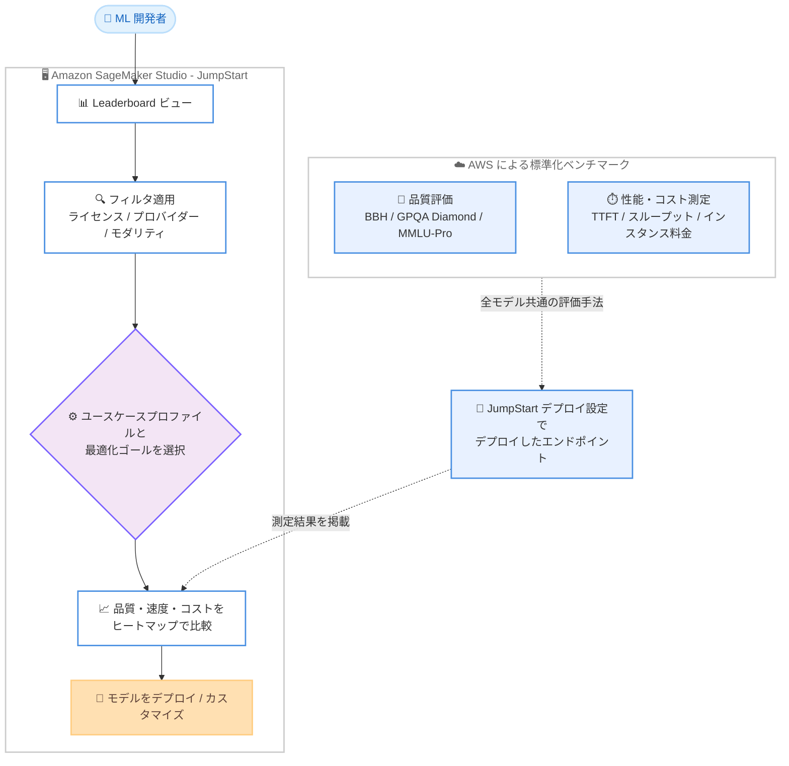

# Amazon SageMaker JumpStart - モデルリーダーボードによる品質・速度・コストの比較

**リリース日**: 2026 年 11 月 20 日
**サービス**: Amazon SageMaker JumpStart
**機能**: SageMaker JumpStart Model Leaderboard (モデルリーダーボード)

📊 [このアップデートのインフォグラフィックを見る](https://takech9203.github.io/aws-news-summary/20261120-sagemaker-jumpstart-model-leaderboard.html)

## 概要

Amazon SageMaker JumpStart に、基盤モデルを品質・速度・コストの観点で横並びに比較できる「モデルリーダーボード」が追加されました。SageMaker Studio の JumpStart ベースモデルページに Categories、All models と並ぶ新しいビューとして提供され、デプロイやカスタマイズの前に、どのモデルが自分のワークロードに適しているかを 1 つの画面で判断できます。

最大の特徴は、すべての指標を AWS 自身が同一の評価手法で測定している点です。品質は BIG-Bench Hard、GPQA Diamond、MMLU-Pro の 3 つの推論ベンチマークを全モデル共通の評価セットアップで実行し、性能とコストは各モデルの JumpStart デプロイ設定でエンドポイントを実際にデプロイして、標準化されたテストワークロードで TTFT (最初のトークンまでの時間)、スループット、インスタンス料金を測定しています。ローンチ時点で Meta、Google、Qwen、IBM、Arcee などのプロバイダーの 70 以上の LLM をカバーし、今後も拡充される予定です。

リーダーボードは SageMaker Studio が利用可能なすべての AWS 商用リージョンで追加料金なしで利用でき、オープンウェイトモデルの選定プロセスを大幅に効率化する、生成 AI アプリケーション開発者向けの実用的なアップデートです。

**アップデート前の課題**

- モデル比較には、モデルカードを 1 つずつ読み、異なるソースが異なる条件で公開したベンチマークスコアを探して突き合わせる必要があった
- 公開ベンチマークはプロンプト、生成パラメータ、ハードウェアが揃っておらず、モデル間の公平な比較が困難だった
- 自分のユースケースでの速度やコストは、実際にデプロイしてみるまで見積もりにくかった

**アップデート後の改善**

- 品質スコアと性能・コスト指標を同一の手法で測定した結果として 1 つのビューで確認でき、同条件での比較が可能になった
- 既存の JumpStart フィルタ (プロバイダー、ライセンス、入出力モダリティ) と組み合わせて、要件を満たすモデルだけを絞り込んでランキングできるようになった
- ユースケースプロファイルと最適化ゴール (Balanced / Cost / Latency / Throughput) を選ぶと、実際にデプロイできる設定ごとの性能・コスト指標を確認できるようになった

## アーキテクチャ図



開発者は SageMaker Studio の Leaderboard ビューでフィルタとユースケースプロファイルを選び、AWS が同一手法で測定した品質・性能・コスト指標を比較してそのままデプロイに進めます。指標は各モデルの JumpStart デプロイ設定で実際にデプロイしたエンドポイントに対する測定結果です。

## サービスアップデートの詳細

### 主要機能

1. **統一された品質ベンチマーク**
   - BIG-Bench Hard (BBH)、GPQA Diamond、MMLU-Pro の 3 つの推論系ベンチマークを、全モデル共通の評価ハーネスと設定で AWS が実行
   - スコアは 1 つの合成値に混ぜず、ベンチマークごとに個別表示されるため、アプリケーションで重視する能力に合わせて評価できる
   - ベンチマークデータセットは GitHub / Hugging Face の公式ソースから取得し、原則としてダウンサンプリングせず全件を使用

2. **デプロイ設定ごとの性能・コスト指標**
   - TTFT (最初のトークンまでの時間)、リクエストあたりスループット (トークン/秒)、インスタンス料金 (USD/時) を表示
   - 各指標は、実際に起動できる JumpStart デプロイ設定でデプロイしたエンドポイントに標準化ワークロードを送信して測定
   - スループット列には測定時の同時リクエスト数も表示される

3. **ユースケースプロファイルと最適化ゴール**
   - 「View benchmarks for your use case」メニューでワークロードに近いプロファイルを選択 (デフォルトは Max Context)。プロファイルは性能・コスト指標のみを切り替え、品質スコアは変わらない
   - 「Optimized for」メニューで Balanced / Cost optimized / Latency optimized / Throughput optimized のいずれかを選択 (デフォルトは Balanced)
   - Throughput optimized の設定では投機的デコーディングが使用される場合がある

4. **既存フィルタとの統合と比較 UI**
   - JumpStart の既存の検索バーとフィルタ (モデルプロバイダー、ライセンス、入出力モダリティ) をそのまま利用可能
   - 各列は青のヒートマップで表示され、濃い色ほど良い結果であることが一目でわかる。列のソート、ギアアイコンによる列の表示 / 非表示のカスタマイズも可能
   - Leaderboard ビューは固有の URL を持ち、ブックマークやチームへの共有ができる

5. **比較からデプロイまでのシームレスな導線**
   - リーダーボードでモデルを選択するとモデルページが開き、そのままデプロイ、またはサーバーレスカスタマイズ対応モデルはカスタマイズに進める
   - リーダーボードで比較したものと同じユースケースと最適化ゴールを選んでデプロイすることで、測定された指標に対応する構成を再現できる

## 技術仕様

### 品質ベンチマークの詳細

| ベンチマーク | カテゴリ | 内容 |
|------|------|------|
| BIG-Bench Hard (BBH) | 推論 | 多段推論を要する 23 タスク (27 サブタスク) のうち、ライセンス制約のある `movie_recommendation` と `causal_judgement` を除く 21 タスク (25 サブタスク) を採点 |
| GPQA Diamond | 質問応答 | 生物・物理・化学の大学院レベル 198 問の多肢選択問題。選択肢は固定シード (42) でシャッフル |
| MMLU-Pro | 推論・一般知識 | MMLU を拡張・難化した多肢選択ベンチマーク。法律、医療、ビジネス、エンジニアリングなどの専門領域が対象 |

### 評価方法

| 項目 | 詳細 |
|------|------|
| 評価対象 | 各モデルの JumpStart デプロイ設定でデプロイした Studio エンドポイント |
| 推論モデルの生成パラメータ | temperature 0.6、top_p 0.95、top_k 20、max_tokens 32,768 (DeepSeek-R1 論文と Qwen3 技術レポートに基づく) |
| 非推論モデルの生成パラメータ | temperature 0 (greedy)。max_tokens は BBH が 1,024、GPQA Diamond と MMLU-Pro が 2,048 |
| 評価戦略 | BBH は 3-shot 回答のみ、GPQA Diamond と MMLU-Pro は 0-shot chain-of-thought。推論モデルの GPQA Diamond は 10 回の独立実行の平均 (avg@10) |
| エラー処理 | 欠落・パース不能・途中打ち切りの応答は不正解として採点。一時的な API エラーは最大 30 回リトライ |
| 参照実装 | 各ベンチマークの原著論文に準拠し、inspect_evals 実装を補助的に参照 |

### 性能・コスト指標

| 指標 | 説明 |
|------|------|
| Latency (TTFT) | ストリーミング応答の最初のトークンが返るまでの秒数の平均。低いほど良い |
| Throughput per request (tokens/s) | 複数の同時リクエストを処理中の単一リクエストあたりの出力トークン生成速度の平均。高いほど良い |
| Instance cost ($/hr) | ベンチマークに使用した Studio Hosting インスタンスタイプの現在のリージョンにおけるオンデマンド時間単価。モデルではなくインスタンスタイプで決まる |

### 最適化ゴールと表示される構成

| 最適化ゴール | 表示される構成 |
|------|------|
| Balanced | 推定トークン単価が最も低い構成 (インスタンス単価とスループットのバランス) |
| Cost optimized | インスタンスの時間単価が最も低い構成 |
| Latency optimized | TTFT が最も短い構成 |
| Throughput optimized | スループットが最も高い構成 (投機的デコーディングを使用する場合あり) |

### API 変更履歴

今回のアップデートは SageMaker Studio のコンソール UI 機能であり、新しい API オペレーションの追加はありません (直近の AWS API Changes に本機能に対応する SageMaker のエントリなし)。

### インスタンス料金表示に必要な IAM 権限

```json
{
  "Version": "2012-10-17",
  "Statement": [
    {
      "Effect": "Allow",
      "Action": "pricing:GetProducts",
      "Resource": "*"
    }
  ]
}
```

Instance cost 列の表示には、Studio 実行ロールに AWS Price List Service への権限が必要です。`AmazonSageMakerFullAccess` ポリシーには含まれないため、`AWSPriceListServiceFullAccess` 管理ポリシーを追加するか、最小権限として `pricing:GetProducts` アクションのみを許可します。権限がない場合でも他の指標は表示されます。

## 設定方法

### 前提条件

1. SageMaker Studio へのアクセス権限と、JumpStart モデルをデプロイする権限
2. Instance cost 列を表示する場合は、Studio 実行ロールに `pricing:GetProducts` 権限 (前述)
3. 追加の有効化作業は不要 (SageMaker Studio が利用可能な商用リージョンで自動的に利用可能)

### 手順

#### ステップ1: リーダーボードを開く

SageMaker Studio で Models ページを開き、Leaderboard ビューを選択します。LLM のリーダーボードがセットアップ質問なしで即座に表示されます。ビューは固有の URL を持つため、ブックマークしてチームに共有できます。

#### ステップ2: フィルタで候補を絞り込む

検索バーとフィルタを使用して、ライセンス (商用利用可否など)、プロバイダー、入出力モダリティといったハード要件を満たすモデルだけに絞り込みます。スコアを見る前に要件でモデルを絞り込むことが推奨されています。

#### ステップ3: ユースケースプロファイルと最適化ゴールを選ぶ

リーダーボード上部の「View benchmarks for your use case」メニューでワークロードに近いプロファイルを選択し、「Optimized for」メニューで最適化ゴールを選択します。顧客向けチャットボットなら Latency optimized、夜間のドキュメントバッチ処理なら Throughput optimized や Cost optimized が出発点になります。性能・コスト列が更新され、品質スコアは変わりません。

#### ステップ4: ヒートマップで比較し、デプロイする

各列の青いヒートマップ (濃いほど良い結果) とソートを使って上位モデルを確認し、ギアアイコンで不要な列を非表示にします。モデルを選択してモデルページを開き、リーダーボードで比較したものと同じユースケースと最適化ゴールを指定してデプロイします。サーバーレスカスタマイズ対応モデルはカスタマイズにも進めます。

## メリット

### ビジネス面

- **モデル選定の高速化**: モデルカードや外部ベンチマークを個別に調査する作業が不要になり、要件に合うモデルの候補リストを数分で作成できる
- **コストの可視化**: デプロイ前にインスタンス単価とスループットを確認でき、「大きいモデルほど良い」ではなくコスト対効果に基づく判断ができる
- **追加料金なし**: SageMaker Studio が利用可能な商用リージョンで追加料金なしで利用できる

### 技術面

- **同条件での比較**: 全モデルを同一の評価ハーネス・生成パラメータ・標準化ワークロードで測定しているため、ソースの異なるスコアを突き合わせる場合と違い公平に比較できる
- **実デプロイ構成に基づく指標**: 性能・コストは実際に起動できる JumpStart デプロイ設定で測定されており、比較した構成をそのままデプロイで再現できる
- **透明性の高い方法論**: ベンチマークごとの個別表示、公開された評価方法 (プロンプト、生成設定、採点方法) により、スコアの意味を検証できる

## デメリット・制約事項

### 制限事項

- ローンチ時点のベンチマークは LLM のテキスト生成が対象。物体検出やテキスト埋め込みなど他タスクのリーダーボードは今後の拡張予定
- すべての JumpStart モデルにスコアがあるわけではない (スコアがないことはモデルの弱さを意味しない)
- Instance cost 列の表示には `pricing:GetProducts` 権限が必要
- MMLU-Pro で回答が抽出できない応答は不正解として採点されるため、公式スクリプト (ランダム推測として採点) よりスコアがやや低くなる場合がある
- BBH はライセンス制約により 2 タスクを除外した 21 タスクで採点される

### 考慮すべき点

- ベンチマークは一般的な能力の指標であり、最終判断には上位 2〜3 モデルを自社のデータとプロンプトで評価することが推奨される
- 推論モデルと非推論モデルは異なる生成パラメータで評価されるため、両者の比較は近似的なものとなる
- 公開ベンチマークの問題がモデルの学習データに含まれている可能性 (データ汚染) があり、スコアが新規タスクでの性能より高く出る場合がある
- 僅差のスコアは実行ごとのばらつきの範囲内の可能性があるため、明確な差に注目する
- 性能指標は標準化ワークロードでの測定値であり、実際の値はプロンプト長、出力長、同時実行数、リージョンによって変わる
- Instance cost は請求額の見積もりではなく、ストレージやデータ転送などの料金は含まれない。請求見積もりには AWS Pricing Calculator を使用する

## ユースケース

### ユースケース1: 社内ヘルプデスクアシスタントのモデル選定

**シナリオ**: 従業員からの質問に高速かつ正確に回答する社内チャットアシスタントを構築する。商用利用可能なライセンスとコストの予測可能性が要件。

**実装例**:
```
1. Leaderboard ビューでライセンスフィルタを適用し、商用利用可能なモデルに絞り込む
2. チャットに近いユースケースプロファイルと Latency optimized を選択
3. BBH / MMLU-Pro スコア、TTFT、インスタンス単価を比較
   例: 大型モデル (BBH 95.9 / TTFT 2.33 秒 / $37.66 毎時) と
       中型モデル (BBH 94.2 / TTFT 0.98 秒 / $5.75 毎時) を比較
4. 品質がほぼ同等で応答が速く安価な中型モデルを選びデプロイして実データで検証
```

**効果**: 「最大のモデルが最適とは限らない」というトレードオフが数秒で可視化され、品質をほぼ維持しながらインスタンスコストを大幅に抑えたモデル選定ができる。

### ユースケース2: 夜間バッチのドキュメント処理

**シナリオ**: 大量のドキュメント要約・分類を夜間バッチで処理する。ユーザーが応答を待たないため、レイテンシよりもスループットとコスト効率が重要。

**実装例**:
```
1. ワークロードに近いユースケースプロファイルを選択
2. Optimized for を Throughput optimized または Cost optimized に切り替え
3. スループット (tokens/s) とインスタンス単価の列をソートして比較
4. 推定トークン単価の観点では Balanced (最小トークン単価の構成) も確認
```

**効果**: バッチ処理のトークン単価を最小化する構成を、デプロイ前に定量的に比較して選定できる。

### ユースケース3: 推論能力重視のエージェントワークロード

**シナリオ**: 多段推論が必要なエージェントアプリケーションで、推論品質を最優先にモデルを選びたい。

**実装例**:
```
1. BBH (多段推論) と GPQA Diamond (深い推論) の列を中心にソート
2. ベンチマークごとに個別表示されるスコアを確認し、
   アプリケーションで重視する能力に合わせて重み付けして判断
3. 上位 2〜3 モデルをデプロイし、自社のエージェントタスクで最終評価
```

**効果**: 合成スコアではなくベンチマーク別のスコアで判断できるため、アプリケーション特性に合った推論能力を持つモデルを選定できる。

## 料金

モデルリーダーボード自体は追加料金なしで利用できます。リーダーボードから実際にモデルをデプロイした場合は、通常の SageMaker のインスタンス料金が発生します。リーダーボードに表示される Instance cost はベンチマークに使用したインスタンスタイプのオンデマンド時間単価であり、請求額の見積もりではありません。

## 利用可能リージョン

Amazon SageMaker Studio が利用可能なすべての AWS 商用リージョンで利用可能です (東京・大阪リージョンを含む)。

## 関連サービス・機能

- **Amazon SageMaker JumpStart**: 数百のオープンウェイト基盤モデルを迅速にデプロイできるモデルハブ。リーダーボードはそのモデル選定プロセスを補完する
- **ユースケースベースデプロイ**: JumpStart の多くのモデルが提供する、ユースケース別の複数デプロイ設定。リーダーボードの性能指標はこれらの構成ごとに測定されている
- **SageMaker サーバーレスカスタマイズ**: リーダーボードから選んだモデルを、対応モデルであればそのままカスタマイズできる
- **Amazon Bedrock**: マネージド API でモデルを利用する選択肢。自前のエンドポイントでオープンウェイトモデルを運用する場合は JumpStart とリーダーボードが選定の起点になる
- **AWS Pricing Calculator**: リーダーボードの Instance cost は請求見積もりではないため、実際のコスト試算にはこちらを使用する

## 参考リンク

- 📊 [インフォグラフィック](https://takech9203.github.io/aws-news-summary/20261120-sagemaker-jumpstart-model-leaderboard.html)
- [公式発表 (What's New)](https://aws.amazon.com/about-aws/whats-new/2026/1/sagemaker-jumpstart-model-leaderboard/)
- [AWS Blog: Introducing the Amazon SageMaker JumpStart Model Leaderboard](https://aws.amazon.com/blogs/machine-learning/introducing-the-amazon-sagemaker-jumpstart-model-leaderboard/)
- [ドキュメント: JumpStart model leaderboard benchmarks](https://docs.aws.amazon.com/sagemaker/latest/dg/jumpstart-foundation-models-leaderboard-benchmarks.html)
- [AWS Blog: Use-case based deployments on SageMaker JumpStart](https://aws.amazon.com/blogs/machine-learning/use-case-based-deployments-on-sagemaker-jumpstart/)
- [料金ページ](https://aws.amazon.com/sagemaker/pricing/)

## まとめ

SageMaker JumpStart のモデルリーダーボードにより、これまで複数のソースを突き合わせて行っていたオープンウェイトモデルの比較が、AWS が同一手法で測定した品質・速度・コスト指標による 1 画面での比較に置き換わりました。JumpStart でのモデル選定を行うチームは、まずリーダーボードでライセンスなどの要件でフィルタし、ユースケースプロファイルと最適化ゴールを選んで候補を 2〜3 モデルに絞り、自社データでの評価を経て本番モデルを決定するワークフローの採用を検討することをお勧めします。
