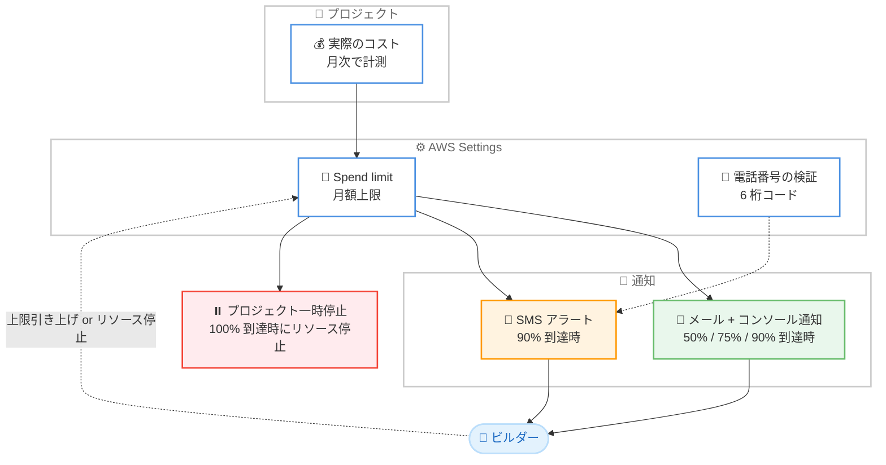

# AWS Settings - 新しい AWS エクスペリエンスの Spend limits が SMS アラートに対応

**リリース日**: 2026 年 11 月 20 日
**サービス**: AWS Settings (新しい AWS エクスペリエンス)
**機能**: Spend limits の SMS (テキストメッセージ) アラート

📊 [このアップデートのインフォグラフィックを見る](https://takech9203.github.io/aws-news-summary/20261120-sms.html)

## 概要

新しい AWS エクスペリエンスの有料プラン (Paid plan) を利用するビルダーは、Spend limits (支出上限) のアラートを、従来のメールに加えて SMS (テキストメッセージ) でも受信できるようになりました。Spend limits はプロジェクトごとに月額コストの上限を設定する機能で、実際のコストが上限に達すると AWS がプロジェクトを一時停止し、コストを上限内に抑えます。

今回のアップデートにより、プロジェクトの実際のコストが Spend limits の 90% に達した時点で、検証済みの携帯電話番号宛てに SMS が送信されます。メールを確認できない状況でもスマートフォンで即座に通知を受け取れるため、上限の引き上げや不要なリソースの停止といった対応を、プロジェクトが一時停止される前に行う時間を確保できます。

設定は AWS Settings で携帯電話番号を検証し、対象プロジェクトの Spend limits でテキストアラートを有効化するだけです。アラートは検証済みの番号にのみ送信され、いつでもオプトアウトできます。

**アップデート前の課題**

このアップデート以前には、以下の課題がありました。

- Spend limits の通知手段はメールとコンソール内通知のみで、メールを見ていない間に通知を見逃す可能性があった
- 通知に気付かないままコストが上限に達すると、プロジェクトが一時停止され、リソースが停止してしまうリスクがあった
- 外出中など PC から離れている状況では、コスト超過の兆候をリアルタイムに把握する手段がなかった

**アップデート後の改善**

今回のアップデートにより、以下が可能になりました。

- 実際のコストが Spend limits の 90% に達した時点で SMS を受信し、メールを確認できない状況でも即座に気付ける
- プロジェクトが一時停止される前に、上限の引き上げや不要なリソースの停止といった対応を取る時間を確保できる
- 米国の電話番号であれば無料で SMS アラートを利用できる

## アーキテクチャ図



プロジェクトの実際のコストが Spend limits に対して増加すると、段階的にメール / コンソール通知が送信され、90% 到達時には検証済み電話番号への SMS も送信されます。上限に達するとプロジェクトは一時停止されるため、SMS により事前対応の機会が広がります。

## サービスアップデートの詳細

### 主要機能

1. **90% 到達時の SMS アラート**
   - プロジェクトの実際のコストが Spend limits の 90% に達すると SMS を送信
   - メール通知を置き換えるものではなく、追加の通知チャネルとして機能
   - プロジェクトごとに有効 / 無効を切り替え可能

2. **検証済み電話番号への送信**
   - SMS は AWS Settings で検証済みの携帯電話番号にのみ送信
   - 番号の検証は 6 桁のコード入力で行い、アカウントごとに 1 回のみ必要
   - アカウントの電話番号は 1 つで、すべてのプロジェクトのテキストアラートが同じ番号に送信される

3. **柔軟なオプトアウト**
   - AWS Settings でチェックボックスを解除していつでも停止可能
   - 受信した SMS に STOP と返信してオプトアウトすることも可能

### Spend limits の通知体系 (参考)

ドキュメントによると、Spend limits では以下の通知が提供されます。

- 実際のコストが上限の 50%、75%、90% に達した時点でのメールおよびコンソール内通知
- 今後 10 日以内に上限へ到達または超過する見込みがある場合の通知
- 実際のコストが上限の 90% に達した時点での SMS (今回のアップデートで追加)

## 技術仕様

### SMS アラートの仕様

| 項目 | 詳細 |
|------|------|
| 通知タイミング | 実際のコストが Spend limits の 90% に到達した時点 |
| 送信先 | AWS Settings で検証済みの携帯電話番号 (アカウントごとに 1 番号) |
| 対応電話番号 | 米国の電話番号 (プエルトリコ、グアム、米領バージン諸島、米領サモアを含む) |
| 前提プラン | 新しい AWS エクスペリエンスの Paid plan (Spend limits の作成に必要) |
| 設定単位 | プロジェクトごと |
| 料金 | 無料 |
| オプトアウト | AWS Settings での設定解除、または SMS に STOP と返信 |

### Spend limits の基本仕様

| 項目 | 詳細 |
|------|------|
| 設定単位 | プロジェクトレベル (最大 10 プロジェクトに適用可能) |
| 最小値 | 20 USD または直近の利用状況に基づく推定値のいずれか大きい方 |
| 対象コスト | 税抜きのコスト (クレジットは除外) |
| 上限到達時 | プロジェクトを一時停止しリソースを停止 (データは保持) |
| 一時停止後の注意 | 90 日以内に対応しない場合、プロジェクトデータは完全に削除される |
| 管理権限 | プロジェクトオーナーのみ管理可能 (閲覧はプロジェクトアクセス権を持つ全員) |

## 設定方法

### 前提条件

1. 新しい AWS エクスペリエンスの Paid plan を利用していること
2. 対象プロジェクトに Spend limits が設定されていること (未設定の場合は先に設定する)
3. SMS を受信できる米国の携帯電話番号を保有していること

### 手順

#### ステップ 1: AWS Settings で対象プロジェクトの Spend limits を開く

1. AWS Settings (https://settings.aws.com) を開く
2. メインナビゲーションペインで [Billing] を選択する
3. [Cost by project] の [Spend limit] で、対象プロジェクトの Spend limits を選択する

プロジェクトにまだ Spend limits がない場合は、[Set limit] から推奨値またはカスタム値で上限を設定します。

#### ステップ 2: テキストアラートを有効化する

1. [Customize what happens as your spending climbs] の [Alerts] で、[Receive text alerts at 90% of your spend limit] を選択する
2. [Save changes] を選択する

この操作により、対象プロジェクトで 90% 到達時の SMS アラートが有効になります。

#### ステップ 3: 電話番号を検証する

1. 電話番号の検証を求められた場合は [Go to Profile] を選択する
2. [Profile] ページの [Contact information] で電話番号を選択し、[Verify phone number] を選択する (番号の追加・変更は [Edit] から行う)
3. 携帯電話に送信された 6 桁のコードを入力する

番号の検証はアカウントごとに 1 回のみ必要です。他のプロジェクトでも SMS アラートを利用する場合は、プロジェクトごとにステップ 1〜2 を繰り返します。

## メリット

### ビジネス面

- **コスト超過リスクの低減**: メールを見逃してもスマートフォンで通知に気付けるため、想定外のコスト増加に早期対応できる
- **サービス中断の回避**: 上限到達によるプロジェクト一時停止の前に対応する時間を確保でき、学習や検証作業の中断を防げる
- **追加コストなし**: 米国の電話番号であれば SMS アラートは無料で利用できる

### 技術面

- **シンプルな設定**: AWS Settings 上のチェックボックスと電話番号検証のみで有効化でき、追加のインフラや SNS トピックの構築が不要
- **既存通知との併用**: メールおよびコンソール内通知 (50% / 75% / 90%) を置き換えずに補完する設計
- **プロジェクト単位の制御**: プロジェクトごとに SMS アラートの有効 / 無効を選択できる

## デメリット・制約事項

### 制限事項

- SMS アラートは米国の電話番号 (プエルトリコ、グアム、米領バージン諸島、米領サモアを含む) のみ対応しており、日本の電話番号では利用できない
- SMS が送信されるのは 90% 到達時のみで、50% や 75% の時点では SMS は送信されない
- アカウントに登録できる電話番号は 1 つのみで、すべてのプロジェクトのアラートが同じ番号に送信される
- Spend limits の作成には Paid plan が必要

### 考慮すべき点

- 本機能は新しい AWS エクスペリエンス (AWS Settings) 向けの機能であり、従来の AWS アカウントでは AWS Budgets のアラート機能 (Amazon SNS 経由の通知など) を利用する
- SMS アラートはプロジェクトごとに有効化する必要があるため、複数プロジェクトを運用する場合は設定漏れに注意する
- 90% 到達の通知を受けた後も対応しなければ、上限到達時にプロジェクトが一時停止されリソースが停止する

## ユースケース

### ユースケース 1: 学習・検証プロジェクトのコスト見守り

**シナリオ**: 個人開発者が新しい AWS エクスペリエンスで学習用プロジェクトを運用しており、月 50 USD の Spend limits を設定している。平日は仕事でメールを頻繁に確認できない。

**実装例**:
```text
1. AWS Settings > Billing > Cost by project で学習用プロジェクトの Spend limit を開く
2. [Receive text alerts at 90% of your spend limit] を有効化
3. Profile で携帯電話番号を検証
```

**効果**: コストが 45 USD (90%) に達した時点で SMS を受信し、放置していたリソースの停止や上限の引き上げを即座に判断できる。

### ユースケース 2: 想定外のコスト急増の早期検知

**シナリオ**: 検証中のアプリケーションで、設定ミスにより Lambda や Bedrock の利用コストが急増する可能性がある。

**実装例**:
```text
1. プロジェクトに Spend limits を設定し、SMS アラートを有効化
2. あわせて早期コストコントロール (新規リソース作成の停止、
   アイドルリソースの一時停止など) を必要に応じて有効化
```

**効果**: コスト急増時に SMS で即座に気付き、プロジェクト一時停止という影響の大きいイベントが発生する前に原因リソースを調査・停止できる。

### ユースケース 3: 複数プロジェクトの一元的なアラート受信

**シナリオ**: 個人のビルダーが実験用・学習用など複数のプロジェクトを運用しており、それぞれに異なる Spend limits を設定している。

**実装例**:
```text
1. アカウントの電話番号を 1 回検証
2. SMS アラートを利用したい各プロジェクトで
   [Receive text alerts at 90% of your spend limit] を有効化
```

**効果**: すべてのプロジェクトの 90% 到達アラートが検証済みの 1 つの番号に届くため、スマートフォンだけで全プロジェクトのコスト状況の異常を把握できる。

## 料金

SMS アラート自体は無料です。米国の電話番号 (プエルトリコ、グアム、米領バージン諸島、米領サモアを含む) が対象です。

なお、Spend limits の作成には新しい AWS エクスペリエンスの Paid plan が必要です。Spend limits 自体は AWS Budgets の一種として提供されます。

## 利用可能リージョン

本機能は新しい AWS エクスペリエンス (AWS Settings) の機能として提供されます。SMS アラートの送信先は米国の電話番号 (プエルトリコ、グアム、米領バージン諸島、米領サモアを含む) に限定されます。

## 関連サービス・機能

- **AWS Budgets**: Spend limits は AWS Budgets の一種として実装されており、従来のアカウントではカスタム予算とアラートを利用できる
- **AWS Compute Optimizer**: 早期コストコントロールの「アイドルリソースの一時停止」は Compute Optimizer のアイドル推奨に基づいて実行される
- **Cost Optimization Hub**: プロジェクト内のアイドルリソースの推奨事項や節約機会を確認できる

## 参考リンク

- 📊 [インフォグラフィック](https://takech9203.github.io/aws-news-summary/20261120-sms.html)
- [公式発表 (What's New)](https://aws.amazon.com/about-aws/whats-new/2026/11/sms/)
- [ドキュメント: Create a spend limit in AWS Settings](https://docs.aws.amazon.com/accounts/latest/reference/create-spend-limit.html)
- [ドキュメント: AWS Account Management Reference Guide (新しい AWS エクスペリエンス)](https://docs.aws.amazon.com/accounts/latest/reference/sign-in-new.html)
- [Get started with AWS](https://aws.amazon.com/start-here/)

## まとめ

新しい AWS エクスペリエンスの Spend limits に SMS アラートが追加され、コストが上限の 90% に達した時点でスマートフォンへ直接通知を受け取れるようになりました。メールの見逃しによるプロジェクト一時停止のリスクを下げられるため、Paid plan で米国の電話番号を利用できるビルダーは、電話番号を検証して主要プロジェクトのテキストアラートを有効化することを推奨します。
