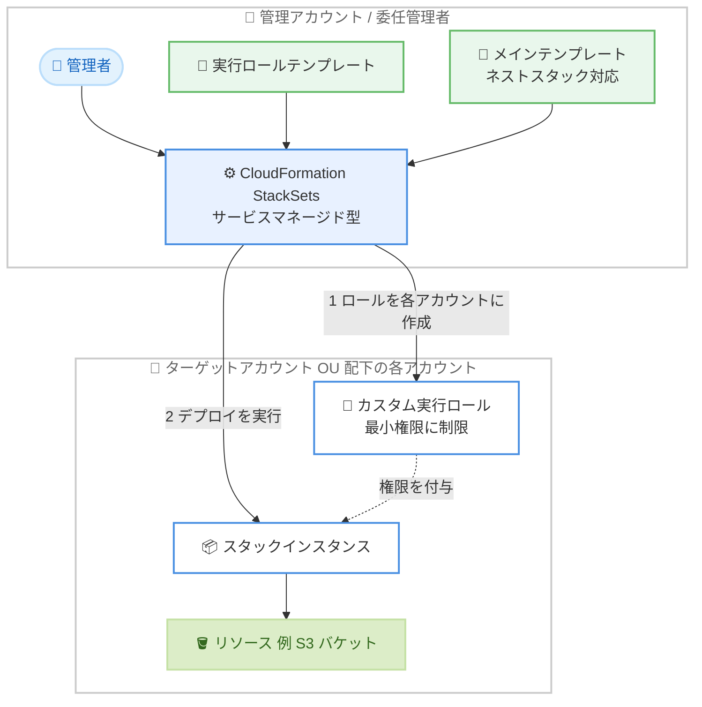

# AWS CloudFormation - サービスマネージド StackSets のカスタム実行ロール対応 (ネストスタックサポート付き)

**リリース日**: 2026 年 11 月 20 日
**サービス**: AWS CloudFormation
**機能**: サービスマネージド StackSets におけるカスタム実行ロールとネストスタックのサポート

📊 [このアップデートのインフォグラフィックを見る](https://takech9203.github.io/aws-news-summary/20261120-stacksets-custom-execution-roles.html)

## 概要

AWS CloudFormation StackSets が、サービスマネージド型 (Service-Managed) のスタックセットでカスタム実行ロールをサポートしました。これにより、StackSets が各ターゲットアカウントで実行できる操作の権限を、お客様自身が定義した IAM ロールの範囲に制限できるようになります。

サービスマネージド StackSets は、AWS Organizations と連携して数千のアカウントとリージョンに同一のインフラストラクチャを一度の操作でデプロイできる機能です。今回のアップデートでは、実行ロールを定義したテンプレートを指定すると、StackSets がデプロイに先立って各アカウントにそのロールを作成し、以降のデプロイでそのロールを使用します。さらに、カスタム実行ロールを使用することで、サービスマネージド StackSets でもネストスタック、マクロ、トランスフォームが利用可能になります。

セキュリティ要件の厳しい組織で最小権限の原則を徹底したい管理者や、個別スタック向けに作成した既存テンプレート (ネストスタックを含む) を組織全体に展開したいユーザーに特に有用なアップデートです。

**アップデート前の課題**

- サービスマネージド StackSets は組み込みの実行ロールを使用しており、このロールはテンプレート内のあらゆるリソースをプロビジョニングできる広範な権限を持っていた
- ターゲットアカウントごとに StackSets の権限を制限する手段がなく、最小権限の原則を適用できなかった
- サービスマネージド StackSets ではネストスタック、マクロ、トランスフォームが利用できず、個別スタック向けに作成したテンプレートを再利用できない場合があった

**アップデート後の改善**

- 実行ロールのテンプレートを指定することで、StackSets が各アカウントで実行できる操作を必要最小限の権限に制限できるようになった
- 実行ロールのテンプレートを更新すると、StackSets がデプロイ済みのすべてのアカウントにロールの変更を自動的に反映するようになった
- カスタム実行ロールの使用により、サービスマネージド StackSets でもネストスタック、マクロ、トランスフォームが利用可能になり、既存テンプレートの組織全体への再利用が容易になった

## アーキテクチャ図



管理者が実行ロールテンプレートとメインテンプレートを StackSets に指定すると、StackSets はまず各ターゲットアカウントにカスタム実行ロールを作成し、そのロールの権限の範囲内でスタックインスタンスをデプロイします。

## サービスアップデートの詳細

### 主要機能

1. **カスタム実行ロールによる権限の制限**
   - 実行ロールを定義した CloudFormation テンプレートを指定すると、StackSets がデプロイ前に各ターゲットアカウントへそのロールを作成する
   - StackSets が各アカウントで実行できる操作を、定義したロールの権限の範囲内に制限できる
   - 例: S3 バケットを作成するスタックセットには、CloudFormation と S3 の権限のみを持つロールを使用できる
   - デフォルトの組み込みロール (追加設定なしで任意のリソースをプロビジョニング可能) も引き続き利用可能

2. **実行ロールの自動更新**
   - 実行ロールのテンプレートを変更すると、StackSets がデプロイ済みのすべてのアカウントに更新後のロールを自動的に反映する
   - アカウントごとに手動でロールを更新する運用負荷が不要になる

3. **ネストスタック、マクロ、トランスフォームのサポート**
   - カスタム実行ロールを使用することで、サービスマネージド StackSets でもネストスタック、マクロ、トランスフォームが利用可能になる
   - 個別スタック向けに作成した既存テンプレートを、組織全体へのデプロイに再利用できる

## 技術仕様

### API 変更の概要

| 項目 | 詳細 |
|------|------|
| `ExecutionRoleTemplateBody` / `ExecutionRoleTemplateUrl` | 実行ロールを定義するテンプレートの本文または URL を指定する新しいパラメータ (`CreateStackSet`、`UpdateStackSet`) |
| `UseAdminExecutionRole` | デフォルトの組み込みロールの使用に戻すためのパラメータ (`UpdateStackSet`) |
| `StackSetOutputBucket` | スタックセットの出力を保存する S3 バケットを指定するパラメータ |
| `StackSetOutputBucketPath` | `DescribeStackSet` のレスポンスに追加された、出力バケットのパスを示すフィールド |

### API変更履歴

| 日付 | サービス | 変更内容 |
|------|----------|----------|
| 2026/11/19 | [cloudformation](https://awsapichanges.com/archive/changes/b8bc94-cloudformation.html) | 3 updated api methods - `CreateStackSet`、`UpdateStackSet`、`DescribeStackSet` にサービスマネージドスタックセットのカスタム実行ロールをサポートするパラメータを追加。マクロ、トランスフォーム、ネストスタックの利用が可能に |

### 実行ロールテンプレートの例

```yaml
AWSTemplateFormatVersion: "2010-09-09"
Resources:
  StackSetExecutionRole:
    Type: AWS::IAM::Role
    Properties:
      AssumeRolePolicyDocument:
        Version: "2012-10-17"
        Statement:
          - Effect: Allow
            Principal:
              Service: cloudformation.amazonaws.com
            Action: sts:AssumeRole
      Policies:
        - PolicyName: S3OnlyPolicy
          PolicyDocument:
            Version: "2012-10-17"
            Statement:
              - Effect: Allow
                Action:
                  - s3:CreateBucket
                  - s3:DeleteBucket
                  - s3:PutBucketTagging
                Resource: "*"
```

S3 バケットのみを管理するスタックセット向けに、S3 関連の操作に権限を制限した実行ロールの定義例です。実際の信頼ポリシーや必要なアクションは、公式ドキュメントで最新の要件を確認してください。

## 設定方法

### 前提条件

1. AWS Organizations ですべての機能が有効化されており、CloudFormation StackSets との信頼されたアクセスが有効であること
2. 管理アカウントまたは StackSets の委任管理者アカウントで操作すること
3. 実行ロールを定義する CloudFormation テンプレートを用意していること

### 手順

#### ステップ1: 実行ロールテンプレートの作成

```bash
# 実行ロールを定義するテンプレートを作成し、S3 にアップロード
aws s3 cp execution-role.yaml s3://my-templates-bucket/execution-role.yaml
```

実行ロール (IAM ロール) を定義したテンプレートを作成し、テンプレート URL として参照できるよう S3 バケットにアップロードします。

#### ステップ2: カスタム実行ロールを指定してスタックセットを作成

```bash
aws cloudformation create-stack-set \
  --stack-set-name my-stackset \
  --template-url https://my-templates-bucket.s3.amazonaws.com/main-template.yaml \
  --execution-role-template-url https://my-templates-bucket.s3.amazonaws.com/execution-role.yaml \
  --permission-model SERVICE_MANAGED \
  --auto-deployment Enabled=true,RetainStacksOnAccountRemoval=false \
  --capabilities CAPABILITY_NAMED_IAM
```

`--execution-role-template-url` で実行ロールテンプレートを指定し、サービスマネージド型のスタックセットを作成します。StackSets はデプロイ前に各ターゲットアカウントへ実行ロールを作成します。マネジメントコンソールの場合は、スタックセット作成時に [Set execution role] を選択します。

#### ステップ3: スタックインスタンスのデプロイ

```bash
aws cloudformation create-stack-instances \
  --stack-set-name my-stackset \
  --deployment-targets OrganizationalUnitIds=ou-xxxx-xxxxxxxx \
  --regions ap-northeast-1 us-east-1
```

対象の OU とリージョンを指定してスタックインスタンスをデプロイします。各アカウントでは、作成されたカスタム実行ロールの権限の範囲内でリソースがプロビジョニングされます。

## メリット

### ビジネス面

- **セキュリティガバナンスの強化**: StackSets の権限を必要最小限に制限することで、組織のセキュリティポリシーやコンプライアンス要件への準拠が容易になる
- **監査対応の簡素化**: 各アカウントで StackSets が実行可能な操作が明確になり、監査時の説明責任を果たしやすくなる
- **既存資産の活用**: ネストスタックを含む既存テンプレートを組織全体に再利用でき、テンプレートの再作成コストを削減できる

### 技術面

- **最小権限の原則の適用**: デプロイするリソースに応じた権限のみを持つ実行ロールを定義でき、意図しないリソース操作を防止できる
- **ロール管理の自動化**: 実行ロールテンプレートの変更が全アカウントに自動反映されるため、手動でのロール更新作業が不要になる
- **ネストスタック、マクロ、トランスフォームの利用**: サービスマネージド型でもモジュール化されたテンプレート設計が可能になり、テンプレートの保守性が向上する

## デメリット・制約事項

### 制限事項

- カスタム実行ロールはサービスマネージド型のスタックセットで利用する機能であり、実行ロールのテンプレートを別途作成・管理する必要がある
- 実行ロールの権限が不足している場合、スタックインスタンスのデプロイは失敗するため、テンプレートで使用するリソースに応じた権限設計が必要
- ネストスタックやマクロ、トランスフォームの利用にはカスタム実行ロールの使用が前提となる

### 考慮すべき点

- 実行ロールの権限を絞り込みすぎると、テンプレートの変更時にデプロイが失敗する可能性があるため、テンプレートとロールの権限を合わせて管理する運用が必要
- 実行ロールテンプレートの更新は全アカウントに自動反映されるため、変更時は影響範囲を事前に確認することが推奨される
- 具体的な制約の詳細は[カスタム実行ロールの公式ドキュメント](https://docs.aws.amazon.com/AWSCloudFormation/latest/UserGuide/stacksets-custom-execution-role.html)で確認が必要

## ユースケース

### ユースケース1: セキュリティベースラインの最小権限デプロイ

**シナリオ**: 組織全体の全アカウントに S3 ログバケットと関連ポリシーを展開したいが、StackSets には S3 関連の権限のみを許可したい。

**実装例**:
```
1. S3 と CloudFormation の権限のみを持つ実行ロールテンプレートを作成
2. create-stack-set で --execution-role-template-url を指定してスタックセットを作成
3. OU を指定してスタックインスタンスをデプロイ
```

**効果**: StackSets が各アカウントで S3 以外のリソースを操作できないことが保証され、最小権限の原則に準拠したガバナンスを実現できる。

### ユースケース2: ネストスタックを使用した既存テンプレートの組織展開

**シナリオ**: 個別アカウント向けに開発したネストスタック構成のテンプレート (ネットワーク、セキュリティ、監視の子スタックに分割) を、組織の全アカウントに展開したい。

**実装例**:
```
1. ネストスタックのデプロイに必要な権限を持つ実行ロールテンプレートを作成
2. カスタム実行ロールを指定してサービスマネージドスタックセットを作成
3. 既存のネストスタック構成のテンプレートをそのまま指定してデプロイ
```

**効果**: これまでサービスマネージド型では利用できなかったネストスタックが使用可能になり、テンプレートを書き換えることなく組織全体への展開を実現できる。

### ユースケース3: 実行ロールの一元的なライフサイクル管理

**シナリオ**: 新しいサービスのデプロイ要件が追加され、全アカウントの実行ロールに権限を追加する必要がある。

**実装例**:
```
1. 実行ロールテンプレートに新しい権限を追加
2. update-stack-set で更新後の実行ロールテンプレートを指定
3. StackSets が全アカウントのロールを自動更新
```

**効果**: 数千のアカウントに対するロール更新を一度の操作で完了でき、アカウントごとの手動更新による作業ミスや更新漏れを防止できる。

## 料金

本機能は追加料金なしで利用できます。CloudFormation 自体の利用料金 (サードパーティリソースのハンドラーオペレーションなど) は通常どおり適用されます。

## 利用可能リージョン

すべての商用 AWS リージョン、AWS GovCloud (US) リージョン、中国リージョンで利用可能です。最新の対応状況は [AWS リージョン別サービス表](https://aws.amazon.com/about-aws/global-infrastructure/regional-product-services/)を参照してください。

## 関連サービス・機能

- **AWS Organizations**: サービスマネージド StackSets のターゲット選択の基盤となるサービス。OU 単位でのデプロイや新規アカウントへの自動デプロイと連携する
- **AWS IAM**: カスタム実行ロールは IAM ロールとして定義され、最小権限の原則に基づく権限設計が中心となる
- **AWS Control Tower**: 組織全体のガバナンスを提供するサービスで、内部的に StackSets を利用してベースラインを展開する

## 参考リンク

- 📊 [インフォグラフィック](https://takech9203.github.io/aws-news-summary/20261120-stacksets-custom-execution-roles.html)
- [公式発表 (What's New)](https://aws.amazon.com/about-aws/whats-new/2026/11/stacksets-custom-execution-roles/)
- [AWS DevOps Blog: Announcing custom execution roles for AWS CloudFormation StackSets](https://aws.amazon.com/blogs/devops/announcing-custom-execution-roles-for-aws-cloudformation-stacksets/)
- [ドキュメント: StackSets の概念](https://docs.aws.amazon.com/AWSCloudFormation/latest/UserGuide/stacksets-concepts.html)
- [ドキュメント: カスタム実行ロール](https://docs.aws.amazon.com/AWSCloudFormation/latest/UserGuide/stacksets-custom-execution-role.html)
- [料金ページ](https://aws.amazon.com/cloudformation/pricing/)

## まとめ

サービスマネージド StackSets のカスタム実行ロール対応により、マルチアカウント環境でのデプロイに最小権限の原則を適用できるようになり、同時にネストスタック、マクロ、トランスフォームの利用も解禁されました。AWS Organizations で StackSets を運用している組織は、セキュリティ要件の厳しいワークロードから順にカスタム実行ロールの導入を検討することを推奨します。
