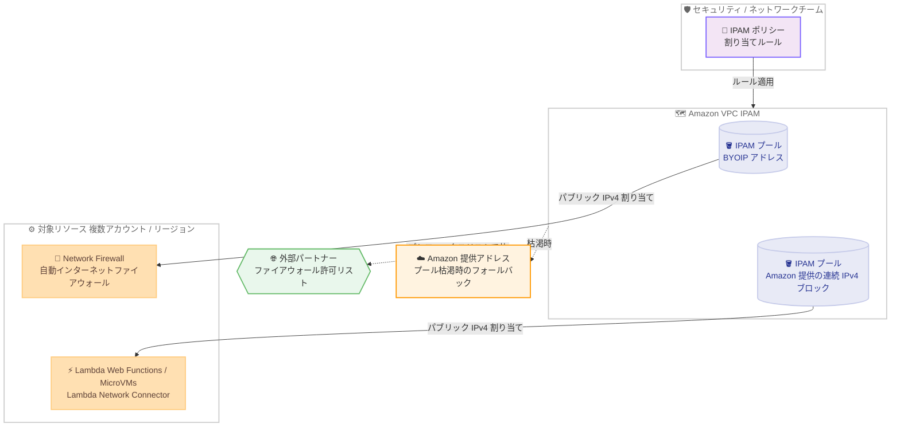

# Amazon VPC IPAM - IPAM ポリシーが自動インターネットファイアウォールと Lambda Web Functions / MicroVMs に対応

**リリース日**: 2026 年 11 月 20 日
**サービス**: Amazon VPC IP Address Manager (IPAM)
**機能**: IPAM ポリシーによる AWS Network Firewall 自動インターネットファイアウォールおよび AWS Lambda Web Functions / MicroVMs へのパブリック IPv4 割り当て制御

📊 [このアップデートのインフォグラフィックを見る](https://takech9203.github.io/aws-news-summary/20261120-vpc-ipam-policies-firewall-lambda.html)

## 概要

Amazon VPC IP Address Manager (IPAM) のポリシー機能が拡張され、AWS Network Firewall の自動インターネットファイアウォールと、AWS Lambda Web Functions および MicroVMs をサポートしました。アカウントとリージョンをまたぐ一元的な IPAM ポリシーを設定することで、これらのリソースに対して指定した IPAM プールからパブリック IPv4 アドレスを割り当てられるようになります。プールには Bring Your Own IP (BYOIP) アドレスや Amazon 提供の連続した IPv4 ブロックを利用できます。

多くの組織では、ACL やファイアウォールで AWS リソースの IP アドレスを許可リストに登録して運用しています。従来、リソースが承認済みのアドレス範囲を使い続けるかどうかは各アプリケーションチームの運用に依存していましたが、今回のアップデートにより、セキュリティチームが割り当てルールを一元的に定義し、リソースが承認済みレンジを使用することを前提に IP ベースのフィルタリングを適用できるようになりました。Lambda Web Functions と MicroVMs については、Lambda Network Connector 経由のアウトバウンド通信に使用されるパブリック IPv4 アドレスが対象です。

対象ユーザーは、マルチアカウント環境で IP アドレス管理を一元化したいネットワーク管理者やセキュリティチーム、BYOIP によるパブリック IPv4 コスト削減を検討している組織です。

**アップデート前の課題**

このアップデート以前に存在していた課題や制限は以下のとおりです。

- IPAM ポリシーの割り当てルールは Elastic IP、Application Load Balancer、Amazon RDS、NAT ゲートウェイなどに限られ、Network Firewall の自動インターネットファイアウォールや Lambda Web Functions / MicroVMs のパブリック IPv4 を一元管理できなかった
- これらのリソースが承認済みの IP アドレス範囲を使用するかどうかは、各アプリケーションチームの個別対応に依存していた
- 外部パートナーやオンプレミスのファイアウォールで許可リストを維持する際、リソースごとに IP アドレスを収集・更新する運用負荷が発生していた

**アップデート後の改善**

今回のアップデートにより可能になったことは以下のとおりです。

- 自動インターネットファイアウォールと Lambda Web Functions / MicroVMs に対して、指定した IPAM プールからパブリック IPv4 アドレスを自動的に割り当てられるようになった
- BYOIP アドレスや Amazon 提供の連続 IPv4 ブロックを使用することで、予測可能なアドレス範囲での運用と、BYOIP によるパブリック IPv4 コストの削減が可能になった
- 割り当てたアドレス範囲を AWS プレフィックスリストとの統合によりパートナーと共有でき、許可リストの維持が容易になった

## アーキテクチャ図



IPAM ポリシーの割り当てルールに基づき、自動インターネットファイアウォールと Lambda Web Functions / MicroVMs に指定プールからパブリック IPv4 アドレスが割り当てられる流れを示しています。プールが枯渇した場合は Amazon 提供アドレスにフォールバックします。

## サービスアップデートの詳細

### 主要機能

1. **自動インターネットファイアウォールへのパブリック IPv4 割り当て**
   - AWS Network Firewall の自動インターネットファイアウォールが IPAM ポリシーの割り当てルールの対象リソースタイプに追加された
   - 指定した IPAM プール (BYOIP または Amazon 提供の連続 IPv4 ブロック) からアドレスが割り当てられる
   - 承認済みアドレス範囲での運用により、IP ベースのフィルタリングを前提としたセキュリティ態勢を強化できる

2. **Lambda Web Functions / MicroVMs へのパブリック IPv4 割り当て**
   - Lambda Network Connector 経由のアウトバウンド通信に使用されるパブリック IPv4 アドレスが対象
   - 外部サービス側で Lambda からの通信元 IP を許可リストに登録する運用が容易になる

3. **アカウント / リージョン横断の一元管理とフォールバック**
   - 1 つのポリシーに複数の割り当てルールを定義し、複数のリージョンに適用できる
   - IPAM プールのアドレスが枯渇した場合、リソースは Amazon 提供のアドレスにフォールバックするため、リソース作成が失敗しない
   - 割り当てたアドレス範囲は AWS プレフィックスリストとの統合によりパートナーと共有できる

## 技術仕様

### IPAM ポリシーの割り当てルール

| 項目 | 詳細 |
|------|------|
| 対象リソースタイプ | Elastic IP アドレス、Application Load Balancer、Amazon RDS、NAT ゲートウェイ (リージョン可用性モード)、Lambda Network Connector、自動インターネットファイアウォール |
| 使用できるプール | BYOIP アドレス、Amazon 提供の連続 IPv4 ブロックを含むパブリック IPAM プール |
| 適用範囲 | AWS Organizations の組織、OU、またはメンバーアカウント単位で有効化。複数リージョンに適用可能 |
| ルールの動作 | ルールを順に評価し、リソースタイプが一致すれば指定プールから割り当て。プール枯渇時は Amazon 提供アドレスにフォールバック |
| 上書き条件 | リソース作成時に特定の IPAM プールや Elastic IP 割り当て ID を明示指定した場合はポリシーより優先される |
| 対応ティア | IPAM の Free Tier および Advanced Tier の両方 |

### 設定の流れ

割り当てルールの追加は、マネジメントコンソールのほか、AWS CLI の `modify-ipam-policy-allocation-rules` コマンドで行えます。

```bash
aws ec2 modify-ipam-policy-allocation-rules \
  --ipam-policy-id ipam-policy-0123456789abcdef0 \
  --locale ap-northeast-1 \
  --resource-type automated-internet-firewall \
  --allocation-rules '[{"IpamPoolId": "ipam-pool-0123456789abcdef0"}]'
```

上記は、指定リージョンの自動インターネットファイアウォールに対して、指定した IPAM プールからパブリック IPv4 アドレスを割り当てるルールを設定する例です (パラメータは環境に応じて読み替えてください)。

## 設定方法

### 前提条件

1. IPAM ポリシーが作成済みであること
2. IPv4 アドレスを持つパブリック IPAM プールが作成済みであること
3. プール所有者以外のアカウントでポリシーを有効化する場合、AWS RAM でプールを対象アカウントと共有していること

### 手順

#### ステップ 1: 割り当てルールの追加

コンソールで IPAM の [Policies] から対象ポリシーを選択し、[Allocation rules] タブで [Create allocation rules] を選択します。Locale (リージョンまたは Local Zone) とリソースタイプ (自動インターネットファイアウォール、Lambda Network Connector など) を選択し、IP アドレスを提供する IPAM プールを指定します。

#### ステップ 2: プールの共有

```bash
aws ram create-resource-share \
  --name ipam-pool-share \
  --resource-arns arn:aws:ec2::123456789012:ipam-pool/ipam-pool-0123456789abcdef0 \
  --principals arn:aws:organizations::123456789012:organization/o-example
```

AWS RAM を使用して、割り当てルールで指定した IPAM プールを対象アカウントや組織と共有します。共有が有効になるまで数分かかる場合があり、その間に作成されたリソースには Amazon 提供アドレスが割り当てられる可能性があります。

#### ステップ 3: ポリシーの有効化とテスト

ポリシーを使用するアカウント (組織、OU、またはメンバーアカウント) を指定して有効化します。その後、対象アカウントで設定したリソースタイプのリソースを新規作成し、IPAM プールのアドレスが割り当てられることを確認します。IPAM プールのコンソールで割り当て状況をモニタリングできます。

## メリット

### ビジネス面

- **パブリック IPv4 コストの削減**: BYOIP アドレスを使用することで、Amazon 提供のパブリック IPv4 アドレスにかかるコストを削減できる
- **パートナー連携の簡素化**: 承認済みアドレス範囲をプレフィックスリストで共有することで、外部パートナーの許可リスト運用が容易になる
- **ガバナンスの強化**: IP アドレス管理をアプリケーションチーム任せにせず、組織全体で一貫したポリシーを適用できる

### 技術面

- **一元的な IP 割り当て制御**: アカウントとリージョンをまたぐ一つのポリシーで、ファイアウォールや Lambda のパブリック IPv4 割り当てを制御できる
- **可用性を損なわないフォールバック**: プール枯渇時は Amazon 提供アドレスに自動フォールバックするため、リソース作成が失敗しない
- **セキュリティ態勢の向上**: リソースが承認済みレンジを使用する前提で、IP ベースのフィルタリングを安心して適用できる

## デメリット・制約事項

### 制限事項

- リソース作成時に特定の IPAM プールや Elastic IP 割り当て ID を明示的に指定した場合、IPAM ポリシーより優先される
- 対象アカウントがプールにアクセスできない場合、リソース作成自体は成功するが Amazon 提供アドレスが割り当てられる
- プール共有の反映には数分かかる場合があり、その間は Amazon 提供アドレスが割り当てられる可能性がある

### 考慮すべき点

- フォールバック時には承認済みレンジ外のアドレスが使用されるため、プールのアドレス残量のモニタリングが重要になる
- 複数の有効なポリシーのスコープにアカウントが含まれる場合、どのポリシーが適用されるかの優先順位を理解しておく必要がある
- Lambda Web Functions / MicroVMs で対象となるのは Lambda Network Connector 経由のアウトバウンド通信のパブリック IPv4 である点に注意が必要

## ユースケース

### ユースケース 1: 外部 SaaS への接続元 IP 固定

**シナリオ**: Lambda Web Functions / MicroVMs から外部の SaaS や金融系 API に接続する際、接続元 IP アドレスを事前に申請・許可リスト登録する必要がある。

**実装例**:
```
1. BYOIP アドレスをパブリック IPAM プールに登録
2. Lambda Network Connector を対象とする割り当てルールを作成
3. ポリシーをワークロードアカウントに対して有効化
4. 承認済みレンジを SaaS 側の許可リストに登録
```

**効果**: Lambda のアウトバウンド通信が常に承認済みレンジから行われるため、外部サービス側の許可リスト運用が安定し、申請の再実施が不要になる。

### ユースケース 2: 自動インターネットファイアウォールのアドレス統制

**シナリオ**: マルチアカウント環境で Network Firewall の自動インターネットファイアウォールを展開しており、オンプレミスや取引先のファイアウォールで AWS 側のアドレスを許可リスト管理している。

**実装例**:
```
1. Amazon 提供の連続 IPv4 ブロックを IPAM プールとして確保
2. 自動インターネットファイアウォールを対象とする割り当てルールを組織単位で有効化
3. 割り当てレンジをプレフィックスリストとして取引先と共有
```

**効果**: 連続したアドレスブロックで運用できるため許可リストのエントリ数が削減され、アカウント追加時もルール変更なしで統制を維持できる。

### ユースケース 3: BYOIP によるパブリック IPv4 コスト最適化

**シナリオ**: 多数のアカウントでパブリック IPv4 アドレスを消費しており、Amazon 提供アドレスの課金を削減したい。

**実装例**:
```
1. 自社保有の IP レンジを BYOIP として IPAM に登録
2. Elastic IP、NAT ゲートウェイに加え、自動インターネットファイアウォールと
   Lambda Network Connector も対象とする割り当てルールを定義
3. 組織全体でポリシーを有効化し、プール使用率をモニタリング
```

**効果**: 対象リソースタイプの拡大により、BYOIP を適用できる範囲が広がり、パブリック IPv4 コストをさらに削減できる。

## 料金

IPAM ポリシー自体の利用は、IPAM の Free Tier と Advanced Tier の両方で可能です。IPAM の料金詳細は、Amazon VPC 料金ページの IPAM タブを参照してください。BYOIP アドレスを使用する場合、Amazon 提供のパブリック IPv4 アドレスにかかる料金を削減できます。

## 利用可能リージョン

すべての AWS 商用リージョンで利用可能です。

## 関連サービス・機能

- **AWS Network Firewall**: 自動インターネットファイアウォールのパブリック IPv4 アドレスが IPAM ポリシーの割り当て対象になった
- **AWS Lambda Web Functions / MicroVMs**: Lambda Network Connector 経由のアウトバウンド通信に使用されるパブリック IPv4 アドレスが割り当て対象になった
- **AWS Resource Access Manager (AWS RAM)**: IPAM プールを組織内の他アカウントと共有するために使用する
- **AWS マネージドプレフィックスリスト**: 割り当てたアドレス範囲をパートナーと共有し、許可リスト運用を簡素化する

## 参考リンク

- 📊 [インフォグラフィック](https://takech9203.github.io/aws-news-summary/20261120-vpc-ipam-policies-firewall-lambda.html)
- [公式発表 (What's New)](https://aws.amazon.com/about-aws/whats-new/2026/11/vpc-ipam-policies-firewall-lambda/)
- [ドキュメント: IPAM ポリシーによるパブリック IPv4 割り当て戦略の定義](https://docs.aws.amazon.com/vpc/latest/ipam/define-public-ipv4-allocation-strategy-with-ipam-policies.html)
- [ドキュメント: IPAM とは](https://docs.aws.amazon.com/vpc/latest/ipam/what-it-is-ipam.html)
- [料金ページ (Amazon VPC 料金の IPAM タブ)](https://aws.amazon.com/vpc/pricing/)

## まとめ

IPAM ポリシーの対象リソースが自動インターネットファイアウォールと Lambda Web Functions / MicroVMs に拡大し、パブリック IPv4 アドレスの組織的な統制をより広い範囲に適用できるようになりました。外部サービスの許可リスト運用や BYOIP によるコスト削減に取り組んでいる場合は、既存の IPAM ポリシーへの割り当てルール追加を検討することを推奨します。
