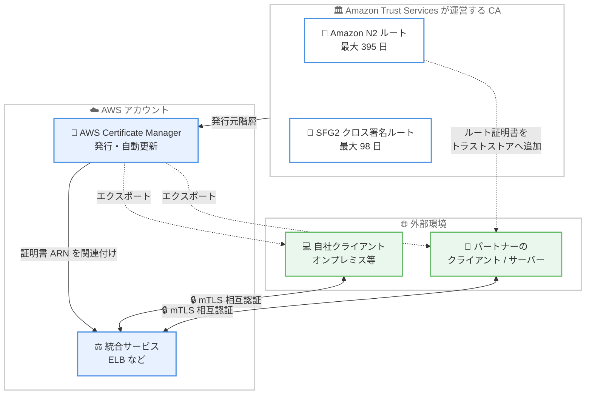

# AWS Certificate Manager - Amazon N2 証明書による mTLS サポート

**リリース日**: 2026 年 11 月 21 日
**サービス**: AWS Certificate Manager (ACM)
**機能**: Amazon N2 certificates for mTLS

📊 [このアップデートのインフォグラフィックを見る](https://takech9203.github.io/aws-news-summary/20261121-acm-amazon-n2-certificates.html)

## 概要

AWS Certificate Manager (ACM) が、mTLS (相互 TLS) をはじめとする Web ブラウザー以外の認証用途向けに、Amazon N2 証明書の発行をサポートしました。Amazon N2 証明書は、ACM のパブリック証明書を発行する WebPKI CA と同じ組織である Amazon Trust Services が運営・統制する「Amazon N2 認証局 (CA)」階層から発行されます。

ACM パブリック証明書は WebPKI の要件に沿ってクライアント認証 (Client Authentication EKU) を廃止したため、mTLS でクライアント証明書が必要なケースでは、これまで AWS Private CA などのプライベート PKI を自前で構築・運用する必要がありました。しかし、検証する相手 (verifying peer) が別組織にある場合、プライベート PKI ではルート証明書の配布やトラストガバナンスの整備が大きな負担となっていました。

今回のアップデートにより、自前の CA を運用することなく、「パートナーのクライアントが自社の API を呼び出す」といった組織をまたぐ mTLS 認証を、ACM のマネージドな証明書ライフサイクル管理 (自動更新を含む) のもとで実現できるようになりました。対象ユーザーは、サービスメッシュ、API エンドポイント、オンプレミスクライアント、パートナー連携などで mTLS を利用するすべての組織です。

**アップデート前の課題**

このアップデート以前には、以下の課題がありました。

- ACM パブリック証明書は WebPKI 要件に伴いクライアント認証に使用できず、mTLS のクライアント証明書として利用できなかった
- AWS Private CA などのプライベート PKI を利用する場合、CA の運用コストに加え、別組織のピアへのルート証明書配布や信頼ガバナンスの整備を自前で行う必要があった
- WebPKI 証明書の有効期間は短縮が進んでおり、長い有効期間が必要な非ブラウザー用途に適合しなかった

**アップデート後の改善**

今回のアップデートにより、以下が可能になりました。

- 自前の CA を運用せずに、Amazon が運営する N2 CA 階層から mTLS 用の証明書 (クライアント認証 EKU 付き) を発行できるようになった
- 最大 395 日の有効期間 (Amazon N2 ルートの場合) を持つ証明書を利用でき、ACM による自動更新も行われるようになった
- 更新された証明書は AWS 統合サービスに自動反映され、エクスポートして自社やパートナーのクライアント・サーバーにも配置できるようになった
- 既存のトラストストアを活用したい場合は、多くのデバイスに同梱されている Starfield Services Root Certificate Authority - G2 (SFG2) にチェーンする階層も選択できるようになった

## アーキテクチャ図



ACM が Amazon N2 CA 階層から証明書を発行し、AWS 統合サービスへの関連付けと外部クライアントへのエクスポートの両方に利用できる構成を示しています。検証するピアは、Amazon N2 ルートをトラストストアに追加する (または既存の SFG2 を利用する) ことで証明書を検証します。

## サービスアップデートの詳細

### 主要機能

1. **Amazon N2 CA 階層からの証明書発行**
   - `RequestCertificate` API の新パラメーター `RootHierarchyType` で発行元階層を指定する
   - `N2_AMAZON_MANAGED`: Amazon N2 ルートにチェーンする。最大有効期間 395 日
   - `N2_SFG2_AMAZON_MANAGED`: SFG2 ルートにクロス署名された Amazon SFG2 N2 ルート経由でチェーンする。最大有効期間 98 日 (CA/Browser Forum の要件に追従して短縮される可能性あり)
   - ACM が階層内の CA を選択するため、特定のルートや中間 CA は指定できない

2. **EKU プロファイルの選択**
   - 新パラメーター `CertificateUsage` で証明書の用途を指定する
   - `CLIENT_AND_SERVER_AUTH` (デフォルト): クライアントとサーバーの両方を認証可能
   - `CLIENT_AUTH_ONLY`: クライアント認証のみ (`N2_AMAZON_MANAGED` でのみ指定可能)

3. **自動更新とライフサイクル管理**
   - DNS 検証レコードが維持されている限り、ACM が証明書を自動更新する
   - 更新開始タイミングは `N2_AMAZON_MANAGED` が有効期限の 60 日前、`N2_SFG2_AMAZON_MANAGED` が 30 日前
   - 更新された証明書は統合サービスに自動反映される。エクスポート済みのコピーは自動更新されないため、更新のたびに再エクスポートが必要

4. **デフォルトでエクスポート可能**
   - Amazon N2 証明書はデフォルトでエクスポート可能 (`Export` 省略時は `ENABLED`)
   - パブリック証明書 (デフォルトでエクスポート不可) とは逆の挙動である点に注意
   - エクスポート設定は発行後に変更できない。エクスポート済み証明書は `RevokeCertificate` で失効できる
   - CRL と OCSP のロケーションが証明書に含まれ、失効確認を行うピアは失効を検知できる

## 技術仕様

### Amazon N2 証明書の特性

| 項目 | 詳細 |
|------|------|
| 発行元 | Amazon N2 認証局 (Amazon Trust Services が運営・統制) |
| 最大有効期間 | `N2_AMAZON_MANAGED`: 395 日 / `N2_SFG2_AMAZON_MANAGED`: 98 日 |
| EKU | `CLIENT_AND_SERVER_AUTH` (デフォルト) または `CLIENT_AUTH_ONLY` |
| キーアルゴリズム | RSA 2048 bit、ECDSA 256 bit、ECDSA 384 bit |
| ドメイン検証 | DNS 検証のみ (HTTP 検証・メール検証は不可)。パブリック DNS 名が必要 |
| 検証レコード | リージョン・アカウント固有。パブリック証明書用の既存レコードとは別に作成が必要 |
| CT ログ | 記録されない (ブラウザークライアント向けではないため) |
| エクスポート | デフォルトで可能 (`ENABLED`)。発行後の変更は不可 |
| 失効 | `RevokeCertificate` で可能。CRL / OCSP ロケーションを含む |
| 証明書タイプ | `AMAZON_ISSUED` (他の ACM 発行証明書と同じ) |
| クォータ | 「Number of ACM certificates」クォータにカウント |

### ルート階層の比較

| 特性 | Amazon N2 ルート | SFG2 経由 |
|------|------------------|-----------|
| `RootHierarchyType` | `N2_AMAZON_MANAGED` | `N2_SFG2_AMAZON_MANAGED` |
| 選択する場面 | 各ピアのトラストストアに Amazon N2 ルートを追加できる場合、または 98 日を超える有効期間が必要な場合 | ピアが既に SFG2 をトラストストアに含む場合 |
| ピアに必要なもの | Amazon N2 ルート群 (全ルートを追加。amazontrust.com/repository から入手) | SFG2 ルート。CT を必須としないこと |
| 最大有効期間 | 395 日 | 98 日 |
| `CLIENT_AUTH_ONLY` | 対応 | 非対応 (SFG2 チェーンは常にサーバー認証を含む) |
| ACM が返すチェーン | 発行中間 CA のみ (ルートは含まない) | 発行中間 CA とクロス署名された Amazon SFG2 N2 ルート |

### API 変更履歴

| 日付 | サービス | 変更内容 |
|------|----------|----------|
| 2026/11/19 | [acm](https://awsapichanges.com/archive/changes/b8bc94-acm.html) | 4 updated api methods - `RequestCertificate`、`DescribeCertificate`、`ListCertificates`、`SearchCertificates` に `RootHierarchyType` と `CertificateUsage` が追加 |

### リクエストパラメーターの組み合わせ

| `RootHierarchyType` | `CertificateUsage` | 認証できる対象 |
|---------------------|--------------------|----------------|
| `N2_AMAZON_MANAGED` | `CLIENT_AND_SERVER_AUTH` (省略時デフォルト) | クライアントとサーバー |
| `N2_AMAZON_MANAGED` | `CLIENT_AUTH_ONLY` | クライアントのみ |
| `N2_SFG2_AMAZON_MANAGED` | `CLIENT_AND_SERVER_AUTH` (省略時デフォルト) | クライアントとサーバー |

`RootHierarchyType` を省略すると ACM パブリック証明書が発行されます。`CertificateAuthorityArn` との同時指定、および未サポートの組み合わせは `ValidationException` となります。

## 設定方法

### 前提条件

1. 証明書に含めるドメイン名がパブリック DNS 名であり、DNS 検証用の CNAME レコードを作成できること
2. 検証するピア (クライアント / サーバー) のトラストストアを管理できること、または SFG2 が既に含まれていること
3. ACM を利用できる AWS アカウントと、`acm:RequestCertificate` などの IAM 権限

### 手順

#### ステップ 1: Amazon N2 証明書をリクエストする

```bash
aws acm request-certificate \
    --domain-name api.example.com \
    --validation-method DNS \
    --root-hierarchy-type N2_AMAZON_MANAGED \
    --certificate-usage CLIENT_AND_SERVER_AUTH
```

Amazon N2 ルート階層 (`N2_AMAZON_MANAGED`) から、クライアント認証とサーバー認証の両方に使える証明書をリクエストしています。`--certificate-usage` を省略した場合も `CLIENT_AND_SERVER_AUTH` になります。レスポンスとして証明書 ARN が返されます。

#### ステップ 2: DNS 検証レコードを作成する

```bash
aws acm describe-certificate \
    --certificate-arn arn:aws:acm:ap-northeast-1:123456789012:certificate/example \
    --query "Certificate.DomainValidationOptions[].ResourceRecord"
```

ACM が提示する検証用 CNAME レコードを取得しています。このレコードを DNS に作成すると検証が完了し、証明書が発行されます。Amazon N2 証明書の検証レコードはリージョン・アカウント固有であり、同一ドメインのパブリック証明書用レコードとは異なるため、既に検証済みのドメインでも新たに作成が必要です。

#### ステップ 3: ピアのトラストストアに Amazon N2 ルートを追加する

Amazon Trust Services のリポジトリ (https://www.amazontrust.com/repository/) から Amazon N2 ルート証明書を PEM または DER 形式でダウンロードし、検証する各ピアのトラストストアに追加します。ACM が階層内の CA を選択し、その選択は変わる可能性があるため、キーアルゴリズムに対応するルートだけでなく、すべての Amazon N2 ルートを追加します。

#### ステップ 4: 証明書を利用する

統合サービスで利用する場合は、証明書 ARN をリソースに関連付けます (エクスポート不要)。自社またはパートナーのクライアント・サーバーで利用する場合は、証明書をエクスポートして配置します。

```bash
aws acm list-certificates \
    --root-hierarchy-types N2_AMAZON_MANAGED N2_SFG2_AMAZON_MANAGED
```

`ListCertificates` はデフォルトでは Amazon N2 証明書を返さないため、`--root-hierarchy-types` フィルターを指定して一覧を取得しています。

## メリット

### ビジネス面

- **CA 運用コストの削減**: 自前の CA やプライベート PKI を構築・運用することなく、Amazon が運営する CA から mTLS 用証明書を取得できる
- **組織間連携の簡素化**: パートナー企業との mTLS 連携において、ルート証明書の入手先 (amazontrust.com) と信頼ガバナンス (Amazon Trust Services の CP/CPS) が明確になり、調整コストが下がる
- **既存トラストストアの活用**: SFG2 階層を選べば、多くの既存クライアント・デバイスが持つトラストストアをそのまま利用でき、ピア側の変更を最小化できる

### 技術面

- **自動更新によるマネージドなライフサイクル**: ACM が有効期限前に自動更新し、統合サービスには更新が自動反映されるため、証明書の期限切れ事故を防げる
- **最大 395 日の有効期間**: WebPKI の有効期間短縮の影響を受けずに、非ブラウザー用途に適した長めの有効期間を利用できる
- **柔軟な EKU 制御**: `CLIENT_AUTH_ONLY` により、クライアント認証専用の最小権限な証明書を発行でき、証明書の悪用リスクを低減できる
- **失効インフラの標準装備**: CRL / OCSP ロケーションが含まれるため、ピア側で標準的な失効確認が機能する

## デメリット・制約事項

### 制限事項

- ブラウザークライアント向けには使用できない。CT ログに記録されないため、CT を必須とするブラウザーは接続を拒否する
- ドメイン検証は DNS 検証のみ。HTTP 検証・メール検証は利用できず、ドメイン名はパブリック DNS 名である必要がある
- `N2_SFG2_AMAZON_MANAGED` は最大 98 日と有効期間が短く、`CLIENT_AUTH_ONLY` も指定できない
- エクスポート設定 (`ENABLED` / `DISABLED`) は発行後に変更できない
- キーアルゴリズムは RSA 2048 / ECDSA P-256 / ECDSA P-384 のみ (RSA 3072 / 4096 などは不可)

### 考慮すべき点

- パブリック証明書と異なりデフォルトでエクスポート可能 (`ENABLED`) なため、エクスポートを許可しない運用の場合は明示的に `DISABLED` を指定する必要がある
- エクスポートしたコピーは自動更新されないため、更新のたびに再エクスポートと再配置の運用 (自動化) を設計する必要がある
- `ListCertificates` はデフォルトで N2 証明書を返さず、統合サービスのコンソールの証明書ピッカーに表示されない場合がある
- `N2_AMAZON_MANAGED` では、ピアのトラストストアにすべての Amazon N2 ルートを配布する運用が必要
- パブリック CloudFront ディストリビューションやインターネット向け ELB リスナーなど、ブラウザーがアクセスするリソースには関連付けない
- パブリック証明書 (無料) と異なり、ドメイン名ごとに課金が発生する

## ユースケース

### ユースケース 1: パートナー企業からの API 呼び出しの mTLS 認証

**シナリオ**: 自社が提供する API エンドポイントに対し、パートナー企業のクライアントが mTLS で接続する。パートナー側のクライアント証明書を Amazon N2 証明書で発行し、プライベート PKI の構築を回避する。

**実装例**:
```bash
# クライアント認証専用の証明書をリクエスト
aws acm request-certificate \
    --domain-name client.partner-integration.example.com \
    --validation-method DNS \
    --root-hierarchy-type N2_AMAZON_MANAGED \
    --certificate-usage CLIENT_AUTH_ONLY
```

**効果**: 自前 CA の運用なしで組織間 mTLS を実現できる。サーバー側は Amazon N2 ルートをトラストストアに追加するだけで、Amazon Trust Services のガバナンスのもとで発行された証明書を検証できる。

### ユースケース 2: オンプレミスクライアントと AWS 上のサービス間の相互認証

**シナリオ**: オンプレミスのバッチクライアントから AWS 上のサービスへ接続する際に、双方向で証明書を検証する。クライアント側にはエクスポートした N2 証明書を配置し、サーバー側は統合サービスに証明書 ARN を関連付ける。

**実装例**:
```bash
# サーバー側: 統合サービスに証明書 ARN を関連付け (エクスポート不要)
# クライアント側: 証明書をエクスポートして配置
aws acm export-certificate \
    --certificate-arn arn:aws:acm:ap-northeast-1:123456789012:certificate/example \
    --passphrase fileb://passphrase.bin
```

**効果**: 最大 395 日の有効期間と ACM の自動更新により、証明書管理の運用負荷を大幅に削減できる。統合サービス側は更新が自動反映される。

### ユースケース 3: 既存デバイスのトラストストアを変更できない環境での mTLS

**シナリオ**: 多数の既存デバイスや組み込みクライアントが接続する環境で、各デバイスのトラストストアに新しいルートを配布することが難しい。多くのデバイスが既に信頼している SFG2 にチェーンする階層を利用する。

**実装例**:
```bash
aws acm request-certificate \
    --domain-name device-gateway.example.com \
    --validation-method DNS \
    --root-hierarchy-type N2_SFG2_AMAZON_MANAGED
```

**効果**: ピア側のトラストストア変更なしで mTLS を導入できる。有効期間は最大 98 日と短いが、ACM が有効期限の 30 日前から自動更新するため運用負荷は抑えられる。

## 料金

Amazon N2 証明書は、証明書に含まれるドメイン名ごとに、発行時および更新時に課金されます。AWS 統合サービスで利用する場合も課金対象です。

### 料金例

| 項目 | 料金 (発行・更新ごと) |
|------|----------------------|
| 395 日有効期間 - FQDN 1 件あたり | $30.00 |
| 395 日有効期間 - ワイルドカード 1 件あたり | $150.00 |
| 98 日有効期間 - FQDN 1 件あたり | $7.50 |
| 98 日有効期間 - ワイルドカード 1 件あたり | $35.00 |

例: 395 日有効期間の証明書に FQDN 2 件とワイルドカード 1 件を含む場合、2 × $30.00 + $150.00 = $210.00 となります。N2 証明書のエクスポートは、エクスポート可能なパブリック証明書と同じ月間エクスポート API 呼び出し数にカウントされます。最新の料金は [ACM 料金ページ](https://aws.amazon.com/certificate-manager/pricing/) を参照してください。

## 利用可能リージョン

ACM が利用可能なすべての AWS 商用リージョンで利用できます。

## 関連サービス・機能

- **AWS Private CA**: 完全にプライベートな CA 階層が必要な場合の選択肢。N2 証明書は「CA は Amazon に任せたいが、別組織のピアとも相互認証したい」場合に適する
- **ACM エクスポート可能パブリック証明書**: サーバー認証用途でエクスポートが必要な場合の選択肢。クライアント認証 EKU は含まれない
- **Elastic Load Balancing / ACM 統合サービス**: 証明書 ARN の関連付けにより、エクスポートなしで N2 証明書を利用可能。更新も自動反映される
- **Amazon Trust Services**: Amazon N2 ルートおよび SFG2 ルートの公開リポジトリ (CP/CPS、テストサイトを含む) を提供

## 参考リンク

- 📊 [インフォグラフィック](https://takech9203.github.io/aws-news-summary/20261121-acm-amazon-n2-certificates.html)
- [公式発表 (What's New)](https://aws.amazon.com/about-aws/whats-new/2026/11/acm-amazon-n2-certificates/)
- [ドキュメント: Amazon N2 certificates](https://docs.aws.amazon.com/acm/latest/userguide/acm-amazon-n2-certificates.html)
- [ドキュメント: Amazon N2 certificate characteristics](https://docs.aws.amazon.com/acm/latest/userguide/acm-amazon-n2-characteristics.html)
- [Amazon Trust Services リポジトリ](https://www.amazontrust.com/repository/)
- [料金ページ](https://aws.amazon.com/certificate-manager/pricing/)

## まとめ

Amazon N2 証明書の登場により、ACM パブリック証明書ではクライアント認証ができず、プライベート PKI では組織間の信頼配布が難しいという mTLS の長年のギャップが埋まりました。自前 CA の運用なしで、自動更新付きの mTLS 用証明書を組織をまたいで利用できる点は、API 連携やパートナー統合を持つ多くのシステムにとって有力な選択肢です。現在 AWS Private CA を mTLS 専用に運用している場合や、エクスポート証明書の手動管理に課題がある場合は、2 つのルート階層 (Amazon N2 / SFG2) の特性と料金を比較し、移行を検討することを推奨します。
