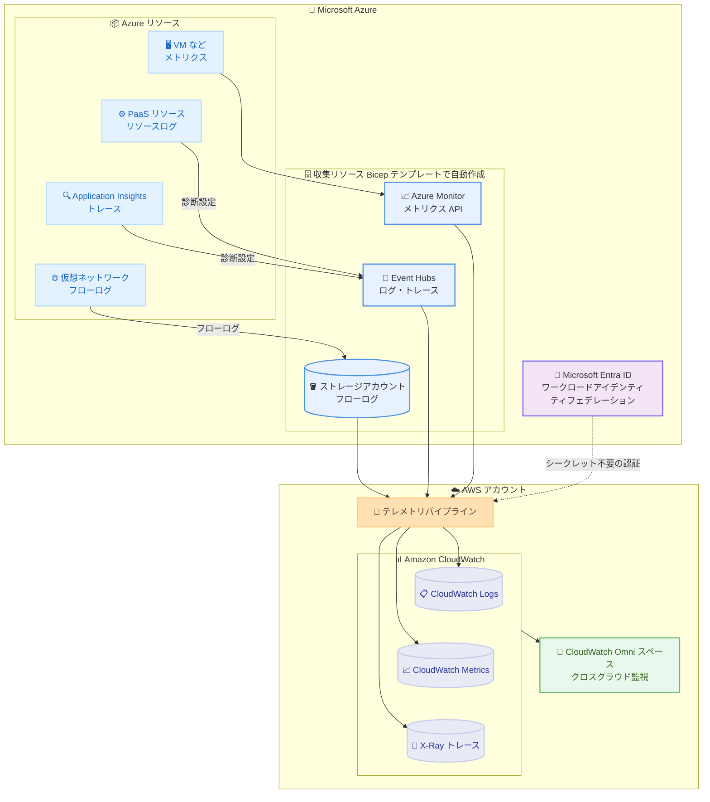

# Amazon CloudWatch - CloudWatch Omni が Microsoft Azure のプラットフォームログ・メトリクス・トレースに対応

**リリース日**: 2026 年 11 月 21 日
**サービス**: Amazon CloudWatch (CloudWatch Omni)
**機能**: Microsoft Azure プラットフォームテレメトリ (リソースログ、メトリクス、トレース、VNet フローログ) の収集

📊 [このアップデートのインフォグラフィックを見る](https://takech9203.github.io/aws-news-summary/20261121-amazon-cloudwatch-omni-microsoft-azure.html)

## 概要

Amazon CloudWatch Omni が、Microsoft Azure のプラットフォームテレメトリの収集に対応した。Azure のリソースログ、Azure Monitor プラットフォームメトリクス、仮想ネットワーク (VNet) フローログ、Application Insights のトレースを CloudWatch に直接取り込めるようになり、AWS と Azure にまたがるワークロードを単一の場所で監視できる。

セットアップでは、Microsoft Entra ID テナントを AWS アカウントとリージョンに一度接続し、収集するテレメトリタイプ、サブスクリプション、Azure リージョン、リソースタイプ、タグを選択する。Azure 側にエージェントなどのソフトウェアをインストールする必要はなく、認証にはワークロードアイデンティティフェデレーションを使用するため、Azure のシークレットやキーを AWS 側に保存することもない。収集された Azure データは CloudWatch に流れ込み、Omni スペースでアプリケーションとインフラストラクチャをクロスクラウドで監視できる。

マルチクラウド環境を運用する中央運用チーム、DevOps チーム、SRE チームが主な対象である。たとえばインシデント対応時に、Azure でホストされたサービスの遅いリクエストを、コンソールを切り替えることなく AWS 側の依存関係までトレースできる。

**アップデート前の課題**

- 以前は AWS と Azure の両方でワークロードを運用する組織は、環境全体を把握するために別々の監視ツールやカスタムパイプラインを構築する必要があった
- 以前は Azure のプラットフォームテレメトリ (リソースログやプラットフォームメトリクスなど) を CloudWatch に取り込む公式の仕組みがなく、Azure 側のテレメトリは CloudWatch エージェントで取得できるアプリケーションテレメトリに限られていた
- 以前はインシデント調査の際に Azure ポータルと AWS コンソールを行き来する必要があり、クロスクラウドのトレーシングが困難だった

**アップデート後の改善**

- 今回のアップデートにより、Azure リソースログ、Azure Monitor プラットフォームメトリクス、VNet フローログ、Application Insights のトレースを CloudWatch に直接取り込めるようになった
- 今回のアップデートにより、Azure 側にソフトウェアをインストールせずに、Entra ID テナントの接続とスコープ選択だけでテレメトリ収集を開始できるようになった
- 今回のアップデートにより、Omni スペース上で AWS と Azure のテレメトリを横断して分析でき、別々の監視ツールやカスタムパイプラインが不要になった

## アーキテクチャ図



Azure 側では Bicep テンプレートが Event Hubs やストレージアカウントなどの収集リソースを自動作成し、テレメトリパイプラインがワークロードアイデンティティフェデレーションで認証して Azure から読み取り、CloudWatch Logs・CloudWatch Metrics・X-Ray に書き込む。取り込まれたテレメトリは CloudWatch Omni スペースに表示される。

## サービスアップデートの詳細

### 主要機能

1. **4 種類の Azure プラットフォームテレメトリの収集**
   - **リソースログ**: 各リソースの診断設定 (allLogs カテゴリグループ) が同一リージョンの Event Hub にログを送信し、パイプラインが継続的に読み取る
   - **プラットフォームメトリクス**: パイプラインが Azure Monitor の Metrics Batch API から各メトリクスの最小タイムグレイン (通常 1 分) で読み取る。Azure 側のリソース作成は不要
   - **トレース**: Application Insights (microsoft.insights/components) の AppRequests および AppDependencies レコードがスパンに変換され、X-Ray に送信される
   - **VNet フローログ**: 仮想ネットワークのフローログが同一リージョンのストレージアカウントに書き込まれ、パイプラインが 1 時間ごとに新しいファイルを読み取る

2. **エージェントレス・シークレットレスの接続**
   - Azure 側にソフトウェアのインストールは不要。Azure サービスが既に記録しているテレメトリをそのまま取り込む
   - 認証はワークロードアイデンティティフェデレーションを使用し、Azure のシークレットやキーを保存しない
   - CloudWatch は接続ロール (IAM ロール) を引き受けて IAM からトークンを取得し、Microsoft Entra ID で AWS CloudWatch Ingestion アプリケーションのアクセストークンと交換する

3. **柔軟なテレメトリスコープ**
   - 収集対象をテレメトリタイプ、サブスクリプション (全部または最大 1,000 件)、Azure リージョン、リソースタイプ、タグフィルターで細かく指定できる
   - リソース ID を直接指定した収集にも対応
   - スコープから生成される Bicep テンプレートが、Event Hubs 名前空間、ストレージアカウント、Azure Policy 割り当てを自動作成し、既存リソースには修復タスクで診断設定を適用する

4. **トポロジーとリソースタグによるエンリッチメント (オプション)**
   - AWS Config コネクタを使用して Azure リソースを検出し、アプリケーションマップに Azure リソースを表示できる
   - Azure のリソースタグをログとメトリクスに付加するテレメトリエンリッチメントにも対応

5. **コンソールと AWS CLI の両方で設定可能**
   - Omni Web UI の 3 ステップウィザード、または AWS CLI (`aws observabilityadmin` の connector コマンド) とセットアップスクリプトで構成できる

## 技術仕様

### 収集の仕組み

| 構成要素 | 詳細 |
|------|------|
| 接続 (コネクタ) | Entra テナント、CloudWatch がサインインする Entra アプリケーション、接続ロール、テレメトリスコープを保持。アカウント・リージョンごとに Azure テナントあたり 1 つ |
| Azure 側収集リソース | ログ収集リージョンごとに Event Hubs 名前空間、フローログ用にストレージアカウントを Bicep テンプレートが作成。メトリクスは Azure リソース不要 |
| テレメトリパイプライン | Event Hubs・ストレージ・Azure Monitor から読み取り、ライターロールで CloudWatch Logs、CloudWatch Metrics、X-Ray に書き込む。接続ごとに 1 パイプライン |
| メトリクスの形式 | Azure メトリクスは集計ごとに 1 メトリクスとなる (例: `Percentage CPU_average`)。`cloud.provider`、`cloud.resource_id`、`cloud.account.id`、`cloud.region` の属性を持つ |
| メトリクスの遅延 | Azure が記録してから約 4 分以降に到着。粒度は最小 1 分 |
| トレースの前提 | 対象アカウント・リージョンで Transaction Search の有効化が必要 |

### 主な制限事項

| 項目 | 制限 |
|------|------|
| 接続数 | アカウント・リージョンあたり 50 接続、外部クラウドソースのパイプラインは 30 |
| テレメトリスコープ | 接続あたり 100 エントリ。各エントリでリージョン 1〜100、リソースタイプ 1〜100 (全タイプ指定は不可)、タグフィルター 1〜50 |
| タグフィルター | 完全一致のみ (大文字小文字を区別)。除外・前方一致・ワイルドカードは非対応 |
| メトリクス系列 | リソースの 1 メトリクスあたり最大 1,000 系列。超過分は収集されない |
| 名前指定サブスクリプション | ResourceLogs エントリ全体で最大 20 件 (それ以上は全サブスクリプション指定を使用) |
| 非対応リソース | `global` ロケーションのリソース (Azure Front Door など) は非対応 |

### API 変更履歴

| 日付 | サービス | 変更内容 |
|------|----------|----------|
| 2026/11/17 | [CloudWatch Observability Admin Service](https://awsapichanges.com/archive/changes/a370bc-observabilityadmin.html) | 13 new 4 updated api methods - Microsoft Azure コネクタ、サードパーティテレメトリエンリッチメント、StartTelemetryPipelineRefresh を追加 |
| 2026/11/23 | [CloudWatch Omni](https://awsapichanges.com/archive/changes/5ec695-cloudwatch-omni.html) | 4 updated api methods - CreateIntegration API に新しい統合タイプを追加。AWS Config コネクタ経由で Azure リソースを Omni のコンテキストグラフに追加 |

### テレメトリスコープの例

```json
{
  "Source": {
    "Azure": [
      {
        "TelemetryTypes": ["ResourceLogs", "Metrics"],
        "Scope": {
          "Subscriptions": { "All": {} },
          "Regions": ["eastus", "westeurope"],
          "ResourceTypes": [
            "Microsoft.Web/sites",
            "Microsoft.KeyVault/vaults",
            "microsoft.insights/components",
            "Microsoft.Compute/virtualMachines"
          ]
        }
      },
      {
        "TelemetryTypes": ["FlowLogs"],
        "Scope": {
          "Subscriptions": { "Ids": ["<subscription-id>"] },
          "Regions": ["eastus"],
          "ResourceTypes": ["Microsoft.Network/virtualNetworks"]
        }
      }
    ]
  },
  "Infrastructure": {
    "Azure": {
      "SubscriptionId": "<infrastructure-subscription-id>",
      "EventHubs": [{ "Tier": "Standard", "PartitionCount": 16 }],
      "FlowLogs": { "AwsManaged": { "RetentionDays": 7 } }
    }
  }
}
```

## 設定方法

### 前提条件

1. トレースを収集する場合、対象の AWS アカウント・リージョンで Transaction Search が有効化されていること
2. `aws observabilityadmin` の connector コマンドを含むバージョンの AWS CLI
3. Microsoft Entra ID 側でアプリケーション登録権限 (Cloud Application Administrator など) と、テナントルート管理グループでのロール割り当て権限 (Owner など) を持つこと
4. Bash、curl、jq、および Azure CLI 2.47.0 以降と Bicep (Azure Cloud Shell にはすべて揃っている)

### 手順

#### ステップ 1: 接続の作成

```bash
bash cloudwatch-azure-connection-setup.sh \
    --aws-region us-east-1 \
    --aws-role-name CloudWatchConnector \
    --connection-name my-azure-tenant
```

セットアップスクリプトが、AWS 側でアウトバウンド Web アイデンティティフェデレーションの有効化と接続ロールの作成、Entra ID 側で AWS CloudWatch Ingestion アプリケーションの登録とロール割り当て、そして接続 (コネクタ) の作成を順に実行する。Azure シークレットは保存されない。

#### ステップ 2: テレメトリスコープの定義

```bash
aws observabilityadmin put-connector-telemetry-manifest \
    --connector-identifier <connector-arn> \
    --manifest file://scope.json
```

収集するテレメトリタイプ、サブスクリプション、リージョン、リソースタイプを記述した JSON (前述の例を参照) を接続に保存する。

#### ステップ 3: Azure リソースのデプロイ

```bash
aws observabilityadmin get-connector-telemetry-setup \
    --connector-identifier <connector-arn> \
    --format BICEP > setup.json

bash cloudwatch-azure-telemetry-deploy.sh \
    --client-id <appId> \
    --tenant-id <tenant-id> \
    --connector-id <connector-id> \
    --location eastus \
    --template-file azure-setup/main.bicep
```

スコープから生成された Bicep テンプレートを取得し、Azure 側にデプロイする。Event Hubs 名前空間、フローログ用ストレージアカウント、診断設定を追加する Azure Policy が作成され、既存リソースには修復タスクで診断設定が適用される。

#### ステップ 4: ライターロールとテレメトリパイプラインの作成

```bash
aws logs create-log-group --log-group-name /az/my-azure-tenant-telemetry

aws observabilityadmin create-telemetry-pipeline \
    --name my-azure-tenant-telemetry \
    --configuration "$(jq -n --rawfile body pipeline.yaml '{Body: $body}')"
```

パイプラインの書き込み先となるロググループを作成し、接続をソース、ライターロールと CloudWatch Logs・Metrics・X-Ray をシンクとするテレメトリパイプラインを作成する。ステータスが `ACTIVE` になると取り込みが開始され、テレメトリが Omni スペースに表示される。

なお、Omni Web UI の Settings から Azure をクラウドプロバイダーとして選択すれば、上記の一連の手順を 3 ステップウィザードで実行できる。

## メリット

### ビジネス面

- **監視ツールの統合**: AWS と Azure で別々の監視ツールやサードパーティ製オブザーバビリティ製品を維持する必要がなくなり、ライセンスコストと運用負荷を削減できる
- **インシデント対応の迅速化**: Azure ホストのサービスから AWS の依存関係までコンソールを切り替えずにトレースでき、MTTR の短縮につながる
- **カスタムパイプラインの廃止**: Azure テレメトリを AWS に転送する自前の連携処理の開発・保守が不要になる

### 技術面

- **エージェントレス収集**: Azure 側にソフトウェアをインストールせず、Azure が既に記録しているテレメトリをそのまま取り込める
- **シークレットレス認証**: ワークロードアイデンティティフェデレーションにより、キーのローテーションや漏えいリスクを排除できる
- **Infrastructure as Code**: 収集リソースは生成された Bicep テンプレートで作成され、セットアップスクリプトは冪等で再実行可能
- **タグエンリッチメントとトポロジー**: Azure リソースタグをテレメトリに付加し、アプリケーションマップに Azure リソースを表示できる

## デメリット・制約事項

### 制限事項

- Azure 仮想マシン内部やアプリケーションコードからのテレメトリは対象外 (CloudWatch エージェントによるアプリケーションテレメトリ収集が別途必要)
- `global` ロケーションのリソース (Azure Front Door など) は収集できない
- タグフィルターは完全一致のみで、ワイルドカードや除外条件は使用できない
- メトリクスはリソースの 1 メトリクスあたり 1,000 系列が上限で、超過分は収集されない
- VNet フローログの読み取りは 1 時間ごとで、リアルタイム性は低い

### 考慮すべき点

- Azure 側で作成される Event Hubs とストレージには Azure の料金が発生する。CloudWatch 側で接続を削除しても Azure リソースは残り、削除するまで課金が継続する
- Azure プラットフォームメトリクスはアカウントの新規メトリクス系列の上限にカウントされるため、リソースの多いテナントを初めて接続する際は上限超過に注意が必要
- セットアップにはテナントルート管理グループでの Owner 相当の強い権限が必要であり、Azure 側の管理者との調整が必要になる
- 配信は at-least-once であり、リトライされたウィンドウが二重にカウントされる可能性がある

## ユースケース

### ユースケース 1: マルチクラウド環境の一元監視

**シナリオ**: 買収などにより AWS と Azure の両方でワークロードを運用している企業で、中央の SRE チームが環境全体を単一のダッシュボードで監視したい。

**実装例**:
```
1. Omni Web UI で Entra ID テナントを AWS アカウントに接続
2. テレメトリスコープで全サブスクリプションの主要リソースタイプを指定
3. Omni スペースで AWS と Azure のメトリクス・ログを横断分析
```

**効果**: 別々の監視ツールを行き来することなく、両クラウドの状態を単一の場所で把握できる。

### ユースケース 2: クロスクラウドの分散トレーシング

**シナリオ**: フロントエンドが Azure App Service、バックエンド API とデータベースが AWS にある構成で、遅いリクエストの原因を特定したい。

**実装例**:
```
1. Transaction Search を有効化
2. Application Insights を含むスコープでリソースログ収集を設定
   (AppRequests と AppDependencies がスパンに変換される)
3. Omni でリクエストを Azure サービスから AWS の依存関係まで追跡
```

**効果**: インシデント対応中にコンソールを切り替えることなく、Azure 起点のリクエストを AWS 側までエンドツーエンドでトレースできる。

### ユースケース 3: Azure ネットワークトラフィックの監査

**シナリオ**: セキュリティチームが Azure VNet のトラフィックを AWS 側の既存のログ分析基盤と同じ場所で監査したい。

**実装例**:
```
1. テレメトリスコープで FlowLogs タイプと対象 VNet を指定
2. フローログが CloudWatch Logs のロググループに取り込まれる
3. CloudWatch Logs Insights で AWS の VPC Flow Logs と合わせて分析
```

**効果**: 両クラウドのネットワークフローログを同一基盤で分析でき、監査・調査のワークフローを統一できる。

## 料金

CloudWatch 側では、取り込まれたログ・メトリクス・トレースに対して通常の CloudWatch / X-Ray の料金が適用される。詳細は CloudWatch 料金ページを参照。

また、Azure 側では収集用に作成される Event Hubs 名前空間とフローログ用ストレージアカウントに対して Azure の料金が発生する点に注意が必要である。CloudWatch で接続を削除しても Azure リソースは自動削除されず、削除するまで Azure 側の課金が継続する。

## 利用可能リージョン

- **Azure 側**: すべての Azure パブリックリージョンからテレメトリを収集可能
- **AWS 側**: CloudWatch Omni が提供されているすべてのリージョンに取り込み可能 (米国東部バージニア北部、米国西部オレゴン、欧州アイルランドに加え、2026 年 10 月に東京を含む 8 リージョンが追加され合計 11 リージョン)

## 関連サービス・機能

- **Amazon CloudWatch Omni**: AI ファーストのクロスクラウドオブザーバビリティ体験。今回のアップデートで取り込んだ Azure テレメトリの表示・分析の場となる
- **AWS X-Ray / Transaction Search**: Application Insights のトレースはスパンとして X-Ray に送信され、Transaction Search で検索できる
- **AWS Config**: Azure リソースの検出 (トポロジー表示とリソースタグエンリッチメント) に AWS Config コネクタを使用する
- **AWS IAM**: アウトバウンド Web アイデンティティフェデレーションにより、シークレットレスで Entra ID と連携する

## 参考リンク

- 📊 [インフォグラフィック](https://takech9203.github.io/aws-news-summary/20261121-amazon-cloudwatch-omni-microsoft-azure.html)
- [公式発表 (What's New)](https://aws.amazon.com/about-aws/whats-new/2026/11/amazon-cloudwatch-omni-microsoft-azure)
- [ドキュメント: Send platform telemetry from Microsoft Azure](https://docs.aws.amazon.com/AmazonCloudWatch/latest/monitoring/omni-send-platform-telemetry-from-microsoft-azure.html)
- [料金ページ](https://aws.amazon.com/cloudwatch/pricing/)

## まとめ

CloudWatch Omni が Azure のプラットフォームテレメトリ収集に対応したことで、AWS と Azure にまたがる環境をエージェントレス・シークレットレスで一元監視できるようになり、マルチクラウド運用における監視ツールの分断という大きな課題が解消される。マルチクラウド環境を運用しているチームは、まず Omni Web UI のウィザードで小さなスコープから接続を試し、Azure 側の Event Hubs 等のコスト影響を確認しながら段階的に対象を広げることを推奨する。
