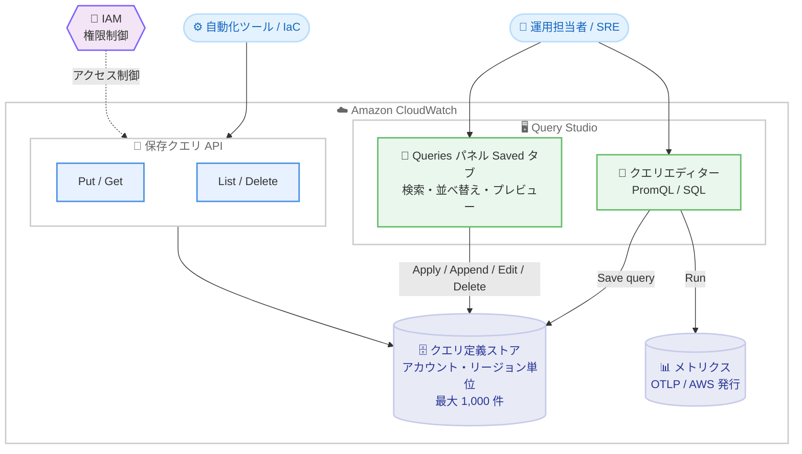

# Amazon CloudWatch - Query Studio の保存クエリ対応

**リリース日**: 2026 年 11 月 21 日
**サービス**: Amazon CloudWatch
**機能**: Query Studio Saved Queries (保存クエリ)

📊 [このアップデートのインフォグラフィックを見る](https://takech9203.github.io/aws-news-summary/20261121-amazon-cloudwatch-query-studio-saved-queries.html)

## 概要

Amazon CloudWatch Query Studio が、PromQL および SQL のメトリクスクエリを保存して再利用できる「保存クエリ (Saved Queries)」に対応しました。Query Studio は CloudWatch コンソール上の対話型クエリ環境で、OTLP 経由で取り込んだメトリクスや AWS が発行するメトリクスに対して PromQL / SQL クエリを実行し、可視化・アラーム作成・ダッシュボード追加を行えます。

今回のアップデートにより、インシデント対応時に毎回使用するレイテンシ確認クエリなど、頻繁に実行するクエリに名前を付けて保存し、ワンクリックで呼び出せるようになりました。クエリ名にスラッシュ (/) を含めることでフォルダー形式の整理も可能です。保存クエリはアカウント・リージョン単位で保存され、IAM 権限により作成・閲覧・削除を制御できます。さらに、新しい 4 つの API によりプログラムからの管理にも対応しています。

運用チームや SRE チームなど、定常的にメトリクスを調査するユーザーにとって、クエリの再作成や共有の手間を削減し、インシデント対応の初動を速める実用的な機能強化です。

**アップデート前の課題**

- 頻繁に実行するクエリであっても、Query Studio を開くたびに書き直すか、別の場所に保管したものを探して貼り付ける必要があった
- インシデント対応時に、調査でよく使うクエリをすぐに呼び出す手段がなく、初動に時間がかかっていた
- チーム内で有用なクエリを共有・標準化するための仕組みが Query Studio 内になかった

**アップデート後の改善**

- クエリに名前を付けて保存し、Queries パネルの Saved タブから検索・並べ替え・プレビューして即座に再利用できるようになった
- クエリ名にスラッシュ (/) を使用することで、`team/errors` のようにフォルダー形式でクエリを整理できるようになった
- 保存クエリはアカウント・リージョン単位で保存されるため、同じアカウントを利用するチームメンバー間でクエリを共有できるようになった
- IAM 権限で保存クエリの作成・閲覧・削除を制御できるようになった
- 新しい API により、保存クエリを IaC や自動化ツールからプログラムで管理できるようになった

## アーキテクチャ図



Query Studio で作成した PromQL / SQL クエリをアカウント・リージョン単位のクエリ定義ストアに保存し、コンソールの Saved タブまたは新しい API から再利用・管理する構成です。

## サービスアップデートの詳細

### 主要機能

1. **クエリの保存とフォルダー整理**
   - Query Studio で作成した PromQL / SQL メトリクスクエリに名前を付けて保存できる
   - クエリ名にスラッシュ (/) を含めると、`team/errors` のようにフォルダー形式でグループ化できる
   - 保存クエリはアカウント内の現在の AWS リージョンに保存され、リージョンごとに最大 1,000 件まで保存できる

2. **Saved タブでの検索・再利用**
   - Queries パネルの Saved タブで、保存済みクエリの検索・並べ替え・プレビューが可能
   - **Apply** で現在のクエリを保存クエリに置き換え、**Append** で現在のクエリに追記できる
   - 各クエリのアクションメニューから **Edit** (編集) と **Delete** (削除) を実行できる
   - 保存クエリを呼び出して変更した後は、**Update query** で変更を保存できる

3. **IAM によるアクセス制御**
   - 保存クエリの作成・閲覧・一覧・削除をそれぞれ IAM アクションで制御できる
   - 必要な権限: `cloudwatch:PutMetricDataQueryDefinition`、`cloudwatch:GetMetricDataQueryDefinition`、`cloudwatch:ListMetricDataQueryDefinitions`、`cloudwatch:DeleteMetricDataQueryDefinition`

4. **API によるプログラム管理**
   - `PutMetricDataQueryDefinition`: クエリ定義の作成・更新
   - `GetMetricDataQueryDefinition`: クエリ定義の取得
   - `ListMetricDataQueryDefinitions`: クエリ定義の一覧取得
   - `DeleteMetricDataQueryDefinition`: クエリ定義の削除

## 技術仕様

### 保存クエリの仕様

| 項目 | 詳細 |
|------|------|
| 対応クエリ言語 | PromQL、SQL |
| 保存スコープ | アカウント・リージョン単位 |
| 保存上限 | 1 リージョンあたり 1,000 件 |
| フォルダー整理 | クエリ名のスラッシュ (/) でグループ化 |
| コンソール操作 | 検索、並べ替え、プレビュー、Apply、Append、Edit、Delete |
| アクセス制御 | IAM アクション 4 種による制御 |

### API 変更履歴

| 日付 | サービス | 変更内容 |
|------|----------|----------|
| 2026/11/12 | [Amazon CloudWatch](https://awsapichanges.com/archive/changes/981bee-monitoring.html) | 4 new api methods - メトリクスデータクエリ定義の保存・取得・一覧・削除をサポート |

### IAM ポリシー例

保存クエリの管理に必要な権限を付与する IAM ポリシーの例です。

```json
{
  "Version": "2012-10-17",
  "Statement": [
    {
      "Effect": "Allow",
      "Action": [
        "cloudwatch:PutMetricDataQueryDefinition",
        "cloudwatch:GetMetricDataQueryDefinition",
        "cloudwatch:ListMetricDataQueryDefinitions",
        "cloudwatch:DeleteMetricDataQueryDefinition"
      ],
      "Resource": "*"
    }
  ]
}
```

閲覧のみを許可する場合は `GetMetricDataQueryDefinition` と `ListMetricDataQueryDefinitions` のみを付与します。

## 設定方法

### 前提条件

1. 対応リージョン (東京・大阪を含む 17 リージョン) で CloudWatch コンソールを利用できること
2. 保存クエリの管理に必要な IAM 権限 (`cloudwatch:PutMetricDataQueryDefinition` など 4 アクション) が付与されていること
3. Query Studio でクエリ対象となるメトリクス (OTLP 取り込みメトリクスまたは AWS 発行メトリクス) が存在すること

### 手順

#### ステップ 1: Query Studio でクエリを作成する

1. [CloudWatch コンソール](https://console.aws.amazon.com/cloudwatch/) を開く
2. ナビゲーションペインで **Query Studio** を選択する
3. クエリエディターで PromQL または SQL を選択し、Builder モードまたは Editor モードでクエリを作成する
4. **Run** を選択して結果を確認する

#### ステップ 2: クエリを保存する

1. **Save query** を選択する
2. **Name** にクエリ名を入力する。フォルダーで整理する場合は `team/errors` のようにスラッシュ (/) を含める
3. **Save** を選択する

クエリがアカウント内の現在のリージョンに保存されます。

#### ステップ 3: 保存クエリを再利用する

1. **Queries** を選択し、**Saved** タブを開く
2. 検索・並べ替えで目的のクエリを探し、プレビューで内容を確認する
3. **Apply** (現在のクエリを置換) または **Append** (現在のクエリに追記) で Query Studio に読み込む
4. クエリを変更した場合は **Update query** で変更を保存する

## メリット

### ビジネス面

- **インシデント対応の高速化**: 調査でよく使うクエリを即座に呼び出せるため、障害発生時の初動と MTTR の短縮につながる
- **チーム内のナレッジ共有**: 保存クエリはアカウント・リージョン単位で保存されるため、有用なクエリをチームで共有・標準化できる
- **運用の属人化防止**: ベテランが作成したクエリを保存しておくことで、担当者に依存しない運用体制を構築できる

### 技術面

- **フォルダーによる体系的な整理**: クエリ名のスラッシュ (/) により、チームや用途ごとにクエリを分類できる
- **IAM によるきめ細かなアクセス制御**: 作成・閲覧・一覧・削除を個別の IAM アクションで制御でき、閲覧専用ユーザーの設定も可能
- **API による自動化**: 4 つの新 API により、標準クエリセットのプロビジョニングやバックアップを自動化できる

## デメリット・制約事項

### 制限事項

- 保存できるクエリは 1 リージョンあたり最大 1,000 件
- 保存クエリはリージョン単位で保存されるため、複数リージョンで同じクエリを使う場合はリージョンごとに保存が必要
- 利用可能リージョンは 17 リージョンに限定される (下記「利用可能リージョン」参照)

### 考慮すべき点

- 保存クエリはアカウント単位で共有されるため、クエリの命名規則やフォルダー構成をチームで事前に取り決めておくと管理しやすい
- 不要なユーザーによるクエリの上書きや削除を防ぐには、`PutMetricDataQueryDefinition` と `DeleteMetricDataQueryDefinition` の権限付与範囲を検討する必要がある

## ユースケース

### ユースケース 1: インシデント対応用クエリの標準化

**シナリオ**: SRE チームが、障害発生時に最初に確認するレイテンシ・エラー率のクエリを標準化し、誰でも即座に実行できるようにしたい。

**実装例**:
```
保存クエリ名の例:
  incident/latency-p99        … API レイテンシ p99 の PromQL クエリ
  incident/error-rate         … エラー率の PromQL クエリ
  incident/active-requests    … アクティブリクエスト数のクエリ

障害発生時は Queries パネルの Saved タブで「incident/」を検索し、
Apply で即座に実行する。
```

**効果**: 障害対応の初動でクエリを書き直す時間がなくなり、担当者のスキルに依存せず一貫した調査を実施できる。

### ユースケース 2: チーム別フォルダーでのクエリ管理

**シナリオ**: 複数チームが同一アカウントの Query Studio を利用しており、チームごとにクエリを整理して管理したい。

**実装例**:
```
保存クエリ名の例:
  payments/checkout-latency
  payments/transaction-errors
  platform/node-cpu-usage
  platform/memory-pressure

クエリ名のスラッシュによりフォルダー形式で表示され、
Saved タブの検索・並べ替えでチームのクエリのみを素早く参照できる。
```

**効果**: チーム間でクエリが混在せず、各チームが必要なクエリに素早くアクセスできる。

### ユースケース 3: API による標準クエリセットの自動プロビジョニング

**シナリオ**: 新しいリージョンや新しいアカウントの立ち上げ時に、組織標準の監視クエリセットを自動投入したい。

**実装例**:
```
自動化スクリプトの流れ:
  1. ListMetricDataQueryDefinitions で既存クエリを確認
  2. PutMetricDataQueryDefinition で標準クエリセットを登録
  3. 廃止されたクエリは DeleteMetricDataQueryDefinition で削除

CI/CD パイプラインに組み込み、クエリ定義をコードとして管理する。
```

**効果**: リージョンやアカウントをまたいで監視クエリを一貫して管理でき、手動登録の漏れを防止できる。

## 料金

What's New およびドキュメントには、保存クエリ機能自体の追加料金に関する記載はありません。クエリの実行には、CloudWatch のメトリクスクエリに関する標準料金が適用されます。最新の料金は [Amazon CloudWatch 料金ページ](https://aws.amazon.com/cloudwatch/pricing/) を参照してください。

## 利用可能リージョン

以下の 17 リージョンで利用可能です (東京・大阪リージョンを含む)。

- 米国東部 (バージニア北部、オハイオ)
- 米国西部 (北カリフォルニア、オレゴン)
- カナダ (中部)
- 南米 (サンパウロ)
- 欧州 (アイルランド、ロンドン、パリ、フランクフルト、ストックホルム)
- アジアパシフィック (ムンバイ、ソウル、大阪、東京、シンガポール、シドニー)

## 関連サービス・機能

- **CloudWatch Query Studio**: 本機能の基盤となる対話型クエリ環境。PromQL / SQL クエリの実行、可視化、アラーム作成、ダッシュボード追加に対応
- **CloudWatch アラーム**: Query Studio で実行した PromQL クエリから直接アラームを作成可能。保存クエリと組み合わせて監視定義を標準化できる
- **CloudWatch ダッシュボード**: Query Studio の可視化をウィジェットとして追加可能。保存クエリを起点にダッシュボードを整備できる
- **AWS IAM**: 保存クエリの作成・閲覧・一覧・削除を 4 つの IAM アクションで制御

## 参考リンク

- 📊 [インフォグラフィック](https://takech9203.github.io/aws-news-summary/20261121-amazon-cloudwatch-query-studio-saved-queries.html)
- [公式発表 (What's New)](https://aws.amazon.com/about-aws/whats-new/2026/11/amazon-cloudwatch-query-studio-saved-queries)
- [ドキュメント: Saving and reusing queries](https://docs.aws.amazon.com/AmazonCloudWatch/latest/monitoring/CloudWatch-PromQL-QueryStudio.html#CloudWatch-PromQL-QueryStudio-SavedQueries)
- [Amazon CloudWatch 製品ページ](https://aws.amazon.com/cloudwatch/)
- [料金ページ](https://aws.amazon.com/cloudwatch/pricing/)

## まとめ

CloudWatch Query Studio の保存クエリ対応により、頻繁に使う PromQL / SQL クエリを保存・整理・共有できるようになり、インシデント対応の初動短縮とチーム内のクエリ標準化が実現できます。Query Studio を利用しているチームは、まずインシデント対応でよく使うクエリをフォルダー付きで保存し、IAM 権限の付与範囲を整理することから始めることを推奨します。
