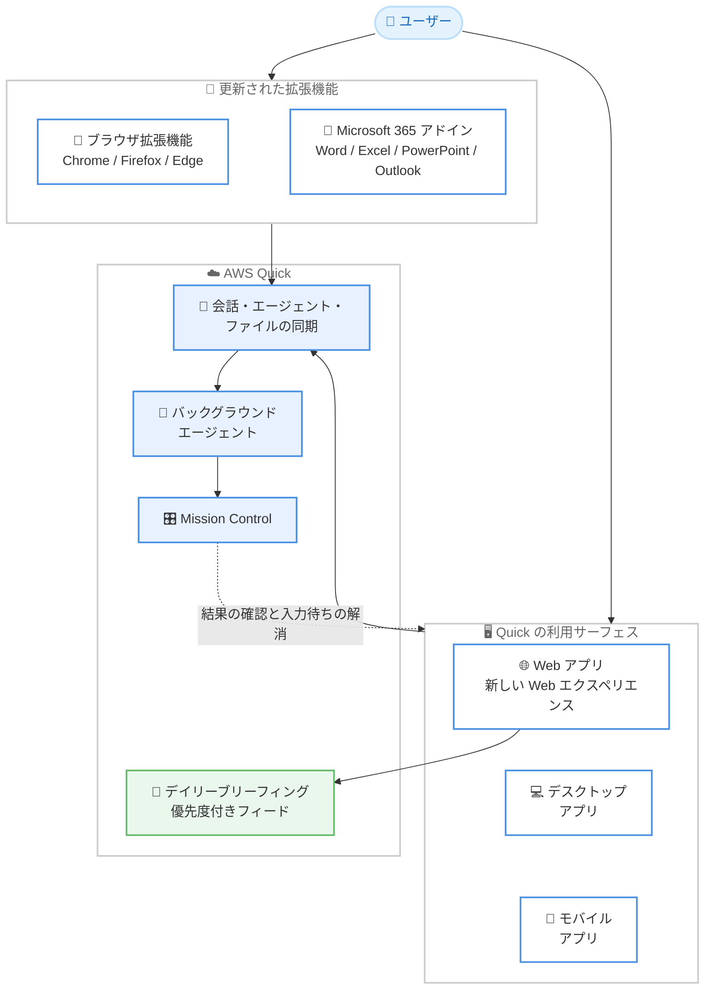

# AWS Quick - 新しい Web エクスペリエンスとブラウザ拡張機能・Microsoft 365 アドインの更新

**リリース日**: 2026 年 11 月 21 日
**サービス**: AWS Quick
**機能**: 新しい Web エクスペリエンス、更新されたブラウザ拡張機能、Microsoft 365 アドイン

📊 [このアップデートのインフォグラフィックを見る](https://takech9203.github.io/aws-news-summary/20261121-aws-quick-launches-new-web-experience-updated-browser-extension-microsoft-365-add-ins.html)

## 概要

AWS Quick が、デスクトップアプリの体験をブラウザに持ち込む新しい Web エクスペリエンスを発表しました。Web アプリでは、デスクトップと同じエージェント、スキル、コネクターをそのまま作成・共有・利用できます。1 日の始まりにはデイリーブリーフィングが表示され、重要なメールやメッセージをハイライトする優先度付きフィードで、注意が必要な項目をすぐに把握できます。ダッシュボード、トピック、スペースもこれまでどおり利用できます。

会話、エージェント、ファイルは Web、デスクトップ、モバイルの間で同期され、あるサーフェスで始めた作業を別のサーフェスで続行できます。Web から起動またはスケジュールしたエージェントは、ブラウザを閉じた後もバックグラウンドで動作を続けます。朝にエージェントをスケジュールし、会議の合間にモバイルでエージェントからの質問に回答し、デスクトップで結果を確認するといった働き方が可能です。完了したエージェントの作業や入力が必要な箇所は、Mission Control で一元的に確認できます。

あわせて、ブラウザ拡張機能と Word、Excel、PowerPoint、Outlook 向けの Microsoft 365 アドインも更新されました。対象ユーザーは、AI アシスタントを日常の業務ツールに組み込みたいすべての AWS Quick 利用者です。

**アップデート前の課題**

このアップデート以前には、以下の課題がありました。

- デスクトップアプリ相当のフル機能の Quick 体験をブラウザだけで利用する手段が限られていた
- デバイスやサーフェスをまたいで作業を継続するには、会話やエージェントのコンテキストを引き継ぐ仕組みが必要だった
- 複数のエージェントの実行状況や入力待ちの項目を、会話やエージェントごとに個別に確認する必要があった

**アップデート後の改善**

今回のアップデートにより、以下が可能になりました。

- ブラウザだけでデスクトップと同じエージェント、スキル、コネクターを作成・共有・利用できるようになった
- デイリーブリーフィングと優先度付きフィードにより、重要なメールやメッセージなど注意が必要な項目から 1 日を始められるようになった
- 会話、エージェント、ファイルが Web、デスクトップ、モバイル間で同期され、サーフェスをまたいだ作業の継続が可能になった
- Web から起動・スケジュールしたエージェントがブラウザを閉じても動作を続け、結果や入力待ちを Mission Control で確認できるようになった
- 更新されたブラウザ拡張機能と Microsoft 365 アドインにより、普段使うツールの中で Quick の支援を受けられるようになった

## アーキテクチャ図



Web、デスクトップ、モバイル、拡張機能のすべてが同じ AWS Quick ランタイムに接続し、会話・エージェント・ファイルが同期される構成を示しています。ブラウザを閉じてもバックグラウンドエージェントは動作を続け、結果や入力待ちは Mission Control から確認できます。

## サービスアップデートの詳細

### 主要機能

1. **新しい Web エクスペリエンス**
   - デスクトップアプリの体験をブラウザに持ち込み、デスクトップと同じエージェント、スキル、コネクターを Web 上で作成・共有・利用できる
   - 1 日の始まりにデイリーブリーフィングを表示し、重要なメールやメッセージをハイライトする優先度付きフィードで注意が必要な項目を提示する
   - ダッシュボード、トピック、スペースはこれまでどおり動作する

2. **クロスデバイス同期**
   - 会話、エージェント、ファイルが Web、デスクトップ、モバイルの間で同期される
   - あるサーフェスで始めたタスクを、別のサーフェスでそのまま続行できる
   - 拡張機能も同じ Quick ランタイムの一部として動作し、拡張機能で始めた作業を Web、デスクトップ、モバイルで継続できる

3. **バックグラウンドエージェントと Mission Control**
   - Web から起動またはスケジュールしたエージェントは、ブラウザを閉じた後も実行を継続する
   - Mission Control は、すべてのエージェントとフローの実行状況を一元的に可視化・管理するコマンドセンター。完了した作業の成果物の確認、実行中のランのライブ監視・一時停止・キャンセル、入力待ちのランへの承認・回答が行える
   - 失敗したラン数、現在実行中の数、週間実行数、エージェント時間などの KPI と、共有したエージェント・フロー・アプリの利用状況を示すクリエイター分析も提供される

4. **更新されたブラウザ拡張機能**
   - Google Chrome、Mozilla Firefox、Microsoft Edge に対応し、管理者によるセットアップなしでインストールして利用できる
   - Web ページの要約、複数ページを会話のスコープに追加した横断的な質問、スペースにある組織ナレッジの参照、ファイルのアップロードと分析に対応
   - Quick で設定済みのコネクターのアクションをブラウザから直接実行できる

5. **更新された Microsoft 365 アドイン**
   - **Outlook**: 未読メールの要約と優先度付け、自然言語でのメール検索・整理、会議スケジュール調整、スレッドの文脈を踏まえた返信ドラフト作成
   - **Excel**: ワークブックの詳細分析、データのインポートとクレンジング、テーブル・チャートの生成、スプレッドシート操作の自動化
   - **Word**: 書式付きドキュメントの生成、文体と構成を維持した編集、変更履歴とコメントによるレッドライン
   - **PowerPoint**: プレゼンテーションの作成、自然言語によるスライド編集、構成変更やトランジション適用などの操作の効率化
   - いずれも管理者によるセットアップなしで利用を開始できる (Slack / Microsoft Teams 拡張機能は従来どおり管理者による設定が必要)

## 技術仕様

### 利用サーフェスと拡張機能

| 項目 | 詳細 |
|------|------|
| Web アプリ | ブラウザでデスクトップと同じエージェント・スキル・コネクターを利用。デイリーブリーフィングと優先度付きフィードを提供 |
| デスクトップアプリ | [ダウンロードページ](https://aws.amazon.com/quick/download/) から入手 |
| モバイルアプリ | Apple App Store および Google Play ストアから無料で入手 |
| ブラウザ拡張機能 | Google Chrome、Mozilla Firefox、Microsoft Edge に対応。Chrome Web Store / Firefox Add-ons から入手 |
| Microsoft 365 アドイン | Word、Excel、PowerPoint、Outlook に対応。Microsoft のアプリストアから入手 |
| 同期対象 | 会話、エージェント、ファイル (サーフェス間で同期) |
| 管理者セットアップ | ブラウザ拡張機能と Microsoft 365 アドインは不要。Slack / Teams 拡張機能は必要 |

### ブラウザ拡張機能の主な仕様

| 項目 | 詳細 |
|------|------|
| 対応ブラウザ | Google Chrome、Mozilla Firefox、Microsoft Edge |
| コンテキスト上限 | Web ページとアップロードファイルの合計で最大 20 件 |
| 会話の保持 | 非アクティブ状態が 30 日間続いた会話と関連ファイルは自動削除 (組織のポリシーにより延長される場合あり) |
| 組織展開 | Chrome Enterprise、Firefox Enterprise、Edge Enterprise のポリシーによる一括配布に対応 |

### Mission Control の主な機能

| 機能 | 説明 |
|------|------|
| 実行状況の一元監視 | すべてのエージェントとフローの実行履歴を一覧で確認 |
| 入力待ちの解消 | 入力が必要なエージェント・フローを抽出し、その場で承認や回答を提供 |
| 実行中ランの管理 | ライブイベントの確認、一時停止、キャンセル |
| KPI | 失敗したラン数、現在実行中の数、週間実行数、共有アセット数、エージェント時間 |
| クリエイター分析 | 共有したエージェント・フロー・アプリの利用者数や実行数を分析 (1 時間ごとに更新) |

## 設定方法

### 前提条件

1. AWS Quick を利用できること (aws.com/quick でのサインアップ、または AWS Management Console からのプロビジョニング)
2. ブラウザ拡張機能を使う場合、Google Chrome、Mozilla Firefox、Microsoft Edge のいずれかを利用していること
3. Microsoft 365 アドインを使う場合、対象の Microsoft 365 アプリケーションを利用できること。Outlook アドインの受信トレイ優先度付けやカレンダー管理などの一部機能には、管理者による Microsoft Graph API 権限の承認が必要

### 手順

#### ステップ 1: Web アプリにサインインする

ブラウザで AWS Quick にサインインします。ホームにはデイリーブリーフィングと優先度付きフィードが表示され、重要なメールやメッセージなど注意が必要な項目から 1 日を始められます。デスクトップで作成済みのエージェント、スキル、コネクターはそのまま Web でも利用できます。

#### ステップ 2: ブラウザ拡張機能をインストールする

Chromium 系ブラウザ (Microsoft Edge を含む) は Chrome Web Store、Mozilla Firefox は Firefox Add-ons ストアから「Amazon Quick」拡張機能をインストールし、サインインします。管理者によるセットアップは不要です。組織全体へ展開する場合は、各ブラウザのエンタープライズポリシーで一括配布できます。

#### ステップ 3: Microsoft 365 アドインを追加する

Word、Excel、PowerPoint、Outlook の各アプリ内のストアで「AWS Quick」を検索してアドインを追加します。Outlook アドインの一部機能 (受信トレイの優先度付け、カレンダー管理、メール整理など) には Microsoft Graph API 権限が必要なため、利用できない場合は管理者に承認状況を確認します。

#### ステップ 4: バックグラウンドエージェントを活用する

Web からエージェントを起動またはスケジュールすると、ブラウザを閉じてもエージェントは実行を継続します。ナビゲーションから Mission Control を開くと、完了した作業の確認、実行中ランの監視、入力待ちへの回答をまとめて行えます。モバイルアプリと組み合わせれば、外出先からエージェントの質問に回答し、デスクトップで最終結果を確認できます。

## メリット

### ビジネス面

- **導入ハードルの低減**: アプリのインストールなしにブラウザだけでフル機能を利用できるため、組織全体への展開や試用が容易になる
- **1 日の業務の起点**: デイリーブリーフィングと優先度付きフィードにより、重要なメールやメッセージへの対応漏れを防ぎ、朝の状況把握を効率化できる
- **業務ツールへの組み込み**: ブラウザ拡張機能と Microsoft 365 アドインにより、普段のメール処理・資料作成・データ分析の中で AI 支援を受けられ、アプリケーションの切り替えが不要になる

### 技術面

- **サーフェス間のコンテキスト同期**: 会話、エージェント、ファイルが Web・デスクトップ・モバイル・拡張機能で同期され、作業の中断と再開がデバイスをまたいで可能
- **非同期実行モデル**: Web から起動したエージェントがブラウザのセッションに依存せず実行を継続するため、長時間タスクを安心して任せられる
- **運用の一元化**: Mission Control の KPI (失敗ラン数、エージェント時間など) とクリエイター分析により、エージェントが増えても実行状況と利用状況を一元管理できる
- **エンタープライズ配布**: ブラウザ拡張機能は Chrome / Firefox / Edge の各エンタープライズポリシーで組織一括配布でき、管理者セットアップなしで利用開始できる

## デメリット・制約事項

### 制限事項

- 利用可能リージョンは米国東部 (バージニア北部)、米国西部 (オレゴン)、欧州 (フランクフルト、アイルランド、ロンドン)、アジアパシフィック (シドニー、東京) に限られる
- ブラウザ拡張機能がコンテキストとして扱えるのは、Web ページとアップロードファイルの合計で最大 20 件
- Outlook アドインの一部機能 (受信トレイ優先度付け、カレンダー管理、メール整理) には、管理者による Microsoft Graph API 権限の承認が必要
- Slack / Microsoft Teams 拡張機能は、引き続き管理者による拡張機能アクセスの設定が必要

### 考慮すべき点

- 会話と関連ファイルは非アクティブ状態が 30 日間続くと自動削除される (拡張機能の会話保持期間は組織のポリシーに従う)
- 拡張機能やアドインの応答は各ユーザーの権限を反映するため、メール返信などに全受信者がアクセスできない情報が含まれる可能性があり、共有前の確認が必要
- 拡張機能の利用中に Quick がリクエストを処理する時間は秒単位で計測され、エージェント時間 (agent hours) として課金対象にカウントされる
- Outlook アドインは生成 AI によりコードを生成・実行するため、誤った操作が行われる可能性を踏まえ、応答と実行結果の確認が推奨される

## ユースケース

### ユースケース 1: 朝のトリアージから 1 日を始める

**シナリオ**: 複数のプロジェクトを掛け持ちするマネージャーが、毎朝大量のメールとメッセージの中から優先対応すべき項目を素早く見極めたい。

**実装例**:
```text
1. 朝、ブラウザで Quick Web アプリを開く
2. デイリーブリーフィングと優先度付きフィードで、重要なメールと
   メッセージを確認する
3. Outlook アドインで「未読メールを要約して、今日中に返信が必要な
   ものをハイライトして」と依頼し、返信ドラフトを作成する
```

**効果**: 受信トレイを総当たりで確認する時間を削減し、優先度の高い対応から 1 日を始められる。

### ユースケース 2: デバイスをまたいだバックグラウンドエージェントの活用

**シナリオ**: 外出の多い営業担当者が、時間のかかる調査タスクをエージェントに任せ、移動中も進捗を確認したい。

**実装例**:
```text
1. 朝、Web アプリで競合調査のエージェントをスケジュールして起動し、
   ブラウザを閉じて外出する
2. 会議の合間に、モバイルアプリでエージェントからの確認事項に回答する
3. 帰社後、デスクトップの Mission Control で完了した調査結果と
   成果物を確認し、チャットで追加の質問をする
```

**効果**: エージェントの実行がブラウザセッションに縛られず、人間の確認が必要なタイミングだけモバイルで対応することで、調査のリードタイムを短縮できる。

### ユースケース 3: ブラウザ拡張機能と Microsoft 365 アドインによる資料作成

**シナリオ**: 企画担当者が、Web 上の複数の記事と社内ナレッジをもとに提案資料を作成したい。

**実装例**:
```text
1. ブラウザ拡張機能で参考記事のタブを + アイコンで会話スコープに追加し、
   要点を横断的に整理する
2. スペースの社内ナレッジを参照しながら、論点の抜け漏れを確認する
3. Word アドインで整理した要点から書式付きドキュメントを生成し、
   PowerPoint アドインで提案スライドに仕上げる
```

**効果**: ブラウザと Office アプリの間でコピー & ペーストを繰り返すことなく、情報収集から資料作成までを一貫した AI 支援のもとで完結できる。

## 料金

What's New に本アップデート固有の追加料金の記載はありません。新しい Web エクスペリエンス、ブラウザ拡張機能、Microsoft 365 アドインは AWS Quick の機能として提供され、AWS Quick のプラン (Free / Plus プラン、または AWS アカウント経由のユーザー単位サブスクリプション) の範囲内で利用します。モバイルアプリは Apple App Store と Google Play ストアから無料で入手できます。

なお、拡張機能の利用時に Quick がリクエストを処理する時間は秒単位で計測され、エージェント時間としてカウントされます。最新の料金は [AWS Quick の料金ページ](https://aws.amazon.com/quick/pricing/) を参照してください。

## 利用可能リージョン

以下のリージョンで利用できます。

- 米国東部 (バージニア北部)
- 米国西部 (オレゴン)
- 欧州 (フランクフルト)
- 欧州 (アイルランド)
- 欧州 (ロンドン)
- アジアパシフィック (シドニー)
- アジアパシフィック (東京)

## 関連サービス・機能

- **AWS Quick のエージェント / スキル / コネクター**: Web アプリでもデスクトップと同一のものを作成・共有・利用できる。今回の同期の中心となる構成要素
- **Mission Control**: エージェントとフローの実行状況、KPI、クリエイター分析を一元管理するコマンドセンター。バックグラウンドエージェントの結果確認と入力待ち解消の窓口
- **AWS Quick Flows**: 反復タスクを自動化するマルチステップワークフロー。ブラウザ拡張機能からも利用できる
- **AWS Quick Plugins**: エージェント、スキル、コネクター、フローを職務単位でバンドルして配布する機能。同日に発表され、Web エクスペリエンスでの環境構築を効率化する
- **Slack / Microsoft Teams 拡張機能**: チームコミュニケーションツール向けの拡張機能。こちらは管理者による拡張機能アクセスの設定が必要

## 参考リンク

- 📊 [インフォグラフィック](https://takech9203.github.io/aws-news-summary/20261121-aws-quick-launches-new-web-experience-updated-browser-extension-microsoft-365-add-ins.html)
- [公式発表 (What's New)](https://aws.amazon.com/about-aws/whats-new/2026/11/aws-quick-launches-new-web-experience-updated-browser-extension-microsoft-365-add-ins/)
- [ドキュメント: AWS Quick User Guide](https://docs.aws.amazon.com/quick/latest/userguide/what-is.html)
- [ドキュメント: Connect AWS Quick to your existing tools with extensions](https://docs.aws.amazon.com/quick/latest/userguide/working-with-extensions-detail.html)
- [ドキュメント: AWS Quick browser extension](https://docs.aws.amazon.com/quick/latest/userguide/browser-extension-user-guide.html)
- [ドキュメント: Mission Control](https://docs.aws.amazon.com/quick/latest/userguide/mission-control.html)
- [デスクトップアプリのダウンロード](https://aws.amazon.com/quick/download/)
- [料金ページ](https://aws.amazon.com/quick/pricing/)

## まとめ

今回のアップデートにより、AWS Quick はデスクトップアプリと同等の体験をブラウザで提供し、Web・デスクトップ・モバイル・拡張機能のすべてで会話とエージェントが同期する「どこでも同じ Quick」を実現しました。ブラウザを閉じても動き続けるバックグラウンドエージェントと Mission Control の組み合わせは、AI エージェントを日常業務の非同期ワーカーとして使う働き方を後押しします。まずは Web アプリのデイリーブリーフィングを試し、ブラウザ拡張機能と Microsoft 365 アドインを普段のメール処理や資料作成に組み込むことを推奨します。
