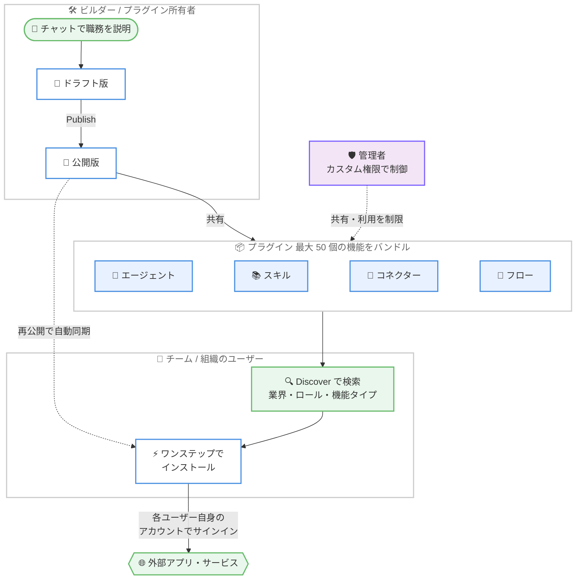

# AWS Quick - プラグインによるエージェント・スキル・コネクター・フローのバンドル

**リリース日**: 2026 年 11 月 21 日
**サービス**: AWS Quick
**機能**: Plugins (エージェント、スキル、コネクター、フローのバンドル)

📊 [このアップデートのインフォグラフィックを見る](https://takech9203.github.io/aws-news-summary/20261121-aws-quick-plugins-bundle-agents-skills-connectors-flows.html)

## 概要

AWS Quick が、特定の職務やロールを想定して設計されたエージェント、スキル、コネクター、フローをひとつにまとめる「プラグイン」をサポートしました。多くの業務タスクは単一の機能では完結せず、システムへアクセスするためのコネクター、チームのやり方を反映したスキル、推論を担うエージェント、処理を編成するフローといった複数の機能の組み合わせが必要です。プラグインはこれらをパッケージ化し、ユーザーは職務に必要なすべてをワンステップでインストールできます。

AWS が公式に提供するプラグインとして、休暇の計画や会議メモからのアクションアイテム作成を支援する「Calendar and Meetings Assistant」、リードリサーチからアウトリーチ、提案書作成までの見込み客対応を支援する「Sales Development」プラグインなどが用意されています。カタログには、一般的な生産性向上、職能別 (財務、マーケティング、法務など)、業界別、主要なビジネスアプリ対応を含む 100 以上のスキルとプラグインが揃っています。

さらに、ビルダーはチーム、部門、組織全体に向けた独自のプラグインを作成できます。チャットで職務の内容を説明するだけで Quick がプラグインを組み立て、共有すればチームメイトが発見してインストールできます。対象ユーザーは、AI アシスタントの環境構築を効率化したいすべての AWS Quick 利用者と、チームの AI 活用を標準化したい管理者・ビルダーです。

**アップデート前の課題**

このアップデート以前には、以下の課題がありました。

- 業務に必要なエージェント、スキル、コネクター、フローを、ユーザーが 1 つずつ個別に探して設定する必要があった
- チームメンバー間で同じ構成を揃える標準的な手段がなく、セットアップ内容が人によってばらつきやすかった
- 構成一式をチームや組織に配布・更新する仕組みがなく、変更のたびに各ユーザーが手動で追従する必要があった

**アップデート後の改善**

今回のアップデートにより、以下が可能になりました。

- 職務に必要な機能一式をプラグインとしてワンステップでインストールできるようになった
- AWS と信頼できるパートナーが公開する公式プラグイン (100 以上のスキル・プラグインを含むカタログ) を、業界・ロール・機能タイプで探せるようになった
- チャットで職務を説明するだけで独自プラグインを組み立て、特定のユーザーまたはアカウント全体に共有できるようになった
- インストール済みプラグインは所有者の公開バージョンと自動的に同期され、再公開のたびに全員へ更新が行き渡るようになった

## アーキテクチャ図



ビルダーがチャットまたは Plugins ページでプラグインを組み立てて公開し、ユーザーがワンステップでインストールする流れを示しています。インストール済みプラグインは所有者の公開バージョンと自動同期され、コネクターへのサインインは各ユーザー自身のアカウントで行います。

## サービスアップデートの詳細

### 主要機能

1. **4 種類の機能のバンドル**
   - プラグインは、エージェント (指示・ナレッジソース・ツールを設定した AI)、スキル (特定タスクの進め方をエージェントに教える再利用可能な指示セット)、コネクター (外部アプリ・サービスへのアクセス)、フロー (反復タスクを自動化するマルチステップワークフロー) をひとつにまとめる
   - 1 つのプラグインには最大 50 個のエージェント、スキル、コネクター、フローを含められる
   - プラグインをインストールすると、含まれるすべての機能がワンステップでセットアップされる

2. **公式プラグインカタログと Discover**
   - AWS Quick と信頼できるパートナーが公開する公式プラグインを Plugins ページの「Browse all」または「Discover」から検索できる
   - Discover では業界、ロール、機能タイプで絞り込みが可能
   - カタログは一般的な生産性、職能別ソリューション (財務、マーケティング、法務など)、業界特化、主要ビジネスアプリ対応を含む 100 以上のスキル・プラグインで構成され、継続的に追加される

3. **カスタムプラグインの作成**
   - チャットで作りたいプラグイン (含めたいエージェント、スキル、コネクター、フロー) を説明すると、Quick が自動的にプラグインを組み立てる。内容はチャットで調整して保存できる
   - Plugins ページから手動で機能を選択して作成することも可能

4. **ドラフト / 公開バージョン管理と共有**
   - 所有するプラグインには「ドラフト版」(編集用) と「公開版」(インストール対象) の 2 つのバージョンがある
   - 共有の前に公開が必要で、再公開すると共有先の全員が新バージョンへ移行する
   - 共有先は特定のユーザーまたはアカウント全体を選択できる。共有するとプラグイン内の機能への閲覧アクセスも付与される
   - コネクターの共有はサインイン情報を共有しない。各ユーザーが自身のアカウントでコネクターにサインインする

5. **所有者 / 閲覧者のロールと管理機能**
   - 所有者は編集、公開、共有、複製、削除が可能。閲覧者はインストール / アンインストールと複製 (自分が所有する別プラグインの作成) が可能
   - アンインストールすると、そのプラグインがインストールした機能は削除される (個別にインストール済み、または他のプラグインが参照している場合を除く)
   - 管理者はカスタム権限 (アカウント・ロール・ユーザーレベルのスコープダウンポリシー) で、プラグイン機能全体 (「Plugins」) や個人への共有 (「Share plugins with individuals」) を制限できる

## 技術仕様

### プラグインの仕様

| 項目 | 詳細 |
|------|------|
| バンドル対象 | エージェント、スキル、コネクター、フロー |
| 最大構成数 | 1 プラグインあたり最大 50 個 |
| 入手元 | AWS・パートナーの公式プラグイン、組織内で共有されたプラグイン、自作プラグイン |
| 作成方法 | チャットでの自然言語による組み立て、または Plugins ページでの手動作成 |
| バージョン | ドラフト版 (編集用) と公開版 (配布用) の 2 系統 |
| 更新の反映 | 所有者の再公開により、インストール済みコピーへ自動同期 |
| 共有範囲 | 特定のユーザー、またはアカウント全体 |
| コネクター認証 | ユーザーごとに自身のアカウントでサインイン (認証情報は共有されない) |
| 管理者制御 | カスタム権限による「Plugins」および「Share plugins with individuals」の制限 |

## 設定方法

### 前提条件

1. AWS Quick を利用できること (aws.com/quick でのサインアップ、または AWS Management Console からのプロビジョニング)
2. プラグインに含まれるコネクターが外部サービスへ接続する場合、各ユーザーが接続先サービスのアカウントを持っていること
3. 組織で利用する場合、管理者のカスタム権限でプラグイン機能が制限されていないこと

### 手順

#### ステップ 1: プラグインを探す

Plugins ページを開き、「Browse all」を選択するか「Discover」を開きます。Discover では業界、ロール、機能タイプで絞り込んで、業務に合うプラグインを探せます。

#### ステップ 2: プラグインをインストールする

1. 検索またはフィルターで目的のプラグインを見つける
2. プラグインを選択し、含まれるエージェント、スキル、コネクター、フローを確認する
3. 「Install」を選択する
4. コネクターが必要な場合は、既存のコネクターを選択するか新規作成し、「Continue to install plugin」を選択する

インストール済みプラグインは所有者の公開バージョンと同期され、再公開時に自動更新されます。

#### ステップ 3: カスタムプラグインを作成する

チャットで作成する場合は、含めたいエージェント、スキル、コネクター、フローを含むプラグインの内容を説明します。Quick が組み立てた内容を確認し、チャットで調整して保存します。Plugins ページから「Create」を選択し、機能を手動で追加して保存することもできます。

#### ステップ 4: 公開して共有する

1. 所有するプラグインを開き、ドラフトの内容を確認して「Publish」を選択する
2. 「Share」を選択し、共有先 (特定のユーザーまたはアカウント全体) を選ぶ

公開と共有は別のステップです。先に公開してから共有先を選択します。

## メリット

### ビジネス面

- **オンボーディングの高速化**: 新しいメンバーやチームが、職務に必要な AI 環境一式をワンステップで入手でき、立ち上げ時間を短縮できる
- **チーム運用の標準化**: 全員が同じ公開バージョンのプラグインから始めるため、チーム内のエージェント・スキル構成を統一でき、属人化を防げる
- **既製ソリューションの活用**: 100 以上のスキル・プラグインを含む公式カタログにより、財務・マーケティング・法務などの職能別や業界別のユースケースをすぐに試せる

### 技術面

- **構成のコード化に近い配布モデル**: ドラフト / 公開のバージョン管理と自動同期により、構成変更を所有者が一元管理し、利用者全員へ一斉反映できる
- **自然言語によるプラグイン組み立て**: チャットで職務を説明するだけで Quick がプラグインを構成するため、個々の機能の設定に関する深い知識がなくても作成できる
- **セキュアな認証分離**: コネクターのサインインはユーザーごとに行われ、共有しても認証情報は共有されない。各ユーザーのアクセス権限の範囲で動作する
- **ガバナンス制御**: カスタム権限により、アカウント・ロール・ユーザーレベルでプラグインの利用や個人への共有を制限できる

## デメリット・制約事項

### 制限事項

- 1 つのプラグインに含められる機能は最大 50 個 (エージェント、スキル、コネクター、フローの合計)
- 閲覧者は共有されたプラグインを直接編集できない。変更するには複製して自分が所有する別プラグインを作成する必要がある
- 所有者がプラグインを削除すると、共有されていた全員からも削除される
- 単一の機能だけが必要な場合は、プラグインを作成せずその機能を個別に追加することが推奨されている

### 考慮すべき点

- 所有者が再公開すると共有先全員が新バージョンへ即時に移行するため、組織で広く共有するプラグインは公開前のドラフト確認を運用ルール化することが望ましい
- アンインストール時にはプラグイン由来の機能が削除されるため、他の用途で使い続けたい機能は個別インストールの有無を確認する必要がある
- コネクターを含むプラグインでは、インストールした各ユーザーが接続先サービスへ自身のアカウントでサインインする必要がある
- 組織での展開時は、カスタム権限の「Plugins」「Share plugins with individuals」の設定方針を事前に決めておく必要がある

## ユースケース

### ユースケース 1: 営業開発チームの立ち上げ標準化

**シナリオ**: 営業開発 (SDR) チームで、リードリサーチ、アウトリーチ、提案書作成までの一連の業務を AI で支援したい。メンバーごとに設定がばらつくことを避けたい。

**実装例**:
```text
公式の Sales Development プラグインを Discover から検索し、
各メンバーが Install を実行。CRM などのコネクターには
各自のアカウントでサインインする。
```

**効果**: リードリサーチから提案書作成までの機能一式が全メンバーに同一構成で展開され、チーム全体の業務プロセスを標準化できる。

### ユースケース 2: 部門独自の業務プラグインの作成と配布

**シナリオ**: 経理部門で、月次決算の確認手順 (スキル)、会計システムへの接続 (コネクター)、定型レポート作成 (フロー)、問い合わせ対応 (エージェント) をまとめて部門全体に配布したい。

**実装例**:
```text
チャットで「月次決算業務を支援するプラグインを作成して。
決算チェックリストのスキル、会計システムのコネクター、
レポート作成フロー、問い合わせ対応エージェントを含めて」と依頼。
組み立てられた内容を確認・調整し、Publish して部門メンバーに Share する。
```

**効果**: 部門の業務ノウハウをプラグインとして資産化できる。手順変更時は所有者が再公開するだけで全員の環境が自動更新される。

### ユースケース 3: 全社向け生産性プラグインの統制された展開

**シナリオ**: 情報システム部門として、会議・カレンダー支援などの生産性プラグインを全社に展開しつつ、未承認プラグインの個人間共有は制限したい。

**実装例**:
```text
1. 管理者がカスタム権限で「Share plugins with individuals」を
   一般ユーザーに対して制限する
2. 承認済みの Calendar and Meetings Assistant プラグインを
   アカウント全体に共有する
```

**効果**: ガバナンスを維持しながら、承認済みの AI 機能一式を全社員へ一括展開できる。休暇計画や会議メモからのアクションアイテム作成などの支援をすぐに利用できる。

## 料金

What's New およびドキュメントにプラグイン固有の追加料金の記載はありません。プラグインは AWS Quick の機能として提供され、AWS Quick のプラン (Free / Plus プラン、または AWS アカウント経由のユーザー単位サブスクリプション) の範囲内で利用します。ただし、プラグインに含まれるコネクターの接続先サービス側の料金は別途発生する場合があります。最新の料金は [AWS Quick の料金情報](https://aws.amazon.com/quick/) を参照してください。

## 利用可能リージョン

AWS Quick が利用可能なすべてのリージョンで利用できます。

## 関連サービス・機能

- **AWS Quick のエージェント**: 指示、ナレッジソース、ツールを設定して質問応答やタスク実行を行う AI。プラグインのバンドル対象
- **AWS Quick のスキル**: 特定タスクの進め方をエージェントに教える再利用可能な指示セット。プラグインのバンドル対象
- **AWS Quick のコネクター / 統合**: MCP や OpenAPI などのオープン標準を含む、外部アプリ・データソースへの接続。プラグインのバンドル対象
- **AWS Quick Flows**: 反復タスクを自動化するマルチステップワークフロー。プラグインのバンドル対象
- **カスタム権限**: アカウント・ロール・ユーザーレベルでプラグインを含む機能の利用を制限するスコープダウンポリシー

## 参考リンク

- 📊 [インフォグラフィック](https://takech9203.github.io/aws-news-summary/20261121-aws-quick-plugins-bundle-agents-skills-connectors-flows.html)
- [公式発表 (What's New)](https://aws.amazon.com/about-aws/whats-new/2026/11/aws-quick-plugins-bundle-agents-skills-connectors-flows/)
- [ドキュメント: Plugins](https://docs.aws.amazon.com/quick/latest/userguide/working-with-plugins.html)
- [ドキュメント: What is AWS Quick?](https://docs.aws.amazon.com/quick/latest/userguide/what-is.html)
- [AWS Quick 製品ページ](https://aws.amazon.com/quick/)

## まとめ

AWS Quick のプラグインは、エージェント、スキル、コネクター、フローという個別の機能を「職務単位」でパッケージ化し、ワンステップでの導入と組織的な配布・自動更新を可能にする仕組みです。AI アシスタントの構成を個人任せにせず、チームや組織の標準として管理できる点は、AWS Quick の全社展開を検討する上で重要なアップデートです。まずは公式カタログの Calendar and Meetings Assistant や Sales Development プラグインを試し、自部門の業務に合わせたカスタムプラグインの作成と、カスタム権限による共有ポリシーの設計を検討することを推奨します。
