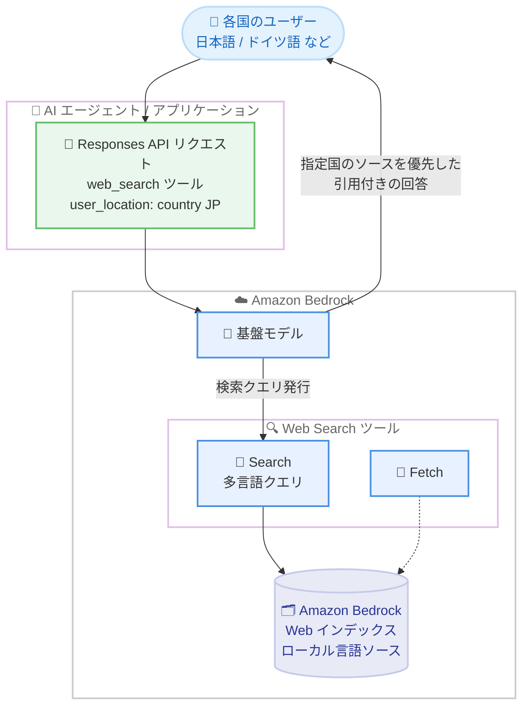

# Amazon Bedrock - Web Search の多言語サポート拡大と国別検索対応

**リリース日**: 2026 年 11 月 21 日
**サービス**: Amazon Bedrock / Amazon Bedrock AgentCore
**機能**: Web Search on Amazon Bedrock の言語サポート拡大と国別検索 country-aware search

📊 [このアップデートのインフォグラフィックを見る](https://takech9203.github.io/aws-news-summary/20261121-web-search-amazon-bedrock.html)

## 概要

Web Search on Amazon Bedrock は、AI エージェントやアプリケーションに引用付きの最新 Web 情報を提供するビルトインツールです。今回のアップデートにより、英語 (米国以外の英語を含む) に加えて、スペイン語、フランス語、ドイツ語、イタリア語、日本語の 5 言語が新たにサポートされました。この言語サポートは Amazon Bedrock AgentCore と Amazon Bedrock の両方で利用できます。

あわせて、検索結果を特定の国のソースに寄せるためのオプションの国指定フィールドが追加されました。開発者は ISO 3166-1 alpha-2 形式の国コード (例: `JP` や `DE`) を渡すことで、ユーザーの実際の所在地や希望する地域に応じた検索結果を取得できます。地域の規制、価格、公的機関の情報など、回答がユーザーの所在国に依存する質問に特に有効です。

既存のお客様は、コードを変更することなく新しい言語機能を自動的に利用できます。料金はすべての言語で同一です。

**アップデート前の課題**

このアップデート以前には、以下のような課題がありました。

- Web Search の検索結果は英語 (米国) のソースが中心で、日本語などローカル言語の情報源に基づく回答を得ることが困難だった
- 検索結果を特定の国に寄せる仕組みがなく、地域の規制や価格など所在国に依存する質問への回答精度に課題があった
- 多言語・多国籍のユーザーに対応するエージェントを構築する際、国ごとの情報の違いを扱いにくかった

**アップデート後の改善**

今回のアップデートにより、以下が可能になりました。

- スペイン語、フランス語、ドイツ語、イタリア語、日本語の 5 言語と米国以外の英語に対応し、各言語のユーザーに対してローカル言語ソースに基づく検索結果を提供できるようになった
- オプションの国指定フィールドに ISO 3166-1 alpha-2 コードを渡すことで、特定の国のソースを優先した検索が可能になった
- 既存のコードを変更せずに新しい言語機能が自動的に有効になり、移行作業が不要になった

## アーキテクチャ図



`user_location` の `country` フィールドに国コードを指定すると、Web Search ツールが指定国のソースを優先して検索し、モデルがローカル言語ソースに基づく引用付きの回答を生成します。検索クエリは呼び出し元リージョン内で処理されます。

## サービスアップデートの詳細

### 主要機能

1. **5 言語の新規サポート**
   - スペイン語、フランス語、ドイツ語、イタリア語、日本語が新たに利用可能
   - 米国以外の英語 (英国英語など) にも対応
   - これらの言語でサービスを提供するエージェントは、ローカル言語の情報源に基づいた検索結果を取得できる
   - Amazon Bedrock AgentCore と Amazon Bedrock の両方で利用可能

2. **国別検索 country-aware search**
   - 新しいオプションの国指定フィールドにより、検索結果を特定の国のソースに寄せることが可能
   - ISO 3166-1 alpha-2 形式の国コード (例: `JP`、`DE`) を指定する
   - 複数の国のユーザーにサービスを提供するエージェントや、地域の規制・価格・公的機関など回答がユーザーの所在地に依存する質問に有効

3. **コード変更不要の自動適用**
   - 既存のお客様は、コードを変更することなく新しい言語機能を自動的に利用できる
   - 料金はすべての言語で同一

## 技術仕様

### user_location パラメータ

開発者ガイドによると、`user_location` は Web Search ツールに位置情報を共有するためのオプションパラメータです。未設定または空の場合、位置は米国がデフォルトになります。

| フィールド | 詳細 |
|------|------|
| `country` | ISO 3166-1 alpha-2 の割り当て済みコード。大文字小文字は区別されない (`de` も `DE` として受理)。`UK` や `XK` など未割り当て・ユーザー割り当てコードは拒否される |
| `region` | 自由形式の文字列として受理 |
| `city` | 自由形式の文字列として受理 |
| `timezone` | IANA タイムゾーン識別子として受理 |

### Web Search ツールの主なパラメータ

| 項目 | 詳細 |
|------|------|
| ツールタイプ | `web_search` (Responses API の `tools` 配列に追加) |
| エンドポイント | `bedrock-mantle` (サーバーサイドツールのため `bedrock-runtime` では利用不可) |
| `search_context_size` | `low` (最大 5 件) / `medium` (最大 11 件、デフォルト) / `high` (最大 25 件) |
| `external_web_access` | `true` (デフォルト) / `false`。`false` に設定すると検索・取得が AWS 境界内で完結する |
| `filters` | `allowed_domains` / `blocked_domains` を各最大 100 件指定可能 |
| IAM アクション | `bedrock-websearch:InvokeSearch`、`bedrock-websearch:InvokeFetch`、`bedrock-websearch:ExternalWebAccess` |

## 設定方法

### 前提条件

1. Amazon Bedrock API キーを取得し、`bedrock-mantle` エンドポイントを利用できること
2. リクエストを実行する IAM アイデンティティに `bedrock-websearch:InvokeSearch` および `bedrock-websearch:InvokeFetch` の権限があること (AmazonBedrockFullAccess ポリシーで付与可能)
3. Web Search がサポートされるモデル (米国の商用リージョンでは OpenAI GPT-5.4 以降) を使用すること

### 手順

#### ステップ 1: 環境変数の設定

```bash
export OPENAI_API_KEY="your-amazon-bedrock-api-key"
export OPENAI_BASE_URL="https://bedrock-mantle.us-west-2.api.aws/openai/v1"
```

Amazon Bedrock の API キーと `bedrock-mantle` エンドポイントの URL を環境変数に設定します。OpenAI SDK がこれらの値を参照してリクエストを送信します。

#### ステップ 2: 国コードを指定して Web Search を呼び出す

```python
from openai import OpenAI

client = OpenAI()

response = client.responses.create(
    model="openai.gpt-5.6-terra",
    input="最新の電気料金の規制動向を教えてください。",
    tools=[{
        "type": "web_search",
        "external_web_access": False,
        "user_location": {
            "type": "approximate",
            "country": "JP",
        },
    }],
)

print(response.output_text)
```

`tools` 配列に `web_search` ツールを追加し、`user_location` の `country` フィールドに ISO 3166-1 alpha-2 コード (この例では日本を示す `JP`) を指定しています。日本語の質問に対して、日本のソースを優先した検索結果に基づく引用付きの回答が生成されます。`external_web_access` を `false` に設定することで、検索・取得を AWS 境界内に保っています。

#### ステップ 3: 引用情報の確認

```python
for item in response.output:
    if item.type == "message":
        for block in item.content:
            if block.type == "output_text":
                for ann in block.annotations:
                    if ann.type == "url_citation":
                        print(f"- {ann.title}: {ann.url}")
```

レスポンスの `url_citation` アノテーションから、回答の根拠となった情報源のタイトルと URL を取得しています。エンドユーザーに回答を表示する際は、これらの引用と出典リンクを保持して表示する必要があります。

## メリット

### ビジネス面

- **グローバル展開の加速**: 日本語を含む多言語ユーザーに対して、ローカル言語ソースに基づく高品質な回答を提供でき、エージェントの対象市場を拡大できる
- **回答の地域適合性向上**: 地域の規制、価格、公的機関など所在国に依存する質問に対して、適切な国のソースに基づく回答を返せる
- **移行コストゼロ**: 既存のコードを変更せずに新しい言語機能が自動的に有効になり、追加料金も発生しない

### 技術面

- **シンプルな国指定**: ISO 3166-1 alpha-2 コードを 1 つ渡すだけで検索結果の国別バイアスを制御できる
- **データレジデンシー対応**: クエリは呼び出し元リージョン内で処理されるため、データ所在地要件への対応に役立つ
- **引用付きのグラウンディング**: 多言語の検索結果でも、回答には出典への引用が付与されるため、信頼性の検証が容易

## デメリット・制約事項

### 制限事項

- Amazon Bedrock 側の Web Search は米国リージョンでの提供であり、利用可能なリージョンが限られる
- Web Search はサーバーサイドツールのため、`bedrock-runtime` エンドポイントの Responses API では利用できず、`bedrock-mantle` エンドポイントの利用が必要
- `country` には ISO 3166-1 alpha-2 の割り当て済みコードのみ指定可能で、`UK` や `XK` などの未割り当て・ユーザー割り当てコードは拒否される

### 考慮すべき点

- `user_location` を設定しない場合、位置のデフォルトは米国になるため、日本のユーザー向けエージェントでは明示的に `country: "JP"` を指定することが望ましい
- `external_web_access` はデフォルトで `true` のため、機密データを扱う場合はデータ流出リスクを避けるために明示的に `false` を設定することが推奨される
- 位置情報がどの程度結果に反映されるかは、モデルと検索サービスの組み合わせに依存する

## ユースケース

### ユースケース 1: 日本語ユーザー向けカスタマーサポートエージェント

**シナリオ**: 日本のエンドユーザー向けに、製品の最新情報や国内の制度・規制について日本語で回答するサポートエージェントを構築する。

**実装例**:
```python
tools=[{
    "type": "web_search",
    "external_web_access": False,
    "user_location": {"type": "approximate", "country": "JP"},
}]
```

**効果**: 日本語の情報源と日本国内のソースを優先した検索結果に基づき、国内の制度や価格に即した引用付きの回答を提供できる。

### ユースケース 2: 複数国対応のマルチリンガルエージェント

**シナリオ**: 欧州の複数国 (ドイツ、フランス、イタリア、スペイン) でサービスを展開しており、ユーザーの所在国に応じて適切な国のソースから回答したい。

**実装例**:
```python
# ユーザープロファイルの所在国に応じて country を動的に設定
country_code = user_profile.country  # 例: "DE", "FR", "IT", "ES"
tools=[{
    "type": "web_search",
    "external_web_access": False,
    "user_location": {"type": "approximate", "country": country_code},
}]
```

**効果**: 1 つのエージェント実装で、各国のユーザーにそれぞれの国・言語のソースを優先した回答を提供でき、国ごとの個別実装が不要になる。

### ユースケース 3: 所在国に依存する質問への正確な回答

**シナリオ**: 地域の規制、現地価格、公的機関の情報など、回答がユーザーの所在国によって異なる質問を扱う情報提供アプリケーションを運用している。

**実装例**:
```python
response = client.responses.create(
    model="openai.gpt-5.6-terra",
    input="現在の消費税率と直近の改定予定を教えてください。",
    tools=[{
        "type": "web_search",
        "external_web_access": False,
        "user_location": {"type": "approximate", "country": "JP"},
    }],
)
```

**効果**: 国コードの指定により、質問内容が同じでもユーザーの所在国に応じた正確な情報を返せるようになり、誤った国の情報を提示するリスクを低減できる。

## 料金

料金はすべての言語で同一です。既存のお客様は追加料金なしで新しい言語機能を利用できます。Web Search の料金の詳細は [Amazon Bedrock 料金ページ](https://aws.amazon.com/bedrock/pricing/) を参照してください。

なお、`search_context_size` を大きく設定すると、モデルへの入力トークンが増加し、関連する推論コストが増える可能性がある点に注意してください。

## 利用可能リージョン

両機能は、Web Search が提供されているすべてのリージョンで利用可能です。

**Amazon Bedrock AgentCore**

- 米国東部 (バージニア北部)
- 米国東部 (オハイオ)
- 米国西部 (オレゴン)
- アジアパシフィック (シドニー)
- アジアパシフィック (東京)
- 欧州 (アイルランド)

**Amazon Bedrock**

- 米国リージョン

クエリは呼び出し元のリージョン内で処理されるため、データレジデンシー要件への対応に役立ちます。

## 関連サービス・機能

- **Amazon Bedrock AgentCore**: AI エージェントの構築・運用基盤。AgentCore のビルトインツールとしても今回の多言語・国別検索機能を利用できる
- **Responses API (bedrock-mantle エンドポイント)**: Web Search ツールを利用するための API。OpenAI SDK 互換のインターフェイスで呼び出せる
- **AWS IAM**: `bedrock-websearch` サービスプレフィックスのアクション (InvokeSearch、InvokeFetch、ExternalWebAccess) により、検索・取得・外部 Web アクセスを制御できる
- **AWS CloudTrail**: Web Search の API アクティビティをデータイベントとして記録し、ツールの呼び出し元や取得元の監査に利用できる

## 参考リンク

- 📊 [インフォグラフィック](https://takech9203.github.io/aws-news-summary/20261121-web-search-amazon-bedrock.html)
- [公式発表 (What's New)](https://aws.amazon.com/about-aws/whats-new/2026/11/web-search-amazon-bedrock/)
- [ドキュメント (Web Search 開発者ガイド)](https://docs.aws.amazon.com/bedrock/latest/userguide/web-search.html)
- [製品ページ (Web Search on Amazon Bedrock)](https://aws.amazon.com/bedrock/grounding/web-search/)
- [料金ページ](https://aws.amazon.com/bedrock/pricing/)

## まとめ

Web Search on Amazon Bedrock が日本語を含む 5 言語と国別検索に対応したことで、日本のユーザー向けエージェントでもローカル言語ソースに基づく引用付きの回答を提供できるようになりました。既存のコードは変更不要で追加料金もないため、多言語ユーザーを抱えるエージェントではまず `user_location` の `country` フィールドに国コードを指定し、回答の地域適合性を確認することを推奨します。
