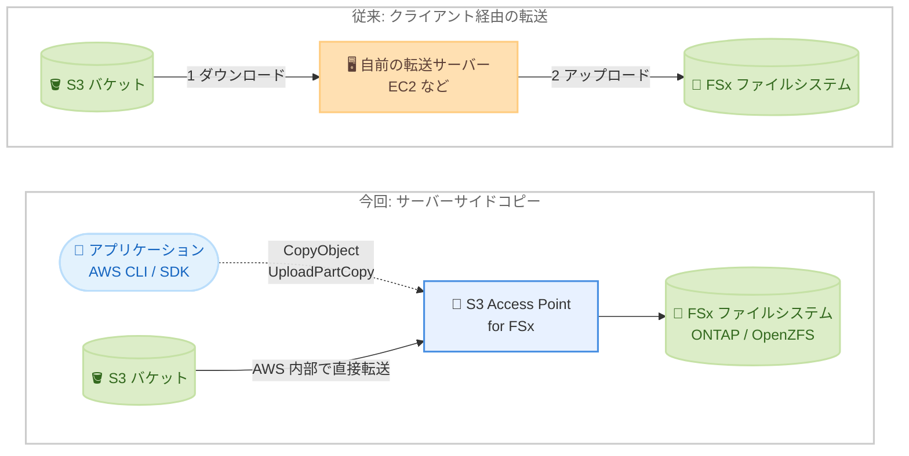

# Amazon S3 / Amazon FSx - S3 Access Points によるサーバーサイドコピー対応

**リリース日**: 2026 年 11 月 22 日
**サービス**: Amazon S3、Amazon FSx (FSx for NetApp ONTAP、FSx for OpenZFS)
**機能**: S3 Access Points を使用した S3 バケットと FSx ファイルシステム間のサーバーサイドコピー

📊 [このアップデートのインフォグラフィックを見る](https://takech9203.github.io/aws-news-summary/20261122-s3-access-points-server-side-copy-fsx.html)

## 概要

Amazon S3 の汎用バケットと Amazon FSx ファイルシステムの間で、S3 Access Points を使用したサーバーサイドコピーおよび移動が可能になりました。同一 AWS リージョン内であれば、S3 標準の `CopyObject` および `UploadPartCopy` オペレーションを使用して、S3 と FSx 間、または FSx ファイルシステム間でデータを直接転送できます。

S3 Access Points for FSx は、FSx ファイルシステムをマウントすることなく、S3 API 経由で FSx 上のデータにアクセスできるエンドポイントです。パートナーから受領したデータを S3 バケットから FSx に取り込む、分析結果を別チームの S3 バケットにエクスポートするといった用途で、サービスやアプリケーションがファイルシステムのデータを S3 オブジェクトとして扱えます。

今回のアップデートにより、データ転送が AWS 側で完結するため、従来よりも高速かつ低コストで、簡単に S3 と FSx 間のデータ移動を実現できます。AWS CLI、AWS SDK、S3 互換ツールから利用可能です。

**アップデート前の課題**

このアップデート以前は、S3 Access Points for FSx はサーバーサイドコピーをサポートしていませんでした。

- S3 バケットと FSx 間でデータを転送するには、ユーザーが運用するサーバー (EC2 インスタンスなど) で各オブジェクトをダウンロードし、再アップロードする必要があった
- 転送用のコンピューティングリソースの準備と運用が必要で、コストと管理負荷が発生していた
- クライアント経由の 2 段階転送のため、大量データの移動に時間がかかっていた

**アップデート後の改善**

今回のアップデートにより、以下が可能になりました。

- `CopyObject` / `UploadPartCopy` オペレーションによる、S3 バケットと FSx ファイルシステム間のサーバーサイドコピー・移動
- FSx ファイルシステム間 (クロスファイルシステム) のデータコピー
- 転送用サーバーが不要になり、より高速・低コスト・シンプルなデータ移動を実現

## アーキテクチャ図



従来はユーザー管理のサーバーを経由した 2 段階転送が必要でしたが、今回のアップデートにより API 呼び出しのみでデータ転送が AWS 内部で完結します。

## サービスアップデートの詳細

### 主要機能

1. **S3 バケットと FSx 間のサーバーサイドコピー**
   - 同一 AWS リージョン内の S3 汎用バケットと FSx ファイルシステム間でデータを直接コピー・移動できる
   - S3 標準の `CopyObject` および `UploadPartCopy` オペレーションをそのまま使用できる
   - データがクライアントを経由しないため、転送が高速かつ低コスト

2. **FSx ファイルシステム間のコピー**
   - S3 Access Points を介して、FSx ファイルシステム間でもサーバーサイドでデータを転送できる
   - ファイルシステムの移行やチーム間のデータ共有に活用できる

3. **既存ツールとの互換性**
   - AWS CLI、AWS SDK、S3 互換ツールから利用可能
   - S3 の標準 API を使用するため、既存の S3 向けワークフローやスクリプトを流用できる

## 技術仕様

### 対応構成

| 項目 | 詳細 |
|------|------|
| 対応 FSx ファイルシステム | Amazon FSx for NetApp ONTAP、Amazon FSx for OpenZFS |
| 対応 S3 バケット | S3 汎用バケット |
| 対応オペレーション | `CopyObject`、`UploadPartCopy` |
| コピー方向 | S3 → FSx、FSx → S3、FSx → FSx |
| リージョン条件 | コピー元とコピー先が同一 AWS リージョン内であること |
| アクセス方法 | S3 Access Point for FSx 経由 |

## 設定方法

### 前提条件

1. Amazon FSx for NetApp ONTAP または FSx for OpenZFS のファイルシステムが作成済みであること
2. FSx ファイルシステムに S3 Access Point がアタッチされていること
3. コピー元・コピー先に対する適切な IAM 権限 (s3:GetObject、s3:PutObject など) が設定されていること

### 手順

#### ステップ1: FSx ファイルシステムに S3 Access Point を作成

```bash
aws s3control create-access-point \
  --account-id 111122223333 \
  --name my-fsx-access-point \
  --bucket arn:aws:fsx:ap-northeast-1:111122223333:volume/fs-0123456789abcdef0/fsvol-0123456789abcdef0
```

FSx ボリュームを指定して S3 Access Point を作成します。これにより、FSx 上のデータに S3 API でアクセスできるエンドポイントが用意されます (既にアタッチ済みの場合はこのステップは不要です)。

#### ステップ2: S3 バケットから FSx へサーバーサイドコピー

```bash
aws s3api copy-object \
  --copy-source my-source-bucket/data/input.csv \
  --bucket arn:aws:s3:ap-northeast-1:111122223333:accesspoint/my-fsx-access-point \
  --key data/input.csv
```

`CopyObject` オペレーションで、S3 バケット上のオブジェクトを S3 Access Point 経由で FSx ファイルシステムに直接コピーします。データはクライアントを経由せず、AWS 内部で転送されます。

#### ステップ3: 大容量オブジェクトのマルチパートコピー

```bash
aws s3api upload-part-copy \
  --copy-source my-source-bucket/data/large-file.bin \
  --bucket arn:aws:s3:ap-northeast-1:111122223333:accesspoint/my-fsx-access-point \
  --key data/large-file.bin \
  --part-number 1 \
  --upload-id "example-upload-id" \
  --copy-source-range bytes=0-5368709119
```

大容量オブジェクトの場合は、マルチパートアップロードと `UploadPartCopy` を組み合わせて、パート単位でサーバーサイドコピーを実行します。

## メリット

### ビジネス面

- **コスト削減**: 転送専用のサーバー (EC2 インスタンスなど) の運用が不要になり、コンピューティングコストと運用負荷を削減できる
- **時間短縮**: AWS 内部でデータ転送が完結するため、ダウンロード・アップロードの 2 段階転送と比較して転送時間を短縮できる
- **データ活用の促進**: S3 バケットと FSx 間のデータ移動が容易になり、パートナーデータの取り込みや部門間のデータ共有がスムーズになる

### 技術面

- **標準 API の利用**: S3 の標準オペレーションである `CopyObject` / `UploadPartCopy` を使用するため、既存のツールやスクリプトをそのまま活用できる
- **アーキテクチャの簡素化**: 転送用の中間サーバーが不要になり、障害点が減少し運用がシンプルになる
- **ファイルシステムのマウント不要**: S3 API 経由でアクセスするため、NFS 等でのマウント設定なしにデータ転送を実行できる

## デメリット・制約事項

### 制限事項

- サーバーサイドコピーは同一 AWS リージョン内の転送に限定される
- 対応する FSx ファイルシステムは FSx for NetApp ONTAP と FSx for OpenZFS のみ (FSx for Windows File Server、FSx for Lustre は対象外)
- S3 Access Points for FSx が利用可能なリージョンでのみ使用できる

### 考慮すべき点

- FSx 側のファイルシステムの性能 (スループット容量) がコピー速度に影響する可能性があるため、大量データ転送時はファイルシステムの性能設定を確認する
- コピー元・コピー先の双方に対する IAM 権限と Access Point ポリシーの設計が必要
- クロスリージョンの転送が必要な場合は、従来どおり別の転送手段 (AWS DataSync など) を検討する

## ユースケース

### ユースケース1: パートナーデータの FSx への取り込み

**シナリオ**: パートナー企業から S3 バケット経由で受領したデータを、社内の分析基盤が利用する FSx for NetApp ONTAP ファイルシステムに取り込みたい。

**実装例**:
```bash
aws s3 cp s3://partner-delivery-bucket/dataset/ \
  s3://arn:aws:s3:ap-northeast-1:111122223333:accesspoint/analytics-fsx-ap/dataset/ \
  --recursive
```

**効果**: 転送用サーバーを経由せずにデータを直接取り込めるため、取り込み時間とコストを削減し、パイプラインを簡素化できる。

### ユースケース2: 分析結果の S3 バケットへのエクスポート

**シナリオ**: FSx for OpenZFS 上で生成された分析結果やレポートを、別チームが利用する S3 バケットに共有したい。

**実装例**:
```bash
aws s3api copy-object \
  --copy-source "arn:aws:s3:ap-northeast-1:111122223333:accesspoint/results-fsx-ap/object/reports/monthly.parquet" \
  --bucket team-b-shared-bucket \
  --key reports/monthly.parquet
```

**効果**: ファイルシステムをマウントすることなく、S3 API のみで成果物を他チームに共有でき、データ連携のリードタイムを短縮できる。

### ユースケース3: FSx ファイルシステム間のデータ移行

**シナリオ**: 既存の FSx ファイルシステムから新しい FSx ファイルシステムへ、特定ディレクトリのデータを移行したい。

**実装例**:
```bash
aws s3 cp \
  s3://arn:aws:s3:ap-northeast-1:111122223333:accesspoint/old-fsx-ap/project-a/ \
  s3://arn:aws:s3:ap-northeast-1:111122223333:accesspoint/new-fsx-ap/project-a/ \
  --recursive
```

**効果**: 中間サーバーやステージング用バケットを用意することなく、ファイルシステム間でデータを直接移動できる。

## 料金

公式発表には本機能固有の料金は記載されていませんが、従来のようにダウンロード・アップロード用のサーバーを運用する必要がなくなるため、転送にかかる時間・コスト・手間を削減できるとされています。S3 API リクエストおよび FSx の利用には、それぞれの標準料金が適用されます。詳細は [Amazon S3 料金ページ](https://aws.amazon.com/s3/pricing/) および [Amazon FSx 料金ページ](https://aws.amazon.com/fsx/pricing/) を確認してください。

## 利用可能リージョン

S3 Access Points for FSx が利用可能なすべての AWS リージョンで利用できます。

## 関連サービス・機能

- **Amazon S3 Access Points**: バケットやファイルシステムへのアクセスをアプリケーション単位で管理するエンドポイント機能。本アップデートの基盤となる機能
- **Amazon FSx for NetApp ONTAP**: NetApp ONTAP ベースのフルマネージドファイルストレージ。本機能の対応ファイルシステム
- **Amazon FSx for OpenZFS**: OpenZFS ベースのフルマネージドファイルストレージ。本機能の対応ファイルシステム
- **AWS DataSync**: クロスリージョン転送や大規模なデータ移行が必要な場合の代替手段

## 参考リンク

- 📊 [インフォグラフィック](https://takech9203.github.io/aws-news-summary/20261122-s3-access-points-server-side-copy-fsx.html)
- [公式発表 (What's New)](https://aws.amazon.com/about-aws/whats-new/2026/11/s3-access-points-server-side-copy-fsx/)
- [AWS Blog: Amazon FSx for OpenZFS now supports Amazon S3 access without any data movement](https://aws.amazon.com/blogs/aws/amazon-fsx-for-openzfs-now-supports-amazon-s3-access-without-any-data-movement/) (S3 Access Points for FSx の基盤機能の紹介記事)
- [ドキュメント: Accessing data via S3 Access Points (FSx for NetApp ONTAP)](https://docs.aws.amazon.com/fsx/latest/ONTAPGuide/accessing-data-via-s3-access-points.html)
- [ドキュメント: S3 Access Points for FSx (FSx for OpenZFS)](https://docs.aws.amazon.com/fsx/latest/OpenZFSGuide/s3accesspoints-for-FSx.html)
- [S3 Access Points 機能ページ](https://aws.amazon.com/s3/features/access-points/)

## まとめ

S3 Access Points for FSx がサーバーサイドコピーに対応したことで、S3 バケットと FSx ファイルシステム間のデータ移動から転送用サーバーが不要になり、高速・低コスト・シンプルなデータ連携が実現しました。S3 と FSx を併用してデータパイプラインを構築している場合は、既存の転送処理を `CopyObject` / `UploadPartCopy` ベースのサーバーサイドコピーに置き換えることを検討してください。
