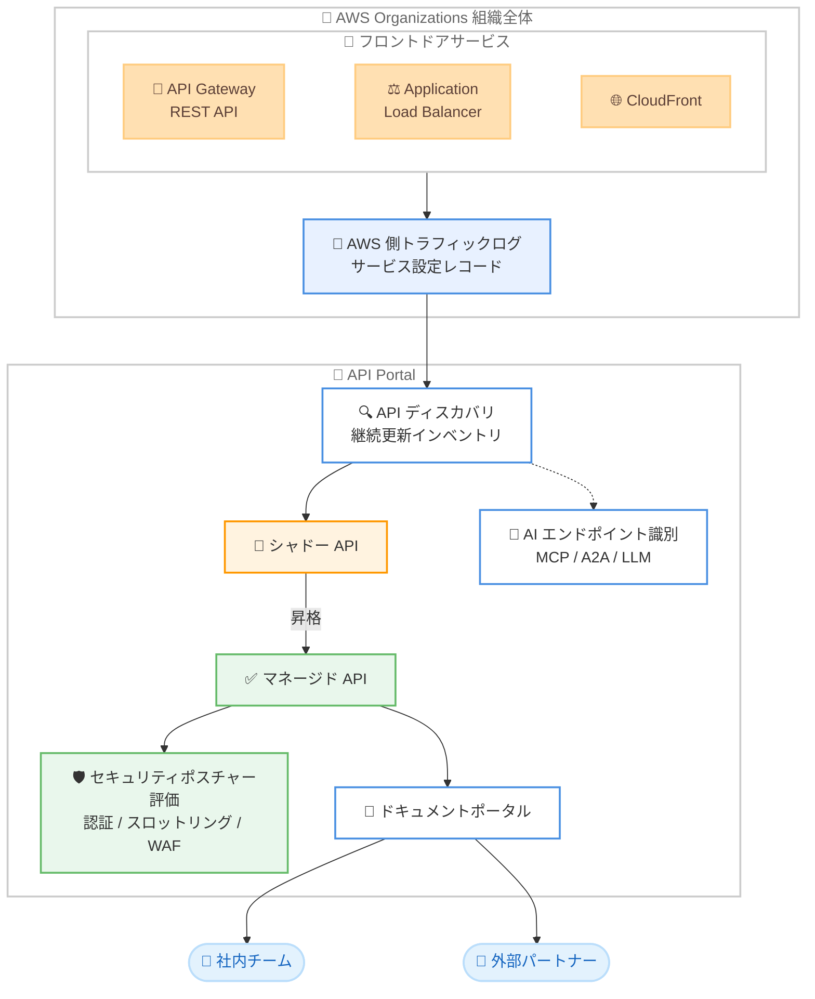

# Amazon API Gateway - API Portal

**リリース日**: 2026 年 11 月 23 日
**サービス**: Amazon API Gateway
**機能**: API Portal

📊 [このアップデートのインフォグラフィックを見る](https://takech9203.github.io/aws-news-summary/20261123-amazon-api-gateway-announces-api-portal.html)

## 概要

Amazon API Gateway の新機能である API Portal が発表されました。API Portal は、単一の AWS アカウントまたは AWS Organizations の組織全体を対象に、Amazon API Gateway、Application Load Balancer (ALB)、Amazon CloudFront の背後で稼働する API と AI エンドポイントを検出 (ディスカバリ) し、ガバナンスとドキュメント化を一元的に実現する機能です。

多くの組織では、どの API が稼働しているのか、未登録のまま放置された API や保護されていない API が存在しないか、といった可視性の課題を抱えています。API Portal は AWS 側のトラフィックログとサービス設定レコードから継続的に更新されるインベントリを構築するため、エージェントのインストール、ログの転送、トラフィック経路の変更は一切不要です。検出は読み取り専用で、既存の API に変更を加えることはありません。

さらに、MCP サーバー、A2A サーバー、LLM エンドポイントといった AI 向けエンドポイントをトラフィックのプロトコルから識別できるため、生成 AI 時代の API ガバナンスにも対応します。API ガバナンスを担うプラットフォームチーム、セキュリティチーム、API を公開する開発チームが主な対象ユーザーです。

**アップデート前の課題**

- 組織全体でどの API が稼働しているかを把握するには、各チームへのヒアリングや手動でのカタログ登録が必要で、未登録のシャドー API や放置された API を見落とすリスクがあった
- API の棚卸しのために、サードパーティツールのインストール、ログ転送基盤の構築、プロキシ経由へのトラフィック経路変更などの追加作業が必要だった
- MCP サーバーや LLM エンドポイントなどの AI 向けエンドポイントを体系的に識別・管理する仕組みがなかった
- API ごとの認証、スロットリング、AWS WAF 保護といったセキュリティ対策の適用状況を横断的に確認する手段がなかった

**アップデート後の改善**

- AWS 側のトラフィックログとサービス設定レコードから、組織全体の API インベントリが自動的かつ継続的に構築されるようになった
- インストール、ログ転送、トラフィック経路変更が不要になり、有効化するだけで検出が開始されるようになった
- MCP サーバー、A2A サーバー、LLM エンドポイントを含む AI 向けエンドポイントをインベントリ上で識別できるようになった
- マネージド API に対して認証、リクエスト検証、スロットリング、TLS バージョン、AWS WAF 保護などのセキュリティポスチャー評価が可能になり、AWS WAF API Security と組み合わせると検出された脅威も API 単位で確認できるようになった
- マネージド API を製品単位でグループ化し、社内チームや外部パートナー向けのドキュメントポータルとして公開できるようになった

## アーキテクチャ図



API Portal は、API Gateway、ALB、CloudFront の AWS 側トラフィックログとサービス設定レコードから API インベントリを継続的に構築します。検出された API はシャドー API として登録され、昇格したマネージド API に対してセキュリティポスチャー評価とドキュメントポータルへの公開が可能になります。

## サービスアップデートの詳細

### 主要機能

1. **API ディスカバリ**
   - API Gateway REST API、ALB、CloudFront の背後にあるすべての API のインベントリを構築し、継続的に更新する
   - カタログに未登録のままトラフィックを受けている API も検出できる
   - AWS 側のトラフィックログとサービス設定レコードを情報源とするため、インストール、ログ転送、トラフィック経路変更は不要
   - 検出は読み取り専用で、既存の API リソースを変更しない

2. **分類とガバナンス**
   - 検出されたすべての API は、まず「シャドー API」として扱われる
   - ガバナンス対象としたい API を「マネージド API」に昇格できる
   - マネージド API がトラフィックを受けなくなった場合 (ゾンビ API) や、所有者が不在になった場合 (オーファン API) にフラグを立てる
   - API をパブリック / プライベートとしてラベル付けできる

3. **AI エンドポイント識別**
   - MCP サーバー、A2A サーバー、LLM バックエンドの API といった AI 向けエンドポイントを、トラフィックで観測されたプロトコルから任意で識別できる
   - 生成 AI エージェントやツールの増加に伴う「見えない AI エンドポイント」の把握に有効

4. **セキュリティポスチャー評価**
   - マネージド API を認証、リクエスト検証、スロットリング、TLS バージョン、AWS WAF 保護などのベストプラクティスに照らして評価し、所見をレポートする
   - API の前段の Web ACL で AWS WAF API Security を使用している場合、AWS WAF が検出したセキュリティイベント (脅威) をマネージド API 単位で表示する

5. **ドキュメントポータル**
   - マネージド API を製品 (Product) としてグループ化し、API 定義から生成されるリファレンスページと独自ドキュメントを組み合わせて公開できる
   - 社内チーム向け、外部パートナー向けのいずれにも対応
   - カスタムブランディング、Amazon Cognito によるアクセス制御、インタラクティブな「Try it」ページをサポート
   - 既存の API Gateway Portals は従来どおり動作し、API Gateway コンソールの Documentation Portals セクションから管理する

### API Portal における API の定義

API Portal は、フロントドアリソース上の「HTTP メソッド + URI パス」の組み合わせ (例: `GET /v1/payments`) を 1 つの API として定義します。API Gateway の `RestApi` リソースとは異なる粒度であり、API Gateway、ALB、CloudFront の API を同じ形式で表現し、OpenAPI Specification と整合させるための設計です。そのため、1 つの `RestApi` はインベントリ上では複数の行 (メソッドとパスごと) として表示されるのが一般的です。

### 検出の仕組み

| ソースサービス | 検出方法 | 備考 |
|------|------|------|
| API Gateway | 設定 (AWS Config 設定項目) とトラフィックの両方 | REST API のみ対象。明示的なメソッドとリテラルパスはトラフィックがなくても検出される |
| Application Load Balancer | 観測されたトラフィックのみ | リクエストを受けていないエンドポイントはインベントリに表示されない |
| CloudFront | 観測されたトラフィックのみ | グローバルサービスのため、us-east-1 リージョンでのみ検出される |

検出は継続的に実行されますが即時ではなく、新しい API は通常数時間以内に表示されます。アカウントまたは組織で検出を初めて有効化した場合は、最大 24 時間を見込む必要があります。

## 技術仕様

### API 変更履歴

| 日付 | サービス | 変更内容 |
|------|----------|----------|
| 2026/11/20 | [APIPortal](https://awsapichanges.com/archive/changes/e9d2b3-apiportal.html) | 46 new api methods - API Portal のサポートを追加。API Gateway、ALB、CloudFront の背後にある API の検出、セキュリティポスチャー評価、ドキュメントポータルの公開に対応 |

### サービスリンクロールと AWS Config レコーダー

API Portal は、サービスリンクロール `AWSServiceRoleForAPIPortal` を使用して AWS Organizations の階層を読み取り、検出に使用する AWS Config 設定レコーダーを管理します。検出を有効化すると、API Portal がこのロールをアカウントに自動作成します。組織全体の検出では、管理アカウントにこのロールが存在する必要があります。

検出により、検出が実行される各アカウント・各リージョンに API Portal 用のサービスリンク AWS Config 設定レコーダーが作成されます。このレコーダーは検出に必要なリソースタイプのみを記録し、AWS Config の料金は発生しません。

## 設定方法

### 前提条件

1. AWS アカウントと、API Portal 用の IAM 権限 (サービスプレフィックス `apiportal`) があること。検出の有効化前に API が稼働している必要はなく、API が見つかり次第インベントリに追加される
2. 組織全体の検出を行う場合: AWS Organizations の管理アカウント、または登録済みの委任管理者アカウントでサインインし、API Portal の信頼されたアクセス (trusted access) が有効であること
3. サインインを必要とするドキュメントポータルを公開する場合: アプリクライアントとユーザープールドメインを持つ Amazon Cognito ユーザープール。製品単位の細かいアクセス制御を行う場合は ID プールも必要
4. ドキュメントポータルでカスタムドメイン名を使用する場合: us-east-1 リージョンの ACM 証明書

### 手順

#### ステップ 1: API ディスカバリの有効化

API Gateway コンソールの API Portal セクションから検出を有効化します。単一アカウントで有効化する方法と、管理アカウントまたは委任管理者アカウントから組織全体で一括有効化する方法があります。組織全体で有効化すれば、各アカウントで個別に設定する必要はありません。有効化時にサービスリンクロール `AWSServiceRoleForAPIPortal` と AWS Config 設定レコーダーが自動作成されます。

#### ステップ 2: インベントリの確認とマネージド API への昇格

検出された API はインベントリにシャドー API として表示されます (初回有効化後は最大 24 時間を見込む)。ガバナンス対象としたい API を選択してマネージド API に昇格します。昇格しても、基盤となる API Gateway、ALB、CloudFront のリソースは変更されません。必要に応じて AI エンドポイント識別を有効化し、MCP サーバーや LLM エンドポイントを確認します。

#### ステップ 3: セキュリティポスチャーの確認

マネージド API ごとに、認証、リクエスト検証、スロットリング、TLS バージョン、AWS WAF 保護などの評価結果と所見を確認します。AWS WAF API Security を Web ACL で使用している場合は、検出された脅威も API 単位で確認できます。所見に基づいて、オーソライザーの追加や AWS WAF の適用などの改善を実施します。

#### ステップ 4: ドキュメントポータルの公開

マネージド API を製品としてグループ化し、API 定義から生成されるリファレンスページと独自のドキュメントページを組み合わせて、ドキュメントポータルとして公開します。必要に応じてカスタムブランディング、Amazon Cognito によるアクセス制御、カスタムドメインを設定します。製品、ページ、ポータル設定の変更は、ポータルを公開 (Publish) した時点で反映されます。

## メリット

### ビジネス面

- **API 資産の完全な可視化**: 組織全体のシャドー API を含む API 資産を自動的に把握でき、ガバナンスやコンプライアンス対応の土台となる
- **導入コストの低さ**: インストール、ログ転送、トラフィック経路変更が不要なため、既存システムへの影響なく短期間で導入できる
- **API エコシステムの促進**: ドキュメントポータルにより、社内チームや外部パートナーへの API 公開とオンボーディングが容易になる

### 技術面

- **継続的なインベントリ更新**: AWS 側のトラフィックログと設定レコードに基づき、インベントリが自動的に最新状態に保たれる
- **AI エンドポイントへの対応**: MCP サーバー、A2A サーバー、LLM エンドポイントをプロトコルベースで識別でき、生成 AI 時代のガバナンスに対応できる
- **セキュリティ運用との統合**: セキュリティポスチャー評価と AWS WAF API Security の脅威情報を API 単位で一元的に確認でき、リスクの高い API から優先的に対処できる
- **読み取り専用の安全な検出**: 検出もマネージド API への昇格も既存リソースを変更しないため、本番環境に安心して適用できる

## デメリット・制約事項

### 制限事項

- API Gateway については REST API のみが検出対象であり、HTTP API と WebSocket API は検出されず、ドキュメントポータルにも追加できない
- API Gateway REST API の設定ベース検出は、リテラルパス上の明示的なメソッドのみが対象。`ANY` メソッドや `/{proxy+}` のようなグリーディパスは設定からは検出されず、実際にトラフィックを受けた具体的なメソッドとパスとして初めて表示される
- ALB と CloudFront の API はトラフィックのみから検出されるため、トラフィックがほとんどないエンドポイントはインベントリに表示されない
- CloudFront はグローバルサービスのため、CloudFront を前段とする API は us-east-1 リージョンでのみ検出される
- API Gateway Portals と API Portal のドキュメントポータルは別リソースであり、ローンチ時点で両者間の移行機能はない

### 考慮すべき点

- 検出は即時ではなく、新しい API の表示まで数時間、初回有効化後は最大 24 時間かかる場合がある
- API を削除またはトラフィックを停止しても、インベントリの行は約 30 日間残る。検出設定を削除してもインベントリ行が早く消えるわけではない
- 1 つの API が複数のフロントドア (例: CloudFront の背後の API Gateway REST API) から到達可能な場合、フロントドアごとに 1 行ずつ表示される
- 組織全体の検出には AWS Organizations の管理アカウントまたは委任管理者アカウントでの操作と信頼されたアクセスの有効化が必要なため、組織管理者との調整が必要

## ユースケース

### ユースケース 1: 組織全体のシャドー API の棚卸し

**シナリオ**: 複数の事業部がそれぞれ AWS アカウントで API を運用しており、全社でどの API が稼働しているか誰も正確に把握できていない。セキュリティ監査で API の棚卸しが求められている。

**実装例**:
```text
1. 管理アカウントで API Portal の信頼されたアクセスを有効化
2. 委任管理者アカウントから組織全体の API ディスカバリを有効化
3. 最大 24 時間後、インベントリで全アカウントのシャドー API を確認
4. 所有チームを特定し、ガバナンス対象の API をマネージド API に昇格
```

**効果**: エージェント導入やログ転送の構築なしに、組織全体の API 資産を網羅的に把握でき、未登録 API や放置された API のリスクを早期に発見できる。

### ユースケース 2: AI エンドポイントのガバナンス

**シナリオ**: 社内の各チームが MCP サーバーや LLM を利用した API を次々に構築しており、セキュリティチームがどこにどのような AI エンドポイントが存在するかを把握できていない。

**実装例**:
```text
1. API Portal で AI エンドポイント識別を有効化
2. インベントリで MCP サーバー、A2A サーバー、LLM エンドポイントを確認
3. 対象をマネージド API に昇格し、認証や AWS WAF 保護の有無を評価
4. AWS WAF API Security を併用し、検出された脅威を API 単位で監視
```

**効果**: 生成 AI 関連のエンドポイントを体系的に可視化し、認証や WAF 保護が不足している AI エンドポイントへ優先的に対策を講じられる。

### ユースケース 3: パートナー向け API ドキュメントポータルの公開

**シナリオ**: 外部パートナーに提供している API のドキュメントを手動で管理しており、仕様変更のたびに更新漏れが発生している。パートナーのオンボーディングにも時間がかかっている。

**実装例**:
```text
1. パートナー向けのマネージド API を製品としてグループ化
2. API 定義から生成されるリファレンスページに独自ドキュメントを追加
3. Amazon Cognito ユーザープールでアクセス制御を設定
4. カスタムブランディングとカスタムドメインを設定してポータルを公開
```

**効果**: API 定義に基づく正確なリファレンスとインタラクティブな「Try it」ページにより、パートナーのオンボーディングを迅速化し、ドキュメントの更新漏れを防止できる。

## 料金

API Portal の料金は「ディスカバリ」と「ドキュメントポータル」の 2 つで構成され、1 つの API が両方で二重に課金されることはありません。月額料金は日割りで計算されます。以下は米国東部 (バージニア北部) リージョンの料金例に基づく概算です。最新の料金は [API Gateway 料金ページ](https://aws.amazon.com/api-gateway/pricing/) を参照してください。

### 料金例

| 項目 | 月額料金 (概算、us-east-1) |
|--------|------------------|
| ディスカバリ最低料金 (リージョンごと、検出 API 400 件まで含む) | 40.00 USD |
| 追加の検出 API (400 件超過分、1 API あたり) | 0.10 USD |
| ドキュメントポータル (1 ポータルあたり、公開 API 400 件まで含む) | 125.00 USD |
| ポータルでの追加公開 API (400 件超過分、1 API あたり) | 0.30 USD |

なお、既存の API Gateway Portals は従来の料金体系のまま継続して利用できます。

## 利用可能リージョン

以下の 32 の AWS リージョンで利用可能です。

アフリカ (ケープタウン)、アジアパシフィック (香港)、アジアパシフィック (ハイデラバード)、アジアパシフィック (ジャカルタ)、アジアパシフィック (マレーシア)、アジアパシフィック (メルボルン)、アジアパシフィック (ムンバイ)、アジアパシフィック (ニュージーランド)、アジアパシフィック (大阪)、アジアパシフィック (ソウル)、アジアパシフィック (シンガポール)、アジアパシフィック (シドニー)、アジアパシフィック (台北)、アジアパシフィック (タイ)、アジアパシフィック (東京)、カナダ (中部)、カナダ西部 (カルガリー)、欧州 (フランクフルト)、欧州 (アイルランド)、欧州 (ロンドン)、欧州 (ミラノ)、欧州 (パリ)、欧州 (スペイン)、欧州 (ストックホルム)、欧州 (チューリッヒ)、イスラエル (テルアビブ)、メキシコ (中部)、南米 (サンパウロ)、米国東部 (バージニア北部)、米国東部 (オハイオ)、米国西部 (北カリフォルニア)、米国西部 (オレゴン)

東京リージョンと大阪リージョンの両方で利用可能です。API Portal のリソースはリージョナルであり、CloudFront を前段とする API は us-east-1 リージョンでのみ検出されます。

## 関連サービス・機能

- **AWS WAF API Security**: API の前段の Web ACL で有効化すると、AWS WAF が検出した脅威を API Portal のマネージド API 単位で確認できる
- **AWS Organizations**: 組織全体の API 検出に使用。管理アカウントまたは委任管理者アカウントから一括で検出を有効化できる
- **AWS Config**: 検出用のサービスリンク設定レコーダーが各アカウント・リージョンに自動作成される。必要なリソースタイプのみを記録し、AWS Config の料金は発生しない
- **Amazon Cognito**: ドキュメントポータルのサインインと、製品単位の細かいアクセス制御に使用
- **AWS Certificate Manager**: ドキュメントポータルのカスタムドメイン名に使用 (証明書は us-east-1 リージョンに必要)

## 参考リンク

- 📊 [インフォグラフィック](https://takech9203.github.io/aws-news-summary/20261123-amazon-api-gateway-announces-api-portal.html)
- [公式発表 (What's New)](https://aws.amazon.com/about-aws/whats-new/2026/11/amazon-api-gateway-announces-api-portal/)
- [AWS Blog: Introducing API and AI security on AWS, from discovery to protection](https://aws.amazon.com/blogs/security/introducing-api-and-ai-security-on-aws-from-discovery-to-protection/)
- [ドキュメント: API Portal in API Gateway](https://docs.aws.amazon.com/apigateway/latest/developerguide/apiportal.html)
- [ドキュメント: AWS WAF API Security](https://docs.aws.amazon.com/waf/latest/developerguide/waf-api-security.html)
- [料金ページ](https://aws.amazon.com/api-gateway/pricing/)

## まとめ

API Portal は、組織全体の API と AI エンドポイントを「インストール不要・経路変更不要」で可視化し、シャドー API の発見からセキュリティポスチャー評価、ドキュメント公開までを一元化する、API ガバナンスの基盤となる機能です。複数アカウントで API を運用している組織や、MCP サーバーなどの AI エンドポイントが増えている組織は、まず検出を有効化してインベントリを確認し、重要な API をマネージド API に昇格してセキュリティ所見のレビューから始めることを推奨します。
