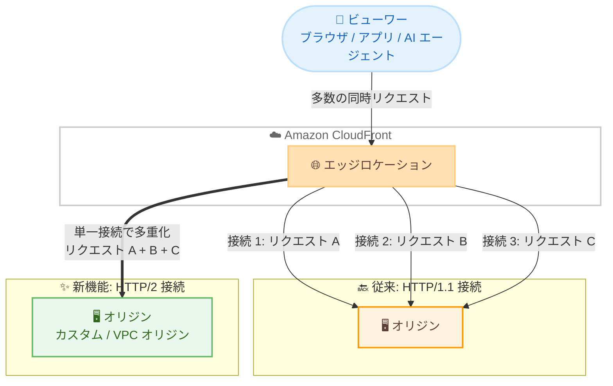

# Amazon CloudFront - オリジンへの接続における HTTP/2 サポート

**リリース日**: 2026 年 11 月 23 日
**サービス**: Amazon CloudFront
**機能**: オリジン接続の HTTP/2 サポート (Origin HTTP version)

📊 [このアップデートのインフォグラフィックを見る](https://takech9203.github.io/aws-news-summary/20261123-amazon-cloudfront-http2-origins.html)

## 概要

Amazon CloudFront が、カスタムオリジンおよび VPC オリジンへの接続において HTTP/2 をサポートしました。これまで CloudFront とオリジン間の接続は HTTP/1.1 のみで、1 つの接続で同時に処理できるリクエストは 1 つに限られていました。今回のアップデートにより、HTTP/2 の多重化 (マルチプレキシング) を利用して、より少ない接続数で多数のリクエストをオリジンに送信できるようになります。

この機能は、オリジンが処理する接続数と TLS ハンドシェイク数を削減するため、バックエンド API を呼び出すモバイル / Web アプリケーションや、MCP サーバーを呼び出す AI エージェントのような API 中心のワークロードで特に効果を発揮します。トラフィックスパイク時にも既存の共有接続上でリクエストを処理できるため、新規接続確立に伴うレイテンシーを回避し、応答時間の短縮とオリジン負荷の軽減につながります。また、extended CONNECT をサポートするオリジンに対しては、HTTP/2 経由の WebSocket 接続もサポートされます。

オリジン側の変更は不要です。オリジンが HTTP/2 をサポートしていない場合、CloudFront は自動的に HTTP/1.1 にフォールバックします。

**アップデート前の課題**

このアップデート以前は、オリジン接続に関して以下の制約がありました。

- CloudFront からオリジンへの接続は HTTP/1.1 のみで、1 接続あたり同時に 1 リクエストしか処理できなかった
- 多数の同時リクエストが発生すると、その分だけオリジンへの接続数と TLS ハンドシェイク数が増加し、オリジンの負荷が高くなっていた
- トラフィックスパイク時には新規接続の確立に伴うレイテンシーが発生し、応答時間が悪化する要因となっていた

**アップデート後の改善**

今回のアップデートにより、以下が可能になりました。

- HTTP/2 の多重化により、少ない接続数で多数のリクエストをオリジンに送信できるようになった
- オリジンが処理する接続数と TLS ハンドシェイク数が削減され、オリジンのリソース消費が軽減された
- スパイク時にも既存接続を再利用できるため、接続確立のレイテンシーを回避し応答が高速化された
- extended CONNECT をサポートするオリジンに対して、HTTP/2 経由の WebSocket 接続が利用可能になった

## アーキテクチャ図



従来の HTTP/1.1 ではリクエストごとに個別の接続が必要でしたが、HTTP/2 では単一の接続上で複数のリクエストを多重化できるため、オリジンが処理する接続数と TLS ハンドシェイク数が削減されます。

## サービスアップデートの詳細

### 主要機能

1. **オリジン接続の HTTP/2 多重化**
   - カスタムオリジンおよび VPC オリジンへの接続で HTTP/2 を選択可能
   - 同一接続上で複数のリクエストを並行して送信でき、接続数と TLS ハンドシェイク数を削減
   - オリジンの CPU / メモリ消費の軽減と、スパイク時の応答高速化に寄与

2. **自動フォールバック**
   - CloudFront は TLS 接続確立時 (ALPN) に HTTP/2 をオリジンに提示
   - オリジンが HTTP/2 を受け入れない場合は自動的に HTTP/1.1 を使用
   - オリジン側の事前変更なしで安全に有効化できる

3. **HTTP/2 経由の WebSocket サポート**
   - extended CONNECT をサポートするオリジンに対して、HTTP/2 接続上で WebSocket を利用可能
   - リアルタイム通信を行うアプリケーションでも接続集約の恩恵を受けられる

## 技術仕様

### Origin HTTP version 設定

| 項目 | 詳細 |
|------|------|
| 設定名 | Origin HTTP version (API: `OriginHttpVersion`) |
| 設定対象 | カスタムオリジン、VPC オリジン (`CustomOriginConfig` / `VpcOriginConfig`) |
| 有効な値 | `http1.1` (デフォルト)、`http2` |
| プロトコル要件 | HTTPS 接続のみで HTTP/2 を使用 |
| TLS 要件 | オリジンの最小 SSL プロトコルが TLSv1.2 以上であること |
| フォールバック | オリジンが HTTP/2 非対応の場合は HTTP/1.1 を自動使用 |
| VPC オリジンの扱い | HTTP バージョンはディストリビューション側で指定 (同じ VPC オリジンを使う複数ディストリビューションで異なるバージョンを設定可能) |

### HTTP/2 が使用されず HTTP/1.1 になるケース

`http2` を選択していても、以下の場合は HTTP/1.1 が使用されます。

- オリジンの Protocol 設定が **HTTP only** の場合
- Protocol 設定が **Match viewer** で、ビューワーリクエストが HTTP の場合
- 最小オリジン SSL プロトコルが TLSv1.2 より古い場合 (`OriginSslProtocols` に `SSLv3`、`TLSv1`、`TLSv1.1` が含まれる場合)
- キャッシュビヘイビアにオリジンリクエスト / オリジンレスポンスイベントの Lambda@Edge 関数がある場合 (HTTP/1.1 が使用されることがある)

### API 変更履歴

| 日付 | サービス | 変更内容 |
|------|----------|----------|
| 2026/11/20 | [cloudfront](https://awsapichanges.com/archive/changes/e9d2b3-cloudfront.html) | 14 updated api methods - カスタムオリジンと VPC オリジンへの HTTP/2 接続サポートを追加。extended CONNECT をサポートする HTTP/2 オリジンへの WebSocket 接続を含む |

### 設定例 (CustomOriginConfig)

```json
{
  "CustomOriginConfig": {
    "HTTPPort": 80,
    "HTTPSPort": 443,
    "OriginProtocolPolicy": "https-only",
    "OriginSslProtocols": {
      "Quantity": 1,
      "Items": ["TLSv1.2"]
    },
    "OriginHttpVersion": "http2",
    "OriginReadTimeout": 30,
    "OriginKeepaliveTimeout": 5
  }
}
```

## 設定方法

### 前提条件

1. CloudFront ディストリビューションにカスタムオリジンまたは VPC オリジンが設定されていること
2. オリジンへの接続が HTTPS であること (Protocol が **HTTPS only**、または **Match viewer** かつビューワーが HTTPS)
3. 最小オリジン SSL プロトコルが TLSv1.2 以上に設定されていること

### 手順

#### ステップ 1: 現在のディストリビューション設定を取得

```bash
aws cloudfront get-distribution-config \
  --id EXAMPLEDISTID \
  --output json > dist-config.json
```

対象ディストリビューションの現在の設定と ETag を取得します。取得した JSON を編集して更新に使用します。

#### ステップ 2: Origin HTTP version を HTTP/2 に変更

```bash
# dist-config.json 内の対象オリジンの CustomOriginConfig に
# "OriginHttpVersion": "http2" を設定し、ETag を指定して更新
aws cloudfront update-distribution \
  --id EXAMPLEDISTID \
  --distribution-config file://dist-config.json \
  --if-match E2EXAMPLEETAG
```

編集した設定でディストリビューションを更新します。マネジメントコンソールの場合は、オリジンの編集画面で [Origin HTTP version] に **HTTP/2** を選択します。なお、更新時に `OriginHttpVersion` を省略した場合、そのオリジンには HTTP/1.1 が使用されます。

#### ステップ 3: 動作確認

オリジンサーバーのアクセスログやメトリクスで、接続数や TLS ハンドシェイク数の変化を確認します。ALB や NGINX などのオリジンでは、アクセスログのプロトコルフィールドで HTTP/2 が使用されていることを確認できます。オリジンが HTTP/2 非対応の場合でも、自動的に HTTP/1.1 にフォールバックするため通信は継続されます。

## メリット

### ビジネス面

- **応答時間の改善**: トラフィックスパイク時にも既存接続を再利用するため、接続確立に伴うレイテンシーを回避し、エンドユーザー体験が向上する
- **オリジンコストの最適化**: オリジンが処理する接続数と TLS ハンドシェイク数が減少し、オリジンサーバーのリソース消費を抑えられる
- **追加コストなし**: オリジンへの HTTP/2 接続の利用に追加料金は発生しない

### 技術面

- **接続の多重化**: 単一接続上で複数リクエストを並行処理でき、API 中心のワークロードで効率が向上する
- **安全な有効化**: ALPN による自動ネゴシエーションと HTTP/1.1 への自動フォールバックにより、オリジン側の変更なしで有効化できる
- **WebSocket 対応**: extended CONNECT をサポートするオリジンでは HTTP/2 上の WebSocket も利用でき、リアルタイム通信にも適用可能

## デメリット・制約事項

### 制限事項

- HTTP/2 は HTTPS 接続でのみ使用される (HTTP only や Match viewer の HTTP リクエストでは HTTP/1.1 になる)
- 最小オリジン SSL プロトコルが TLSv1.2 より古い場合、すべてのオリジン接続で HTTP/1.1 が使用される
- Amazon S3 オリジン (REST API エンドポイント) は対象外で、カスタムオリジンと VPC オリジンのみが対象
- オリジンリクエスト / オリジンレスポンスイベントの Lambda@Edge 関数があるキャッシュビヘイビアでは、HTTP/1.1 が使用されることがある

### 考慮すべき点

- デフォルトは HTTP/1.1 のため、既存ディストリビューションで利用するには明示的な設定変更が必要
- ディストリビューション更新時に `OriginHttpVersion` を省略すると HTTP/1.1 に設定されるため、IaC テンプレートの更新漏れに注意が必要
- HTTP/2 の多重化により単一接続に多数のリクエストが集約されるため、オリジン側の HTTP/2 同時ストリーム数の設定 (例: `http2_max_concurrent_streams`) を確認しておくことが望ましい

## ユースケース

### ユースケース 1: AI エージェントから MCP サーバーへの大量同時呼び出し

**シナリオ**: AI エージェントが CloudFront 経由で MCP サーバーに対して多数のツール呼び出しを同時に実行する。従来はリクエストごとに接続が必要で、スパイク時にオリジンの接続処理がボトルネックになっていた。

**実装例**:
```
CloudFront ディストリビューション
  オリジン: MCP サーバー (ALB / VPC オリジン)
  Protocol: HTTPS only
  Minimum origin SSL protocol: TLSv1.2
  Origin HTTP version: HTTP/2
```

**効果**: 多数の同時ツール呼び出しを少数の共有接続で多重化し、接続確立のレイテンシーを排除。エージェントの応答速度が向上し、オリジンの負荷が軽減される。

### ユースケース 2: モバイル / Web アプリのバックエンド API 高速化

**シナリオ**: モバイルアプリや SPA が CloudFront 経由でバックエンド API を呼び出しており、画面表示時に多数の API リクエストが並行して発生する。

**実装例**:
```
CloudFront ディストリビューション
  オリジン: api.example.com (カスタムオリジン)
  Origin HTTP version: HTTP/2
  Keep-alive timeout: 60 秒 (接続再利用を促進)
```

**効果**: エッジからオリジンへのリクエストが多重化され、TLS ハンドシェイク回数が減少。API サーバーの CPU 使用率が下がり、ピーク時のレスポンスタイムが安定する。

### ユースケース 3: HTTP/2 上の WebSocket によるリアルタイム通信

**シナリオ**: チャットや通知などリアルタイム機能を提供するアプリケーションで、CloudFront 経由の WebSocket 接続をオリジン側でも効率的に集約したい。

**実装例**:
```
CloudFront ディストリビューション
  オリジン: extended CONNECT 対応の WebSocket サーバー
  Origin HTTP version: HTTP/2
```

**効果**: extended CONNECT をサポートするオリジンに対して HTTP/2 上で WebSocket 接続を確立でき、通常の HTTP リクエストと合わせて接続を効率化できる。

## 料金

オリジンへの HTTP/2 接続の利用に追加料金は発生しません。既存の CloudFront のデータ転送およびリクエスト料金のみが適用されます。

## 利用可能リージョン

すべての CloudFront エッジロケーションで利用可能です。

## 関連サービス・機能

- **CloudFront VPC オリジン**: VPC 内のプライベートなオリジンに対しても HTTP/2 接続を利用可能。HTTP バージョンはディストリビューションごとに指定する
- **Application Load Balancer**: HTTP/2 をサポートするオリジンの代表例。CloudFront からの接続集約と組み合わせることで効率的な構成を実現できる
- **Lambda@Edge**: オリジンリクエスト / オリジンレスポンスイベントの関数があるキャッシュビヘイビアでは HTTP/1.1 が使用されることがあるため、設計時に考慮が必要
- **CloudFront Origin Shield**: オリジン負荷軽減という点で目的が近く、HTTP/2 オリジン接続と併用することでオリジン保護をさらに強化できる

## 参考リンク

- 📊 [インフォグラフィック](https://takech9203.github.io/aws-news-summary/20261123-amazon-cloudfront-http2-origins.html)
- [公式発表 (What's New)](https://aws.amazon.com/about-aws/whats-new/2026/01/amazon-cloudfront-http2-origins/)
- [ドキュメント: Origin HTTP version (CloudFront Developer Guide)](https://docs.aws.amazon.com/AmazonCloudFront/latest/DeveloperGuide/DownloadDistValuesOrigin.html#DownloadDistValuesOriginHttpVersion)
- [API リファレンス: CustomOriginConfig](https://docs.aws.amazon.com/cloudfront/latest/APIReference/API_CustomOriginConfig.html)
- [料金ページ](https://aws.amazon.com/cloudfront/pricing/)

## まとめ

CloudFront からオリジンへの接続で HTTP/2 が利用可能になり、接続の多重化によってオリジンの接続数と TLS ハンドシェイク数を削減できるようになりました。オリジン側の変更なしで有効化でき、非対応オリジンには自動的に HTTP/1.1 でフォールバックするため、導入リスクは小さい機能です。API 中心のワークロードや AI エージェント経由のトラフィックを CloudFront で配信している場合は、最小オリジン SSL プロトコルが TLSv1.2 以上であることを確認のうえ、Origin HTTP version を HTTP/2 に変更することを推奨します。
