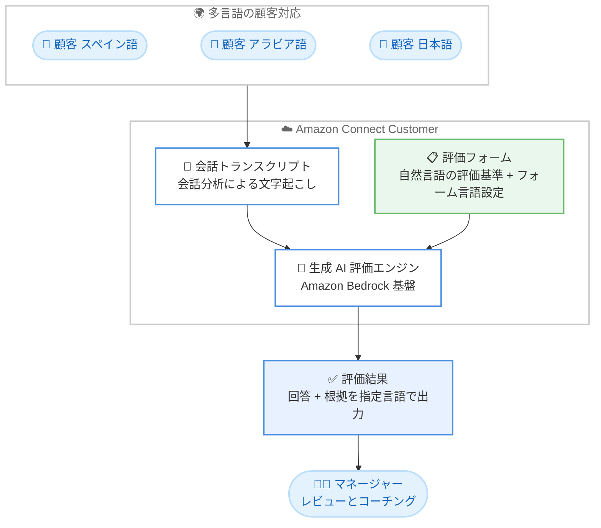

# Amazon Connect - 生成 AI によるパフォーマンス評価の自動化が新たに 45 言語に対応

**リリース日**: 2026 年 11 月 23 日
**サービス**: Amazon Connect (Amazon Connect Customer)
**機能**: 生成 AI によるエージェントパフォーマンス自動評価の多言語対応拡大

📊 [このアップデートのインフォグラフィックを見る](https://takech9203.github.io/aws-news-summary/20261123-amazon-connect-customer-expands-automated-performance-evaluations-new-languages.html)

## 概要

Amazon Connect Customer は、生成 AI を活用した人間のエージェントおよび AI エージェントのパフォーマンス自動評価を、アラビア語、オランダ語、インドネシア語、ポーランド語など新たに 45 の言語に拡大しました。マネージャーは自然言語で評価基準を記述するだけで、希望する言語での根拠 (justification) 付きの AI 評価結果を受け取ることができます。

さらに、言語をまたいだ評価 (クロスランゲージ評価) にも対応しており、会話が別の言語で行われていても、評価フォームへの回答を英語などの指定した言語で受け取ることができます。これにより、多言語対応のコンタクトセンターは、言語ごとに評価プロセスを分けることなく、標準化された評価フレームワークをすべての言語に適用できます。

**アップデート前の課題**

このアップデート以前は、多言語コンタクトセンターでの品質評価に制約がありました。

- 以前は生成 AI による自動評価が利用できる言語が限られており、対応言語以外の会話は手動で評価する必要があった
- 以前は AI 評価の根拠が主に英語で提供され、現地のマネージャーが内容を確認しにくい場合があった
- 以前は言語ごとに評価の運用が分断されやすく、グローバルで統一された評価フレームワークの適用が難しかった

**アップデート後の改善**

今回のアップデートにより、多言語環境での評価を一元化できるようになりました。

- 今回のアップデートにより、新たに 45 言語で生成 AI による自動パフォーマンス評価が利用できるようになった
- 評価フォームの言語を設定することで、AI の回答と根拠の両方を希望する言語で一貫して受け取れるようになった
- クロスランゲージ評価により、会話がどの言語であっても英語など共通言語で評価を完結でき、標準化された評価フレームワークを全言語に適用できるようになった

## アーキテクチャ図



さまざまな言語の会話トランスクリプトと、自然言語で記述した評価基準を生成 AI が解釈し、フォーム言語設定に従って回答と根拠を指定言語で出力する流れを示しています。

## サービスアップデートの詳細

### 主要機能

1. **45 言語への自動評価の拡大**
   - 生成 AI によるパフォーマンス自動評価が、アラビア語、オランダ語、インドネシア語、ポーランド語などの 45 言語に新たに対応
   - 人間のエージェントと AI エージェントの両方の評価に適用できる
   - 評価フォームの言語は、日本語を含む 54 言語から選択できる (ドキュメント記載のフォーム言語一覧による)

2. **希望言語での回答と根拠の提供**
   - マネージャーが自然言語で評価基準を記述すると、AI が回答とあわせて根拠を提供する
   - 評価フォームに言語を設定することで、回答と根拠の両方を希望言語で一貫して受け取れる
   - 根拠にはトランスクリプト内の参照ポイントが含まれ、エージェントのコーチングに活用できる

3. **クロスランゲージ評価**
   - 会話がスペイン語などの別言語であっても、評価フォームへの記入を英語で完結できる
   - 多言語コンタクトセンターで、言語をまたいだ標準化された評価フレームワークを適用できる
   - 言語ごとに評価フォームや評価者を分ける運用が不要になる

## 技術仕様

### 機能概要

| 項目 | 詳細 |
|------|------|
| 評価対象 | 人間のエージェントおよび AI エージェントの顧客対応 |
| 評価方法 | 評価フォームの質問と評価者向け指示を生成 AI が解釈し、トランスクリプトを分析して回答 |
| 基盤技術 | Amazon Bedrock 上に構築された生成 AI 機能 |
| フォーム言語設定 | 評価フォームの [Additional settings] タブの [Form language] で選択 |
| 選択可能なフォーム言語 | 日本語、アラビア語、オランダ語、インドネシア語、ポーランド語、中国語 (簡体字)、韓国語、ヒンディー語など 54 言語 |
| Ask AI の質問数上限 | 1 コンタクトあたり最大 30 問 |
| 自動送信評価の質問数上限 | 生成 AI による回答は 1 コンタクトあたり最大 10 問 |

### フォーム言語の設定

```text
1. 評価フォームの作成または更新時に [Additional settings] タブを選択
2. ドロップダウンから [Form language] を選択
3. フォームの質問、指示、回答選択肢を選択したフォーム言語と同じ言語で記述する
   (AI のパフォーマンスを最適化するため)
```

フォーム言語を設定しない場合、生成 AI モデルが質問の言語を自動検出して同じ言語での回答を試みますが、根拠は通常英語で提供されます。回答と根拠の両方を希望言語で一貫して受け取るには、フォーム言語の明示的な設定が推奨されます。

## 設定方法

### 前提条件

1. Amazon Connect インスタンスが作成済みで、会話分析 (Conversational Analytics) が有効化されていること
2. 評価を実施するユーザーに、パフォーマンス評価および Ask AI アシスタントのセキュリティプロファイル権限が割り当てられていること
3. 評価フォームが作成済みであること (質問と評価者向け指示を含む)

### 手順

#### ステップ 1: 評価フォームの作成と評価基準の記述

評価フォームに質問を追加し、各質問の「評価者向け指示」に自然言語で評価基準を記述します。生成 AI はこの質問タイトルと指示を解釈してトランスクリプトを分析します。

#### ステップ 2: フォーム言語の設定

評価フォームの [Additional settings] タブで [Form language] を選択します。希望言語を設定することで、AI の回答と根拠の両方がその言語で提供されます。クロスランゲージ評価を行う場合は、会話の言語にかかわらず評価に使用したい言語 (例: 英語) を設定します。

#### ステップ 3: 自動評価の有効化

評価フォーム上で、生成 AI によって自動回答する質問を事前設定します。評価者が送信前に AI の回答をレビューする運用と、自動入力・自動送信する運用のいずれかを選択できます。精度を確認するため、まず Ask AI ボタンによる回答推奨で質問ごとの精度を検証してから、本格展開することが推奨されます。

## メリット

### ビジネス面

- **グローバル展開の加速**: 多言語コンタクトセンターで標準化された評価フレームワークを全言語に適用でき、品質管理をグローバルで統一できる
- **評価工数の削減**: 最大 100% の顧客対応を自動評価の対象にでき、マネージャーが評価に費やす時間を削減できる
- **コーチングの質の向上**: 根拠とトランスクリプトの参照ポイントが希望言語で提供されるため、現地マネージャーがエージェント指導に活用しやすい

### 技術面

- **自然言語による基準定義**: 評価基準を自然言語で記述するだけでよく、言語ごとの個別の仕組みの構築が不要
- **クロスランゲージ評価**: 会話の言語と評価の言語を分離できるため、評価チームの言語スキルに依存しない運用が可能
- **Amazon Bedrock 基盤**: Amazon Bedrock 上に構築されており、責任ある AI 利用のための安全性・セキュリティ制御を活用できる

## デメリット・制約事項

### 制限事項

- AI による評価は 100% 正確ではないため、報酬やコーチングなどの判断に使用する前に評価のサンプルレビューが推奨される
- 文字起こしの精度が生成 AI 評価の精度に影響する。複数言語を含む会話ではフローブロックで対象言語をすべて選択する必要がある
- 複数の参加者が同時に話す会話 (会議通話、ウォームトランスファーなど) は正確に文字起こしできず、評価精度が低下する
- Ask AI による回答推奨は 1 コンタクトあたり最大 30 問、自動送信評価での生成 AI 回答は最大 10 問の上限がある

### 考慮すべき点

- フォームの質問、指示、回答選択肢は、設定したフォーム言語と同じ言語で記述することが AI の精度確保のために推奨される
- トランスクリプト外の情報 (画面録画、CRM システムの情報など) を必要とする質問や、声のトーンに依存する質問は生成 AI での評価に適さない
- AI による評価とマネージャーによる評価の乖離を検知するため、手動評価プロセスを並行して維持することが推奨される

## ユースケース

### ユースケース 1: グローバルコンタクトセンターでの評価基準の統一

**シナリオ**: 複数の国・地域にコンタクトセンターを展開しており、言語ごとに評価プロセスが分断されている。

**実装例**:
```text
1. 共通の評価フォームを作成し、フォーム言語を英語に設定
2. クロスランゲージ評価により、スペイン語やアラビア語などの会話も英語で自動評価
3. 本社の品質管理チームが全拠点の評価結果を同一基準でレビュー
```

**効果**: 言語をまたいだ標準化された評価フレームワークを適用でき、グローバルでの品質比較と改善が可能になる。

### ユースケース 2: 日本語コンタクトセンターでの評価自動化

**シナリオ**: 日本語の顧客対応について、マネージャーが希望する言語で根拠付きの評価結果を受け取りたい。

**実装例**:
```text
1. 評価フォームの質問と評価者向け指示を日本語で記述
2. [Form language] を日本語に設定
3. 生成 AI が日本語で回答と根拠を提供し、マネージャーがレビュー後に確定
```

**効果**: 回答と根拠の両方を日本語で受け取れるため、現地マネージャーによる確認とエージェントコーチングがスムーズになる。

### ユースケース 3: コンプライアンス遵守の網羅的なモニタリング

**シナリオ**: 多言語で提供する金融サービスにおいて、必須の開示事項をエージェントが伝えたかを全件確認したい。

**実装例**:
```text
1. 「エージェントは手数料の開示を行いましたか?」などの質問を評価フォームに追加
2. 評価者向け指示に回答基準を自然言語で明記
3. 自動評価を有効化し、対象言語の全コンタクトを自動チェック
```

**効果**: 最大 100% の顧客対応を言語を問わず自動評価でき、コンプライアンス遵守状況を網羅的に監視できる。

## 料金

本機能に関する追加料金の記載は公式発表にはありません。パフォーマンス評価機能は Amazon Connect Customer (Contact Lens) の料金体系に含まれます。詳細は [Amazon Connect 料金ページ](https://aws.amazon.com/connect/pricing/)を参照してください。

## 利用可能リージョン

Amazon Connect Customer が利用可能なすべての AWS 商用リージョンで利用できます。対象リージョンの一覧は[リージョン別の利用可否](https://docs.aws.amazon.com/connect/latest/adminguide/regions.html#contactlens_region)を参照してください。

## 関連サービス・機能

- **Amazon Connect Contact Lens (会話分析)**: 本機能の基盤となる会話の文字起こしと分析を提供する。文字起こしの精度が AI 評価の精度に直結する
- **Amazon Bedrock**: 生成 AI 評価機能の基盤。安全性・セキュリティ・責任ある AI 利用のための制御を提供する
- **評価フォームとルール**: 評価基準の定義と、特定のキューなど条件に応じた自動評価の送信制御に使用する

## 参考リンク

- 📊 [インフォグラフィック](https://takech9203.github.io/aws-news-summary/20261123-amazon-connect-customer-expands-automated-performance-evaluations-new-languages.html)
- [公式発表 (What's New)](https://aws.amazon.com/about-aws/whats-new/2026/11/amazon-connect-customer-expands-automated-performance-evaluations-new-languages/)
- [ドキュメント: 生成 AI によるエージェントパフォーマンス評価](https://docs.aws.amazon.com/connect/latest/adminguide/generative-ai-performance-evaluations.html#set-up-generative-ai-evals-in-non-english-language)
- [製品ページ: Amazon Connect Contact Lens](https://aws.amazon.com/connect/contact-lens/)
- [料金ページ](https://aws.amazon.com/connect/pricing/)

## まとめ

生成 AI によるパフォーマンス自動評価が新たに 45 言語に対応し、多言語コンタクトセンターでも標準化された評価フレームワークを言語を問わず適用できるようになりました。日本語を含むフォーム言語の設定により、回答と根拠を希望言語で受け取れるため、多言語での顧客対応を運用している場合は、評価フォームのフォーム言語設定とクロスランゲージ評価の活用を検討することを推奨します。
