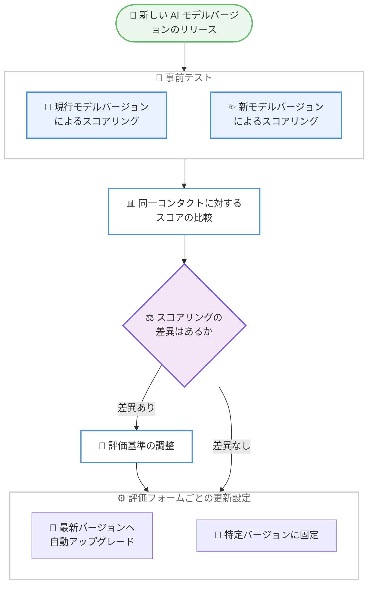

# Amazon Connect Customer - 自動評価における AI モデルバージョンアップグレードのテスト機能

**リリース日**: 2026 年 11 月 23 日
**サービス**: Amazon Connect Customer
**機能**: 自動評価向け AI モデルバージョンアップグレードの事前テスト

📊 [このアップデートのインフォグラフィックを見る](https://takech9203.github.io/aws-news-summary/20261123-amazon-connect-customer-test-ai-model-version-upgrades-automated-evaluations.html)

## 概要

Amazon Connect Customer において、自動評価 (Automated Evaluations) で使用する AI モデルの新しいバージョンを、本番適用前にテストできる機能が発表されました。コンタクトセンターの管理者は、新しいモデルバージョンがリリースされた際に、同じコンタクトに対して現行バージョンと新バージョンがどのようにスコアリングするかを比較できます。

この機能により、モデルのアップグレードをまたいでも評価スコアの一貫性を維持できます。モデル間のスコアリングの差異を事前に検出し、エージェントのパフォーマンス結果に影響が及ぶ前に評価基準を調整することが可能です。

さらに、評価フォームごとにモデルの更新動作を制御できます。継続的な精度向上のために最新モデルバージョンへ自動的にアップグレードするか、スコアリングの一貫性を保つために特定のバージョンに固定するかを選択できます。

**アップデート前の課題**

このアップデート以前には、以下の課題がありました。

- AI モデルの新バージョンがリリースされた際、既存の評価結果への影響を事前に確認する手段がなかった
- モデルバージョンの変更によりスコアリング傾向が変わると、エージェントのパフォーマンス評価の一貫性が損なわれるリスクがあった
- スコアリングの差異が発覚するのは、実際にエージェントの評価結果に反映された後になりがちだった

**アップデート後の改善**

今回のアップデートにより、以下が可能になりました。

- 新モデルバージョンが同じコンタクトをどのようにスコアリングするかを、現行バージョンと比較して事前に確認できる
- モデル間のスコアリング差異を検出し、エージェントのパフォーマンス結果に影響が出る前に評価基準を調整できる
- 評価フォームごとに「最新バージョンへの自動アップグレード」または「特定バージョンへの固定」を選択できる

## アーキテクチャ図



新しい AI モデルバージョンのリリース後、同一コンタクトに対する現行バージョンと新バージョンのスコアを比較し、差異があれば評価基準を調整したうえで、評価フォームごとに自動アップグレードまたはバージョン固定を選択する流れを示しています。

## サービスアップデートの詳細

### 主要機能

1. **モデルバージョン間のスコア比較テスト**
   - 新しいモデルバージョンがリリースされた際、切り替え前に新バージョンを試用できる
   - 同じコンタクトに対して、現行バージョンと新バージョンがそれぞれどのようにスコアリングするかを比較できる
   - モデル間のスコアリング差異を事前に検出できる

2. **評価基準の事前調整**
   - スコアリングの差異がエージェントのパフォーマンス結果に影響する前に、評価基準を調整できる
   - モデルアップグレードをまたいだ評価スコアの一貫性を維持できる

3. **評価フォームごとの更新動作の制御**
   - 継続的な精度向上を重視する場合は、最新モデルバージョンへの自動アップグレードを選択できる
   - スコアリングの一貫性を重視する場合は、特定のモデルバージョンに固定できる
   - 更新動作は評価フォーム単位で設定できる

## 技術仕様

### 機能の構成要素

| 項目 | 詳細 |
|------|------|
| 対象機能 | Amazon Connect Customer の自動評価 (Automated Evaluations) |
| 比較対象 | 現行モデルバージョンと新モデルバージョンのスコアリング結果 |
| 比較単位 | 同一のコンタクトに対するスコア |
| 更新制御の単位 | 評価フォームごと |
| 更新オプション | 最新バージョンへの自動アップグレード / 特定バージョンへの固定 |

## 設定方法

### 前提条件

1. Amazon Connect インスタンスが利用可能であること
2. Amazon Connect Customer の自動評価 (評価フォームの自動化) を使用していること
3. 評価フォームを管理する権限を持つ管理者ユーザーであること

### 手順

#### ステップ1: 評価フォームの自動化設定を確認する

Amazon Connect 管理者コンソールで対象の評価フォームを開き、自動評価の設定を確認します。評価フォームの自動化の詳細は[管理者ガイド](https://docs.aws.amazon.com/connect/latest/adminguide/create-evaluation-forms.html#step-automate)を参照してください。

#### ステップ2: 新モデルバージョンのスコアを比較する

新しいモデルバージョンがリリースされたら、同じコンタクトに対する現行バージョンと新バージョンのスコアリング結果を比較し、差異の有無を確認します。

#### ステップ3: 評価基準の調整と更新動作の選択

スコアリングに差異がある場合は評価基準を調整します。そのうえで、評価フォームごとに「最新モデルバージョンへの自動アップグレード」または「特定バージョンへの固定」を選択します。

## メリット

### ビジネス面

- **評価の公平性維持**: モデルアップグレードによるスコア変動がエージェントのパフォーマンス評価に影響する前に対処できるため、公平な評価運用を維持できる
- **品質管理の継続性**: 評価スコアの一貫性が保たれることで、時系列での品質トレンド分析の信頼性が向上する
- **リスクの低減**: 新モデルへの切り替えを事前に検証できるため、想定外のスコア変動によるトラブルを回避できる

### 技術面

- **事前検証の仕組み**: 本番の評価結果に影響を与えずに、新モデルバージョンの挙動を同一コンタクトで比較検証できる
- **柔軟なバージョン管理**: 評価フォーム単位で自動アップグレードとバージョン固定を使い分けられる
- **段階的な移行**: スコア差異の確認と評価基準の調整を経てから新バージョンへ移行できる

## デメリット・制約事項

### 制限事項

- 利用可能なのは Amazon Connect Customer が提供されている AWS 商用リージョンに限られる
- バージョンを固定し続けると、新モデルバージョンによる精度向上の恩恵を受けられない

### 考慮すべき点

- スコア比較の結果を評価基準の調整に反映する運用プロセスを整備する必要がある
- 自動アップグレードを選択した場合、スコアリング傾向の変化を継続的にモニタリングすることが望ましい

## ユースケース

### ユースケース1: 新モデルバージョンへの安全な移行

**シナリオ**: コンタクトセンターで自動評価を運用中に、新しい AI モデルバージョンがリリースされた。評価スコアの急な変動を避けたい。

**実装例**:
```
1. 新モデルバージョンで同一コンタクトのスコアを試算
2. 現行バージョンのスコアと比較し、差異のある評価項目を特定
3. 必要に応じて評価基準を調整してから新バージョンへ切り替え
```

**効果**: スコア変動を事前に把握したうえで移行でき、エージェント評価の混乱を防止できる。

### ユースケース2: コンプライアンス評価フォームのバージョン固定

**シナリオ**: 規制対応のためのコンプライアンス評価では、監査期間中にスコアリング基準が変わることを避けたい。

**実装例**:
```
1. コンプライアンス用の評価フォームで特定のモデルバージョンに固定
2. 監査期間終了後に新バージョンとのスコア比較を実施
3. 差異を確認してから計画的にアップグレード
```

**効果**: 監査期間中のスコアリングの一貫性を担保し、説明責任を果たしやすくなる。

### ユースケース3: 精度向上を優先する評価フォームの自動アップグレード

**シナリオ**: 社内のコーチング目的の評価フォームでは、常に最新モデルの精度向上を取り込みたい。

**実装例**:
```
1. コーチング用の評価フォームで最新バージョンへの自動アップグレードを選択
2. アップグレード後のスコア傾向を定期的にレビュー
3. 大きな差異が見られた場合のみ評価基準を調整
```

**効果**: 運用負荷を抑えながら、継続的なモデル精度向上の恩恵を受けられる。

## 料金

公式発表には本機能に関する追加料金の記載はありません。Amazon Connect Customer の会話分析機能の料金体系に従います。詳細は [Amazon Connect の料金ページ](https://aws.amazon.com/connect/pricing/)を確認してください。

## 利用可能リージョン

Amazon Connect Customer が利用可能なすべての AWS 商用リージョンで利用できます。対象リージョンの詳細は[リージョン一覧](https://docs.aws.amazon.com/connect/latest/adminguide/regions.html#contactlens_region)を参照してください。

## 関連サービス・機能

- **Amazon Connect**: 本機能の基盤となるクラウドコンタクトセンターサービス
- **Amazon Connect Customer 会話分析**: コンタクトの文字起こしや分析を行い、自動評価の入力となるデータを提供する機能
- **評価フォーム (Evaluation Forms)**: 自動評価の評価基準を定義する仕組みで、本機能によりフォーム単位でモデルバージョンの更新動作を制御できる

## 参考リンク

- 📊 [インフォグラフィック](https://takech9203.github.io/aws-news-summary/20261123-amazon-connect-customer-test-ai-model-version-upgrades-automated-evaluations.html)
- [公式発表 (What's New)](https://aws.amazon.com/about-aws/whats-new/2026/11/amazon-connect-customer-test-ai-model-version-upgrades-automated-evaluations)
- [ドキュメント: 評価フォームの自動化](https://docs.aws.amazon.com/connect/latest/adminguide/create-evaluation-forms.html#step-automate)
- [製品ページ: Amazon Connect Customer 会話分析](https://aws.amazon.com/products/connect/customer/conversational-analytics/)
- [利用可能リージョン一覧](https://docs.aws.amazon.com/connect/latest/adminguide/regions.html#contactlens_region)

## まとめ

Amazon Connect Customer の自動評価において、AI モデルの新バージョンを本番適用前にテストし、評価フォームごとに更新動作を制御できるようになりました。自動評価を運用しているコンタクトセンターでは、新モデルバージョンのリリース時にスコア比較を実施し、評価の一貫性要件に応じて自動アップグレードとバージョン固定を使い分けることを推奨します。
