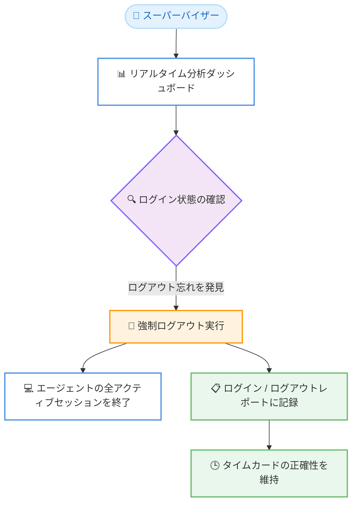

# Amazon Connect - 分析ダッシュボードからのエージェント強制ログアウト機能

**リリース日**: 2026 年 11 月 23 日
**サービス**: Amazon Connect (Amazon Connect Customer)
**機能**: リアルタイム分析ダッシュボードからのエージェント強制ログアウト

📊 [このアップデートのインフォグラフィックを見る](https://takech9203.github.io/aws-news-summary/20261123-amazon-connect-force-logout.html)

## 概要

Amazon Connect Customer は、リアルタイム分析ダッシュボードから直接エージェントを強制ログアウト (Force logout) できる機能を発表しました。スーパーバイザーは、ダッシュボード上でログイン状態のエージェントを確認し、その場でセッションを終了できます。強制ログアウトはエージェントのすべてのアクティブセッションを終了し、ログアウトイベントをログイン / ログアウトレポートに記録します。

この機能は、コンタクトセンターのスーパーバイザーや管理者を対象としています。たとえば、シフト終了後に端末からログアウトせずに退席したエージェントがいる場合、スーパーバイザーはダッシュボードから即座にログアウトを実行でき、エージェントのタイムカードにアイドル時間が不正確に積み上がることを防止できます。

**アップデート前の課題**

このアップデート以前は、ログアウトし忘れたエージェントへの対応に手間がかかっていました。

- 以前はスーパーバイザーがエージェント本人に個別に連絡し、セッションを閉じるよう依頼する必要があった
- 以前はエージェントがログアウトを忘れた場合、タイムカードにアイドル時間が不正確に記録され続けた
- 以前は監視 (ダッシュボード) と対処 (ログアウト依頼) が別々のフローに分かれており、迅速な対応が難しかった

**アップデート後の改善**

今回のアップデートにより、監視と対処をダッシュボード上で完結できるようになりました。

- 今回のアップデートにより、リアルタイム分析ダッシュボードから直接エージェントを強制ログアウトできるようになった
- 強制ログアウトはエージェントのすべてのアクティブセッションを終了するため、セッションの残留を確実に解消できるようになった
- ログアウトイベントがログイン / ログアウトレポートに記録されるため、タイムカードの正確性を維持できるようになった

## アーキテクチャ図



スーパーバイザーがリアルタイム分析ダッシュボードでエージェントのログイン状態を確認し、強制ログアウトを実行すると、すべてのアクティブセッションが終了し、ログアウトイベントがレポートに記録される流れを示しています。

## サービスアップデートの詳細

### 主要機能

1. **ダッシュボードからの直接強制ログアウト**
   - リアルタイム分析ダッシュボード上の操作だけでエージェントをログアウトできる
   - エージェント本人への個別連絡が不要になり、対応時間を短縮できる
   - 監視から対処までをダッシュボード上で完結できる

2. **全アクティブセッションの終了**
   - 強制ログアウトは対象エージェントのすべてのアクティブセッションを終了する
   - 複数のセッションが残っている場合でも一括で解消できる

3. **ログイン / ログアウトレポートへの記録**
   - 強制ログアウトのイベントはログイン / ログアウトレポートに記録される
   - エージェントのタイムカード (勤怠記録) の正確性を維持できる
   - 監査やレビューの際にログアウト操作の履歴を確認できる

## 技術仕様

### 機能概要

| 項目 | 詳細 |
|------|------|
| 操作場所 | Amazon Connect Customer のリアルタイム分析ダッシュボード |
| 操作者 | スーパーバイザー (適切な権限を持つユーザー) |
| 動作 | 対象エージェントのすべてのアクティブセッションを終了 |
| 記録 | ログアウトイベントをログイン / ログアウトレポートに記録 |
| ダッシュボード更新間隔 | リアルタイムダッシュボードは 15 秒ごとに更新 (時系列ウィジェットを除く) |

### 権限

ダッシュボードの利用には、セキュリティプロファイルで適切な権限 (メトリクスへのアクセス権限またはダッシュボードへのアクセス権限など) が割り当てられている必要があります。詳細は [Amazon Connect 管理者ガイドのダッシュボード](https://docs.aws.amazon.com/connect/latest/adminguide/dashboards.html)を参照してください。

## 設定方法

### 前提条件

1. Amazon Connect インスタンスが作成済みであること
2. 操作するユーザーにダッシュボードへのアクセス権限が割り当てられていること
3. エージェントの状態を管理するための適切なセキュリティプロファイル権限があること

### 手順

#### ステップ 1: ダッシュボードへアクセス

Amazon Connect Customer の管理 Web サイトにサインインし、[Analytics and Optimization] から [Dashboards and reports] に移動します。リアルタイム分析ダッシュボードを開きます。

#### ステップ 2: 対象エージェントの確認

ダッシュボード上でエージェントのログイン状態やアクティビティを確認し、ログアウトし忘れているエージェントを特定します。

#### ステップ 3: 強制ログアウトの実行

対象エージェントに対して強制ログアウトを実行します。すべてのアクティブセッションが終了し、ログアウトイベントがログイン / ログアウトレポートに記録されます。

## メリット

### ビジネス面

- **勤怠記録の正確性向上**: ログアウト忘れによるアイドル時間の不正確な積み上げを防止し、タイムカードの正確性を維持できる
- **運用コストの削減**: エージェントへの個別連絡や手動での対応が不要になり、スーパーバイザーの作業負荷が軽減される
- **迅速な対応**: ダッシュボードでの監視から対処までをワンストップで実施でき、問題発見から解決までの時間を短縮できる

### 技術面

- **セッション管理の確実性**: すべてのアクティブセッションを一括で終了するため、セッションの残留を確実に解消できる
- **監査証跡の確保**: ログアウトイベントがレポートに記録されるため、操作履歴を後から確認できる
- **既存ダッシュボードとの統合**: 新しいツールを導入することなく、既存のリアルタイム分析ダッシュボード上で利用できる

## デメリット・制約事項

### 制限事項

- Amazon Connect Customer が利用可能なリージョンでのみ提供される
- ダッシュボードへのアクセスには適切なセキュリティプロファイル権限が必要

### 考慮すべき点

- 強制ログアウトはすべてのアクティブセッションを終了するため、対象エージェントが実際に業務中でないことを確認してから実行することが望ましい
- 強制ログアウトを実行できるユーザーの権限設計を事前に検討しておく必要がある

## ユースケース

### ユースケース 1: シフト終了後のログアウト忘れ対応

**シナリオ**: シフト終了後、エージェントがログアウトせずに退席してしまい、ログイン状態が継続している。

**実装例**:
```text
1. スーパーバイザーがリアルタイム分析ダッシュボードでログイン状態を確認
2. シフト終了済みにもかかわらずログイン中のエージェントを特定
3. ダッシュボードから強制ログアウトを実行
```

**効果**: エージェントのタイムカードにアイドル時間が不正確に記録されることを防止できる。

### ユースケース 2: リアルタイムメトリクスの正常化

**シナリオ**: ログアウト忘れのエージェントが「対応可能」などの状態のまま残り、リアルタイムメトリクスやスタッフィング状況の把握が不正確になっている。

**実装例**:
```text
1. ダッシュボードでエージェントのアクティビティを監視
2. 実際には不在のエージェントを特定し、強制ログアウトを実行
3. リアルタイムメトリクスに正しい稼働状況が反映される
```

**効果**: 実態に即したメトリクスに基づいて、キュー管理やスタッフィングの判断を行える。

### ユースケース 3: 勤怠レポートの精度向上

**シナリオ**: 給与計算や勤怠管理にログイン / ログアウトレポートを利用しており、記録の正確性が求められる。

**実装例**:
```text
1. 日次でダッシュボードを確認し、ログアウト忘れのエージェントを強制ログアウト
2. ログイン / ログアウトレポートに記録されたイベントを勤怠管理に活用
```

**効果**: ログアウトイベントがレポートに記録されるため、勤怠記録の精度と監査性が向上する。

## 料金

本機能に関する追加料金の記載は公式発表にはありません。Amazon Connect の料金体系の詳細は [Amazon Connect 料金ページ](https://aws.amazon.com/connect/pricing/)を参照してください。

## 利用可能リージョン

Amazon Connect Customer が利用可能なすべての AWS リージョンで利用できます。対象リージョンの一覧は[リージョン別の Amazon Connect の利用可否](https://docs.aws.amazon.com/connect/latest/adminguide/regions.html#amazonconnect_region)を参照してください。

## 関連サービス・機能

- **Amazon Connect リアルタイム分析ダッシュボード**: 本機能の操作場所。リアルタイムメトリクスは 15 秒ごとに更新され、コンタクトセンターの稼働状況を可視化する
- **ログイン / ログアウトレポート**: 強制ログアウトのイベントが記録されるレポート。勤怠管理や監査に活用できる
- **セキュリティプロファイル**: ダッシュボードへのアクセスや操作に必要な権限を管理する仕組み

## 参考リンク

- 📊 [インフォグラフィック](https://takech9203.github.io/aws-news-summary/20261123-amazon-connect-force-logout.html)
- [公式発表 (What's New)](https://aws.amazon.com/about-aws/whats-new/2026/11/amazon-connect-force-logout/)
- [ドキュメント: ダッシュボードの概要](https://docs.aws.amazon.com/connect/latest/adminguide/dashboards.html)
- [製品ページ: Amazon Connect](https://aws.amazon.com/connect/)
- [料金ページ](https://aws.amazon.com/connect/pricing/)

## まとめ

Amazon Connect のリアルタイム分析ダッシュボードから直接エージェントを強制ログアウトできるようになり、ログアウト忘れへの対応が大幅に簡素化されました。勤怠記録の正確性やリアルタイムメトリクスの信頼性向上に直結するため、コンタクトセンターを運用している場合は、スーパーバイザーの権限設計を確認のうえ、運用フローへの組み込みを検討することを推奨します。
