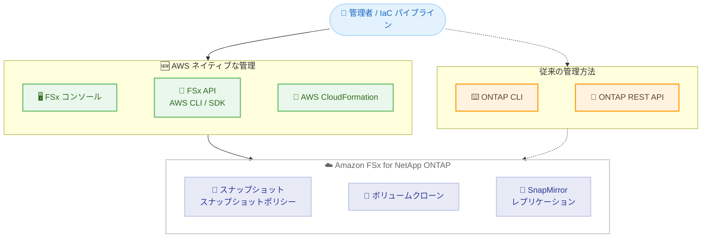

# Amazon FSx for NetApp ONTAP - スナップショット、クローン、データレプリケーションの AWS CloudFormation / コンソールサポート

**リリース日**: 2026 年 11 月 23 日
**サービス**: Amazon FSx for NetApp ONTAP
**機能**: スナップショット、ボリュームクローン、SnapMirror レプリケーションの Amazon FSx コンソール、Amazon FSx API、AWS CloudFormation サポート

📊 [このアップデートのインフォグラフィックを見る](https://takech9203.github.io/aws-news-summary/20261123-amazon-fsx-for-netapp-ontap-additional-resources.html)

## 概要

Amazon FSx for NetApp ONTAP が、スナップショット、ボリュームクローン、SnapMirror データレプリケーションを Amazon FSx コンソール、Amazon FSx API、AWS CloudFormation から直接管理できるようになりました。これまでこれらの ONTAP リソースは ONTAP CLI または ONTAP REST API 経由でのみ管理可能でしたが、今回のアップデートにより AWS ネイティブなツールチェーンで完結できます。

AWS コンソール上の数クリックで操作できるほか、Infrastructure as Code (IaC) ワークフローの一部として CloudFormation テンプレートに組み込むことも可能になりました。ONTAP の専門知識を持たないチームでも、データ保護 (スナップショット)、開発・テスト環境の迅速な複製 (クローン)、ディザスタリカバリ (SnapMirror レプリケーション) といった ONTAP の主要なデータ管理機能を活用しやすくなります。

**アップデート前の課題**

- 以前はスナップショットポリシー、ボリュームクローン、SnapMirror レプリケーションの管理に ONTAP CLI または ONTAP REST API を使用する必要があった
- AWS の IAM 権限管理や CloudFormation による IaC 管理の対象外であり、他の AWS リソースと運用方法が分断されていた
- ONTAP 固有の操作知識が必要で、AWS に慣れたチームにとって学習コストが高かった

**アップデート後の改善**

- Amazon FSx コンソールから数クリックでスナップショット、クローン、レプリケーションを操作できるようになった
- Amazon FSx API (AWS CLI / SDK) に `CreateSnapshot`、`CreateSnapmirrorRelationship` などの操作が追加され、AWS 標準のツールで自動化できるようになった
- AWS CloudFormation でこれらのリソースをテンプレート化し、IaC ワークフローに統合できるようになった

## アーキテクチャ図



今回のアップデートにより、従来 ONTAP CLI / REST API 経由でのみ管理できたスナップショット、クローン、SnapMirror レプリケーションを、FSx コンソール、FSx API、CloudFormation という AWS ネイティブな経路で管理できるようになりました。

## サービスアップデートの詳細

### 主要機能

1. **スナップショットの AWS ネイティブ管理**
   - FSx コンソールおよび FSx API から ONTAP ボリュームのスナップショットを作成、更新、削除、一覧表示できる
   - スナップショットポリシーの作成・管理にも対応し、ラベル、保持数、作成スケジュールを定義できる
   - ボリュームをスナップショットから復元する操作も AWS 側から実行できる

2. **ボリュームクローンの作成**
   - 既存ボリュームのスナップショットをもとに、書き込み可能なクローンボリュームを AWS コンソールや API から作成できる
   - 開発・テスト環境の複製やデータ分析用コピーの作成を、ONTAP の知識なしで実行できる

3. **SnapMirror レプリケーションの管理**
   - SnapMirror ポリシー (コピーモード、保持ルール、転送スケジュール、ネットワーク圧縮、スロットリングなど) を FSx API で定義できる
   - SnapMirror リレーションシップの作成・更新・削除に対応し、ファイルシステム間のデータレプリケーションを構成できる
   - クラスターピア、Storage Virtual Machine (SVM) ピアの管理操作も FSx API に追加された

4. **AWS CloudFormation サポート**
   - これらのリソースを CloudFormation テンプレートとして定義し、IaC ワークフローでプロビジョニング・変更管理できる
   - 既存の FSx ファイルシステムやボリュームのテンプレートと合わせて、データ保護・DR 構成までコード化できる

## 技術仕様

### 今回 AWS ネイティブ管理に対応した主なリソース

| リソース | 主な FSx API 操作 | 用途 |
|------|------|------|
| スナップショット | `CreateSnapshot`、`UpdateSnapshot`、`DeleteSnapshot`、`DescribeSnapshots`、`RestoreVolumeFromSnapshot` | ポイントインタイムのデータ保護と復元 |
| スナップショットポリシー | `CreateSnapshotPolicy`、`UpdateSnapshotPolicy`、`DeleteSnapshotPolicy`、`DescribeSnapshotPolicies` | スケジュールに基づく自動スナップショット |
| SnapMirror ポリシー | `CreateSnapmirrorPolicy`、`UpdateSnapmirrorPolicy`、`DeleteSnapmirrorPolicy`、`DescribeSnapmirrorPolicies` | レプリケーションの動作 (コピーモード、保持、スケジュール) 定義 |
| SnapMirror リレーションシップ | `CreateSnapmirrorRelationship`、`UpdateSnapmirrorRelationship`、`DeleteSnapmirrorRelationship`、`DescribeSnapmirrorRelationships` | ソース / デスティネーション間のレプリケーション構成 |
| クラスターピア | `CreateClusterPeer`、`UpdateClusterPeer`、`DeleteClusterPeer`、`DescribeClusterPeers` | ファイルシステム間のピアリング |
| SVM ピア | `CreateStorageVirtualMachinePeer`、`UpdateStorageVirtualMachinePeer`、`DeleteStorageVirtualMachinePeer`、`DescribeStorageVirtualMachinePeers` | SVM 間のピアリング |

### API 変更履歴

| 日付 | サービス | 変更内容 |
|------|----------|----------|
| 2026/11/23 | [Amazon FSx](https://awsapichanges.com/archive/changes/5ec695-fsx.html) | 20 new 24 updated api methods - FSx for NetApp ONTAP の新リソース (スナップショットポリシー、SnapMirror ポリシー / リレーションシップ、クラスターピア、SVM ピアなど) のサポート追加 |

### SnapMirror ポリシー作成の例 (AWS CLI)

```bash
aws fsx create-snapmirror-policy \
  --file-system-id fs-0123456789abcdef0 \
  --storage-virtual-machine-id svm-0123456789abcdef0 \
  --name my-dr-policy \
  --snapshot-copy-mode COPY_LATEST_SOURCE_SNAPSHOT \
  --retention-rules '[{"Label":"daily","Count":7}]' \
  --transfer-schedule hourly \
  --network-compression-enabled
```

このコマンドは、最新のソーススナップショットをコピーし、daily ラベルのスナップショットを 7 世代保持し、1 時間ごとに転送する SnapMirror ポリシーを作成します (パラメータは API 定義に基づく例です)。

## 設定方法

### 前提条件

1. Amazon FSx for NetApp ONTAP ファイルシステムが作成済みであること
2. FSx の各操作を許可する IAM 権限が付与されていること
3. レプリケーションを構成する場合は、ソースとデスティネーションのファイルシステム / SVM が用意されていること

### 手順

#### ステップ 1: スナップショットポリシーの作成

```bash
aws fsx create-snapshot-policy \
  --file-system-id fs-0123456789abcdef0 \
  --name daily-snapshot-policy
```

ファイルシステムに対してスナップショットポリシーを作成します。コンソールの場合は、FSx コンソールの対象ファイルシステムからスナップショット関連の設定を数クリックで行えます。

#### ステップ 2: ピアリングと SnapMirror リレーションシップの構成

```bash
# ファイルシステム間のクラスターピアを作成
aws fsx create-cluster-peer --file-system-id fs-source --peer-file-system-id fs-destination

# SVM ピアを作成した上で SnapMirror リレーションシップを作成
aws fsx create-snapmirror-relationship ...
```

レプリケーション元とレプリケーション先のファイルシステム / SVM をピアリングし、SnapMirror リレーションシップを作成してデータレプリケーションを開始します。

#### ステップ 3: CloudFormation テンプレートへの組み込み

スナップショットポリシーや SnapMirror 構成を CloudFormation テンプレートとして定義し、スタックのデプロイによって環境全体を再現可能な形で管理します。具体的なリソースタイプとプロパティは [CloudFormation ドキュメント](https://docs.aws.amazon.com/AWSCloudFormation/latest/UserGuide/AWS_FSx.html)を参照してください。

## メリット

### ビジネス面

- **運用の標準化**: ONTAP 固有のツールを使わず AWS 標準の運用プロセスに統一でき、チームのスキル要件と運用コストを削減できる
- **DR 構成の迅速な展開**: SnapMirror によるディザスタリカバリ構成をコード化し、複数環境へ一貫して展開できる
- **ガバナンスの向上**: IAM と CloudFormation による権限管理・変更管理の枠組みに ONTAP データ管理操作を取り込める

### 技術面

- **IaC との統合**: スナップショット、クローン、レプリケーションを CloudFormation テンプレートで宣言的に管理できる
- **自動化の容易さ**: AWS CLI / SDK から FSx API を呼び出せるため、既存の自動化パイプラインに組み込みやすい
- **操作の簡素化**: コンソールから数クリックで操作でき、ONTAP CLI / REST API の学習が不要になる

## デメリット・制約事項

### 制限事項

- 対象は FSx for NetApp ONTAP のスナップショット、クローン、SnapMirror レプリケーション関連リソースであり、ONTAP のすべての機能が AWS ネイティブ管理に対応したわけではない
- 高度な ONTAP 固有設定は引き続き ONTAP CLI / REST API が必要になる場合がある

### 考慮すべき点

- 既に ONTAP CLI / REST API で構成済みのリソースを CloudFormation 管理へ移行する場合は、管理方法の重複や競合に注意が必要
- FSx API の操作に対応する IAM ポリシーの見直し (新規アクションの許可) が必要になる場合がある

## ユースケース

### ユースケース 1: 開発・テスト環境の迅速な複製

**シナリオ**: 本番データベースのデータを使って開発・テスト環境を構築したいが、フルコピーには時間とストレージコストがかかる。

**実装例**:
```
1. 本番ボリュームのスナップショットを FSx コンソールから作成
2. スナップショットからボリュームクローンを作成
3. クローンボリュームを開発環境のインスタンスにマウント
```

**効果**: 書き込み可能なクローンを数クリックで作成でき、開発・テスト環境の準備時間を大幅に短縮できる。

### ユースケース 2: クロスリージョンのディザスタリカバリ

**シナリオ**: 基幹ファイルサーバーのデータを別リージョンへレプリケーションし、災害時に迅速に切り替えたい。

**実装例**:
```
1. DR リージョンに FSx for ONTAP ファイルシステムを作成
2. クラスターピアと SVM ピアを FSx API で構成
3. SnapMirror ポリシーとリレーションシップを CloudFormation で定義しデプロイ
```

**効果**: DR 構成全体をコードとして管理でき、構成ミスを防ぎながら複数システムへ一貫した DR 戦略を適用できる。

### ユースケース 3: スナップショットポリシーによるデータ保護の自動化

**シナリオ**: 複数のボリュームに対して、保持世代数やスケジュールが統一されたスナップショット運用を行いたい。

**実装例**:
```
1. ラベル、保持数、作成スケジュールを定義したスナップショットポリシーを作成
2. ポリシーを対象ボリュームに適用
3. CloudFormation テンプレート化して全環境に展開
```

**効果**: データ保護ポリシーを標準化・自動化でき、スナップショット取得漏れによるデータ損失リスクを低減できる。

## 料金

今回のアップデート (コンソール / API / CloudFormation サポート) 自体に追加料金は発表されていません。スナップショットやクローンが消費するストレージ、SnapMirror レプリケーションのデータ転送などには、FSx for NetApp ONTAP の標準料金が適用されます。詳細は[料金ページ](https://aws.amazon.com/fsx/netapp-ontap/pricing/)を参照してください。

## 利用可能リージョン

FSx for NetApp ONTAP が利用可能なすべての AWS リージョンで利用できます。

## 関連サービス・機能

- **AWS CloudFormation**: 今回対応したスナップショット、クローン、レプリケーションリソースを IaC として管理するサービス
- **AWS Backup**: FSx for ONTAP のバックアップを一元管理するサービス。スナップショットと組み合わせた多層的なデータ保護が可能
- **NetApp BlueXP**: ONTAP 環境を統合管理する NetApp のツール。引き続き ONTAP 固有の高度な管理に利用可能

## 参考リンク

- 📊 [インフォグラフィック](https://takech9203.github.io/aws-news-summary/20261123-amazon-fsx-for-netapp-ontap-additional-resources.html)
- [公式発表 (What's New)](https://aws.amazon.com/about-aws/whats-new/2026/11/amazon-fsx-for-netapp-ontap-additional-resources/)
- [FSx for NetApp ONTAP 製品ページ](https://aws.amazon.com/fsx/netapp-ontap/)
- [FSx for NetApp ONTAP ユーザーガイド](https://docs.aws.amazon.com/fsx/latest/ONTAPGuide/getting-started.html)
- [API 変更詳細 (awsapichanges.com)](https://awsapichanges.com/archive/changes/5ec695-fsx.html)
- [料金ページ](https://aws.amazon.com/fsx/netapp-ontap/pricing/)

## まとめ

FSx for NetApp ONTAP のスナップショット、クローン、SnapMirror レプリケーションが AWS ネイティブなツール (コンソール、FSx API、CloudFormation) で管理できるようになり、ONTAP の専門知識がなくてもデータ保護や DR 構成を標準的な AWS 運用に統合できます。ONTAP CLI で運用している場合は、IaC 化による構成管理の改善余地がないか検討することをお勧めします。
