# Amazon EC2 - G7 インスタンスの metal サイズ発表

**リリース日**: 2026 年 11 月 23 日
**サービス**: Amazon EC2
**機能**: Amazon EC2 G7 インスタンスの metal サイズ (g7.metal)

📊 [このアップデートのインフォグラフィックを見る](https://takech9203.github.io/aws-news-summary/20261123-amazon-g7-metal-size.html)

## 概要

Amazon EC2 G7 インスタンスに新しいベアメタルサイズ「g7.metal」が一般提供開始されました。G7 インスタンスは NVIDIA RTX PRO 4500 Blackwell Server Edition GPU を搭載した GPU インスタンスで、前世代の G6 と比較して最大 4.6 倍の AI 推論性能、最大 2.1 倍のグラフィックス性能を提供します。

g7.metal は、それぞれ 32 GB の GPU メモリを持つ NVIDIA RTX PRO 4500 Blackwell GPU を 8 基搭載し、192 vCPU、768 GiB のシステムメモリ、700 Gbps の Elastic Fabric Adapter (EFA) ネットワーク帯域幅を備えています。プロセッサーにはカスタム Intel Xeon 6 を採用しています。

ベアメタルサイズは、物理サーバーへの直接アクセスを必要とするワークロードに適しており、カスタム仮想化スタック、ハイパーバイザーレベルの GPU ドライバー、ライセンス制約のあるアプリケーションを利用するお客様が対象です。フィジカル AI シミュレーション、AI エージェントサンドボックス、グラフィックスワークロードなどのユースケースが想定されています。

**アップデート前の課題**

このアップデート以前に存在していた課題や制限は以下のとおりです。

- 以前の G7 インスタンスは仮想化されたサイズ (g7.2xlarge ～ g7.48xlarge) のみの提供で、物理サーバーへの直接アクセスができなかった
- 独自のハイパーバイザーやカスタム仮想化スタックを G7 の GPU 環境上で実行できなかった
- ベアメタル環境を必須とするライセンス制約のあるアプリケーションを最新世代の Blackwell GPU で利用できなかった

**アップデート後の改善**

今回のアップデートにより可能になったことは以下のとおりです。

- g7.metal により、NVIDIA RTX PRO 4500 Blackwell GPU を 8 基搭載した物理サーバーへ直接アクセスできるようになった
- カスタム仮想化スタックやハイパーバイザーレベルの GPU ドライバーを必要とするワークロードを G7 上で実行可能になった
- フィジカル AI シミュレーションや AI エージェントサンドボックスなど、ベアメタル環境を前提とする新しいユースケースに対応できるようになった

## アーキテクチャ図

```mermaid
flowchart TD
    subgraph Metal["🖥️ g7.metal ベアメタルインスタンス"]
        App["🧩 お客様のワークロード<br/>フィジカル AI シミュレーション / AI エージェントサンドボックス"]
        Custom["⚙️ カスタム仮想化スタック<br/>独自ハイパーバイザー / GPU ドライバー"]
        HW["🔩 物理サーバーへの直接アクセス<br/>192 vCPU / 768 GiB メモリ<br/>カスタム Intel Xeon 6"]
        GPU["🎮 NVIDIA RTX PRO 4500 Blackwell x 8<br/>GPU メモリ合計 256 GB"]
        App --> Custom --> HW --> GPU
    end

    subgraph Nitro["☁️ AWS Nitro System"]
        direction LR
        Net["🌐 EFA ネットワーク<br/>700 Gbps"]
        EBS["💾 EBS 帯域幅<br/>80 Gbps"]
        NVMe["🪣 ローカル NVMe SSD<br/>7.6 TB"]
        Net ~~~ EBS ~~~ NVMe
    end

    HW --> Net
    HW --> EBS
    HW --> NVMe

    classDef metal fill:none,stroke:#CCCCCC,stroke-width:2px,color:#666666
    classDef compute fill:#FFE0B2,stroke:#FFCC80,stroke-width:2px,color:#5D4037
    classDef process fill:#FFFFFF,stroke:#4A90E2,stroke-width:2px,color:#333333
    classDef internal fill:#E8F1FF,stroke:#4A90E2,stroke-width:2px,color:#333333
    classDef storage fill:#DCEDC8,stroke:#C5E1A5,stroke-width:2px,color:#33691E

    class Metal,Nitro metal
    class App process
    class Custom internal
    class HW,GPU compute
    class Net,EBS,NVMe storage
```



g7.metal では、お客様のワークロードやカスタム仮想化スタックが物理サーバーへ直接アクセスし、8 基の Blackwell GPU を利用できます。ネットワーク、ストレージ、I/O は AWS Nitro System によりオフロードされます。

## サービスアップデートの詳細

### 主要機能

1. **ベアメタルサイズ g7.metal の提供**
   - 物理サーバーへの直接アクセスが可能なベアメタルインスタンス
   - NVIDIA RTX PRO 4500 Blackwell Server Edition GPU を 8 基搭載 (各 32 GB、合計 256 GB の GPU メモリ)
   - 192 vCPU、768 GiB のシステムメモリを提供

2. **高性能なネットワークとストレージ**
   - 700 Gbps の EFA 対応ネットワーク帯域幅
   - 80 Gbps の EBS 帯域幅
   - 2 x 3800 GB (合計 7.6 TB) のローカル NVMe SSD ストレージ

3. **カスタム Intel Xeon 6 プロセッサー**
   - 全コア持続ターボ周波数 3.9 GHz のカスタム Intel Xeon 6 を採用
   - コアあたりの性能を最大化するため、同時マルチスレッディングを無効化して動作

## 技術仕様

### g7.metal インスタンス仕様

| 項目 | 詳細 |
|------|------|
| GPU | NVIDIA RTX PRO 4500 Blackwell Server Edition x 8 |
| GPU メモリ | 256 GB (32 GB x 8) |
| vCPU | 192 |
| システムメモリ | 768 GiB |
| プロセッサー | カスタム Intel Xeon 6 (全コア持続ターボ 3.9 GHz) |
| ローカルストレージ | 2 x 3800 GB NVMe SSD (合計 7.6 TB) |
| ネットワーク帯域幅 | 700 Gbps (EFA 対応) |
| EBS 帯域幅 | 80 Gbps |

### G7 ファミリーのサイズ比較

| サイズ | GPU 数 | GPU メモリ (GB) | vCPU | メモリ (GiB) | ネットワーク (Gbps) |
|--------|--------|------------------|------|---------------|----------------------|
| g7.2xlarge | 1 | 32 | 8 | 32 | 最大 60 |
| g7.4xlarge | 1 | 32 | 16 | 64 | 最大 100 |
| g7.8xlarge | 1 | 32 | 32 | 128 | 100 |
| g7.12xlarge | 2 | 64 | 48 | 192 | 175 |
| g7.24xlarge | 4 | 128 | 96 | 384 | 350 |
| g7.48xlarge | 8 | 256 | 192 | 768 | 700 |
| **g7.metal** | **8** | **256** | **192** | **768** | **700** |

g7.metal は最大仮想化サイズの g7.48xlarge と同等のスペックを持ちつつ、物理サーバーへの直接アクセスを提供します。

## 設定方法

### 前提条件

1. AWS アカウントを保有していること
2. 米国東部 (バージニア北部) リージョンを利用できること
3. 必要に応じて g7.metal のサービスクォータ引き上げを申請済みであること

### 手順

#### ステップ1: 利用可能なインスタンスタイプの確認

```bash
aws ec2 describe-instance-type-offerings \
  --region us-east-1 \
  --filters "Name=instance-type,Values=g7.metal"
```

米国東部 (バージニア北部) リージョンで g7.metal インスタンスタイプが利用可能であることを確認します。

#### ステップ2: インスタンスの起動

```bash
aws ec2 run-instances \
  --region us-east-1 \
  --instance-type g7.metal \
  --image-id ami-xxxxxxxxxxxxxxxxx \
  --key-name my-key-pair \
  --subnet-id subnet-xxxxxxxx \
  --security-group-ids sg-xxxxxxxx
```

g7.metal インスタンスを起動します。NVIDIA ドライバーがプリインストールされた AMI や AWS Deep Learning AMI (DLAMI) の利用も可能です。AWS マネジメントコンソール、AWS CLI、AWS SDK のいずれからでも起動できます。

#### ステップ3: GPU の認識確認

```bash
nvidia-smi
```

インスタンスへ接続後、8 基の NVIDIA RTX PRO 4500 Blackwell GPU が認識されていることを確認します。

## メリット

### ビジネス面

- **ライセンス制約への対応**: ベアメタル環境を必須とするライセンス制約のあるアプリケーションを、最新世代の GPU インスタンスで実行可能
- **柔軟な購入オプション**: オンデマンドインスタンス、スポットインスタンス、Savings Plans から選択でき、コスト最適化が可能
- **新しいワークロードの獲得**: フィジカル AI シミュレーションや AI エージェントサンドボックスなど、従来は実行が難しかったワークロードをクラウドへ移行可能

### 技術面

- **物理サーバーへの直接アクセス**: ハイパーバイザーを介さずにハードウェアへ直接アクセスでき、カスタム仮想化スタックや独自ハイパーバイザーを実行可能
- **高い AI・グラフィックス性能**: G6 比で最大 4.6 倍の AI 推論性能、最大 2.1 倍のグラフィックス性能を提供
- **大容量・高帯域の構成**: 256 GB の GPU メモリ、700 Gbps の EFA ネットワーク、7.6 TB のローカル NVMe SSD により大規模ワークロードに対応

## デメリット・制約事項

### 制限事項

- 提供リージョンは現時点で米国東部 (バージニア北部) のみ
- 提供されるベアメタルサイズは g7.metal (8 GPU 構成) の 1 サイズのみで、小規模なベアメタル構成は選択できない

### 考慮すべき点

- ベアメタルインスタンスでは AWS Nitro System による仮想化レイヤーが提供されないため、OS やドライバーの管理責任がより大きくなる
- 物理サーバーへの直接アクセスが不要なワークロードであれば、同等スペックの g7.48xlarge の利用で十分な場合がある

## ユースケース

### ユースケース1: フィジカル AI シミュレーション

**シナリオ**: ロボティクスや自動運転の開発で、物理環境を模したシミュレーションを大規模に実行したい。ハイパーバイザーレベルの GPU ドライバーや独自の仮想化構成が必要となる。

**実装例**:
```
g7.metal 上にシミュレーションプラットフォームを直接インストールし、
8 基の Blackwell GPU を独自の仮想化スタックで分割して複数の
シミュレーション環境を同時実行する
```

**効果**: ベアメタル環境ならではの柔軟な GPU 制御により、物理環境に忠実な大規模シミュレーションをクラウド上で実現できます。

### ユースケース2: AI エージェントサンドボックス

**シナリオ**: AI エージェントがコードを実行したり環境を操作したりするためのサンドボックス環境を、独自のハイパーバイザーで分離して大量に提供したい。

**実装例**:
```
g7.metal 上でカスタムハイパーバイザーを稼働させ、GPU リソースを
割り当てた軽量なサンドボックス VM を多数起動して AI エージェントに提供する
```

**効果**: ネストした仮想化に頼らず、物理サーバー上で直接ハイパーバイザーを実行することで、高い分離性と性能を両立したサンドボックスを構築できます。

### ユースケース3: ライセンス制約のあるグラフィックスアプリケーション

**シナリオ**: 物理サーバーへのライセンス紐付けが必要なグラフィックスソフトウェアや、ベアメタル環境のみサポートされる商用アプリケーションを GPU 環境で実行したい。

**実装例**:
```
g7.metal インスタンスにライセンス制約のあるアプリケーションを
直接インストールし、8 基の GPU を活用したレンダリングや
ビジュアライゼーション処理を実行する
```

**効果**: オンプレミスの専用サーバーを維持することなく、ライセンス要件を満たしながらクラウドの柔軟性を活用できます。

## 料金

g7.metal は以下の購入オプションで利用できます。

- オンデマンドインスタンス
- スポットインスタンス
- Savings Plans

具体的な料金は [Amazon EC2 料金ページ](https://aws.amazon.com/ec2/pricing/) を参照してください。

## 利用可能リージョン

- 米国東部 (バージニア北部)

## 関連サービス・機能

- **Amazon EC2 G7 インスタンス**: g7.metal が属するインスタンスファミリー。仮想化サイズ (g7.2xlarge ～ g7.48xlarge) も提供
- **Elastic Fabric Adapter (EFA)**: g7.metal で 700 Gbps の帯域幅を提供する高性能ネットワークインターフェイス
- **AWS Deep Learning AMI / Deep Learning Containers**: NVIDIA ドライバーや機械学習フレームワークがプリインストールされた環境で、G7 での迅速なセットアップに利用可能
- **Amazon EKS / Amazon ECS**: G7 インスタンスをコンテナワークロードの実行基盤として利用可能

## 参考リンク

- 📊 [インフォグラフィック](https://takech9203.github.io/aws-news-summary/20261123-amazon-g7-metal-size.html)
- [公式発表 (What's New)](https://aws.amazon.com/about-aws/whats-new/2026/11/amazon-g7-metal-size/)
- [Amazon EC2 G7 インスタンス](https://aws.amazon.com/ec2/instance-types/g7/)
- [Amazon EC2 料金ページ](https://aws.amazon.com/ec2/pricing/)

## まとめ

Amazon EC2 G7 インスタンスに、NVIDIA RTX PRO 4500 Blackwell GPU を 8 基搭載したベアメタルサイズ g7.metal が追加されました。カスタム仮想化スタックやライセンス制約のあるアプリケーション、フィジカル AI シミュレーションなど、物理サーバーへの直接アクセスを必要とするワークロードを持つお客様は、米国東部 (バージニア北部) リージョンでの利用を検討することを推奨します。
