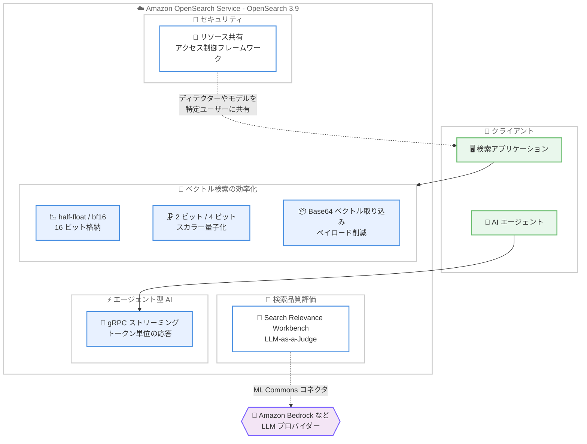

# Amazon OpenSearch Service - OpenSearch バージョン 3.9 のサポート

**リリース日**: 2026 年 11 月 23 日
**サービス**: Amazon OpenSearch Service
**機能**: OpenSearch バージョン 3.9 対応 (マネージドクラスター)

📊 [このアップデートのインフォグラフィックを見る](https://takech9203.github.io/aws-news-summary/20261123-amazon-opensearch-opensearch-3-9.html)

## 概要

Amazon OpenSearch Service が OpenSearch バージョン 3.9 の実行をサポートしました。これまでマネージドクラスターで利用できた最新バージョンは 3.7 であり、本アップデートによりオープンソース版 OpenSearch 3.8 / 3.9 で追加された機能群をマネージド環境で利用できるようになります。

本リリースの柱は 4 つです。(1) ベクトル検索のメモリ・ストレージ消費の削減、(2) 検索品質評価 (Search Relevance Workbench) の強化、(3) エージェント型 AI アプリケーション向けの応答性向上、(4) 共有リソースへのアクセス制御の強化。特にベクトル検索では、half-float ベクトル型や bf16 エンコーダー、2 ビット / 4 ビットのスカラー量子化が追加され、セマンティック検索や RAG ワークロードのコスト効率を大きく改善できます。

OpenSearch 3.9 は、Amazon OpenSearch Service が利用可能なすべての AWS リージョンで利用できます。

**アップデート前の課題**

- ベクトルの各次元を 32 ビット (float) で保持する構成が基本であり、大規模なベクトルインデックスではメモリとストレージのコストが高くなりやすかった
- スカラー量子化の圧縮オプションが限られており、圧縮率と再現率 (recall) のトレードオフをワークロードごとに細かく選択できなかった
- 検索品質評価で LLM による自動判定 (LLM-as-a-Judge) を行う際、失敗したドキュメントの再試行や過去の判定結果の再利用ができず、LLM の呼び出しコストがかさみやすかった
- モデル推論やエージェント実行の応答はリクエスト完了後にまとめて返却されるため、生成途中の結果を順次表示するような応答性の高い UI を構築しにくかった
- 異常検知ディテクターや ML モデルなどのリソースを特定のユーザーと共有するには、広い権限を付与する必要があった

**アップデート後の改善**

- half-float ベクトル型と bf16 エンコーダーにより各次元を 16 ビットで格納でき、ベクトルインデックスのメモリ・ストレージ要件を削減できるようになった
- 2 ビット / 4 ビットのスカラー量子化が追加され、圧縮率と再現率のバランスをワークロードごとに選択できるようになった
- Base64 エンコードされたベクトルの取り込みによりリクエストペイロードが小さくなり、バルクロードが高速化された
- ラジアル検索のグラフ走査が再設計され、再現率とスループットが向上した
- Search Relevance Workbench の LLM-as-a-Judge が ML Commons コネクタ経由で Amazon Bedrock などの LLM プロバイダーに対応し、失敗ドキュメントの再試行・評価の編集・過去の判定の再利用が可能になった
- gRPC ストリーミングによりモデル推論とエージェント実行の結果をトークン単位で受信でき、応答性の高いエージェント型 AI アプリケーションを構築できるようになった
- リソース共有・アクセス制御フレームワークにより、異常検知ディテクターや ML モデルなどを特定のユーザー・ロールにだけ共有できるようになった

## アーキテクチャ図



OpenSearch 3.9 の主要な機能領域を示しています。ベクトル検索の効率化、LLM-as-a-Judge による検索品質評価、gRPC ストリーミング、リソース共有フレームワークの 4 つが柱です。

## サービスアップデートの詳細

### 主要機能

1. **ベクトル検索のメモリ・ストレージ削減**
   - half-float ベクトル型: 各次元を 16 ビット (FP16) で格納し、float 型と比べてメモリ・ストレージをほぼ半減
   - bf16 スカラー量子化エンコーダー: FP32 と同じ指数部を持つ 16 ビット形式で、FP16 のような値域の制約を受けずに格納サイズを削減
   - 2 ビット (16 倍圧縮) / 4 ビット (8 倍圧縮) のスカラー量子化が追加され、既存の 1 ビット (32 倍圧縮) と合わせて圧縮率と再現率のトレードオフを選択可能
   - Base64 エンコードされたベクトルの取り込みに対応し、リクエストペイロードを縮小してバルクロードを高速化
   - ラジアル検索のグラフ走査の再設計により、再現率とスループットが向上

2. **Search Relevance Workbench の強化**
   - LLM-as-a-Judge が ML Commons コネクタを通じて Amazon Bedrock をはじめとする LLM プロバイダーに対応
   - 判定に失敗したドキュメントの再試行、評価 (レーティング) の編集、過去の判定結果の再利用が可能になり、LLM の重複呼び出しを削減
   - 検索関連性のオフライン評価サイクルを低コストで回せるようになった

3. **エージェント型 AI 向け gRPC ストリーミング**
   - モデル推論 (predict) とエージェント実行の結果を gRPC でストリーミング受信可能
   - トークン単位の逐次応答により、生成途中の回答を順次表示する応答性の高いアプリケーションを実現

4. **リソース共有・アクセス制御フレームワーク**
   - 異常検知ディテクターや ML モデルなどのリソースを、特定のユーザー・ロールに限定して共有可能
   - 従来必要だった広範な権限付与が不要になり、最小権限の原則に沿った運用が可能

## 技術仕様

### ベクトル圧縮オプションの比較

| オプション | 格納サイズ | 特徴 |
|------|------|------|
| float (従来) | 32 ビット / 次元 | 最高精度。メモリ・ストレージ消費が最大 |
| half-float | 16 ビット / 次元 | FP16 でほぼ半減。Faiss / Lucene エンジンに対応 |
| bf16 エンコーダー | 16 ビット / 次元 | FP32 と同じ値域をカバーしつつ半減 |
| 4 ビット量子化 | 8 倍圧縮 | 圧縮率と再現率のバランス型 |
| 2 ビット量子化 | 16 倍圧縮 | 高圧縮。再現率とのトレードオフを確認して採用 |
| 1 ビット量子化 (既存) | 32 倍圧縮 | 最大圧縮の既存オプション |

### Amazon OpenSearch Service がサポートする OpenSearch バージョン

| 項目 | 詳細 |
|------|------|
| 新規サポートバージョン | OpenSearch 3.9 |
| サポート中の 3.x 系 | 3.9、3.7、3.5、3.3、3.1 |
| エンジンバージョン指定 | `OpenSearch_3.9` |
| アップグレード方式 | インプレースアップグレード (version-migration に準拠) |

### API変更履歴

本アップデートに直接関連する API 変更は、発表時点の AWS API Changes (直近 7 日間) では確認されていません。バージョン指定は既存の `EngineVersion` パラメータで `OpenSearch_3.9` を指定します。

## 設定方法

### 前提条件

1. Amazon OpenSearch Service ドメインを作成・変更できる IAM 権限があること
2. 既存ドメインをアップグレードする場合は、現在のバージョンから 3.9 への互換性があること
3. アップグレード前に自動または手動スナップショットが取得できること

### 手順

#### ステップ1: アップグレード可能なバージョンを確認する

```bash
aws opensearch get-compatible-versions \
  --domain-name my-domain
```

指定したドメインの現在のエンジンバージョンから、アップグレード可能なターゲットバージョンの一覧を取得しています。`OpenSearch_3.9` が含まれていることを確認します。

#### ステップ2: 既存ドメインを OpenSearch 3.9 にアップグレードする

```bash
aws opensearch upgrade-domain \
  --domain-name my-domain \
  --target-version OpenSearch_3.9
```

既存ドメインを OpenSearch 3.9 へインプレースアップグレードしています。実行前に `--perform-check-only` を付けて事前チェックのみを行うこともできます。

#### ステップ3: 新規ドメインを OpenSearch 3.9 で作成する

```bash
aws opensearch create-domain \
  --domain-name my-new-domain \
  --engine-version OpenSearch_3.9 \
  --cluster-config InstanceType=r7g.large.search,InstanceCount=3 \
  --ebs-options EBSEnabled=true,VolumeType=gp3,VolumeSize=100
```

エンジンバージョンに `OpenSearch_3.9` を指定して新規ドメインを作成しています。インスタンスタイプやストレージ構成はワークロードに応じて調整します。

## メリット

### ビジネス面

- **ベクトル検索のコスト削減**: 16 ビット格納や高圧縮の量子化により、同じデータ量をより少ないメモリ・ストレージで保持でき、インスタンスサイズやノード数の削減につながる
- **検索品質改善の高速化**: LLM-as-a-Judge の再試行・再利用機能により、検索関連性のチューニングサイクルを低コストで回せる
- **AI アプリケーションの体験向上**: トークン単位のストリーミング応答により、チャットやエージェント型アプリケーションのユーザー体験が向上する

### 技術面

- **柔軟な圧縮戦略**: 1 / 2 / 4 ビット量子化と 16 ビット格納形式から、ワークロードごとに圧縮率と再現率の最適なバランスを選択できる
- **取り込み性能の向上**: Base64 エンコードによるペイロード削減でバルクロードが高速化され、ラジアル検索の走査再設計でクエリスループットも向上
- **最小権限での共有**: リソース共有フレームワークにより、ディテクターや ML モデルを必要なユーザーにだけ公開でき、セキュリティ態勢を強化できる

## デメリット・制約事項

### 制限事項

- 量子化や 16 ビット格納は圧縮率に応じて再現率が低下する可能性があり、ワークロードごとの検証が必要
- LLM-as-a-Judge で Amazon Bedrock などを利用する場合、LLM プロバイダー側の利用料金が別途発生する
- gRPC ストリーミングの利用にはクライアント側の対応 (gRPC 対応クライアントの実装) が必要

### 考慮すべき点

- 既存ドメインのアップグレードは、互換性チェックとスナップショット取得を含めた計画的な実施が必要 (バージョン移行ガイドの確認を推奨)
- 旧バージョンを使い続けると、将来的に標準サポート終了後は延長サポート料金の対象となるため、最新バージョンへの計画的な移行が推奨される
- 本アップデートはマネージドクラスター (ドメイン) が対象であり、OpenSearch Serverless はバージョンの概念が異なる

## ユースケース

### ユースケース1: 大規模 RAG ワークロードのコスト最適化

**シナリオ**: 数億件規模の埋め込みベクトルを保持するセマンティック検索基盤で、メモリコストが課題になっている。

**実装例**:
```json
PUT /my-vector-index
{
  "settings": { "index.knn": true },
  "mappings": {
    "properties": {
      "embedding": {
        "type": "knn_vector",
        "dimension": 768,
        "data_type": "half_float",
        "method": { "name": "hnsw", "engine": "faiss" }
      }
    }
  }
}
```

**効果**: 各次元を 16 ビットで格納することでベクトルインデックスのメモリ・ストレージをほぼ半減でき、必要なノード数やインスタンスサイズを削減できる。

### ユースケース2: LLM-as-a-Judge による検索関連性の継続的評価

**シナリオ**: EC サイトの検索チームが、クエリ変更の効果を人手のレーティングに頼らず継続的に評価したい。

**実装例**:
```
1. ML Commons コネクタで Amazon Bedrock の判定用モデルを登録
2. Search Relevance Workbench でクエリセットと判定ジョブを作成
3. 失敗ドキュメントのみ再試行し、過去の判定結果は再利用
4. 新旧クエリの検索品質メトリクスを比較
```

**効果**: LLM の重複呼び出しを避けながら検索品質評価を自動化でき、関連性チューニングのサイクルを短縮できる。

### ユースケース3: ストリーミング応答するエージェント型 AI アシスタント

**シナリオ**: 社内ナレッジを検索しながら回答を生成する AI アシスタントで、回答生成の待ち時間が長く離脱が発生している。

**実装例**:
```
1. OpenSearch 3.9 ドメインで gRPC ストリーミングを利用
2. エージェント実行 API の応答をトークン単位で受信
3. フロントエンドで生成途中の回答を逐次レンダリング
```

**効果**: 回答全体の生成完了を待たずに表示を開始でき、体感待ち時間を大幅に短縮して利用体験を改善できる。

## 料金

OpenSearch 3.9 の利用自体に追加料金はありません。Amazon OpenSearch Service の標準料金 (インスタンス時間、EBS ストレージ、データ転送) が適用されます。ベクトル圧縮によりメモリ・ストレージ要件が下がれば、インスタンスサイズやノード数の削減を通じてコストを下げられる可能性があります。

なお、標準サポートが終了した旧バージョンを使い続けると延長サポート料金が発生するため、最新バージョンへの移行はコスト面でも有効です。詳細は [Amazon OpenSearch Service 料金ページ](https://aws.amazon.com/opensearch-service/pricing/) を参照してください。

## 利用可能リージョン

Amazon OpenSearch Service が利用可能なすべての AWS リージョンで OpenSearch 3.9 を利用できます。

## 関連サービス・機能

- **Amazon Bedrock**: Search Relevance Workbench の LLM-as-a-Judge で、ML Commons コネクタ経由の判定用 LLM として利用可能
- **OpenSearch k-NN / ベクトル検索**: 本アップデートの中心となる機能領域。half-float、bf16、スカラー量子化は k-NN インデックスの構成オプションとして利用する
- **OpenSearch ML Commons**: LLM プロバイダーとの接続 (コネクタ) やモデル管理を担うプラグイン。リソース共有フレームワークの対象でもある

## 参考リンク

- 📊 [インフォグラフィック](https://takech9203.github.io/aws-news-summary/20261123-amazon-opensearch-opensearch-3-9.html)
- [公式発表 (What's New)](https://aws.amazon.com/about-aws/whats-new/2026/11/amazon-opensearch-opensearch-3-9)
- [OpenSearch Blog: Get to know OpenSearch 3.9](https://opensearch.org/blog/get-to-know-opensearch-3-9/)
- [ドキュメント: half-float ベクトル](https://docs.opensearch.org/latest/mappings/supported-field-types/knn-memory-optimized/#half-float-vectors)
- [ドキュメント: LLM-as-a-Judge (Search Relevance Workbench)](https://docs.opensearch.org/latest/search-plugins/search-relevance/judgments/)
- [ドキュメント: リソースアクセス制御](https://docs.opensearch.org/latest/security/access-control/resources/)
- [ドキュメント: ドメインのアップグレード](https://docs.aws.amazon.com/opensearch-service/latest/developerguide/version-migration.html)
- [料金ページ](https://aws.amazon.com/opensearch-service/pricing/)

## まとめ

Amazon OpenSearch Service で OpenSearch 3.9 が利用可能になり、ベクトル検索のメモリ・ストレージ削減、LLM-as-a-Judge による検索品質評価、gRPC ストリーミング、リソース共有フレームワークといった機能をマネージド環境で活用できるようになりました。特にベクトル検索を大規模に運用している場合はコスト削減効果が期待できるため、`get-compatible-versions` でアップグレードパスを確認し、検証環境での再現率評価を経て 3.9 への移行を計画することを推奨します。
