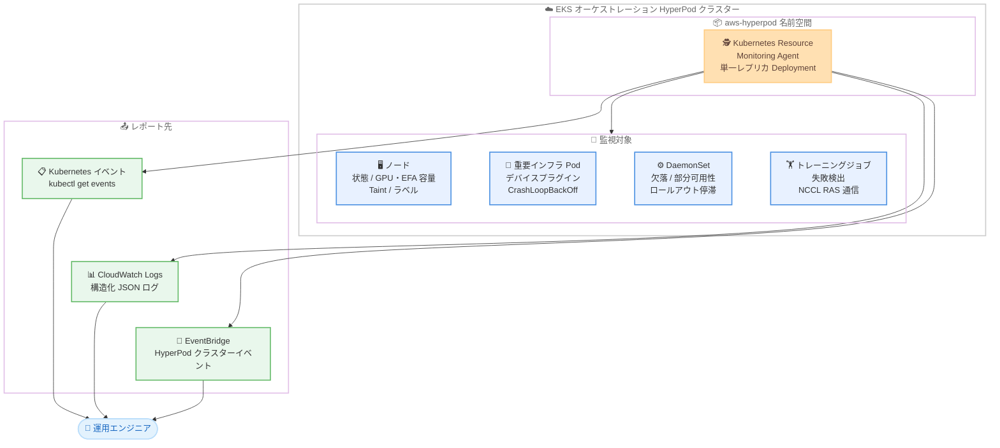

# Amazon SageMaker HyperPod - Kubernetes Resource Monitoring Agent によるトレーニング阻害要因の検出

**リリース日**: 2026 年 11 月 23 日
**サービス**: Amazon SageMaker HyperPod
**機能**: HyperPod Kubernetes Resource Monitoring Agent

📊 [このアップデートのインフォグラフィックを見る](https://takech9203.github.io/aws-news-summary/20261123-amazon-sagemaker-hyperpod-k8s-monitoring-agent.html)

## 概要

Amazon SageMaker HyperPod が、Amazon EKS でオーケストレーションされたクラスターにおいて、トレーニングを妨げる Kubernetes の問題 (クラッシュループするデバイスプラグイン、欠落した DaemonSet など) を検出できるようになりました。新しい **HyperPod Kubernetes Resource Monitoring Agent** がクラスター内で 1 つ稼働し、すべてのノード、重要な Pod (NVIDIA デバイスプラグインなど)、必須の DaemonSet、分散トレーニングジョブを継続的に監視します。

このエージェントは、検出した Kubernetes の問題を影響を受ける特定のトレーニングジョブと関連付け、Kubernetes イベント、構造化された Amazon CloudWatch ログ、および Amazon EventBridge 経由で受け取れる HyperPod クラスターイベントとしてレポートします。例えば、実行中にあるノードでデバイスプラグインが繰り返しクラッシュして GPU が脱落した場合、エージェントはそのノードにフラグを立て、ジョブ失敗時には関係する Pod とノードを含む失敗理由をログに記録します。これにより、ノードの修復とジョブの再開を迅速に行えます。さらに、オプトインしたジョブについては、NCCL 通信が停滞した際にどのランクが遅れているかをジョブ実行中に特定できます。

大規模な GPU クラスターで分散トレーニングを運用する ML インフラエンジニアや Platform チームにとって、障害発生時の原因特定時間 (MTTR) を大幅に短縮できる重要なアップデートです。

**アップデート前の課題**

このアップデート以前は、Kubernetes レイヤーの問題がトレーニングジョブに与える影響を特定することが困難でした。

- デバイスプラグインがクラッシュループしたり、Taint によって Pod が退避されたりしても、ジョブのエラーメッセージに原因となった Pod やノードの名前が含まれることはほとんどなかった
- エンジニアは kubectl の出力とランクごとのログを突き合わせて、根本原因を手動で再構築する必要があった
- 既存の Health Monitoring Agent はハードウェアやホストレベルの障害 (GPU エラー、EC2 プラットフォームエラーなど) を検出するが、Kubernetes クラスターレベルの問題 (DaemonSet の欠落、重要 Pod の異常など) はカバーしていなかった
- NCCL 集合通信の停滞が発生しても、ジョブ実行中にどのランクが原因かを特定する手段がなかった

**アップデート後の改善**

- クラッシュループするデバイスプラグイン、欠落した DaemonSet、ノードの状態悪化、GPU / EFA 容量の減少などを自動検出し、影響を受けるトレーニングジョブと関連付けられるようになった
- ジョブ失敗時に、失敗理由と関係する Pod・ノードが構造化ログとして記録されるため、原因調査の手作業が不要になった
- 検出結果が Kubernetes イベント、CloudWatch ログ、EventBridge へのクラスターイベントの 3 つの経路で通知され、既存の運用ワークフローに統合しやすくなった
- NCCL RAS モニタリングにより、ジョブ実行中に GPU 間集合通信の健全性 (healthy / degraded / unhealthy) を把握できるようになった

## アーキテクチャ図



Kubernetes Resource Monitoring Agent はクラスターごとに 1 つ稼働し、ノード・重要 Pod・DaemonSet・トレーニングジョブをクラスター全体のインフォーマーで監視します。検出した問題は Kubernetes イベント、CloudWatch Logs、EventBridge の 3 経路でレポートされます。

## サービスアップデートの詳細

### 主要機能

1. **ノードの監視**
   - ノードの `Ready` 状態や `MemoryPressure`、`DiskPressure`、`PIDPressure`、`NetworkUnavailable` 状態の悪化を検出
   - 割り当て可能な NVIDIA GPU (`nvidia.com/gpu`) がインスタンスタイプの提供数より少なくなった場合を検出 (Ready になった直後のノードには 10 分間の猶予期間あり)
   - EFA デバイス (`vpc.amazonaws.com/efa`) の容量減少も同様に検出
   - GPU ノードが NVIDIA の capability ラベルを失った場合を検出 (デバイスプラグインやドライバーの問題を示唆)
   - ノードへの Taint 追加や効果の変更を検出し、`NoExecute` Taint の場合は退避される可能性のある Pod とジョブをログに記録
   - HyperPod 管理ラベルの欠落を検証 (新規ノードには 5 分間の猶予期間あり)

2. **重要インフラ Pod の監視**
   - `kube-system`、`aws-hyperpod`、`kubeflow`、`nvidia-gpu-addon` 名前空間の DaemonSet 所有 Pod、Kubeflow training operator の Pod、エージェント自身の Pod を重要 Pod として扱う
   - 失敗、`CrashLoopBackOff`、コンテナエラー、5 分間実行状態にならない Pod を検出
   - 重要 Pod の再起動回数の増加や、1 分以上 Not Ready が続く Pod を検出
   - 各 Pod を所有するトレーニングジョブとノードにマッピングし、リソース間で問題を関連付け

3. **DaemonSet の監視**
   - `monitoring.necessaryDaemonsets` に列挙された必須 DaemonSet (デフォルトは Health Monitoring Agent) の存在を 5 分ごとに検証
   - 5 分間すべての Pod が利用可能にならない部分的可用性低下を検出
   - 15 分間進捗のないロールアウトの停滞や、スケジュールミスの Pod を検出

4. **分散トレーニングジョブの監視**
   - HyperPod PyTorchJob、Kubeflow TrainJob (Trainer v2)、Kubeflow PyTorchJob (v1、レガシー) のライフサイクルを追跡
   - ジョブ失敗時に、失敗理由と影響を受けた Pod・ノードのコンテキストを含めてレポート
   - 対応する CRD がクラスターにインストールされていないジョブタイプの監視は自動的に無効化される

5. **NCCL 集合通信ヘルスの監視 (NCCL RAS)**
   - 各トレーニング Pod 上の NCCL RAS デーモン (デフォルト TCP ポート 28028) に定期接続し、ジョブレベルの健全性を判定
   - `healthy` (全エンドポイント正常) / `degraded` (一部エンドポイント到達不能 = GPU 通信の部分的喪失) / `unhealthy` (全エンドポイント失敗 = 集合通信の停滞・停止の可能性) の 3 段階で評価
   - NCCL 2.24 以降が必要。トレーニングコンテナで `NCCL_RAS_ADDR` を Pod IP に設定する必要がある

### 3 つのコンポーネントの役割分担

本エージェントは、既存の HyperPod 耐障害性コンポーネントを補完するものです。

| コンポーネント | 実行単位 | 役割 |
|------|------|------|
| Health Monitoring Agent | 各ノード | NVIDIA GPU エラー、AWS Trainium エラー、EC2 プラットフォームエラーなどハードウェア・ホストレベルの障害検出。ノードの自動交換・再起動と連携 |
| Kubernetes Resource Monitoring Agent (新規) | クラスターごとに 1 つ | ノード・Pod・DaemonSet・トレーニングジョブにまたがる Kubernetes クラスターレベルの問題検出 |
| HyperPod training operator | ジョブ単位 | 分散トレーニングジョブの実行と、プロセスレベル障害からの復旧 |

**注意**: 本エージェントはオブザーバビリティコンポーネントであり、問題の検出とレポートのみを行います。ノードやワークロードの修復は行いません (問題の原因がアプリケーションワークロード側にある可能性があるため)。

## 技術仕様

### デフォルトのデプロイ構成

| 項目 | 詳細 |
|------|------|
| ワークロード種別 | Deployment (1 レプリカ、maxSurge: 0 のローリング更新で 2 つのエージェントが同時に動かない) |
| 名前空間 | `aws-hyperpod` |
| イメージ | クラスターのリージョンの HyperPod Amazon ECR リポジトリ (`hyperpod-cluster-monitoring-agent`) |
| ヘルスポート | 8081/TCP (`/healthz`、`/readyz`、`/health` エンドポイント) |
| スケジューリング | NVIDIA GPU インスタンスタイプ (ml.p4d、ml.p4de、ml.p5、ml.p5e、ml.p6、ml.g5、ml.g6、ml.g6e、ml.gr6 系) を優先ノードアフィニティで回避し、トレーニング用 GPU 容量を消費しない |
| リソース | CPU: 100m 要求 / 200m 上限、メモリ: 512Mi 要求 / 1Gi 上限 |
| セキュリティ | 非 root (UID 1000)、読み取り専用ルートファイルシステム、全 Linux capability を削除 |
| ログボリューム | ホストパス `/var/log/aws` をコンテナにマウント |

### レポートされる主な Kubernetes イベント

| イベント理由 | 意味 |
|------|------|
| `NodeConditionDegraded` | ノードの状態 (Ready、MemoryPressure など) が悪化 |
| `NodeResourceDegraded` | 割り当て可能な GPU / EFA デバイスがインスタンスタイプの提供数または以前の報告数より減少 |
| `NodeGPUCapabilityLost` | GPU ノードが NVIDIA capability ラベルを喪失 |
| `NoExecuteTaintApplied` | NoExecute Taint が適用され、Pod とジョブが退避される可能性 |
| `CriticalPodCrashLoop` | 重要インフラ Pod が CrashLoopBackOff 状態に |
| `NecessaryDaemonSetMissing` | 必須の DaemonSet が欠落 |
| `DaemonSetRolloutStalled` | DaemonSet のロールアウトが停滞 |
| `TrainingJobFailed` | 分散トレーニングジョブが失敗 |
| `NCCLProtocolErrorsPersistent` | NCCL RAS がジョブの持続的なプロトコルエラーを報告 |
| `MonitoringDegraded` | エージェント自身が一部リソースを監視できない状態 |

問題が解消した際は `NodeRecovered`、`PodRecovered`、`DaemonSetRecovered` などの Normal イベントが発行されます。

### レポート経路

1. **Kubernetes イベント**: 影響を受けたノード・Pod・DaemonSet・ジョブに Warning イベントを作成。`kubectl get events` や `kubectl describe` で確認可能
2. **構造化 CloudWatch ログ**: 影響を受けたノード・Pod・ジョブとトリガーとなった変化を含む JSON ログを、HyperPod クラスターロググループ `/aws/sagemaker/Clusters/{cluster-name}/{cluster-id}` のログストリーム `SageMakerClusterMonitoringAgent/{instance-group}/{instance-id}` に出力
3. **HyperPod クラスターイベント (EventBridge)**: クラスタースコープの `HyperPodKRMAConfig` オブジェクトにヘルスレポートを保持し、HyperPod が変化をクラスターイベントに変換。`ListClusterEvents` / `DescribeClusterEvent` API で一覧でき、デフォルトイベントバスにソース `aws.sagemaker`、詳細タイプ `SageMaker HyperPod Cluster Event` として配信される (クラスターイベントは `NodeProvisioningMode` が `Continuous` のクラスターで利用可能)

## 設定方法

### 前提条件

1. Amazon EKS でオーケストレーションされた SageMaker HyperPod クラスター
2. Helm と kubectl がセットアップ済みであること
3. ノードから対象リージョンの Amazon ECR へのネットワーク経路があること
4. NCCL RAS モニタリングを使用する場合は NCCL 2.24 以降

### 手順

#### ステップ 1: HyperPod Helm チャートでエージェントを有効化してインストール

```bash
git clone https://github.com/aws/sagemaker-hyperpod-cli.git
cd sagemaker-hyperpod-cli/helm_chart
helm dependencies update HyperPodHelmChart
helm install dependencies HyperPodHelmChart \
  --namespace kube-system \
  --set hyperpod-kubernetes-resource-monitor.enabled=true \
  --set hyperpod-kubernetes-resource-monitor.region=<リージョン>
```

HyperPod Helm チャートの `hyperpod-kubernetes-resource-monitor` サブチャートを有効化してインストールします。サブチャートはデフォルトで無効のため、`enabled=true` の指定が必要です。エージェントは `aws-hyperpod` 名前空間にデプロイされます。

#### ステップ 2: 既存クラスターへの追加 (チャートインストール済みの場合)

```bash
kubectl apply -f HyperPodHelmChart/charts/hyperpod-kubernetes-resource-monitor/crds/
helm upgrade dependencies HyperPodHelmChart \
  --namespace kube-system \
  --reuse-values \
  --set hyperpod-kubernetes-resource-monitor.enabled=true \
  --set hyperpod-kubernetes-resource-monitor.region=<リージョン>
```

Helm はアップグレード時に CRD をインストールしないため、先にエージェントの CRD (`HyperPodKRMAConfig`) を適用してからリリースをアップグレードします。

#### ステップ 3: デプロイの確認

```bash
kubectl get deployment -n aws-hyperpod hyperpod-kubernetes-resource-monitoring-agent
kubectl get pods -n aws-hyperpod -l app=cluster-monitoring-agent
kubectl get hyperpodkrmaconfigs default
```

エージェントの Deployment と Pod が稼働していること、ヘルスレポートを保持する `HyperPodKRMAConfig` オブジェクトが作成されていることを確認します。

#### ステップ 4: エージェントが発行するイベントの確認

```bash
kubectl get events -A --field-selector source=hyperpod-kubernetes-resource-monitoring-agent
```

エージェントがソースとなっている Kubernetes イベントをすべての名前空間から一覧表示します。

#### ステップ 5: 必須 DaemonSet の宣言 (任意)

```yaml
monitoring:
  necessaryDaemonsets:
    - name: "health-monitoring-agent"
      namespace: "aws-hyperpod"
    - name: "dependencies-nvidia-device-plugin"
      namespace: "kube-system"
    - name: "dependencies-aws-efa-k8s-device-plugin"
      namespace: "kube-system"
```

クラスターが依存する DaemonSet を Helm 値 `monitoring.necessaryDaemonsets` に宣言すると、5 分ごとに存在が検証され、欠落時に `NecessaryDaemonSetMissing` イベントが発行されます。リストを設定するとデフォルトが置き換えられるため、Health Monitoring Agent のエントリは必ず残します。

#### ステップ 6: NCCL RAS モニタリングの有効化 (任意)

```yaml
env:
  - name: POD_IP
    valueFrom:
      fieldRef:
        fieldPath: status.podIP
  - name: NCCL_RAS_ADDR
    value: "$(POD_IP):28028"
```

NCCL はデフォルトで localhost のみで RAS クライアントを待ち受けるため、各トレーニングコンテナで `NCCL_RAS_ADDR` を Pod IP に設定し、エージェントから到達可能にします。RAS ソケットを外部到達可能にするセキュリティ上の影響を考慮し、ポート 28028 へのアクセスをエージェントの Pod のみに制限する Kubernetes NetworkPolicy の併用が推奨されています。

## メリット

### ビジネス面

- **MTTR の短縮**: ジョブ失敗の原因となった Pod とノードが自動的に特定・記録されるため、原因調査にかかる時間が大幅に削減され、高価な GPU クラスターのアイドル時間を最小化できる
- **GPU 投資の保護**: デバイスプラグインのクラッシュなどで GPU がジョブから脱落する問題を早期に検知でき、計算リソースの無駄を防げる
- **運用負荷の軽減**: kubectl 出力とランクごとのログを突き合わせる手作業の調査が不要になり、ML インフラチームの運用負荷が下がる

### 技術面

- **ジョブとインフラ問題の自動関連付け**: Kubernetes レベルの問題 (Taint、DaemonSet 欠落など) が、影響を受ける具体的なトレーニングジョブと紐付けてレポートされる
- **3 経路での通知**: Kubernetes イベント、CloudWatch Logs、EventBridge という標準的な仕組みでレポートされるため、既存の監視・アラートパイプラインに統合しやすい
- **トレーニングへの影響なし**: 単一レプリカで GPU インスタンスを避けてスケジュールされ、CPU 100m / メモリ 512Mi という小さなフットプリントで動作する
- **実行中ジョブの NCCL 可視化**: ジョブ完了を待たずに、NCCL 集合通信の停滞やどのランクが遅れているかを把握できる

## デメリット・制約事項

### 制限事項

- EKS オーケストレーションの HyperPod クラスターのみが対象 (Slurm オーケストレーションは対象外)
- 検出とレポートのみを行うオブザーバビリティコンポーネントであり、ノードやワークロードの自動修復は行わない
- HyperPod 管理ノードでのみ動作する。HyperPod が管理しないノードで起動した場合はメッセージをログに記録して終了する
- HyperPod クラスターイベント (EventBridge 配信) は `NodeProvisioningMode` が `Continuous` のクラスターでのみ利用可能
- HyperPod Helm チャートではサブチャートがデフォルト無効のため、明示的な有効化が必要
- ジョブタイプごとの監視は対応する CRD がインストールされている場合のみ動作する

### 考慮すべき点

- NCCL RAS モニタリングには NCCL 2.24 以降と、トレーニングコンテナでの `NCCL_RAS_ADDR` 設定が必要
- `NCCL_RAS_ADDR` を Pod IP に設定すると、クラスター内の任意の Pod からトレーニング Pod の NCCL RAS 状態を照会できてしまうため、NetworkPolicy によるアクセス制限を検討する必要がある (EKS では VPC CNI プラグインのネットワークポリシーサポートの有効化が前提)
- Pod モニターは `monitoring.monitoredNamespaces` (デフォルト: `aws-hyperpod`、`kube-system`、`default`、`kubeflow`) に列挙された名前空間のみを監視するため、別の名前空間でジョブを実行する場合はリストへの追加が必要
- `monitoring.necessaryDaemonsets` を設定するとデフォルトのリストが置き換えられるため、Health Monitoring Agent のエントリを残す必要がある

## ユースケース

### ユースケース 1: デバイスプラグイン障害による GPU 脱落の早期検知

**シナリオ**: 大規模な事前学習ジョブの実行中、あるノードで NVIDIA デバイスプラグインが繰り返しクラッシュし、そのノードの GPU がジョブから脱落する。従来はジョブ失敗後にランクごとのログから原因ノードを推測する必要があった。

**実装例**:
```bash
# エージェントが発行したイベントから問題のノードを特定
kubectl get events -A --field-selector source=hyperpod-kubernetes-resource-monitoring-agent

# CloudWatch Logs Insights で GPU 容量低下を検索
fields @timestamp, @message
| filter @message like /NodeResourceDegraded/
| sort @timestamp desc
```

**効果**: GPU が脱落した時点で `NodeResourceDegraded` / `CriticalPodCrashLoop` イベントにより問題ノードが特定され、ジョブ失敗時には失敗理由と関係する Pod・ノードが記録される。ノード修復とジョブ再開までの時間を大幅に短縮できる。

### ユースケース 2: クラスターイベントによる運用アラートの自動化

**シナリオ**: ML プラットフォームチームが、Health Monitoring Agent の停止や GPU 容量低下などのクラスター健全性の問題を、既存のインシデント管理フローに自動で通知したい。

**実装例**:
```json
{
  "source": ["aws.sagemaker"],
  "detail-type": ["SageMaker HyperPod Cluster Event"]
}
```

**効果**: 上記イベントパターンの EventBridge ルールを作成し、Amazon SNS トピックなどをターゲットに設定することで、障害発生時 (Warn) と回復時 (Info) のイベントを自動で受信できる。未解消の障害は 6 時間ごとに繰り返し通知されるため、対応漏れを防げる。

### ユースケース 3: 実行中ジョブの NCCL 通信停滞の特定

**シナリオ**: 数百 GPU を使用する分散トレーニングで、NCCL 集合通信が停滞してスループットが低下した。従来はジョブを停止してログを解析するまで、どのランクが原因か分からなかった。

**実装例**:
```yaml
# トレーニングコンテナで NCCL RAS を外部到達可能に設定
env:
  - name: POD_IP
    valueFrom:
      fieldRef:
        fieldPath: status.podIP
  - name: NCCL_RAS_ADDR
    value: "$(POD_IP):28028"
```

**効果**: エージェントが 30 秒間隔 (デフォルト) で各トレーニング Pod の NCCL RAS デーモンに接続し、ジョブレベルの通信健全性を healthy / degraded / unhealthy の 3 段階で判定する。ジョブ実行中にどのランクが遅れているかを特定でき、問題のあるノードの切り離し判断を迅速化できる。

## 料金

公式発表に追加料金の記載はありません。エージェントは HyperPod クラスター内の軽量な Deployment として動作します。関連する SageMaker HyperPod のクラスター利用料金や、CloudWatch Logs のログ取り込み・保存料金は通常どおり発生します。詳細は [Amazon SageMaker の料金ページ](https://aws.amazon.com/sagemaker/pricing/) を参照してください。

## 利用可能リージョン

Amazon EKS オーケストレーションの SageMaker HyperPod クラスターで利用可能なすべての AWS リージョンで利用できます。

## 関連サービス・機能

- **Amazon EKS**: HyperPod クラスターのオーケストレーションレイヤー。本エージェントは EKS オーケストレーションのクラスター専用
- **HyperPod Health Monitoring Agent**: 各ノードで動作し、GPU / Trainium / EC2 プラットフォームレベルの障害を検出する既存コンポーネント。本エージェントはこれを補完し、必須 DaemonSet としての存在確認も行う
- **HyperPod training operator**: 分散トレーニングジョブの実行とプロセスレベル障害からの復旧を担うコンポーネント。本エージェントが監視する HyperPod PyTorchJob を提供する
- **Amazon CloudWatch Logs**: エージェントの構造化 JSON ログの出力先。Logs Insights でイベント理由による検索が可能
- **Amazon EventBridge**: HyperPod クラスターイベントの配信先。ルールを作成して SNS などへの通知を自動化できる

## 参考リンク

- 📊 [インフォグラフィック](https://takech9203.github.io/aws-news-summary/20261123-amazon-sagemaker-hyperpod-k8s-monitoring-agent.html)
- [公式発表 (What's New)](https://aws.amazon.com/about-aws/whats-new/2026/11/amazon-sagemaker-hyperpod-k8s-monitoring-agent/)
- [AWS Blog: Introducing workload recovery and expanded infrastructure checks on Amazon SageMaker HyperPod](https://aws.amazon.com/blogs/machine-learning/introducing-workload-recovery-and-expanded-infrastructure-checks-on-amazon-sagemaker-hyperpod/)
- [ドキュメント: Kubernetes Resource Monitoring Agent](https://docs.aws.amazon.com/sagemaker/latest/dg/sagemaker-hyperpod-eks-resiliency-kubernetes-resource-monitoring-agent.html)
- [HyperPod Helm チャート (GitHub)](https://github.com/aws/sagemaker-hyperpod-cli/tree/main/helm_chart/HyperPodHelmChart)
- [料金ページ](https://aws.amazon.com/sagemaker/pricing/)

## まとめ

SageMaker HyperPod の Kubernetes Resource Monitoring Agent により、これまで kubectl 出力とランクごとのログから手動で推測するしかなかった Kubernetes レベルの障害原因 (クラッシュループするデバイスプラグイン、欠落した DaemonSet、Taint による退避など) が、影響を受けるトレーニングジョブと関連付けて自動検出されるようになりました。EKS オーケストレーションの HyperPod クラスターを運用しているチームは、Helm チャートでサブチャートを有効化するだけで導入できるため、まず必須 DaemonSet の宣言と EventBridge ルールの設定から始めることを推奨します。NCCL 2.24 以降を利用している場合は、NCCL RAS モニタリングによる実行中ジョブの通信健全性の可視化も検討する価値があります。
