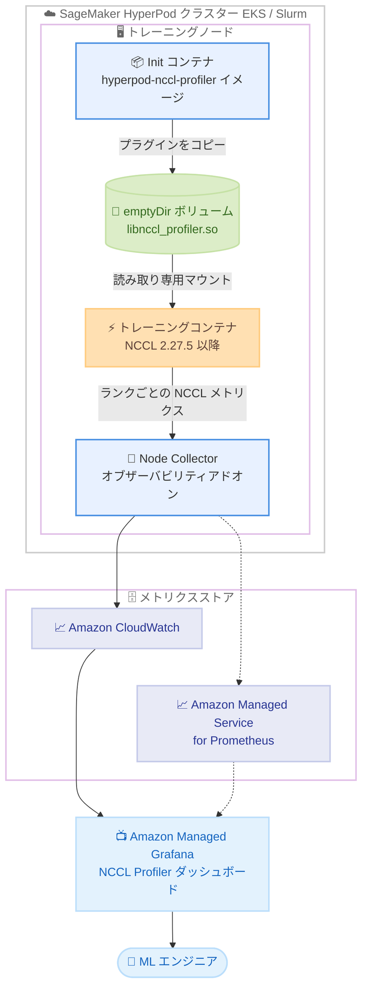

# Amazon SageMaker HyperPod - トレーニングジョブの NCCL プロファイリングサポート

**リリース日**: 2026 年 11 月 23 日
**サービス**: Amazon SageMaker HyperPod
**機能**: HyperPod NCCL Profiler (トレーニングジョブの NCCL 通信プロファイリング)

📊 [このアップデートのインフォグラフィックを見る](https://takech9203.github.io/aws-news-summary/20261123-amazon-sagemaker-hyperpod-nccl-profiler.html)

## 概要

Amazon SageMaker HyperPod が、トレーニングジョブに対する NVIDIA Collective Communications Library (NCCL) プロファイリングをサポートしました。新しい HyperPod NCCL Profiler は、分散トレーニングジョブのノードと GPU 間における通信パフォーマンスを可視化します。

分散トレーニングでは、AllReduce、AllGather、ReduceScatter などの NCCL 集合通信によって GPU 間の同期が行われます。集合通信はすべてのランクが到達して初めて完了するため、1 つの遅い GPU、リンク、ホストがジョブ全体を遅くし、しかもエラーを出さないことが多くあります。HyperPod NCCL Profiler はプラグインとしてトレーニングジョブにロードされ、トレーニングコードの変更なしに、ランクごとの帯域幅と実行時間のメトリクスを Amazon CloudWatch または Amazon Managed Service for Prometheus に送信します。Amazon Managed Grafana のダッシュボードで結果を確認でき、ジョブを停止することなくボトルネックとなっているノードや GPU を特定できます。

数百から数千の AI アクセラレーターにまたがる生成 AI モデル開発を行う ML エンジニアやインフラ担当者にとって、通信性能の劣化を迅速に切り分けられる重要なアップデートです。

**アップデート前の課題**

このアップデート以前は、分散トレーニングの通信性能の問題を診断する手段が限られていました。

- スロットリングされた 1 つの GPU や劣化したリンクが、エラーを出さずに分散トレーニングジョブ全体を遅くすることがあった
- 原因を診断するには、ジョブを停止して NCCL テスト (nccl-tests) を実行する必要があった
- ネットワークの問題なのか、特定の GPU の故障なのかを切り分けることが困難だった

**アップデート後の改善**

今回のアップデートにより、稼働中のジョブを止めずに通信性能を分析できるようになりました。

- プロファイラーがトレーニングジョブにプラグインとしてロードされ、トレーニングコードの変更が不要になった
- ランクごとの帯域幅・実行時間・待機時間のメトリクスを CloudWatch または Amazon Managed Service for Prometheus に送信し、Grafana ダッシュボードで確認できるようになった
- スループットがエラーなしで低下した場合、ダッシュボードがピアより遅れている GPU を持つノードを特定し、スロットリングの有無を示すようになった
- 全ノードで同時に帯域幅が低下した場合はその状況も表示され、ネットワークの問題と GPU の故障を区別できるようになった

## アーキテクチャ図



Init コンテナがプロファイラープラグインをボリューム経由でトレーニングコンテナに配置し、NCCL が起動時にプラグインをロードします。収集されたメトリクスは同一ノード上のオブザーバビリティアドオンのコレクターを経由してメトリクスストアに送信され、Amazon Managed Grafana の NCCL Profiler ダッシュボードで可視化されます。

## サービスアップデートの詳細

### 主要機能

1. **トレーニングコード変更不要の NCCL プロファイリング**
   - プロファイラーは NCCL プロファイラープラグイン (`libnccl_profiler.so`) として、トレーニングコンテナ内の NCCL ライブラリが起動時にロードする
   - 各集合通信および送受信操作の GPU 上での実行を計測する
   - ジョブごとに有効化する方式で、設定していないジョブはプロファイリングされない
   - プロファイラーがメトリクスを送信できない場合でも、トレーニングは影響を受けずに継続する

2. **ランクごとの詳細メトリクス**
   - 帯域幅 (アルゴリズム帯域幅・バス帯域幅)、実行時間、待機時間をランク単位で収集する
   - メトリクスには GPU UUID が付与され、アドオンが収集する GPU 使用率、クロック、温度、エラーなどの DCGM メトリクスと並べて確認できる
   - テンソルデータやモデルの内容は収集せず、パフォーマンスメトリクスのみを送信する

3. **NCCL Profiler ダッシュボード**
   - SageMaker HyperPod コンソールで Amazon Managed Grafana ワークスペースと連携してアドオンをセットアップすると、NCCL Profiler ダッシュボードが自動でインストールされる
   - ジョブレベルから単一 GPU まで掘り下げて、ピアより遅れているノードや GPU、通信グループ (コミュニケーター) ごとの帯域幅を確認できる
   - ノード内通信とノード間通信、メッセージサイズ別、NCCL アルゴリズム・プロトコル別の分析が可能

4. **柔軟なメトリクスストアの選択**
   - Amazon CloudWatch または Amazon Managed Service for Prometheus のいずれかにメトリクスを送信できる
   - CloudWatch の場合は PromQL でクエリでき、CloudWatch アラームの作成も可能

## 技術仕様

### NCCL メトリクス一覧

| メトリクス | 単位 | 説明 |
|------|------|------|
| `nccl_collective_exec_time_microseconds` | マイクロ秒 | 集合通信の GPU カーネル実行時間 |
| `nccl_collective_wait_time_microseconds` | マイクロ秒 | 集合通信の発行から最初の GPU カーネル開始までの時間 |
| `nccl_collective_algobw_gbs` / `nccl_algorithm_bandwidth_gbs` | GB/s | アルゴリズム帯域幅 (ランクあたりの転送データ量 ÷ 実行時間) |
| `nccl_bus_bandwidth_gbs` | GB/s | バス帯域幅 (ランク数で調整した帯域幅。nccl-tests の結果と比較可能) |
| `nccl_p2p_exec_time_microseconds` | マイクロ秒 | Send/Recv 操作の GPU 実行時間 |
| `nccl_p2p_wait_time_microseconds` | マイクロ秒 | Send/Recv 操作の発行からカーネル開始までの時間 |
| `nccl_p2p_bus_bandwidth_gbs` / `nccl_p2p_algobw_gbs` | GB/s | Send/Recv 操作の帯域幅 |

各データポイントには `job_name`、`hostname`、`rank`、`comm_id`、`gpu_uuid`、`op` (AllReduce、AllGather など)、`algo`、`proto`、`message_size` などのディメンションが付与されます。

### 動作仕様

| 項目 | 詳細 |
|------|------|
| 配布形式 | リージョンごとの ECR コンテナイメージ `{account-id}.dkr.ecr.{region}.amazonaws.com/hyperpod-nccl-profiler:latest` |
| 送信間隔 | デフォルト設定 (`profiler.toml`) で 10 秒ごとにメトリクスを送信 |
| 計測対象 | 8 KiB 以上の操作 (それ未満はレイテンシーが支配的なため計測対象外) |
| 必要な NCCL バージョン | 2.27.5 以降 |
| オーバーヘッド | 検証 (最大 13B パラメータのモデル、ml.g7.48xlarge x 2 ノード) でランクあたり約 1.5 ホスト CPU コア、150〜190 MiB のホストメモリを使用。GPU メモリは不使用。ネットワーク性能が安定している場合、トレーニングのステップ時間に変化なし |

### 環境変数の設定

```yaml
env:
  - name: NCCL_PROFILER_PLUGIN       # 必須: プラグインのパス
    value: /opt/amazon/hyperpod-nccl-profiler/libnccl_profiler.so
  - name: HYPERPOD_NCCL_PROFILER_CONFIG  # 必須: 設定ファイルのパス
    value: /opt/amazon/hyperpod-nccl-profiler/profiler.toml
  - name: HYPERPOD_JOB_NAME          # ダッシュボード用: job_name ディメンション
    value: fsdp2
  - name: HYPERPOD_JOB_ID            # ダッシュボード用: ジョブ一覧に表示される
    value: run-1
  - name: NODE_NAME                  # 推奨: hostname ディメンション
    valueFrom:
      fieldRef:
        fieldPath: spec.nodeName
  - name: NCCL_DEBUG                 # 推奨: プロファイラーの警告をログに出力
    value: WARN
```

## 設定方法

### 前提条件

1. Amazon EKS でオーケストレーションされ、NVIDIA GPU インスタンスを持つ SageMaker HyperPod クラスター (Slurm クラスターはオブザーバビリティ拡張の設定で対応)
2. SageMaker HyperPod オブザーバビリティアドオンのセットアップ
3. トレーニングコンテナ内の NCCL バージョン 2.27.5 以降

### 手順 (EKS オーケストレーションの場合)

#### ステップ 1: ポッドテンプレートにボリュームと Init コンテナを追加

```yaml
volumes:
  - name: hyperpod-nccl-profiler
    emptyDir: {}
initContainers:
  - name: install-nccl-profiler
    image: {{account-id}}.dkr.ecr.{{region}}.amazonaws.com/hyperpod-nccl-profiler:latest
    command:
      - sh
      - -c
      - cp -v /hyperpod-nccl-profiler/libnccl_profiler.so /hyperpod-nccl-profiler/profiler.toml /opt/amazon/hyperpod-nccl-profiler/
    volumeMounts:
      - name: hyperpod-nccl-profiler
        mountPath: /opt/amazon/hyperpod-nccl-profiler
```

PyTorchJob や HyperPodPyTorchJob のポッドテンプレートに `emptyDir` ボリュームを追加し、Init コンテナがプロファイラーイメージからプラグイン (`libnccl_profiler.so`) とデフォルト設定ファイル (`profiler.toml`) をボリュームにコピーします。リージョンごとのアカウント ID はドキュメントに記載されています (東京リージョン ap-northeast-1 は `533267052152`)。

#### ステップ 2: トレーニングコンテナにボリュームをマウントし環境変数を設定

```yaml
containers:
  - name: pytorch
    volumeMounts:
      - name: hyperpod-nccl-profiler
        mountPath: /opt/amazon/hyperpod-nccl-profiler
        readOnly: true
    env:
      - name: NCCL_PROFILER_PLUGIN
        value: /opt/amazon/hyperpod-nccl-profiler/libnccl_profiler.so
      - name: HYPERPOD_NCCL_PROFILER_CONFIG
        value: /opt/amazon/hyperpod-nccl-profiler/profiler.toml
```

ボリュームを読み取り専用でマウントし、`NCCL_PROFILER_PLUGIN` と `HYPERPOD_NCCL_PROFILER_CONFIG` を設定することで、NCCL がジョブ起動時にプロファイラーをロードします。独自のトレーニングイメージをビルドする場合は、Dockerfile の `COPY --from` でプロファイラーファイルをイメージに含めれば、Init コンテナとボリュームは不要です。

#### ステップ 3: メトリクスの到達を確認

```bash
# トレーニングポッドの状態を確認
kubectl get pods

# NCCL_DEBUG=INFO の場合、ログでプラグインのロードを確認
# 「PROFILER/Plugin: Loaded HYPERPOD_NCCL_PROFILER_V{n}」が出力される
```

トレーニング開始の数分後に、CloudWatch コンソールの Query Studio で `nccl_bus_bandwidth_gbs` を PromQL でクエリし、メトリクスの到達を確認します。以下は、ジョブ内の各 GPU の AllGather バス帯域幅を取得するクエリ例です。

```text
avg by (gpu_uuid, hostname) (nccl_bus_bandwidth_gbs{op="AllGather", job_name="{{my-job}}"})
```

## メリット

### ビジネス面

- **トレーニングの中断コスト削減**: 従来はジョブを停止して NCCL テストを実行する必要があったが、稼働中のジョブのまま診断でき、高価な GPU クラスターの停止時間を削減できる
- **GPU リソースの有効活用**: サイレントな性能劣化 (スロットリングやリンク劣化) を早期に検出し、数百〜数千のアクセラレーターの投資効果を最大化できる
- **障害切り分けの迅速化**: ネットワーク問題と GPU 故障を区別できるため、適切なチームへのエスカレーションと復旧が迅速になる

### 技術面

- **コード変更不要**: プラグイン方式のため、トレーニングスクリプトや分散学習フレームワークの変更なしに有効化できる
- **GPU メトリクスとの相関分析**: NCCL メトリクスと DCGM の GPU メトリクス (温度、クロック、スロットリング、XID エラーなど) が同じ GPU UUID で紐づくため、遅い GPU の根本原因を一画面で分析できる
- **低オーバーヘッドで安全**: GPU メモリを消費せず、ネットワークが安定していればステップ時間に影響しない。メトリクス送信に失敗してもトレーニングは継続する

## デメリット・制約事項

### 制限事項

- トレーニングコンテナ内の NCCL バージョン 2.27.5 以降が必要
- 8 KiB 未満の操作は計測されない (レイテンシーが支配的なため)
- GPU キューに 5 秒を超える処理が積まれている場合、該当の操作はデータポイントを生成せず、ジョブ稼働中でもメトリクスが途切れることがある (nccl-tests で大きなメッセージを使う場合は `-z 1` オプションを使用)
- NCCL メトリクスは `aws cloudwatch list-metrics` の出力には表示されず、PromQL でクエリする必要がある
- オブザーバビリティアドオンは CloudWatch と Amazon Managed Service for Prometheus の両方に同時送信できない

### 考慮すべき点

- ランクあたり約 1.5 ホスト CPU コアと 150〜190 MiB のホストメモリを消費するため、データローディングなどでホスト CPU がボトルネックのワークロードでは余裕を確保する必要がある
- `latest` タグはリリースごとに変わるため、検証済み構成を維持するにはイメージをダイジェストで参照することが推奨される
- `hostNetwork: true` を使用するトレーニングポッドでは `dnsPolicy: ClusterFirstWithHostNet` の設定が必要 (コレクターのクラスター DNS 名を解決するため)
- NCCL Profiler ダッシュボードには `HYPERPOD_JOB_ID` を設定したジョブのみが表示される

## ユースケース

### ユースケース 1: スループット低下時の遅延ノード特定

**シナリオ**: 大規模な FSDP トレーニング中に、エラーは出ていないがステップ時間が徐々に悪化している。どのノードが原因か特定したい。

**実装例**:
```text
NCCL Profiler ダッシュボードで対象の Job ID を選択し、
「Groups of N GPUs」行の「Nodes below 0.95x」「Slowest node」パネルを確認。
特定されたノードの「Per-GPU hardware DCGM」行で
温度、SM クロック、スロットリング時間、XID エラーを確認する。
```

**効果**: ジョブを停止せずに、他のランクを待たせている GPU とその原因 (サーマルスロットリングなど) を特定し、該当ノードの交換や修復を計画的に実施できる。

### ユースケース 2: ネットワーク問題と GPU 故障の切り分け

**シナリオ**: トレーニングの通信帯域幅が低下した。ネットワークインフラの問題なのか、特定の GPU の問題なのかを切り分けたい。

**実装例**:
```text
PromQL で全ランクのバス帯域幅を比較:
avg by (gpu_uuid, hostname) (nccl_bus_bandwidth_gbs{op="AllReduce", job_name="my-job"})

- 1 つのランクのみ実行時間が短い (帯域幅が高い) → 他ランクがそのランクを待っている
- 全ランクで同時に帯域幅が低下 → ネットワーク経路の輻輳など共有の原因
```

**効果**: ダッシュボードのパターン分析により、インフラチームへのエスカレーション (ネットワーク) かノード交換 (GPU 故障) かを迅速に判断できる。

### ユースケース 3: ハング検出と通信グループ別の分析

**シナリオ**: 大規模ジョブが進捗しなくなった。どのランクが停止しているのか、またテンソル並列とデータ並列のどちらの通信グループに問題があるのかを調べたい。

**実装例**:
```text
- メトリクスの報告が止まったシリーズ (ランク) を特定 → ハングの疑い
- comm_id / comm_name ディメンションでフィルタリングし、
  テンソル並列グループとデータ並列グループの帯域幅を分離して比較
- 「inside vs across nodes」行でノード内通信とノード間通信を比較
```

**効果**: 集合通信を完了しなくなったランクを特定してハングを検出できる。また、ノード内 NVLink とノード間ネットワークのどちらで性能が劣化したかをメッセージサイズ別に分析できる。

## 料金

HyperPod NCCL Profiler 自体の追加料金に関する記載は公式発表にはありません。メトリクスの保存とクエリには、送信先として選択した Amazon CloudWatch または Amazon Managed Service for Prometheus、およびダッシュボード表示に使用する Amazon Managed Grafana の標準料金が適用されます。

## 利用可能リージョン

SageMaker HyperPod が利用可能なすべての AWS リージョンで、Amazon EKS または Slurm でオーケストレーションされたクラスター向けに利用できます。

プロファイラーのコンテナイメージは、東京 (ap-northeast-1)、ソウル (ap-northeast-2)、ムンバイ (ap-south-1)、シンガポール (ap-southeast-1)、シドニー (ap-southeast-2)、バージニア北部 (us-east-1)、オハイオ (us-east-2)、オレゴン (us-west-2)、フランクフルト (eu-central-1)、アイルランド (eu-west-1) を含む各リージョンの ECR で提供されています。リージョンごとのアカウント ID はドキュメントを参照してください。

## 関連サービス・機能

- **SageMaker HyperPod オブザーバビリティアドオン**: NCCL メトリクスの送信経路となるアドオン。DCGM、ノードエクスポーター、EFA、Kueue などのメトリクスも収集し、本プロファイラーの前提条件となる
- **Amazon CloudWatch**: メトリクスストアの選択肢の 1 つ。Query Studio での PromQL クエリや、PromQL ベースのアラーム作成が可能
- **Amazon Managed Service for Prometheus**: もう 1 つのメトリクスストアの選択肢。既存の Prometheus ベースの監視基盤と統合できる
- **Amazon Managed Grafana**: NCCL Profiler ダッシュボードのホスト先。NCCL メトリクスと GPU ハードウェアメトリクスを並べて可視化する
- **Elastic Fabric Adapter (EFA)**: HyperPod のノード間高速通信を担うネットワークインターフェイス。NCCL メトリクスと合わせてネットワーク性能の分析に活用できる

## 参考リンク

- 📊 [インフォグラフィック](https://takech9203.github.io/aws-news-summary/20261123-amazon-sagemaker-hyperpod-nccl-profiler.html)
- [公式発表 (What's New)](https://aws.amazon.com/about-aws/whats-new/2026/11/amazon-sagemaker-hyperpod-nccl-profiler/)
- [ドキュメント: Monitoring NCCL communication in training jobs on SageMaker HyperPod clusters](https://docs.aws.amazon.com/sagemaker/latest/dg/hyperpod-observability-nccl-metrics.html)
- [ドキュメント: Amazon EKS クラスターのオブザーバビリティアドオン](https://docs.aws.amazon.com/sagemaker/latest/dg/sagemaker-hyperpod-observability-addon.html)
- [ドキュメント: Slurm 向けオブザーバビリティ拡張の設定](https://docs.aws.amazon.com/sagemaker/latest/dg/sagemaker-hyperpod-cluster-observability-slurm-extension-config.html)
- [NVIDIA NCCL プロファイラープラグイン (GitHub)](https://github.com/NVIDIA/nccl/blob/master/plugins/profiler/README.md)

## まとめ

HyperPod NCCL Profiler により、分散トレーニングの通信性能をジョブを停止せずに可視化できるようになり、従来はジョブ停止と NCCL テストの実行が必要だったボトルネック診断が大幅に効率化されます。大規模 GPU クラスターで HyperPod を運用しているチームは、オブザーバビリティアドオンのセットアップと NCCL 2.27.5 以降への更新を確認したうえで、主要なトレーニングジョブでプロファイラーを有効化することを推奨します。
