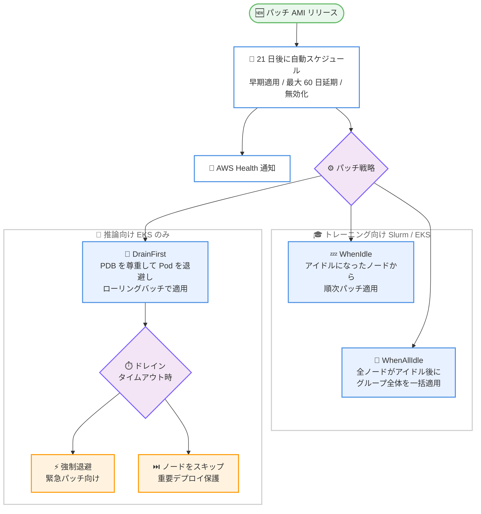

# Amazon SageMaker HyperPod - AMI 自動パッチ適用の Slurm クラスターおよび EKS 推論ワークロードへの拡張

**リリース日**: 2026 年 11 月 23 日
**サービス**: Amazon SageMaker HyperPod
**機能**: AMI 自動パッチ適用の Slurm 対応と EKS 向け DrainFirst パッチ戦略

📊 [このアップデートのインフォグラフィックを見る](https://takech9203.github.io/aws-news-summary/20261123-amazon-sagemaker-hyperpod-patching-slurm-eks-inference.html)

## 概要

Amazon SageMaker HyperPod が、Slurm オーケストレーションのクラスターに対する AMI 自動パッチ適用に対応しました。あわせて、推論ワークロードをデプロイする Amazon EKS オーケストレーションのクラスター向けに、新しいパッチ戦略「DrainFirst」が導入されました。SageMaker HyperPod は、基盤モデルの大規模なトレーニングとデプロイのために構築された専用インフラストラクチャであり、今回のアップデートにより、トレーニング・推論の両ワークロードでセキュリティパッチを自動的かつ安全に適用できるようになります。

各 HyperPod AMI には、NVIDIA ドライバー、CUDA、EFA、NCCL、OS カーネルを対象とするセマンティックバージョニング (major.minor.patch) に基づく ImageReleaseVersion が付与されます。自動パッチ適用は、選択中のバージョンライン (例: 1.4.x) に対するパッチレベルの更新のみを適用するため、トレーニングジョブを壊す可能性のあるメジャー / マイナーアップグレードを避けながら、セキュリティ修正を確実に取り込めます。

パッチ AMI がリリースされると、HyperPod は 21 日後にパッチ適用をスケジュールし、AWS Health を通じて通知します。早期適用、AMI リリース日から最大 60 日までの延期、または無効化を選択できるため、運用スケジュールに合わせた柔軟な管理が可能です。

**アップデート前の課題**

このアップデート以前は、クラスターの種類やワークロードによってパッチ適用に大きな運用負荷がありました。

- Slurm クラスターのパッチ適用には、トレーニングの終了待ち、ダウンタイムの調整、手動でのノード更新が必要で、管理者と研究者の間で数日にわたる調整が発生していた
- EKS クラスターの自動パッチ適用はノードがアイドルになるのを待つ方式のみで、トレーニングには適していたが、ほとんどアイドルにならない推論ノードはパッチ未適用のまま残っていた
- 長時間実行されるワークロードを中断せずにセキュリティパッチを適用する手段がなく、更新が先送りされがちだった

**アップデート後の改善**

今回のアップデートにより、以下が可能になりました。

- Slurm クラスターでノードがアイドルになったタイミングで自動的にパッチが適用され、実行中のジョブは中断されない
- EKS クラスターの推論ノードに対して、DrainFirst 戦略によりローリングバッチでパッチを適用でき、Pod Disruption Budget を尊重しながらモデルの提供を継続できる
- ドレインがタイムアウトした場合、緊急パッチでは強制退避、重要なデプロイ保護ではノードのスキップを選択できる
- パッチレベルの更新のみが適用されるため、既存のトレーニング / 推論コンテナとの後方互換性が維持される

## アーキテクチャ図



パッチ AMI のリリースから 21 日後に自動スケジュールされ、インスタンスグループごとに選択した戦略 (WhenIdle / WhenAllIdle / DrainFirst) に従ってワークロードを考慮したパッチ適用が実行される流れを示しています。

## サービスアップデートの詳細

### 主要機能

1. **Slurm クラスターの AMI 自動パッチ適用**
   - ノードがアイドルになったタイミングでのみパッチを適用するため、実行中のジョブは中断されない
   - 従来必要だったトレーニング終了待ち、ダウンタイム調整、手動ノード更新が不要になる
   - インスタンスグループ単位のオプトイン設定で、グループごとに異なる戦略を選択可能

2. **EKS 推論ワークロード向け DrainFirst 戦略**
   - ノードをコルドンして実行中の Pod を退避させた後、ローリングバッチでパッチを適用
   - Pod Disruption Budget (PDB) を尊重しながら Pod をドレインするため、モデルは提供を継続できる
   - `DeploymentConfig` の `MaximumBatchSize` で同時にパッチ適用するノード数を制御し、トラフィック処理に必要な容量を確保
   - `DrainPolicy` の `DrainTimeoutInSeconds` でドレイン待機時間を、`OnDrainTimeout` でタイムアウト時の動作 (強制退避またはスキップ) を設定可能

3. **セマンティックバージョニングに基づくパッチレベル更新**
   - 各 HyperPod AMI は NVIDIA ドライバー、CUDA、EFA、NCCL、OS カーネルを対象とする ImageReleaseVersion (major.minor.patch) を持つ
   - 選択中の major.minor ライン内のパッチ更新のみを適用 (例: 1.2.3 から 1.2.4)
   - マイナー / メジャーバージョン境界を越えることはなく、既存コンテナとの後方互換性を維持

4. **予測可能なパッチスケジュールと通知**
   - パッチ AMI リリース時に 21 日後のパッチ適用日を自動設定
   - `NextPatchDate` の変更により早期適用、または AMI リリース日から最大 60 日までの延期が可能
   - AMI 公開時、パッチ開始、部分完了、完了、失敗の各タイミングで AWS Health (PHD) 通知を受信
   - コンソールのクラスター詳細ページでパッチ進捗をリアルタイムに確認可能

## 技術仕様

### パッチ戦略の比較

| 戦略 | 動作 | 適するワークロード | 注意点 |
|------|------|--------------------|--------|
| WhenIdle | 全ノードをコルドンし、アイドルになったノードから個別にパッチ適用 | トレーニング (ノード単位で無停止適用) | 長時間実行ジョブによりノードが長期間未適用のまま残り、AMI バージョンが混在する可能性 |
| WhenAllIdle | 全ノードをコルドンし、グループ全体がアイドルになった時点で一括適用 | トレーニング (AMI バージョンの一貫性を重視) | グループが完全にドレインしない場合、パッチは失敗し次サイクルで再試行 |
| DrainFirst | Pod を退避させた後、バッチ単位のローリング更新で適用 | 推論などアイドルにならないワークロード | Pod の退避により実行中ワークロードに影響。`MaximumBatchSize` が必須で EKS オーケストレーションのみ対応 |

### 主要設定項目

| 項目 | 詳細 |
|------|------|
| 設定単位 | インスタンスグループごと (オプトイン)。`CreateCluster` / `UpdateCluster` の `AutoPatchConfig` で指定 |
| `PatchingStrategy` | `WhenIdle` / `WhenAllIdle` / `DrainFirst` |
| `IdleWaitWindowInSeconds` | アイドル待機時間。3600 (1 時間) ～ 2160000 (25 日)、デフォルト 86400 (24 時間)。`DrainFirst` には適用されない |
| `PatchSchedule.NextPatchDate` | ISO 8601 形式の UTC タイムスタンプ。パッチ AMI リリースから 60 日以内 |
| 前提条件 | AMI バージョニングが有効なクラスター (2026 年 1 月 1 日以降に作成されたクラスター) |
| ロールバック | 自動ロールバックは非対応。`UpdateClusterSoftware` API で以前の `ImageReleaseVersion` を指定して手動で実施 |

### アイドル判定 (EKS クラスター)

ノードは、アクティブなワークロード Pod が存在しない場合にアイドルと判定されます。以下は判定から除外されます。

- システム系 Namespace の Pod (`kube-system`、`aws-hyperpod`、`hyperpod-inference-system`、`kueue-system`、`amazon-cloudwatch` など)
- DaemonSet Pod、静的 Pod、完了済み Pod、削除処理中の Pod

また、コルドン / アンコルドン時には以下のノード属性が変更されます。

- ラベル `sagemaker.amazonaws.com/cordoned-by: AutoPatching` (コルドン時に付与、アンコルドン時に削除)
- ノード仕様 `spec.unschedulable: true` (コルドン時に設定、アンコルドン時に解除)
- ラベル `sagemaker.amazonaws.com/idle: true` (アイドル検出時に付与)

### 設定例

```json
{
    "ClusterName": "my-hyperpod-cluster",
    "InstanceGroups": [{
        "InstanceGroupName": "inference-group",
        "AutoPatchConfig": {
            "PatchingStrategy": "DrainFirst",
            "PatchSchedule": {
                "NextPatchDate": "2026-12-15T00:00:00Z"
            }
        }
    }]
}
```

## 設定方法

### 前提条件

1. SageMaker HyperPod クラスター (Slurm または Amazon EKS オーケストレーション) が作成済みであること
2. クラスターが AMI バージョニングに対応していること (2026 年 1 月 1 日以降に作成されたクラスター。それ以前に作成されたクラスターは対象外)
3. `UpdateCluster` / `DescribeCluster` API を呼び出す IAM 権限があること

### 手順

#### ステップ1: 自動パッチ適用の有効化

```bash
aws sagemaker update-cluster \
    --cli-input-json file://update_cluster.json
```

`update_cluster.json` のインスタンスグループ定義に `AutoPatchConfig` を追加して `update-cluster` を実行します。`PatchingStrategy` には、トレーニング向けの `WhenIdle` / `WhenAllIdle`、または EKS 推論向けの `DrainFirst` を指定します。クラスター作成時 (`create-cluster`) に設定することも可能です。

#### ステップ2: 設定とスケジュールの確認

```bash
aws sagemaker describe-cluster \
    --cluster-name my-hyperpod-cluster \
    --query 'InstanceGroups[0].AutoPatchConfig'
```

`describe-cluster` を実行し、対象インスタンスグループに設定された `PatchingStrategy` を確認します。出力例は `{ "PatchingStrategy": "WhenIdle" }` です。

#### ステップ3: パッチ適用日の調整 (必要に応じて)

```bash
aws sagemaker update-cluster \
    --cli-input-json file://update_cluster.json
```

`AutoPatchConfig` 内の `PatchSchedule.NextPatchDate` に ISO 8601 形式の UTC タイムスタンプを設定して `update-cluster` を実行します。デフォルトはパッチ AMI リリースの 21 日後で、早期適用またはリリース日から最大 60 日までの延期が可能です。自動パッチ適用を停止する場合は、`AutoPatchConfig` を含めずに `update-cluster` を実行します。

## メリット

### ビジネス面

- **運用コストの削減**: 管理者と研究者の間で数日かかっていたパッチ適用の調整作業が不要になり、運用チームの負荷を大幅に軽減
- **セキュリティコンプライアンスの向上**: 予測可能なスケジュール (21 日後の自動適用) でセキュリティパッチが確実に適用され、脆弱性の放置リスクを低減
- **サービス継続性の確保**: 推論エンドポイントがモデルの提供を継続したままパッチ適用が完了するため、ビジネスへの影響を最小化

### 技術面

- **ワークロードを考慮した適用**: アイドル検出 (WhenIdle / WhenAllIdle) や PDB を尊重したドレイン (DrainFirst) により、実行中のジョブや推論 Pod への影響を制御
- **後方互換性の維持**: パッチレベルの更新のみを適用し、NVIDIA ドライバー、CUDA、EFA、NCCL などのバージョン境界を越えないため、既存コンテナが壊れない
- **可視性の確保**: AWS Health (PHD) 通知とコンソール上のライブ進捗表示により、パッチ適用状況を常に把握可能。EventBridge ルールで SNS、Lambda、PagerDuty などへの通知転送も可能

## デメリット・制約事項

### 制限事項

- 2026 年 1 月 1 日より前に作成されたクラスターは AMI バージョニングがなく、自動パッチ適用の対象外
- `DrainFirst` 戦略は Amazon EKS オーケストレーションのクラスターのみ対応 (Slurm では利用不可)。また `DeploymentConfig` の `MaximumBatchSize` の設定が必須
- パッチ対象の AMI バージョンは選択できず、同じ major.minor ライン内の次のパッチバージョンに自動的に更新される
- 自動ロールバックは非対応。復元が必要な場合は `UpdateClusterSoftware` API による手動ロールバックが必要
- EKS コントロールプレーンのアップグレードや AMI のメジャー / マイナーバージョン更新は自動化されず、引き続きユーザーによる明示的な操作が必要

### 考慮すべき点

- `WhenIdle` では長時間実行ジョブによりノードが未適用のまま残り、インスタンスグループ内で AMI バージョンが一時的に混在する可能性がある。早期に収束させるには `UpdateClusterSoftware` API による手動アップグレードが必要
- `WhenAllIdle` では、アイドル待機時間 (デフォルト 24 時間) 内にグループ全体がドレインしない場合パッチが失敗する。長時間ジョブがある場合は `IdleWaitWindowInSeconds` の引き上げを検討
- `DrainFirst` では Pod の退避が発生するため、PDB の適切な設定と `MaximumBatchSize` による容量確保が重要
- コルドンされたノードには新しいワークロードがスケジュールされないため、パッチ適用期間中の実効キャパシティを考慮したジョブ計画が必要

## ユースケース

### ユースケース1: 長時間トレーニングを実行する Slurm クラスターの無停止パッチ適用

**シナリオ**: 基盤モデルの事前学習を数週間単位で実行している Slurm クラスターで、トレーニングを中断せずにセキュリティパッチを適用したい。

**実装例**:
```json
"AutoPatchConfig": {
    "PatchingStrategy": "WhenIdle",
    "IdleWaitWindowInSeconds": 604800
}
```

**効果**: ジョブが完了してアイドルになったノードから順次パッチが適用され、トレーニングの中断やダウンタイム調整が不要になる。アイドル待機時間を 7 日に延長することで、長時間ジョブにも対応できる。

### ユースケース2: 本番推論エンドポイントを提供する EKS クラスターの計画的パッチ適用

**シナリオ**: HyperPod 上の EKS クラスターで 24 時間 365 日稼働する推論エンドポイントを運用しており、ノードがアイドルにならないためパッチを適用できずにいた。

**実装例**:
```json
"AutoPatchConfig": {
    "PatchingStrategy": "DrainFirst"
}
```

あわせて `DeploymentConfig` の `MaximumBatchSize` でバッチサイズを、`DrainPolicy` でドレインタイムアウトとタイムアウト時の動作を設定する。

**効果**: PDB を尊重したローリングバッチ更新により、推論サービスを提供し続けながら予測可能なスケジュールでパッチ適用が完了する。

### ユースケース3: コンプライアンス要件に基づくパッチ適用タイミングの制御

**シナリオ**: 社内のセキュリティポリシーで脆弱性修正の適用期限が定められており、変更凍結期間を避けながら期限内にパッチを適用する必要がある。

**実装例**:
```json
"AutoPatchConfig": {
    "PatchingStrategy": "WhenAllIdle",
    "PatchSchedule": {
        "NextPatchDate": "2026-12-10T00:00:00Z"
    }
}
```

**効果**: AWS Health 通知でパッチ AMI の公開を把握し、`NextPatchDate` を調整することで、変更凍結期間を避けつつ AMI リリースから 60 日以内の任意のタイミングで適用できる。EventBridge 経由で通知を SNS や PagerDuty に転送すれば、運用チームへの自動連携も可能。

## 料金

AMI 自動パッチ適用機能自体に追加料金はありません。SageMaker HyperPod の利用料金は、クラスターを構成するインスタンスの稼働時間に基づいて課金されます。詳細は [Amazon SageMaker の料金ページ](https://aws.amazon.com/sagemaker/pricing/) を参照してください。

## 利用可能リージョン

Amazon SageMaker HyperPod が利用可能なすべての AWS リージョンで利用できます。

## 関連サービス・機能

- **Amazon EKS**: HyperPod のオーケストレーターの 1 つ。DrainFirst 戦略は EKS クラスターでのみ利用可能で、コルドンや Pod のドレインは Kubernetes の仕組みに基づいて実行される
- **Slurm**: HPC / ML トレーニングで広く使われるジョブスケジューラ。今回のアップデートで Slurm オーケストレーションの HyperPod クラスターも自動パッチ適用に対応
- **AWS Health (Personal Health Dashboard)**: パッチ AMI の公開、パッチの開始 / 完了 / 失敗を通知。EventBridge ルールと組み合わせて SNS や Lambda への転送が可能
- **Amazon EventBridge**: AWS Health イベントを捕捉し、任意の通知チャネルへルーティングするために使用

## 参考リンク

- 📊 [インフォグラフィック](https://takech9203.github.io/aws-news-summary/20261123-amazon-sagemaker-hyperpod-patching-slurm-eks-inference.html)
- [公式発表 (What's New)](https://aws.amazon.com/about-aws/whats-new/2026/11/amazon-sagemaker-hyperpod-patching-slurm-eks-inference/)
- [ドキュメント: Amazon SageMaker HyperPod AMI automatic patching](https://docs.aws.amazon.com/sagemaker/latest/dg/sagemaker-hyperpod-ami-auto-patching.html)
- [API リファレンス: UpdateCluster](https://docs.aws.amazon.com/sagemaker/latest/APIReference/API_UpdateCluster.html)
- [API リファレンス: UpdateClusterSoftware](https://docs.aws.amazon.com/sagemaker/latest/APIReference/API_UpdateClusterSoftware.html)
- [料金ページ](https://aws.amazon.com/sagemaker/pricing/)

## まとめ

SageMaker HyperPod の AMI 自動パッチ適用が Slurm クラスターと EKS 推論ワークロードに拡張され、トレーニング・推論を問わずワークロードを中断せずにセキュリティパッチを適用できるようになりました。パッチレベルのみの更新と 21 日間の猶予を持つ予測可能なスケジュールにより、互換性リスクを抑えながらセキュリティ運用を自動化できます。HyperPod クラスターを運用している場合は、ワークロード特性に応じたパッチ戦略 (WhenIdle / WhenAllIdle / DrainFirst) を選択し、`AutoPatchConfig` の有効化を検討することを推奨します。
