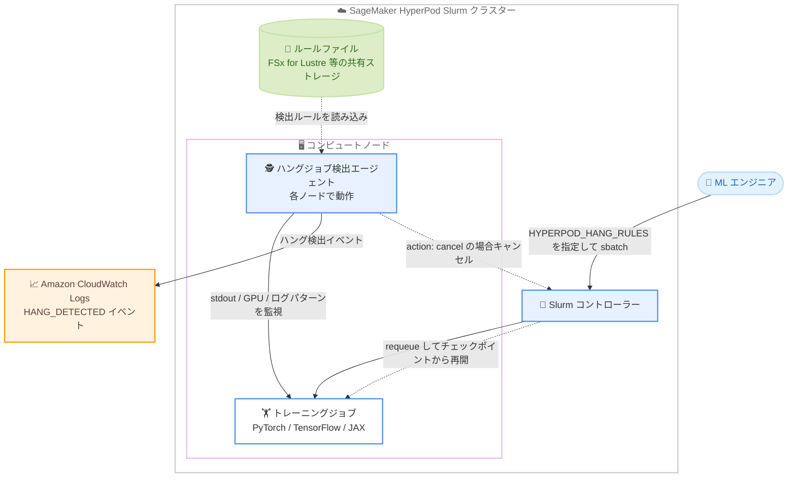

# Amazon SageMaker HyperPod - Slurm クラスターでのハングジョブ検出と復旧

**リリース日**: 2026 年 11 月 23 日
**サービス**: Amazon SageMaker HyperPod
**機能**: Slurm クラスターにおけるハングしたトレーニングジョブの検出と復旧 (Hung Job Detection)

📊 [このアップデートのインフォグラフィックを見る](https://takech9203.github.io/aws-news-summary/20261123-amazon-sagemaker-hyperpod-slurm-hung-jobs.html)

## 概要

Amazon SageMaker HyperPod が、Slurm オーケストレーションクラスター上でハング (進捗停止) したトレーニングジョブの検出に対応しました。ハングジョブ検出は、進捗が止まったジョブを数分以内に特定して Amazon CloudWatch にイベントを書き込み、オプションでジョブをキャンセルして Slurm のジョブキューに戻します。これにより、ジョブは GPU をアイドル状態で占有し続ける代わりに、最後のチェックポイントから再開できます。

検出エージェントは SageMaker HyperPod Slurm クラスターの各ノード上で動作し、ジョブの出力 (stdout)、GPU アクティビティ、ユーザー定義のログパターン (トレーニングステップのメッセージや NCCL エラーなど) を監視します。環境変数 `HYPERPOD_HANG_RULES` でルールファイルを指定するだけで有効化でき、トレーニングスクリプトやコンテナの変更は不要です。PyTorch、TensorFlow、JAX、カスタムスクリプトなどフレームワークを問わず利用できます。

大規模な分散トレーニングを運用する ML エンジニアやインフラ管理者にとって、高価な GPU リソースの無駄な占有を自動的に解消し、クラスター全体の稼働効率を高められるアップデートです。

**アップデート前の課題**

このアップデート以前は、ハングしたジョブへの対処が手動運用に依存していました。

- NCCL タイムアウト、停止したデータパイプライン、プロセスのデッドロックなどでジョブがハングすると、GPU を保持したまま Slurm 上は「実行中」と報告され続けた
- 進捗が止まっていることに誰かが手動で気付くまで、高価な GPU リソースがアイドル状態で占有され続けた
- 既存の自動復旧 (auto-resume) はハードウェア障害で終了したジョブの再起動を対象としており、終了せずにハングし続けるジョブはカバーされなかった

**アップデート後の改善**

今回のアップデートにより、ハングしたジョブへの対処が自動化されました。

- ジョブの出力、GPU アクティビティ、ログパターンに基づき、ハングしたジョブを数分以内に自動検出できるようになった
- 検出イベントが CloudWatch に書き込まれ、オプションでジョブを自動キャンセルして Slurm のキューに再投入 (requeue) できるようになった
- 環境変数でルールファイルを指定するだけで有効化でき、コードやコンテナの変更なしに PyTorch、TensorFlow、JAX などで利用可能になった

## アーキテクチャ図



各ノード上の検出エージェントが共有ストレージ上のルールファイルに従ってジョブを監視し、ハングを検出すると CloudWatch にイベントを書き込み、設定に応じてジョブをキャンセルして Slurm に再キューイングさせる流れを示しています。

## サービスアップデートの詳細

### 主要機能

1. **デフォルト検出 (出力と GPU アクティビティの監視)**
   - ルールファイルに `{"enabled": true}` のみを記述した場合、エージェントはジョブの stdout と GPU アクティビティを監視するデフォルト検出を使用
   - GPU がメモリを保持したままアイドル状態で、ジョブ出力が長時間停止している場合にハングと判定 (1 ノードの障害で他ノードがバリアで待機するランデブーハングを捕捉)
   - GPU の状態にかかわらず、ジョブ出力がさらに長い期間停止した場合もハングと判定

2. **カスタム検出ルール (ログパターン監視)**
   - RE2 正規表現 (最大 256 文字) でログパターンを定義し、トレーニングステップやエポックの進捗を追跡可能
   - `timeout_minutes` で指定した時間内にパターンがマッチしない場合にハングと判定
   - `fault_on_match` を true にすると、NCCL エラーなどのパターンが出現した時点で即座にハングと判定
   - `stop_pattern` (ルールの無効化条件)、`start_timeout_minutes` (起動時ハングの検出)、`metric_evaluation_data_points` (誤検知低減のための連続チェック回数) などの調整が可能
   - 1 つのルールファイルに最大 20 ルール、ファイルサイズは最大 1 MB

3. **検出時のアクションと CloudWatch 連携**
   - `action_policy.action` に `notify` (デフォルト、イベント記録のみ) または `cancel` (ジョブのキャンセルも実行) を指定
   - Slurm はデフォルトでキャンセルされたジョブを requeue するため、ジョブは最後のチェックポイントから再開可能 (`#SBATCH --no-requeue` で停止のみにすることも可能)
   - 検出イベントはクラスターの CloudWatch ロググループに `HANG_DETECTED`、`HANG_ACTION_TAKEN`、`CONFIG_ERROR` として記録

4. **フレームワーク非依存のシンプルな有効化**
   - 環境変数 `HYPERPOD_HANG_RULES` にルールファイルのパスを指定するだけでジョブ単位に有効化
   - トレーニングスクリプトやコンテナの変更は不要で、PyTorch、TensorFlow、JAX、カスタムスクリプトに対応
   - `srun --no-hang-detection` で特定のジョブステップのみ無効化も可能

## 技術仕様

### ルールファイルのフィールド

| フィールド | 必須 | 説明 |
|------|------|------|
| `enabled` | はい | true で検出を有効化。false または未指定の場合は監視されない |
| `monitoring.log_file` | いいえ | 監視対象のログファイル。デフォルトは Slurm の出力ファイル (`--output` または `slurm-{job-id}.out`) |
| `rules` | いいえ | 最大 20 ルール。有効な `log_pattern` ルールはデフォルト検出を置き換える |
| `action_policy.action` | いいえ | `notify` (デフォルト) はイベント記録のみ。`cancel` はジョブもキャンセル |

### ルールのフィールド

| フィールド | 必須 | 説明 |
|------|------|------|
| `name` | はい | ルール名。イベントに表示される |
| `type` | はい | `log_pattern` のみサポート |
| `enabled` | いいえ | デフォルトは false。true で有効化 |
| `log_pattern` | はい | RE2 正規表現。最大 256 文字 |
| `timeout_minutes` | 条件付き | パターンが未マッチのまま許容される時間 (`fault_on_match` が true の場合は不要) |
| `fault_on_match` | いいえ | true の場合、マッチした時点でハングと判定。エラーパターン向け |
| `stop_pattern` | いいえ | マッチするとルールを無効化するパターン (例: Training complete) |
| `start_timeout_minutes` | いいえ | ジョブ開始から最初のマッチまでの最大時間。起動時のハングを捕捉 |
| `metric_evaluation_data_points` | いいえ | ハング判定に必要な 10 秒間隔の連続失敗チェック回数。デフォルトは 1 |

### CloudWatch 検出イベント

検出イベントはコントローラーノードからクラスターの CloudWatch ロググループに書き込まれます。

| 項目 | 詳細 |
|------|------|
| ロググループ | `/aws/sagemaker/Clusters/{cluster-name}/{cluster-id}` |
| ログストリーム | `SageMakerHangJobDetectionEvents/{controller-instance-group-name}/{controller-instance-id}` |
| イベントタイプ | `HANG_DETECTED` (ハング検出)、`HANG_ACTION_TAKEN` (キャンセル実行)、`CONFIG_ERROR` (ルールファイル不正) |

`HANG_DETECTED` イベントの例。

```json
{
  "event_type": "HANG_DETECTED",
  "job_id": "12345",
  "step_id": "0",
  "node": "ip-172-22-230-3",
  "evidence": "stdout stale for 18 min and GPU idle with memory allocated",
  "layer": "signal_evaluator",
  "detected_at": "2026-04-22T00:58:47Z",
  "job_action": "notify",
  "config_source": "per_job_env_var"
}
```

`layer` フィールドはデフォルト検出 (`signal_evaluator`) とカスタムルール (`pattern_evaluator`) のどちらが発火したかを示します。

## 設定方法

### 前提条件

1. SageMaker HyperPod の Slurm オーケストレーションクラスターを利用していること
2. 既存クラスターの場合、クラスターソフトウェアを最新の AMI に更新していること (更新しない場合、ハングジョブ検出は利用不可)
3. マルチノードジョブの場合、ルールファイルを全コンピュートノードから読み取り可能な共有ストレージ (Amazon FSx for Lustre など) に配置すること

### 手順

#### ステップ 1: ルールファイルを作成する

```bash
echo '{"enabled": true}' > /fsx/my-project/rules.json
```

共有ストレージ上に検出を有効化するルールファイルを作成します。この最小構成では、ジョブの出力と GPU アクティビティを監視するデフォルト検出が使用され、ハング検出時にはイベントの記録のみが行われます。

#### ステップ 2: ジョブ投入時に環境変数を設定する

```bash
#SBATCH --export=ALL,HYPERPOD_HANG_RULES=/fsx/my-project/rules.json
```

sbatch スクリプトで `HYPERPOD_HANG_RULES` 環境変数にルールファイルのパスを指定します。この環境変数を設定したジョブのみが監視対象となります。多数のジョブに同じルールを適用する場合は、バッチスクリプト、シェルプロファイル、サイト共通のプロファイルスクリプトで設定できます。

#### ステップ 3: カスタムルールと自動キャンセルを設定する (推奨)

```json
{
  "enabled": true,
  "rules": [
    {
      "name": "epoch_progress",
      "type": "log_pattern",
      "enabled": true,
      "log_pattern": "Epoch \\d+/\\d+ complete",
      "timeout_minutes": 45
    },
    {
      "name": "nccl_error",
      "type": "log_pattern",
      "enabled": true,
      "log_pattern": "NCCL error|NCCL WARN",
      "fault_on_match": true
    }
  ],
  "action_policy": {
    "action": "cancel"
  }
}
```

エポック完了のログが 45 分間出力されない場合、または NCCL エラーが出現した時点でジョブをハングと判定し、自動的にキャンセルする設定例です。キャンセルされたジョブは Slurm によって requeue され、最後のチェックポイントから再開されます。GPU がビジーのまま進捗しないジョブはデフォルト検出では捕捉できないため、進捗を追跡する `log_pattern` ルールを少なくとも 1 つ追加することが推奨されています。

#### ステップ 4: 検出イベントを確認する

```bash
aws logs filter-log-events \
  --log-group-name /aws/sagemaker/Clusters/{cluster-name}/{cluster-id} \
  --log-stream-name-prefix SageMakerHangJobDetectionEvents/ \
  --filter-pattern '{ $.job_id = "12345" }'
```

クラスターの CloudWatch ロググループをジョブ ID でフィルタリングし、対象ジョブの検出イベントを確認します。`CONFIG_ERROR` は sbatch や squeue、ジョブ出力には表示されないため、新しいルールファイルは短いジョブでテストし、本番ジョブで使用する前にログストリームを確認してください。

## メリット

### ビジネス面

- **GPU コストの削減**: ハングしたジョブが高価な GPU をアイドル状態で占有し続ける時間を数分以内の検出で最小化し、クラスターの投資対効果を向上
- **運用負荷の軽減**: 進捗停止の手動監視が不要になり、オンコール対応や定期的なジョブ状態確認の工数を削減
- **トレーニング完了までの時間短縮**: ハングからの自動復旧により、人が気付くまでの待ち時間なしでチェックポイントからトレーニングを再開可能

### 技術面

- **非侵襲的な導入**: 環境変数の設定のみで有効化でき、トレーニングコードやコンテナイメージの変更が不要
- **フレームワーク非依存**: PyTorch、TensorFlow、JAX、カスタムスクリプトなど、あらゆるワークロードで利用可能
- **柔軟な検出ルール**: デフォルト検出に加え、RE2 正規表現によるログパターン監視、即時検出 (`fault_on_match`)、誤検知低減 (`metric_evaluation_data_points`) など細かな調整が可能
- **可観測性との統合**: 検出イベントが CloudWatch Logs に集約されるため、既存のモニタリングやアラートの仕組みと連携しやすい

## デメリット・制約事項

### 制限事項

- デフォルト検出は、GPU がビジーのまま進捗しないジョブ (ループに陥ったジョブなど) を捕捉できない。ステップやエポックを追跡する `log_pattern` ルールの追加が推奨される
- デフォルト検出は持続的な非アクティブ期間を待つため、検出は即時ではない。短いカスタムタイムアウトは検出を速くするが、チェックポイント保存などの正常な停止を誤検知する可能性がある
- パターンは RE2 構文のみ対応。後方参照や先読み / 後読みを使用したパターンはコンパイルされず、そのルールはスキップされる
- ルールファイルは最大 20 ルール、最大 1 MB。超過したファイルは拒否され、ジョブは監視されない
- 既存クラスターでは、最新の AMI へのクラスターソフトウェア更新が必要

### 考慮すべき点

- カスタムルールはそのジョブのデフォルト検出を置き換えるため、パターンがマッチし続ける限り GPU がアイドルでもハングと判定されない
- エージェントはルールファイルの所有者や書き込み権限を検証しないため、ファイルに書き込める人は誰でも検出動作を変更できる。ルールファイルとそのディレクトリは所有者のみ書き込み可能に設定する (`chmod 600` または共有時は `chmod 644`)
- ルールファイルの変更を確実に反映するには、ジョブをキャンセルして再投入する必要がある
- ハングジョブ検出は、ハードウェア障害で終了したジョブを再起動する auto-resume とは独立した機能である

## ユースケース

### ユースケース 1: 大規模分散トレーニングでの NCCL タイムアウト対策

**シナリオ**: 数百 GPU を使用する LLM の事前トレーニングで、ノード間通信の問題により NCCL タイムアウトが発生し、全ノードがバリアで待機したままジョブがハングする。

**実装例**:
```json
{
  "enabled": true,
  "rules": [
    {
      "name": "nccl_error",
      "type": "log_pattern",
      "enabled": true,
      "log_pattern": "NCCL error|NCCL WARN",
      "fault_on_match": true
    }
  ],
  "action_policy": {
    "action": "cancel"
  }
}
```

**効果**: NCCL エラーの出現と同時にジョブがキャンセル・requeue され、タイムアウトを待たずに最後のチェックポイントからトレーニングを再開。大規模クラスターのアイドル時間を大幅に削減。

### ユースケース 2: トレーニング進捗の停滞監視

**シナリオ**: データパイプラインの停止やデッドロックにより、GPU はビジーに見えるがトレーニングステップが進まない状態を検出したい。

**実装例**:
```json
{
  "enabled": true,
  "rules": [
    {
      "name": "step_progress",
      "type": "log_pattern",
      "enabled": true,
      "log_pattern": "step \\d+ loss",
      "timeout_minutes": 30,
      "start_timeout_minutes": 60,
      "metric_evaluation_data_points": 3,
      "stop_pattern": "Training complete"
    }
  ],
  "action_policy": {
    "action": "cancel"
  }
}
```

**効果**: ステップログが 30 分間出力されない場合にハングと判定。デフォルト検出では捕捉できない「GPU ビジーのまま進捗停止」のケースもカバーし、起動時のハング (`start_timeout_minutes`) や誤検知 (`metric_evaluation_data_points`) にも対応。

### ユースケース 3: 通知のみで段階的に導入する

**シナリオ**: 自動キャンセルによる誤検知のリスクを避けつつ、まずはハング発生状況を可視化して運用判断の材料にしたい。

**実装例**:
```bash
# notify のみの最小構成でルールファイルを作成
echo '{"enabled": true}' > /fsx/team/rules.json
chmod 644 /fsx/team/rules.json

# サイト共通のプロファイルで全ジョブに適用
export HYPERPOD_HANG_RULES=/fsx/team/rules.json
```

**効果**: デフォルトの `notify` アクションにより、ジョブへの影響なしに CloudWatch へハング検出イベントが記録される。検出精度を確認した後、`action: cancel` へ段階的に移行することで安全に自動復旧を導入できる。

## 料金

ハングジョブ検出機能自体の追加料金に関する記載は、公式発表にはありません。SageMaker HyperPod の利用料金 (インスタンス料金など) と、CloudWatch Logs へのイベント書き込みに伴う CloudWatch の標準料金が適用されます。詳細は [Amazon SageMaker の料金ページ](https://aws.amazon.com/sagemaker/pricing/)を参照してください。

## 利用可能リージョン

Amazon SageMaker HyperPod が利用可能なすべての AWS リージョンで利用できます。

## 関連サービス・機能

- **Amazon SageMaker HyperPod auto-resume**: ハードウェア障害で終了したジョブを自動再起動する機能。終了せずにハングするジョブを対象とする今回の機能とは独立しており、組み合わせることで耐障害性が向上
- **Amazon CloudWatch Logs**: ハング検出イベント (`HANG_DETECTED` など) の記録先。メトリクスフィルターやアラームと組み合わせて通知を自動化可能
- **Amazon FSx for Lustre**: マルチノードジョブでルールファイルを全ノードから参照するための共有ストレージとして利用
- **Slurm**: SageMaker HyperPod がサポートするワークロードオーケストレーター。キャンセルされたジョブのデフォルトの requeue 動作により、チェックポイントからの再開を実現

## 参考リンク

- 📊 [インフォグラフィック](https://takech9203.github.io/aws-news-summary/20261123-amazon-sagemaker-hyperpod-slurm-hung-jobs.html)
- [公式発表 (What's New)](https://aws.amazon.com/about-aws/whats-new/2026/11/amazon-sagemaker-hyperpod-slurm-hung-jobs/)
- [AWS Blog - Introducing workload recovery and expanded infrastructure checks on Amazon SageMaker HyperPod](https://aws.amazon.com/blogs/machine-learning/introducing-workload-recovery-and-expanded-infrastructure-checks-on-amazon-sagemaker-hyperpod/)
- [ドキュメント - Hung job detection](https://docs.aws.amazon.com/sagemaker/latest/dg/sagemaker-hyperpod-resiliency-slurm-hang-detection.html)
- [料金ページ - Amazon SageMaker Pricing](https://aws.amazon.com/sagemaker/pricing/)

## まとめ

SageMaker HyperPod の Slurm クラスターで、NCCL タイムアウトやデッドロックなどによりハングしたトレーニングジョブを数分以内に自動検出し、キャンセル・再キューイングまで自動化できるようになりました。環境変数の設定のみで導入でき、コード変更が不要なため、大規模 GPU クラスターを運用するチームはまず `notify` モードで検出状況を可視化し、進捗を追跡する `log_pattern` ルールを整備した上で自動キャンセルへ移行することを推奨します。
