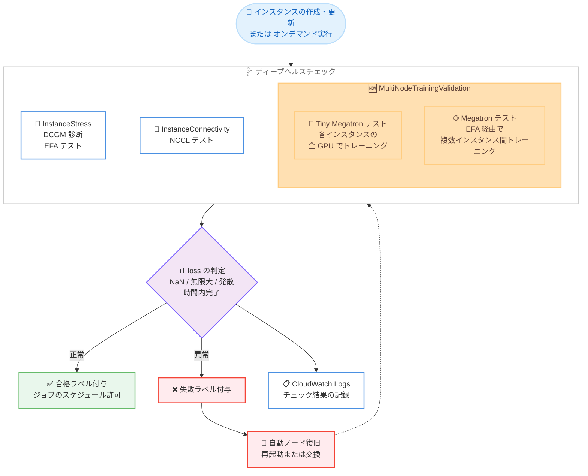

# Amazon SageMaker HyperPod - MultiNodeTrainingValidation によるトレーニング正常性の検証

**リリース日**: 2026 年 11 月 23 日
**サービス**: Amazon SageMaker HyperPod
**機能**: MultiNodeTrainingValidation ディープヘルスチェック

📊 [このアップデートのインフォグラフィックを見る](https://takech9203.github.io/aws-news-summary/20261123-amazon-sagemaker-hyperpod-training-validation.html)

## 概要

Amazon EKS でオーケストレーションされた Amazon SageMaker HyperPod クラスターが、新しいディープヘルスチェック **MultiNodeTrainingValidation** をサポートしました。このチェックは、ジョブがスケジュールされる前に、ノードが「正しくトレーニングできるか」を実際のトレーニングワークロードで検証します。固定の Megatron-LM ワークロードを各インスタンス上でトレーニングし、さらに Elastic Fabric Adapter (EFA) を介して同一インスタンスタイプの複数インスタンス間でもトレーニングを実行します。トレーニング loss が NaN または無限大になった場合、loss が発散した場合、あるいは制限時間内にトレーニングが完了しない場合、そのインスタンスはチェックに失敗します。

従来のヘルスチェックはハードウェアの健全性を個別に検証するものでした。しかし、微細な故障のある GPU は、ハードウェアストレステスト (DCGM 診断など) やインスタンス間接続テスト (NCCL テスト) をすべてパスしながら、誤った計算結果を返すことがあります。この種の障害 (silent data corruption) は、本番のトレーニング実行中に NaN や無限大の loss として初めて顕在化することが多く、数日分の計算リソースが無駄になる原因となっていました。実際、Meta は Llama 3 405B の 54 日間の事前トレーニングで発生した 419 件の予期しない中断のうち 6 件を silent data corruption に起因するものと報告しています。

数週間に及ぶ事前トレーニングを実行する前の検証や、ノード追加・交換時の自動検証に活用でき、大規模な基盤モデルトレーニングを運用する ML インフラチームにとって、クラスターの goodput (有効稼働率) を向上させる重要なアップデートです。

**アップデート前の課題**

- 既存のディープヘルスチェック (InstanceStress、InstanceConnectivity) はハードウェアの健全性と通信性能を検証するもので、GPU が「正しい計算結果を返すか」までは検証できなかった
- 微細な故障のある GPU がすべてのハードウェアテストをパスし、本番トレーニング中に NaN や無限大の loss として初めて問題が顕在化していた
- 数値計算の異常が数日後に発覚した場合、それまでに消費した大量の GPU 時間が無駄になっていた
- 障害発生時、原因がハードウェアなのかモデルやコードの変更なのかの切り分けが困難だった

**アップデート後の改善**

- ジョブ実行前に、固定の Megatron-LM ワークロードによる実トレーニングでノードの計算正常性を検証できるようになった
- 固定ワークロードを使用するため、チェック失敗はモデルやコードではなくハードウェア起因であると判断できるようになった
- 自動ノード復旧 (automatic node recovery) と組み合わせることで、チェックに失敗したインスタンスを自動的に再起動または交換できるようになった
- インスタンスの追加・交換時に毎回チェックを実行するよう設定でき、新規ノードや交換ノードが検証済みの状態でジョブを受け入れられるようになった
- `StartClusterHealthCheck` API により、長期トレーニング開始前など任意のタイミングでオンデマンド実行できるようになった

## アーキテクチャ図



MultiNodeTrainingValidation は、既存の InstanceStress と InstanceConnectivity に加わる 3 つ目のディープヘルスチェックで、実際のトレーニングワークロードにより GPU の計算正常性を検証し、失敗したインスタンスは自動ノード復旧により再起動または交換されます。

## サービスアップデートの詳細

### 主要機能

1. **Tiny Megatron テスト (インスタンスレベル)**
   - 各インスタンスの全 GPU 上で短時間の Megatron-LM ベースのトレーニングワークロードを実行する
   - トレーニング loss が NaN または無限大になった場合、開始時の平均に対してしきい値を超えて上昇 (発散) した場合、または制限時間内に完了しなかった場合に、そのインスタンスを失敗と判定する
   - `MultiNodeTrainingValidation` を指定した場合にのみ実行される

2. **Megatron テスト (クラスターレベル)**
   - 同じトレーニングワークロードを、同一インスタンスタイプの複数インスタンス間で EFA を介して実行する
   - 失敗条件は Tiny Megatron テストと同一で、インスタンス単体では検出できない、複数 GPU が協調してトレーニングする際の数値異常を検出する
   - ワークロードが固定されているため、失敗はモデルやコードの変更ではなくハードウェアに起因すると切り分けられる

3. **自動ノード復旧との連携**
   - チェックに失敗したインスタンスには失敗ラベルが付与され、自動ノード復旧が有効な場合は HyperPod が自動的に再起動または交換する
   - プロビジョニング時にチェックを実行すれば、ジョブがそのインスタンスを使用する前に問題を排除できる

4. **柔軟な実行タイミング**
   - インスタンスグループの `OnStartDeepHealthChecks` に指定することで、インスタンスの作成・更新時に自動実行できる
   - `StartClusterHealthCheck` API により、クラスター内の既存インスタンスに対してオンデマンドで実行できる (特定のインスタンス ID の指定も可能)

## 技術仕様

### ディープヘルスチェックの種類 (EKS オーケストレーション)

| チェック | 実行内容 | 検出できる問題 |
|------|------|------|
| InstanceStress | GPU / NVLink 数の確認、DCGM レベル 4 診断、EFA のレイテンシー・帯域テスト (Trainium は Neuron テスト) | ハードウェアの欠落、故障、不安定性 |
| InstanceConnectivity | GPU インスタンス間の NCCL テスト (Trainium は NCCOM テスト) | インスタンス間通信の低速化・断絶 |
| MultiNodeTrainingValidation (新規) | 各インスタンスでの Tiny Megatron テストと、インスタンス間での Megatron テスト | ハードウェアテストはパスするが正しくトレーニングできない GPU (NaN / 無限大 loss、発散、時間内未完了) |

### MultiNodeTrainingValidation の仕様

| 項目 | 詳細 |
|------|------|
| 対象オーケストレーター | Amazon EKS のみ |
| 対象インスタンス | EFA 対応の NVIDIA GPU インスタンスタイプ (例: ml.p5.48xlarge) |
| 失敗条件 | loss が NaN または無限大、loss の発散、制限時間内の未完了 |
| 実行タイミング | インスタンスの作成・更新時 (`OnStartDeepHealthChecks`)、またはオンデマンド (`StartClusterHealthCheck`) |
| 所要時間の目安 | AWS Blog の 2 ノード (ml.p5.48xlarge) 検証では Tiny Megatron 約 4 分 + Megatron 約 4 分の計約 8 分を追加 (ディープヘルスチェック全体は DCGM レベル 4 診断が大半を占め約 1 時間 28 分) |
| 結果の確認 | CloudWatch Logs の `DeepHealthCheckResults/<id>` ログストリーム、ノードラベル `sagemaker.amazonaws.com/deep-health-check-status`、各ノードの `/var/log/aws/clusters/sagemaker-deep-health-check.log` |

### インスタンスグループ設定例

`create-cluster` または `update-cluster` に渡すインスタンスグループ設定の `OnStartDeepHealthChecks` に `MultiNodeTrainingValidation` を追加します。

```json
{
  "InstanceGroupName": "<instance-group>",
  "InstanceType": "ml.p5.48xlarge",
  "InstanceCount": 2,
  "LifeCycleConfig": {
    "SourceS3Uri": "s3://<bucket>/<prefix>",
    "OnCreate": "on_create.sh"
  },
  "ExecutionRole": "arn:aws:iam::<account-id>:role/<hyperpod-execution-role>",
  "OnStartDeepHealthChecks": [
    "InstanceStress",
    "InstanceConnectivity",
    "MultiNodeTrainingValidation"
  ]
}
```

## 設定方法

### 前提条件

1. Amazon EKS でオーケストレーションされた SageMaker HyperPod クラスター
2. EFA 対応の NVIDIA GPU インスタンスタイプ (例: ml.p5.48xlarge) のインスタンスグループ (Megatron テストは同一インスタンスタイプのインスタンス間で実行される)
3. 自動復旧を利用する場合は、自動ノード復旧 (automatic node recovery) の有効化

### 手順

#### ステップ 1: インスタンスグループでチェックを有効化

```bash
aws sagemaker describe-cluster \
  --cluster-name <cluster-name> \
  --query "InstanceGroups[?InstanceGroupName=='<instance-group>'].OnStartDeepHealthChecks"
```

インスタンスグループ設定の `OnStartDeepHealthChecks` に `MultiNodeTrainingValidation` を追加して `create-cluster` または `update-cluster` を実行した後、上記コマンドで設定内容を確認します。出力に 3 つのチェック名が表示されれば有効化は完了です。

#### ステップ 2: オンデマンドでチェックを実行

```bash
aws sagemaker start-cluster-health-check \
  --cluster-name <cluster-name> \
  --deep-health-check-configurations \
  '[{"InstanceGroupName": "<instance-group>", "DeepHealthChecks": ["MultiNodeTrainingValidation"]}]'
```

クラスター内の既存インスタンスに対して MultiNodeTrainingValidation をオンデマンドで実行します。長期の事前トレーニング開始前の検証に有効です。インスタンスグループ全体ではなく特定のインスタンスを検証する場合は、設定に `"InstanceIds": [...]` を追加します。オンデマンド実行は `DeepHealthCheck` タイプのクラスターオペレーションを作成します。

#### ステップ 3: 結果を確認

```bash
# クラスターオペレーションのイベントを確認
aws sagemaker list-cluster-events \
  --cluster-name <cluster-name> \
  --operation-id <operation-id>

# ノードラベルで合否を確認
kubectl get nodes \
  -l sagemaker.amazonaws.com/instance-group-name=<instance-group> \
  -L sagemaker.amazonaws.com/deep-health-check-status
```

1 つ目のコマンドはオンデマンドチェックのオペレーションイベントを一覧表示し、チェックの進行状況と結果を確認します。2 つ目のコマンドは各ノードの `deep-health-check-status` ラベル (Passed など) を表示します。詳細な結果は CloudWatch ロググループ `/aws/sagemaker/Clusters/<cluster-name>/<cluster-id>` の `DeepHealthCheckResults/<id>` ログストリームに、テストごとに 1 行ずつ記録されます。トレーニングの詳細ログは各インスタンスの `/var/log/aws/clusters/sagemaker-deep-health-check.log` で確認できます。

## メリット

### ビジネス面

- **計算リソースの浪費防止**: 数週間規模の事前トレーニングが数日経過後に NaN loss で失敗するリスクを低減し、高価な GPU 時間の浪費を防げる
- **goodput の向上**: 不良ハードウェアにジョブがスケジュールされることを防ぎ、クラスター時間のうち有効なトレーニングに使われる割合を高められる
- **運用負荷の軽減**: 自動ノード復旧と組み合わせることで、不良インスタンスの検出から交換までを自動化できる

### 技術面

- **計算正常性の検証**: ハードウェアストレステストや接続性テストでは検出できない、silent data corruption のような数値計算の異常を実トレーニングで検出できる
- **原因の切り分けが容易**: 固定の既知正常ワークロードを使用するため、失敗がハードウェア起因であると明確に判断できる
- **継続的な検証**: インスタンスの追加・交換のたびにチェックを実行するよう設定でき、クラスターの計算正常性を継続的に担保できる

## デメリット・制約事項

### 制限事項

- Amazon EKS でオーケストレーションされたクラスターのみサポート (Slurm クラスターは対象外)
- EFA 対応の NVIDIA GPU インスタンスタイプのみサポート (Trainium インスタンスは対象外)
- Megatron テストは同一インスタンスタイプのインスタンス間でのみ実行される
- 移動 (move) されたノードはヘルスチェックを再実行しないため、検証するにはオンデマンドチェックの実行が必要

### 考慮すべき点

- ディープヘルスチェックの実行時間が追加される (AWS Blog の例では MultiNodeTrainingValidation で約 8 分の追加)。チェック完了までインスタンスはワークロードを受け入れられないため、キャパシティ追加時はこの時間を考慮した計画が必要
- チェックの合格は「固定の参照ワークロードを正しくトレーニングできた」ことを意味するものであり、ユーザー自身のジョブの収束を保証するものではない
- ディープヘルスチェック全体では DCGM レベル 4 診断が所要時間の大半を占める (AWS Blog の例では約 74 分)

## ユースケース

### ユースケース 1: 長期事前トレーニング前の検証

**シナリオ**: 数週間かかる基盤モデルの事前トレーニングを、数十台の ml.p5.48xlarge インスタンスで開始する前に、全ノードの計算正常性を確認したい。

**実装例**:
```bash
aws sagemaker start-cluster-health-check \
  --cluster-name llm-pretrain-cluster \
  --deep-health-check-configurations \
  '[{"InstanceGroupName": "gpu-group", "DeepHealthChecks": ["MultiNodeTrainingValidation"]}]'
```

**効果**: 微細な故障のある GPU を事前に検出し、トレーニング開始数日後に NaN loss で中断して GPU 時間を浪費するリスクを低減できる。

### ユースケース 2: ノード追加・交換時の自動検証

**シナリオ**: クラスターのスケールアップや障害ノードの交換が頻繁に発生する環境で、新しいノードが常に検証済みの状態でジョブを受け入れるようにしたい。

**実装例**:
```json
"OnStartDeepHealthChecks": [
  "InstanceStress",
  "InstanceConnectivity",
  "MultiNodeTrainingValidation"
]
```

**効果**: 新規ノードと交換ノードが、ジョブがスケジュールされる前に必ずトレーニング正常性を検証されるため、不良ハードウェアの混入を防げる。

### ユースケース 3: 自動ノード復旧と組み合わせた無人運用

**シナリオ**: 大規模クラスターの運用で、不良インスタンスの検出から復旧までを人手を介さずに完結させたい。

**実装例**:
```bash
# チェック結果をノードラベルで確認
kubectl get nodes \
  -l sagemaker.amazonaws.com/instance-group-name=gpu-group \
  -L sagemaker.amazonaws.com/deep-health-check-status
```

**効果**: チェックに失敗したインスタンスは失敗ラベルが付与され、自動ノード復旧により再起動または交換されるため、運用チームの介入なしに健全なクラスター状態を維持できる。

## 料金

MultiNodeTrainingValidation ディープヘルスチェック自体に関する追加料金の記載はありません。SageMaker HyperPod の通常のインスタンス料金が適用されます。なお、ディープヘルスチェック実行中のインスタンスはワークロードを受け入れられないため、チェック時間分だけインスタンスの有効活用開始が遅れる点は考慮が必要です。

詳細は [Amazon SageMaker の料金ページ](https://aws.amazon.com/sagemaker/pricing/) を参照してください。

## 利用可能リージョン

SageMaker HyperPod が利用可能なすべての AWS リージョンで、Amazon EKS でオーケストレーションされたクラスターに対して利用できます。

## 関連サービス・機能

- **Amazon EKS**: 本チェックは EKS オーケストレーションの HyperPod クラスターでのみ利用可能
- **Elastic Fabric Adapter (EFA)**: Megatron テストはインスタンス間通信に EFA を使用するため、EFA 対応インスタンスタイプが必須
- **HyperPod 自動ノード復旧**: チェックに失敗したインスタンスの再起動・交換を自動化する
- **HyperPod Kubernetes Resource Monitoring Agent**: 同時期に発表された、Kubernetes レイヤーの問題を検出するエージェント。本チェックがハードウェアの計算正常性を、エージェントがクラスターレイヤーをカバーする補完関係にある
- **Amazon CloudWatch Logs**: チェック結果が `DeepHealthCheckResults` ログストリームに記録される

## 参考リンク

- 📊 [インフォグラフィック](https://takech9203.github.io/aws-news-summary/20261123-amazon-sagemaker-hyperpod-training-validation.html)
- [公式発表 (What's New)](https://aws.amazon.com/about-aws/whats-new/2026/11/amazon-sagemaker-hyperpod-training-validation/)
- [AWS Blog: Introducing workload recovery and expanded infrastructure checks on Amazon SageMaker HyperPod](https://aws.amazon.com/blogs/machine-learning/introducing-workload-recovery-and-expanded-infrastructure-checks-on-amazon-sagemaker-hyperpod/)
- [ドキュメント: Deep health checks](https://docs.aws.amazon.com/sagemaker/latest/dg/sagemaker-hyperpod-eks-resiliency-deep-health-checks.html)
- [API リファレンス: StartClusterHealthCheck](https://docs.aws.amazon.com/sagemaker/latest/APIReference/API_StartClusterHealthCheck.html)
- [料金ページ](https://aws.amazon.com/sagemaker/pricing/)

## まとめ

MultiNodeTrainingValidation は、ハードウェアテストでは検出できない「正しく計算できない GPU」を、実際の Megatron-LM トレーニングワークロードによりジョブ実行前に検出する新しいディープヘルスチェックです。silent data corruption による本番トレーニングの中断は大規模クラスターで現実に発生する問題であり、長期の事前トレーニングを運用するチームへの影響は大きいアップデートです。EKS オーケストレーションの HyperPod クラスターを運用している場合は、インスタンスグループの `OnStartDeepHealthChecks` への追加と、長期トレーニング開始前のオンデマンド実行の運用への組み込みを推奨します。
