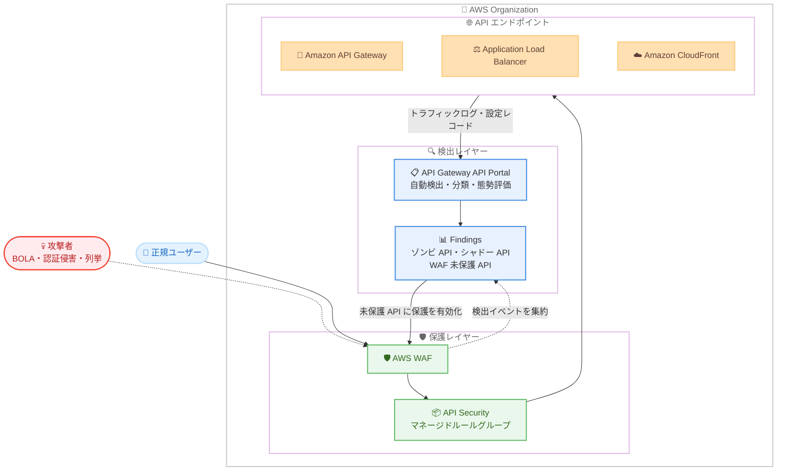

# AWS WAF - API セキュリティ (API Portal による自動検出と API Security マネージドルールグループによる保護)

**リリース日**: 2026 年 11 月 23 日
**サービス**: AWS WAF、Amazon API Gateway
**機能**: 自動 API 検出 (API Gateway API Portal) と API 保護 (AWS WAF API Security マネージドルールグループ)

📊 [このアップデートのインフォグラフィックを見る](https://takech9203.github.io/aws-news-summary/20261123-api-security-with-waf.html)

## 概要

AWS Organization 全体の API を自動的に検出し、AWS WAF で保護する「自動 API 検出と保護」機能が一般提供 (GA) となりました。Amazon API Gateway、Application Load Balancer、Amazon CloudFront の背後にあるすべての API を検出し、AWS WAF を使用して保護できます。

検出機能は新しい API Gateway API Portal を通じて提供されます。API Portal はトラフィックログとサービス設定レコードから API を自動的に識別するため、エージェントのデプロイやログの転送は不要です。検出した API を分類し、ゾンビ API やシャドー API を特定し、各 API のセキュリティ態勢を評価して、WAF 保護が欠如している API を含む検出結果 (findings) をレポートします。

保護機能は新しい AWS WAF API Security マネージドルールグループを通じて提供されます。BOLA (Broken Object Level Authorization)、認証の不備とクレデンシャルスタッフィング、API の偵察と列挙といった、最も悪用されやすい API 攻撃カテゴリから API を保護します。カスタムルールを一切書くことなく、API の検出から保護までを一貫して実現できるソリューションです。

**アップデート前の課題**

- 組織内に存在する API の全体像を把握するには、各アカウントの API Gateway、ALB、CloudFront の設定を個別に棚卸しする必要があった
- 管理されていないゾンビ API やシャドー API を発見する仕組みがなく、保護されていない API が放置されるリスクがあった
- BOLA やクレデンシャルスタッフィングなどの API 特有の攻撃に対しては、WAF のカスタムルールを独自に設計・運用する必要があった
- API の検出にはエージェントのデプロイやログ転送基盤の構築など、追加の運用負荷が発生していた

**アップデート後の改善**

- API Portal が AWS Organization 全体の API をトラフィックログと設定レコードから自動検出し、エージェントやログ転送が不要になった
- ゾンビ API・シャドー API の特定、セキュリティ態勢の評価、WAF 保護が欠如している API の報告が自動化された
- AWS WAF API Security マネージドルールグループにより、主要な API 攻撃カテゴリへの保護をカスタムルールなしで有効化できるようになった
- WAF が検出したイベントは API Portal の findings に集約され、API のセキュリティ状況を一元的に把握できるようになった

## アーキテクチャ図



API Portal が API Gateway、ALB、CloudFront のトラフィックログと設定レコードから API を自動検出して findings を生成し、未保護の API に対して AWS WAF API Security マネージドルールグループによる保護を有効化できます。WAF が検出したイベントは API Portal の findings に集約されます。

## サービスアップデートの詳細

### 主要機能

1. **API Gateway API Portal による自動 API 検出**
   - AWS Organization 全体の Amazon API Gateway、Application Load Balancer、Amazon CloudFront の背後にある API を検出
   - トラフィックログとサービス設定レコードから自動的に API を識別し、エージェントのデプロイやログ転送は不要
   - 検出した API を分類し、ゾンビ API (使われていないが残存している API) やシャドー API (管理外の API) を特定

2. **セキュリティ態勢の評価と findings のレポート**
   - 各 API のセキュリティ態勢を評価し、WAF 保護が欠如している API を含む findings をレポート
   - 未保護の API に対しては、API Portal から WAF による保護を有効化可能
   - WAF が検出したイベントも API Portal の findings に集約され、API セキュリティの全体像を一元的に把握可能

3. **AWS WAF API Security マネージドルールグループ**
   - 最も悪用されやすい API 攻撃カテゴリから API を保護
     - **BOLA (Broken Object Level Authorization)**: リクエスト内のレコード ID を改ざんして他ユーザーのデータを読み取る攻撃
     - **認証の不備とクレデンシャルスタッフィング**: トークンの偽造や、窃取したパスワードの大規模な試行
     - **API の偵察と列挙**: 隠しルートの推測や公開ドキュメントの探査による API マッピング
   - 他の AWS マネージドルールや独自のカスタムルールと組み合わせて使用可能

## 技術仕様

### 機能の構成

| 項目 | 詳細 |
|------|------|
| 検出機能 | API Gateway API Portal (新機能) |
| 検出対象 | Amazon API Gateway、Application Load Balancer、Amazon CloudFront の背後の API |
| 検出範囲 | AWS Organization 全体 |
| 検出方式 | トラフィックログとサービス設定レコードから自動識別 (エージェント不要) |
| 保護機能 | AWS WAF API Security マネージドルールグループ (新機能) |
| 保護対象の攻撃 | BOLA、認証の不備・クレデンシャルスタッフィング、API 偵察・列挙 |
| イベント集約 | WAF 検出イベントを API Portal の findings に統合 |

### API 変更履歴

| 日付 | サービス | 変更内容 |
|------|----------|----------|
| 2026/11/20 | [wafv2](https://awsapichanges.com/archive/changes/e9d2b3-wafv2.html) | 5 new 8 updated api methods - API Security イベント用の読み取り専用 API (`ListEvents`、`ListEventsByWebACL`、`GetEvent`、`ListEventActors`、`GetEventActor`) などを追加 |

## 設定方法

### 前提条件

1. AWS WAF を利用できる AWS アカウント (API Portal の組織全体での利用には AWS Organizations の設定が必要)
2. 保護対象の API が Amazon API Gateway、Application Load Balancer、または Amazon CloudFront の背後に存在すること
3. WAF Web ACL を作成・更新できる IAM 権限

### 手順

#### ステップ 1: API Portal で API を検出する

API Gateway コンソールの API Portal を開き、組織全体の API 検出を有効化します。API Portal はトラフィックログとサービス設定レコードから API を自動的に識別し、分類・評価を行います。エージェントのデプロイやログの転送作業は不要です。

#### ステップ 2: findings を確認する

API Portal の findings で、検出された API の一覧、ゾンビ API・シャドー API、セキュリティ態勢の評価結果、WAF 保護が欠如している API を確認します。

#### ステップ 3: API Security マネージドルールグループで保護を有効化する

```bash
# Web ACL に API Security マネージドルールグループを追加する例
aws wafv2 update-web-acl \
  --name my-web-acl \
  --scope REGIONAL \
  --id <web-acl-id> \
  --lock-token <lock-token> \
  --default-action Allow={} \
  --visibility-config SampledRequestsEnabled=true,CloudWatchMetricsEnabled=true,MetricName=my-web-acl \
  --rules '[{
    "Name": "APISecurityRules",
    "Priority": 0,
    "Statement": {
      "ManagedRuleGroupStatement": {
        "VendorName": "AWS",
        "Name": "AWSManagedRulesAPISecurity"
      }
    },
    "OverrideAction": { "None": {} },
    "VisibilityConfig": {
      "SampledRequestsEnabled": true,
      "CloudWatchMetricsEnabled": true,
      "MetricName": "APISecurityRules"
    }
  }]'
```

Web ACL に API Security マネージドルールグループを追加し、BOLA・認証侵害・列挙攻撃からの保護を有効化するコマンド例です。マネージドルールグループの正確な名称やパラメータは [AWS WAF 開発者ガイド](https://docs.aws.amazon.com/waf/latest/developerguide/waf-api-security.html) を確認してください。未保護の API に対しては、API Portal のコンソールから直接 WAF 保護を有効化することもできます。

#### ステップ 4: イベントを確認する

WAF が検出したイベントは API Portal の findings に集約されます。`ListEvents` や `GetEvent` などの API を使用して、イベントの詳細やタイムライン、イベントに関与したクライアントの情報を確認できます。

## メリット

### ビジネス面

- **API 資産の可視化**: 組織全体の API インベントリを自動的に把握でき、管理外の API によるリスクを低減できる
- **セキュリティ運用の省力化**: カスタムルールの設計・運用なしで主要な API 攻撃への保護を有効化でき、セキュリティチームの負荷を削減できる
- **コンプライアンス対応の強化**: セキュリティ態勢の評価と findings により、保護されていない API を特定して是正するプロセスを確立できる

### 技術面

- **エージェントレスの検出**: トラフィックログと設定レコードから自動検出するため、エージェントのデプロイやログ転送基盤の構築が不要
- **API 特有の攻撃への対応**: BOLA やクレデンシャルスタッフィングなど、従来の WAF ルールでは対応が難しかった API 特有の攻撃カテゴリをマネージドルールでカバー
- **既存ルールとの併用**: 他の AWS マネージドルールやカスタムルールと組み合わせて多層防御を構成可能
- **検出から保護までの一貫性**: API Portal の findings と WAF のイベントが統合され、検出・保護・監視のサイクルを単一のワークフローで実現

## デメリット・制約事項

### 制限事項

- API Portal は 32 の AWS リージョンで利用可能 (対象リージョンは Amazon API Gateway の FAQ を参照)
- API Security は AWS WAF が利用可能なすべてのリージョンで利用できるが、AWS GovCloud (US) リージョン、中国リージョン、AWS European Sovereign Cloud は除く
- 検出対象は Amazon API Gateway、Application Load Balancer、Amazon CloudFront の背後にある API に限定される

### 考慮すべき点

- マネージドルールグループの誤検知の可能性を考慮し、本番適用前にカウントモードでの評価を推奨
- 組織全体での API 検出には AWS Organizations との連携設定が必要
- マネージドルールグループの利用には WAF の料金 (ルールグループ単位の課金) が発生するため、コストを事前に確認することを推奨

## ユースケース

### ユースケース 1: 組織全体の API インベントリの可視化とシャドー API の排除

**シナリオ**: 複数の AWS アカウントを運用する企業で、各開発チームが個別に API をデプロイしており、セキュリティチームが全体像を把握できていない。

**実装例**:
```
1. API Portal を有効化し、AWS Organization 全体の API を自動検出
2. findings でゾンビ API・シャドー API を特定
3. 不要な API を廃止し、必要な API には WAF 保護を有効化
```

**効果**: 管理外の API による攻撃面を削減し、組織全体の API セキュリティ態勢を継続的に監視できる。

### ユースケース 2: BOLA 攻撃からの顧客データ保護

**シナリオ**: EC サイトの注文照会 API で、攻撃者がリクエスト内の注文 ID を変更して他ユーザーの注文情報を取得しようとしている。

**実装例**:
```
1. API Gateway の Web ACL に API Security マネージドルールグループを追加
2. BOLA 検出ルールにより、レコード ID の改ざんによるアクセスを検出・ブロック
3. 検出イベントを API Portal の findings で確認し、攻撃元クライアントを分析
```

**効果**: カスタムルールを書くことなく、オブジェクトレベル認可の不備を突く攻撃から顧客データを保護できる。

### ユースケース 3: クレデンシャルスタッフィング攻撃の防御

**シナリオ**: ログイン API に対して、漏洩したパスワードリストを使用した大規模なログイン試行が発生している。

**実装例**:
```
1. ログイン API を含む Web ACL に API Security マネージドルールグループを適用
2. 窃取されたクレデンシャルの大規模試行やトークン偽造を検出・ブロック
3. ListEventActors / GetEventActor API で攻撃に関与したクライアントを特定
```

**効果**: アカウント乗っ取りのリスクを低減し、攻撃の全体像をイベントのタイムラインで把握できる。

## 料金

AWS WAF のマネージドルールグループの料金体系に準じます。Web ACL、ルール、リクエスト数に応じた課金に加え、マネージドルールグループの利用料金が発生します。API Portal の料金を含む詳細は [AWS WAF 料金ページ](https://aws.amazon.com/waf/pricing/) および [Amazon API Gateway 料金ページ](https://aws.amazon.com/api-gateway/pricing/) を参照してください。

なお、AWS WAF は 2026 年 11 月に簡素化された新料金体系を発表しており、あわせて確認することを推奨します。

## 利用可能リージョン

- **API Portal**: 32 の AWS リージョンで利用可能 (対象リージョンの一覧は [Amazon API Gateway FAQ](https://aws.amazon.com/api-gateway/faqs/) を参照)
- **API Security**: AWS WAF が利用可能なすべての AWS リージョンで利用可能。ただし、AWS GovCloud (US) リージョン、中国リージョン、AWS European Sovereign Cloud を除く

## 関連サービス・機能

- **Amazon API Gateway**: API Portal の提供元であり、検出対象の API エンドポイント。API の作成・公開・管理を行うフルマネージドサービス
- **Application Load Balancer / Amazon CloudFront**: API Portal の検出対象となる API エンドポイント。WAF と統合して保護可能
- **AWS Managed Rules for AWS WAF**: API Security ルールグループと併用可能な既存のマネージドルール群 (Core rule set、Known bad inputs など)
- **AWS WAF AI Security**: 同時期に発表された AI エンドポイントの検出・保護機能。API Security と同様に検出から保護までを提供

## 参考リンク

- 📊 [インフォグラフィック](https://takech9203.github.io/aws-news-summary/20261123-api-security-with-waf.html)
- [公式発表 (What's New)](https://aws.amazon.com/about-aws/whats-new/2026/11/api-security-with-waf/)
- [AWS Blog: Introducing API and AI security on AWS, from discovery to protection](https://aws.amazon.com/blogs/security/introducing-api-and-ai-security-on-aws-from-discovery-to-protection/)
- [AWS WAF 製品ページ](https://aws.amazon.com/waf/)
- [AWS WAF API Security (AWS WAF 開発者ガイド)](https://docs.aws.amazon.com/waf/latest/developerguide/waf-api-security.html)
- [API Portal 開発者ガイド](https://docs.aws.amazon.com/apigateway/latest/developerguide/apiportal.html)
- [Amazon API Gateway FAQ](https://aws.amazon.com/api-gateway/faqs/)

## まとめ

API Gateway API Portal と AWS WAF API Security マネージドルールグループの組み合わせにより、AWS Organization 全体の API の検出から保護までをカスタムルールなしで実現できるようになりました。複数アカウントで API を運用している組織は、まず API Portal で API インベントリと findings を確認し、保護されていない API に対して API Security ルールグループの適用を検討することを推奨します。
