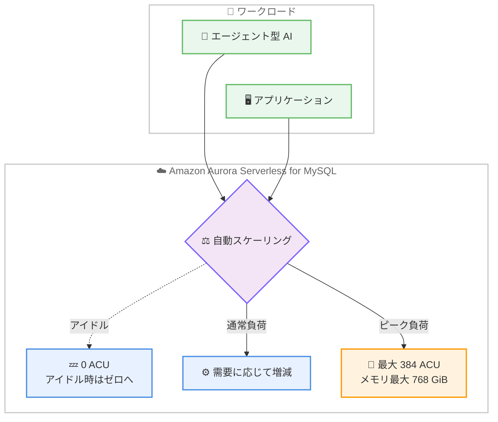

# Amazon Aurora - Aurora Serverless for MySQL が最大 384 ACU をサポート

**リリース日**: 2026 年 11 月 23 日
**サービス**: Amazon Aurora (MySQL 互換エディション)
**機能**: Aurora Serverless の最大キャパシティ拡張 (384 ACU)

📊 [このアップデートのインフォグラフィックを見る](https://takech9203.github.io/aws-news-summary/20261123-aurora-serverless-mysql-supports-384-acu.html)

## 概要

Amazon Aurora MySQL 互換エディションの Aurora Serverless が、最大 384 ACU (Aurora Capacity Unit) までのスケーリングをサポートしました。従来の最大値である 256 ACU から 50% の引き上げとなります。各 ACU は約 2 GiB のメモリと、それに応じた CPU およびネットワークリソースを提供するため、1 つのデータベースインスタンスで最大 768 GiB のメモリを利用できるようになります。

Aurora Serverless はワークロードの需要に応じて自動的にキャパシティをスケーリングし、処理が完了するとゼロまでスケールダウンするため、消費したキャパシティに対してのみ課金されます。AWS は本アップデートの対象ユーザーとして、アクティビティの急増、長いアイドル時間、予測不能なトラフィックパターンを特徴とするエージェント型 AI ワークロードを挙げており、より大規模なピーク需要にもサーバーレス構成のまま対応できるようになりました。

本機能は Aurora MySQL バージョン 3.14 および 8.4.10 (Platform Version 4 上で稼働) でサポートされます。

**アップデート前の課題**

- 以前は Aurora Serverless for MySQL の最大キャパシティが 256 ACU (約 512 GiB メモリ) に制限されていた
- ピーク時に 256 ACU を超えるリソースが必要なワークロードでは、プロビジョンドインスタンスへの移行を検討する必要があった
- 大規模なメモリを必要とするワークロードで、サーバーレスの自動スケーリングやスケール to ゼロの利点を享受しにくかった

**アップデート後の改善**

- 最大キャパシティが 384 ACU (約 768 GiB メモリ) に拡張され、より大規模なワークロードをサーバーレス構成で実行可能になった
- Platform Version 4 上の既存クラスターは、最大キャパシティ設定の変更のみで (必要に応じてエンジンバージョンも変更)、ダウンタイムなしで新しい上限を利用できる
- 需要のバーストが大きいエージェント型 AI ワークロードなどでも、使用した分だけの課金でピーク需要に対応できるようになった

## アーキテクチャ図



Aurora Serverless はワークロードの需要に応じて 0 ACU から最大 384 ACU まで自動的にスケーリングし、消費したキャパシティに対してのみ課金されます。

## サービスアップデートの詳細

### 主要機能

1. **最大キャパシティの 384 ACU への拡張**
   - 従来の最大値 256 ACU から 50% の引き上げ
   - 各 ACU は約 2 GiB のメモリと、対応する CPU・ネットワークリソースを提供
   - 最大構成で約 768 GiB のメモリを利用可能

2. **スケール to ゼロによるコスト最適化**
   - ワークロードの完了後、自動的にキャパシティをゼロまでスケールダウン
   - 消費したキャパシティに対してのみ課金
   - バーストが大きく、アイドル時間が長い、予測不能なトラフィックパターンのワークロードに適合

3. **ダウンタイムなしでの適用**
   - Platform Version 4 上の既存クラスターは、最大キャパシティ設定の変更だけで利用可能
   - 必要に応じてエンジンバージョンを変更
   - 旧プラットフォームのクラスターは、保留中のメンテナンスアクションから Platform Version 4 へアップグレード

## 技術仕様

### キャパシティ仕様

| 項目 | 詳細 |
|------|------|
| 最大キャパシティ | 384 ACU (従来は 256 ACU) |
| 最大メモリ | 約 768 GiB (1 ACU あたり約 2 GiB) |
| 最小キャパシティ | 0 ACU (スケール to ゼロ対応) |
| 対応エンジンバージョン | Aurora MySQL 3.14 および 8.4.10 |
| 必要プラットフォーム | Platform Version 4 |

### API変更履歴

本アップデートに直接関連する API 変更は、発表時点の AWS API Changes (直近 7 日間) では確認されていません。最大キャパシティは既存の `ServerlessV2ScalingConfiguration` の設定値として指定します。

## 設定方法

### 前提条件

1. Aurora MySQL バージョン 3.14 または 8.4.10 を使用していること
2. クラスターが Platform Version 4 上で稼働していること (旧プラットフォームの場合はアップグレードが必要)
3. クラスターを変更できる IAM 権限があること

### 手順

#### ステップ1: 新規クラスターで 384 ACU を指定する場合

```bash
aws rds create-db-cluster \
  --db-cluster-identifier my-serverless-cluster \
  --engine aurora-mysql \
  --engine-version 8.0.mysql_aurora.3.14.0 \
  --serverless-v2-scaling-configuration MinCapacity=0,MaxCapacity=384 \
  --master-username admin \
  --manage-master-user-password
```

サポート対象のエンジンバージョンを指定して Aurora クラスターを作成し、Serverless のスケーリング設定で最大キャパシティを 384 ACU に設定しています。

#### ステップ2: 既存クラスターの最大キャパシティを変更する場合

```bash
aws rds modify-db-cluster \
  --db-cluster-identifier my-serverless-cluster \
  --serverless-v2-scaling-configuration MinCapacity=0,MaxCapacity=384 \
  --apply-immediately
```

Platform Version 4 上の既存クラスターの最大キャパシティ設定を 384 ACU に変更しています。この変更にダウンタイムは発生しません。

#### ステップ3: 旧プラットフォームのクラスターをアップグレードする場合

```bash
# 保留中のメンテナンスアクションを確認
aws rds describe-pending-maintenance-actions

# メンテナンスアクションを即時適用
aws rds apply-pending-maintenance-action \
  --resource-identifier <クラスターの ARN> \
  --apply-action system-update \
  --opt-in-type immediate
```

旧プラットフォームで稼働しているクラスターに対して、保留中のメンテナンスアクションを確認し、Platform Version 4 へのアップグレードを適用しています。

## メリット

### ビジネス面

- **コスト効率の向上**: 大規模なピーク需要に対してもプロビジョンドインスタンスの常時稼働が不要になり、消費したキャパシティのみの課金でコストを最適化できる
- **AI ワークロードへの対応**: エージェント型 AI のようにバーストが大きく予測不能なワークロードを、キャパシティプランニングなしで運用できる
- **移行の手間を削減**: これまで ACU 上限を理由にプロビジョンド構成へ移行していたワークロードを、サーバーレスのまま維持できる

### 技術面

- **スケーリング上限の拡大**: 最大 384 ACU (約 768 GiB メモリ) まで自動スケーリングが可能
- **ダウンタイムなしの適用**: Platform Version 4 上の既存クラスターは設定変更のみで新しい上限を利用可能
- **運用の簡素化**: スケール to ゼロと組み合わせることで、アイドル時のリソース管理が不要

## デメリット・制約事項

### 制限事項

- Aurora MySQL バージョン 3.14 および 8.4.10 のみでサポートされる
- Platform Version 4 上で稼働している必要があり、旧プラットフォームのクラスターはアップグレードが必要
- 本発表は MySQL 互換エディションが対象 (PostgreSQL 互換エディションの上限は別途確認が必要)

### 考慮すべき点

- 最大キャパシティを引き上げると、ピーク時の時間あたりコストも増加するため、ワークロードに応じた上限設定が必要
- リージョンごとの利用可否と料金は Amazon Aurora 料金ページでの確認が必要
- 旧プラットフォームからのアップグレードはメンテナンスアクションとして計画的に実施する必要がある

## ユースケース

### ユースケース1: エージェント型 AI アプリケーションのバックエンド

**シナリオ**: AI エージェントが必要に応じてデータベースへ大量のクエリを発行するアプリケーション。アクティビティのバースト、長いアイドル時間、予測不能なトラフィックが特徴。

**実装例**:
```bash
aws rds modify-db-cluster \
  --db-cluster-identifier ai-agent-backend \
  --serverless-v2-scaling-configuration MinCapacity=0,MaxCapacity=384
```

**効果**: アイドル時は 0 ACU まで縮小してコストを抑えつつ、バースト時は最大 384 ACU まで自動拡張して応答性能を維持できる。

### ユースケース2: 月次バッチ処理や期末処理などの周期的な重負荷

**シナリオ**: 通常時は小規模な負荷だが、月末や期末の集計処理で大量のメモリと CPU を必要とするワークロード。

**実装例**:
```bash
aws rds modify-db-cluster \
  --db-cluster-identifier monthly-batch-db \
  --serverless-v2-scaling-configuration MinCapacity=1,MaxCapacity=384
```

**効果**: ピーク処理のためにプロビジョンドの大型インスタンスを常時確保する必要がなくなり、処理時間の短縮とコスト削減を両立できる。

### ユースケース3: プロビジョンド構成からの統合・移行

**シナリオ**: 従来は 256 ACU の上限を超えるピークに備えてプロビジョンドインスタンスを使用していたが、平均稼働率が低くコスト効率が悪い。

**実装例**:
```bash
aws rds create-db-cluster \
  --db-cluster-identifier migrated-serverless \
  --engine aurora-mysql \
  --engine-version 8.0.mysql_aurora.3.14.0 \
  --serverless-v2-scaling-configuration MinCapacity=0.5,MaxCapacity=384
```

**効果**: 拡大された上限によりピーク需要をサーバーレスでカバーできるようになり、平均稼働率の低いワークロードのコストを削減できる。

## 料金

Aurora Serverless は、消費した ACU 時間 (ACU-hour) に基づく秒単位の課金です。ワークロードがゼロまでスケールダウンしている間はコンピューティング料金が発生せず、ストレージと I/O には別途料金がかかります。最大キャパシティの引き上げ自体に追加料金はなく、実際に消費したキャパシティに対してのみ課金されます。

リージョンごとの単価は [Amazon Aurora 料金ページ](https://aws.amazon.com/rds/aurora/pricing/) を参照してください。

## 利用可能リージョン

公式発表にはリージョンの一覧が記載されていません。利用可能なリージョンは [Amazon Aurora 料金ページ](https://aws.amazon.com/rds/aurora/pricing/) で確認してください。

## 関連サービス・機能

- **Aurora Serverless v2**: 本アップデートの基盤となる自動スケーリング機能。0 ACU から最大キャパシティまで需要に応じて増減する
- **Amazon Aurora プロビジョンドインスタンス**: 一定の負荷が継続するワークロード向けの構成。サーバーレスと同一クラスター内で混在可能
- **Amazon RDS メンテナンスアクション**: 旧プラットフォームから Platform Version 4 へのアップグレードに使用する仕組み

## 参考リンク

- 📊 [インフォグラフィック](https://takech9203.github.io/aws-news-summary/20261123-aurora-serverless-mysql-supports-384-acu.html)
- [公式発表 (What's New)](https://aws.amazon.com/about-aws/whats-new/2026/11/aurora-serverless-mysql-supports-384-acu/)
- [Aurora Serverless 概要](https://aws.amazon.com/rds/aurora/serverless/)
- [ドキュメント: Aurora Serverless v2 の仕組み](https://docs.aws.amazon.com/AmazonRDS/latest/AuroraUserGuide/aurora-serverless-v2.how-it-works.html)
- [料金ページ](https://aws.amazon.com/rds/aurora/pricing/)

## まとめ

Aurora Serverless for MySQL の最大キャパシティが 384 ACU (約 768 GiB メモリ) に拡張され、これまでプロビジョンド構成が必要だった大規模なピーク需要もサーバーレスで対応できるようになりました。Platform Version 4 上の既存クラスターはダウンタイムなしで設定変更のみで利用できるため、エージェント型 AI などバーストの大きいワークロードを運用している場合は、最大キャパシティ設定の見直しを推奨します。
