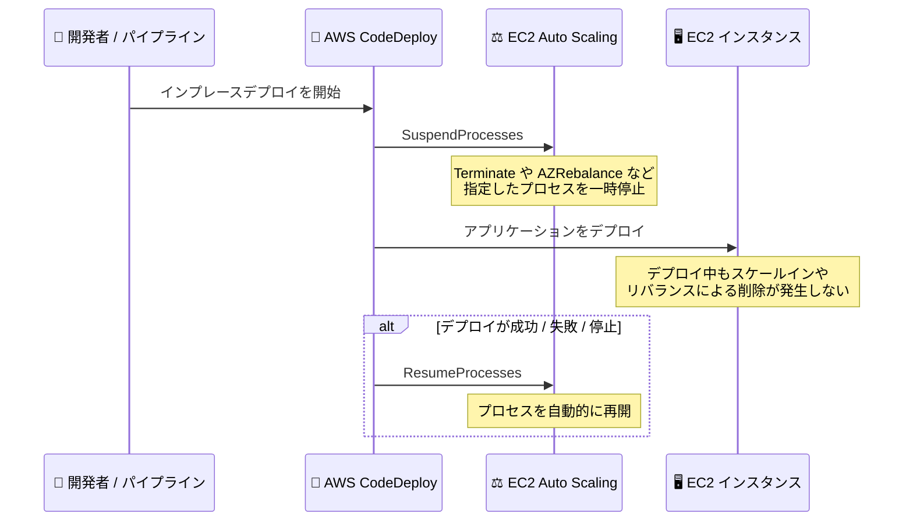

# AWS CodeDeploy - Amazon EC2 Auto Scaling プロセスの一時停止サポート

**リリース日**: 2026 年 11 月 23 日
**サービス**: AWS CodeDeploy
**機能**: デプロイ中の Amazon EC2 Auto Scaling プロセスの一時停止

📊 [このアップデートのインフォグラフィックを見る](https://takech9203.github.io/aws-news-summary/20261123-aws-codedeploy-suspend-asg-processes.html)

## 概要

AWS CodeDeploy が、Auto Scaling グループへのインプレースデプロイ中に Amazon EC2 Auto Scaling プロセスを一時停止する機能をサポートしました。`Terminate`、`AZRebalance`、`InstanceRefresh`、`ScheduledActions` の 4 つのプロセスを任意の組み合わせで指定でき、デプロイグループ単位またはデプロイ単位で設定できます。

CodeDeploy はデプロイの開始前に指定されたプロセスを自動的に一時停止し、デプロイが成功、失敗、または停止した時点で自動的に再開します。これにより、デプロイの途中でスケールインイベントや AZ リバランスがインスタンスを削除・置換してデプロイが失敗する、という問題を防止できます。

EC2 Auto Scaling グループに対してインプレースデプロイを実施しているユーザーにとって、これまで独自に実装していた一時停止・再開の運用スクリプトが不要になる、運用負荷を大きく下げるアップデートです。

**アップデート前の課題**

このアップデート以前は、デプロイと Auto Scaling のスケーリング活動の競合を避けるために手動の対応が必要でした。

- デプロイ中にスケールインイベントが発生すると、更新中のインスタンスが削除されてデプロイが失敗することがあった
- AZ リバランスやインスタンスの更新 (Instance Refresh) により、デプロイ中のインスタンスが置換されるリスクがあった
- 競合を防ぐには、デプロイの前後で `SuspendProcesses` / `ResumeProcesses` を呼び出すカスタムスクリプトを自前で作成・運用する必要があった

**アップデート後の改善**

今回のアップデートにより、CodeDeploy がプロセスの一時停止と再開を自動的に処理します。

- デプロイ前に指定プロセスを自動で一時停止し、デプロイの成功・失敗・停止時に自動で再開するため、カスタムスクリプトが不要になった
- `Terminate`、`AZRebalance`、`InstanceRefresh`、`ScheduledActions` を任意の組み合わせで指定できるようになった
- デプロイグループ単位の設定は、既存のパイプラインから起動されるデプロイを含むすべてのデプロイに適用され、個々のデプロイで上書きも可能になった

## アーキテクチャ図



CodeDeploy がデプロイの開始前に指定された Auto Scaling プロセスを一時停止し、デプロイの終了時 (成功・失敗・停止のいずれでも) に自動的に再開する流れを示しています。

## サービスアップデートの詳細

### 主要機能

1. **一時停止できる 4 つのプロセス**
   - `Terminate`: スケールインイベントによるインスタンス削除を防止
   - `AZRebalance`: アベイラビリティーゾーン間でインスタンスを移動するリバランスを防止
   - `InstanceRefresh`: インスタンスを置換するインスタンスの更新を防止
   - `ScheduledActions`: スケジュールされたスケーリングアクションの実行を防止 (デプロイ中に開始予定だったアクションはスキップされ、後から実行されない)

2. **自動的な一時停止と再開**
   - CodeDeploy がデプロイ前にプロセスを一時停止し、デプロイの成功・失敗・停止時に自動で再開
   - デプロイ開始時点ですでに一時停止されていたプロセスは、デプロイ後も再開されない (既存の運用設定を尊重)
   - 一時停止に失敗した場合は、インスタンスが更新される前にデプロイが失敗する

3. **柔軟な設定スコープ**
   - デプロイグループ単位: そのグループへのすべてのデプロイ (既存パイプラインからのデプロイを含む) に適用
   - デプロイ単位: 個々のデプロイでグループ設定を上書き可能 (空のリストを指定すれば一時停止なしも選択可能)
   - CodeDeploy コンソール、AWS CLI、AWS SDK から設定可能

## 技術仕様

### 利用条件

| 項目 | 詳細 |
|------|------|
| デプロイタイプ | インプレースデプロイのみ (Blue/Green デプロイは対象外) |
| デプロイグループ | 少なくとも 1 つの Auto Scaling グループを含むこと (タグ指定インスタンスやオンプレミスインスタンスの併用は可) |
| 一時停止の対象 | デプロイグループ内の Auto Scaling グループのみ (タグ指定・オンプレミスインスタンスには影響しない) |
| 指定可能なプロセス | `Terminate`、`AZRebalance`、`InstanceRefresh`、`ScheduledActions` (プロセス名は大文字小文字を区別) |
| 対象外のプロセス | `Launch`、`HealthCheck`、`ReplaceUnhealthy` など、グループの健全性維持に必要なプロセスは一時停止できない |

### 必要な IAM 権限

デプロイグループのサービスロールに、対象の Auto Scaling グループへの以下のアクションが必要です。

```json
{
  "Effect": "Allow",
  "Action": [
    "autoscaling:DescribeAutoScalingGroups",
    "autoscaling:SuspendProcesses",
    "autoscaling:ResumeProcesses"
  ],
  "Resource": "*"
}
```

`AWSCodeDeployRole` マネージドポリシーを使用している場合、これらの権限はすでに含まれています。カスタムサービスロールを使用している場合は、上記アクションの追加が必要です。権限が不足している場合、CodeDeploy はデプロイを作成せず、不足している IAM アクション名を含むエラーを返します。

## 設定方法

### 前提条件

1. インプレースデプロイタイプのデプロイグループであること
2. デプロイグループに少なくとも 1 つの Auto Scaling グループが含まれていること
3. サービスロールに `autoscaling:SuspendProcesses` / `autoscaling:ResumeProcesses` / `autoscaling:DescribeAutoScalingGroups` の権限があること

### 手順

#### ステップ 1: デプロイグループに一時停止プロセスを設定する

```bash
aws deploy update-deployment-group \
    --application-name my-application \
    --current-deployment-group-name my-deployment-group \
    --ec2-deployment-options '{"autoScalingGroupProcessesToSuspend":["Terminate","AZRebalance"]}'
```

`--ec2-deployment-options` オプションの `autoScalingGroupProcessesToSuspend` に一時停止するプロセスを指定します。この例では、デプロイグループへのすべてのデプロイで `Terminate` と `AZRebalance` が一時停止されます。コンソールの場合は、デプロイグループの [Environment configuration] で [Auto Scaling process suspension] を展開して選択します。

#### ステップ 2: 個々のデプロイで設定を上書きする (オプション)

```bash
aws deploy create-deployment \
    --application-name my-application \
    --deployment-group-name my-deployment-group \
    --s3-location bucket=amzn-s3-demo-bucket,key=my-app.zip,bundleType=zip \
    --ec2-deployment-options '{"autoScalingGroupProcessesToSuspend":["Terminate"]}'
```

`create-deployment` で `--ec2-deployment-options` を指定すると、そのデプロイに限りデプロイグループの設定を上書きできます。この例では `Terminate` のみを一時停止します。空のリスト (`[]`) を指定すると、そのデプロイではプロセスを一時停止しません。オプションを指定しない場合は、デプロイグループの設定が使用されます。

#### ステップ 3: 一時停止されたままのプロセスを手動で再開する (障害時)

```bash
# 一時停止中のプロセスを確認
aws autoscaling describe-auto-scaling-groups \
    --auto-scaling-group-names my-asg \
    --query 'AutoScalingGroups[0].SuspendedProcesses'

# プロセスを再開
aws autoscaling resume-processes \
    --auto-scaling-group-name my-asg \
    --scaling-processes Terminate AZRebalance
```

CodeDeploy がプロセスを再開できなかった場合、デプロイは失敗し、プロセスは一時停止されたままになります (エラーメッセージに対象の Auto Scaling グループとプロセスが表示されます)。1 つ目のコマンドで一時停止中のプロセスを確認し、2 つ目のコマンドで手動で再開します。

## メリット

### ビジネス面

- **デプロイ成功率の向上**: スケーリング活動との競合によるデプロイ失敗を防ぎ、リリースの信頼性が向上する
- **運用コストの削減**: 一時停止・再開を行うカスタムスクリプトの開発・保守が不要になる
- **既存パイプラインへの容易な適用**: デプロイグループに設定するだけで、既存のパイプラインから起動されるデプロイにも自動的に適用される

### 技術面

- **自動的なライフサイクル管理**: デプロイの成功・失敗・停止のいずれの場合でも CodeDeploy がプロセスを自動的に再開する
- **柔軟な制御**: 4 つのプロセスを任意の組み合わせで指定でき、デプロイ単位での上書きも可能
- **安全側に倒れる設計**: プロセスの一時停止に失敗した場合は、インスタンスが更新される前にデプロイが失敗する

## デメリット・制約事項

### 制限事項

- インプレースデプロイのみ対応で、Blue/Green デプロイでは利用できない
- デプロイグループに Auto Scaling グループが含まれない場合、設定リクエストは拒否される
- 一時停止できるのは `Terminate`、`AZRebalance`、`InstanceRefresh`、`ScheduledActions` の 4 つのみ (`Launch` や `HealthCheck` などは対象外)
- タグで指定したインスタンスやオンプレミスインスタンスには影響しない

### 考慮すべき点

- `Terminate` を一時停止している間は、Auto Scaling が異常なインスタンスを置換しない。デプロイ失敗時の通知 (トリガーや Amazon EventBridge ルール) の設定が推奨される
- `Terminate` の一時停止は、スポットインスタンスの中断や手動のインスタンス終了を防ぐものではない
- `Terminate` のみ一時停止して `AZRebalance` を一時停止しない場合、リバランス中にグループが最大サイズを最大 10% 超過することがある
- ロールバックデプロイは、元のデプロイと同じプロセスを一時停止する
- 2 つのデプロイグループが同じ Auto Scaling グループを共有している場合、一方のデプロイがもう一方の実行中にプロセスを再開してしまう可能性がある。各 Auto Scaling グループは 1 つのデプロイグループにのみ関連付けることが推奨される
- デプロイ中に開始予定だった `ScheduledActions` はスキップされ、後から実行されない

## ユースケース

### ユースケース 1: スケールイン頻度の高い環境でのデプロイ安定化

**シナリオ**: トラフィック変動が大きく、ターゲット追跡スケーリングによるスケールインが頻繁に発生する Web アプリケーションで、デプロイ中にインスタンスが削除されてデプロイが失敗することがある。

**実装例**:
```bash
aws deploy update-deployment-group \
    --application-name web-app \
    --current-deployment-group-name production \
    --ec2-deployment-options '{"autoScalingGroupProcessesToSuspend":["Terminate"]}'
```

**効果**: デプロイ中のスケールインによるインスタンス削除がなくなり、デプロイ失敗率が低下する。デプロイ終了後はスケールインが自動的に再開され、コスト最適化も維持される。

### ユースケース 2: カスタムスクリプトからの移行

**シナリオ**: CI/CD パイプラインのデプロイ前後に `aws autoscaling suspend-processes` / `resume-processes` を呼び出すスクリプトを運用しているが、デプロイ失敗時に再開処理が漏れてプロセスが停止したままになる事故が発生していた。

**実装例**:
```bash
# パイプラインから一時停止・再開スクリプトを削除し、
# デプロイグループの設定に置き換える
aws deploy update-deployment-group \
    --application-name my-app \
    --current-deployment-group-name staging \
    --ec2-deployment-options '{"autoScalingGroupProcessesToSuspend":["Terminate","AZRebalance","InstanceRefresh"]}'
```

**効果**: デプロイの成功・失敗・停止のいずれでも CodeDeploy が再開を処理するため、再開漏れのリスクが減り、パイプラインの保守対象コードも削減できる。

### ユースケース 3: メンテナンスウィンドウ中のデプロイとスケジュールアクションの競合回避

**シナリオ**: 夜間のスケジュールされたスケーリングアクションと定期デプロイの時間帯が重なり、デプロイ中にインスタンス数が変動して問題が発生していた。

**実装例**:
```bash
aws deploy create-deployment \
    --application-name batch-app \
    --deployment-group-name nightly \
    --s3-location bucket=amzn-s3-demo-bucket,key=batch-app.zip,bundleType=zip \
    --ec2-deployment-options '{"autoScalingGroupProcessesToSuspend":["ScheduledActions","Terminate"]}'
```

**効果**: デプロイ中はスケジュールアクションが実行されず、インスタンス構成が安定した状態でデプロイできる。なお、スキップされたスケジュールアクションは後から実行されない点に注意が必要。

## 料金

この機能自体の追加料金に関する言及は公式発表にありません。AWS CodeDeploy の EC2 インスタンスへのデプロイは追加料金なしで利用できます。

ただし、プロセスの一時停止中はスケールインが抑制されるため、デプロイ時間が長い場合はインスタンスが通常より長く稼働し、EC2 の利用料金がわずかに増加する可能性があります。

## 利用可能リージョン

AWS GovCloud (US) リージョンおよび中国リージョンを含む、すべての AWS リージョンで利用可能です。

## 関連サービス・機能

- **Amazon EC2 Auto Scaling**: 一時停止の対象となるスケーリングプロセス (`Terminate`、`AZRebalance` など) を提供するサービス。プロセス一時停止の影響範囲は EC2 Auto Scaling 側のドキュメントも参照
- **AWS CodePipeline**: デプロイグループ単位の設定は、CodePipeline など既存のパイプラインから起動されるデプロイにも自動的に適用される
- **Amazon EventBridge**: `Terminate` 一時停止中は異常インスタンスの置換が行われないため、デプロイ失敗を検知する EventBridge ルールやトリガーの設定が推奨される

## 参考リンク

- 📊 [インフォグラフィック](https://takech9203.github.io/aws-news-summary/20261123-aws-codedeploy-suspend-asg-processes.html)
- [公式発表 (What's New)](https://aws.amazon.com/about-aws/whats-new/2026/11/aws-codedeploy-suspend-asg-processes/)
- [ドキュメント: Suspending Amazon EC2 Auto Scaling processes during deployments](https://docs.aws.amazon.com/codedeploy/latest/userguide/integrations-aws-auto-scaling-suspend-processes.html)
- [API リファレンス: EC2DeploymentOptions](https://docs.aws.amazon.com/codedeploy/latest/APIReference/API_EC2DeploymentOptions.html)
- [AWS CodeDeploy 製品ページ](https://aws.amazon.com/codedeploy/)

## まとめ

AWS CodeDeploy が EC2 Auto Scaling プロセスの一時停止・再開をデプロイのライフサイクルに合わせて自動化し、スケーリング活動との競合によるデプロイ失敗を防げるようになりました。Auto Scaling グループへのインプレースデプロイで独自の一時停止スクリプトを運用している場合は、デプロイグループの `ec2DeploymentOptions` 設定への移行を検討することを推奨します。その際、`Terminate` 一時停止中は異常インスタンスが置換されない点を踏まえ、デプロイ失敗の通知設定を併せて整備してください。
