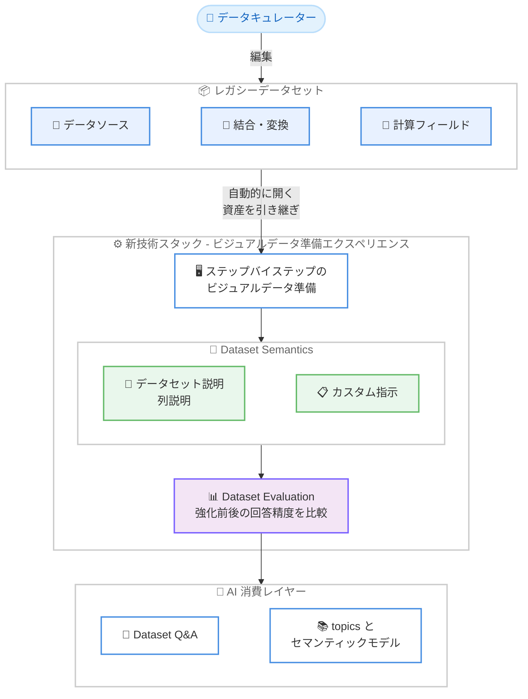

# AWS Quick - 既存データセットの AI 対応化

**リリース日**: 2026 年 11 月 23 日
**サービス**: AWS Quick (Quick Sight)
**機能**: レガシーデータセットへの AI 対応機能の提供 (ビジュアルデータ準備エクスペリエンスによる Dataset Semantics / Dataset Evaluation 対応)

📊 [このアップデートのインフォグラフィックを見る](https://takech9203.github.io/aws-news-summary/20261123-aws-quick-ai-ready-existing-datasets.html)

## 概要

AWS Quick は、改善されたビジュアルデータ準備エクスペリエンスを支える新しい技術スタックを通じて、レガシーデータセットを AI 対応 (AI-ready) にできるようになったと発表しました。この技術スタックは、Dataset Semantics、topics とセマンティックモデル、Dataset Evaluation といった AI 関連機能の基盤となっています。

データキュレーターは、データセット説明、列説明、カスタム指示 (Custom Instructions) を通じてデータセットにビジネスコンテキストを追加できます。さらに Dataset Evaluation を使用して、セマンティック強化の前後で自然言語質問に対する回答精度を比較評価できるため、強化の効果を定量的に確認しながらデータセットを改善できます。

今回のアップデートにより、作成者 (Author) が対応するレガシーデータセットを編集すると、既存のデータソース、結合 (Join)、変換、計算フィールドを引き継いだ状態で、ビジュアルデータ準備エクスペリエンスが自動的に開きます。データセットをゼロから再作成することなく、セマンティクスの追加と精度評価が可能になります。

**アップデート前の課題**

- 2025 年 10 月より前に作成されたレガシーデータセットは、Dataset Semantics や Dataset Evaluation などの AI 対応機能を利用できなかった
- レガシーデータセットで新しい AI 機能を使うには、データソース、結合、変換、計算フィールドを含むデータセットを新しいエクスペリエンスで再作成する必要があった
- データセットの再作成には時間がかかり、既存の分析資産との整合性維持にも手間がかかった

**アップデート後の改善**

- 対応するレガシーデータセットを編集すると、ビジュアルデータ準備エクスペリエンスが自動的に開くようになった
- 既存のデータソース、結合、変換、計算フィールドがそのまま引き継がれるため、再作成が不要になった
- レガシーデータセットに対しても、ビジネスコンテキストの追加 (Dataset Semantics) と回答精度の比較評価 (Dataset Evaluation) が可能になった

## アーキテクチャ図



対応するレガシーデータセットを編集すると、既存資産を引き継いだままビジュアルデータ準備エクスペリエンスが自動的に開き、Dataset Semantics の追加と Dataset Evaluation による精度評価を経て、Dataset Q&A などの AI 機能で活用できるようになります。

## サービスアップデートの詳細

### 主要機能

1. **レガシーデータセットの自動移行オープン**
   - 対応するレガシーデータセット (2025 年 10 月より前に作成されたデータセット) を編集すると、ビジュアルデータ準備エクスペリエンスが自動的に開く
   - 既存のデータソース、結合、変換、計算フィールドがそのまま引き継がれる
   - データセットを再作成することなく、新しい AI 対応機能を利用できる

2. **Dataset Semantics によるビジネスコンテキストの追加**
   - **データセット説明**: データセットの内容、スコープ、用途をビジネスレベルで記述 (最大 5,000 文字)。すべてのデータセット利用者に表示される
   - **列説明**: 各列の意味、有効な値、ビジネス上の定義を記述 (最大 500 文字)。補足情報 (Additional Notes) は最大 2,000 文字
   - **カスタム指示**: AI エージェント専用の自由形式テキスト。データセットの解釈方法、クエリ方法、推論方法をガイドする (最大 5,000 文字)
   - **ファイルアップロード**: Databricks、dbt、Alation などの外部カタログからエクスポートしたセマンティックメタデータを YAML / JSON / TXT 形式で一括取り込み可能 (最大 50,000 文字)

3. **Dataset Evaluation による回答精度の比較評価**
   - セマンティック強化の前後で、自然言語質問に対する回答精度を比較評価できる
   - 強化の効果を確認しながら、反復的にメタデータを改善できる

4. **新技術スタックが提供するデータ準備機能**
   - Append、Aggregate、Pivot などのビジュアルなマルチステップ変換
   - 大規模データセットの高速な取り込み (ingestion)
   - レガシーエクスペリエンス比で最大 20 倍のクロスソース結合上限
   - Google Sheets および Salesforce コネクタ、JODA 日付形式、増分更新 (incremental refresh)、アップグレード時の非マテリアライズ計算列の保持への対応拡大

## 技術仕様

### データ準備エクスペリエンスの比較

| 項目 | レガシーエクスペリエンス | ビジュアルデータ準備エクスペリエンス |
|------|------------------------|------------------------------------|
| 提供時期 | 2025 年 10 月より前 | 2025 年 10 月以降 |
| 変換の表示 | 従来型のインターフェース | ステップバイステップのビジュアル表示 |
| マルチステップ変換 | 限定的 | Append、Aggregate、Pivot などに対応 |
| クロスソース結合上限 | 従来の上限 | 最大 20 倍 |
| Dataset Semantics | 非対応 | 対応 |
| Dataset Evaluation | 非対応 | 対応 |
| topics とセマンティックモデル | 非対応 | 対応 |

### Dataset Semantics の構成要素

| 構成要素 | レベル | 最大文字数 | 主な対象 |
|----------|--------|-----------|----------|
| データセット説明 | データセット | 5,000 文字 | 人間の利用者と AI エージェント |
| カスタム指示 | データセット | 5,000 文字 | AI エージェント |
| メタデータファイル (YAML / JSON / TXT) | データセット | 50,000 文字 | AI エージェント |
| 列説明 | 列 | 500 文字 | 人間の利用者と AI エージェント |
| 補足情報 | 列 | 2,000 文字 | 人間の利用者と AI エージェント |

### カスタム指示の記述例

```text
This dataset contains net revenue after returns and discounts, calculated
on an accrual basis. All figures are in USD. The 'revenue' column excludes
taxes, shipping fees, and promotional credits. For year-over-year
comparisons, use the 'fiscal_year' field rather than 'calendar_year' as
our fiscal year runs April-March.
```

あいまいな用語の定義、計算方法、通貨や除外項目、フィールドの正しい使い分けを具体的に記述することで、AI エージェントが生成する SQL クエリと回答の精度が向上します。

## 設定方法

### 前提条件

1. AWS Quick (Quick Sight) を利用していること
2. データセットを所有または管理する Author / Author Pro であること (Dataset Semantics の編集には Enterprise ライセンスが必要)
3. 対象がビジュアルデータ準備エクスペリエンスに対応するレガシーデータセットであること

### 手順

#### ステップ 1: レガシーデータセットを編集する

Quick コンソールでデータセット一覧から対象のレガシーデータセットを選択し、編集を開始します。対応するデータセットの場合、ビジュアルデータ準備エクスペリエンスが自動的に開き、既存のデータソース、結合、変換、計算フィールドが引き継がれた状態で表示されます。

#### ステップ 2: Dataset Semantics を追加する

データセットを保存した後、[Output] タブを開き、以下を入力します。

1. データセット説明: データセットの内容と用途をビジネスレベルで記述
2. カスタム指示: AI エージェント向けに、用語の定義、計算方法、フィールドの使い分け、データ品質上の注意点を記述
3. 必要に応じて、外部カタログからエクスポートしたセマンティックメタデータファイル (YAML / JSON / TXT) をアップロード

列レベルでは、列説明と補足情報を追加し、フォルダで論理的にグループ化できます。

#### ステップ 3: Dataset Evaluation で精度を比較する

Dataset Evaluation を使用して、セマンティック強化前後の回答精度を比較します。想定される自然言語質問に対する回答を評価し、精度が不足している場合はカスタム指示や列説明を改善して再評価します。

## メリット

### ビジネス面

- **既存資産の有効活用**: 長年運用してきたレガシーデータセットを再作成することなく AI 対応化でき、移行コストを大幅に削減できる
- **セルフサービス分析の促進**: Dataset Q&A により、ダッシュボードを事前に構築しなくても、利用者が自然言語でデータに質問できるようになる
- **メタデータ整備の効果を可視化**: Dataset Evaluation により、セマンティック強化の投資対効果を回答精度の比較という形で確認できる

### 技術面

- **自動的な移行体験**: 対応するレガシーデータセットは編集時に自動的に新しいエクスペリエンスで開くため、明示的な移行作業が不要
- **外部カタログとの連携**: Databricks、dbt、Alation などからエクスポートしたメタデータをファイルで一括取り込みでき、列ごとの手動入力が不要
- **強化されたデータ準備基盤**: マルチステップ変換、高速取り込み、最大 20 倍のクロスソース結合上限など、新技術スタックの機能をレガシーデータセットでも活用できる

## デメリット・制約事項

### 制限事項

- ビジュアルデータ準備エクスペリエンスで保存・公開したデータセットをレガシーエクスペリエンスに直接変換して戻すことはできない (バージョン管理で以前のレガシーバージョンに戻すことは可能)
- Dataset Semantics の編集には Author / Author Pro の Enterprise ライセンスが必要
- 自動的に開くのは「対応する (eligible)」レガシーデータセットであり、すべてのレガシーデータセットが対象とは限らない

### 考慮すべき点

- データセット説明とカスタム指示はすべてのデータセット閲覧者に表示されるため、機密情報を記載しないこと
- カスタム指示の品質が AI の回答精度に直結するため、用語の定義、計算方法、データ品質上の注意点を具体的に記述することが重要
- Dataset Q&A の応答は行レベルセキュリティ (RLS) と列レベルセキュリティ (CLS) に従うため、セキュリティ設定を事前に確認しておくこと
- チームでレガシーエクスペリエンスから移行する際は、ワークフローの変更点を文書化して認識を揃えること

## ユースケース

### ユースケース 1: レガシー売上データセットの AI 対応化

**シナリオ**: 数年前に作成した売上分析用のレガシーデータセットがあり、経営層から自然言語でデータに質問できる環境を求められている。データセットには複雑な結合と計算フィールドが含まれており、再作成は避けたい。

**実装例**:
```text
1. レガシー売上データセットを編集し、自動的に開く
   ビジュアルデータ準備エクスペリエンスで内容を確認
2. [Output] タブでデータセット説明とカスタム指示を追加
   例: 「revenue 列は税・送料を除く純売上。年度比較には
   fiscal_year を使用 (4 月-3 月)」
3. Dataset Evaluation で想定質問に対する回答精度を
   強化前後で比較し、指示を改善
```

**効果**: 既存の結合や計算フィールドを維持したまま、経営層が Dataset Q&A で「前年比の純売上は?」といった質問に正確な回答を得られる環境を短期間で構築できる。

### ユースケース 2: 外部データカタログのメタデータ一括取り込み

**シナリオ**: dbt でデータモデルを管理しており、数百の列定義やビジネスルールがすでにカタログとして整備されている。これらを Quick のデータセットにも反映したい。

**実装例**:
```text
1. dbt からセマンティックメタデータを YAML 形式で
   エクスポート
2. 対象データセットの [Output] タブでファイルを
   アップロード (最大 50,000 文字)
3. 数百の列定義、ビジネスルール、メトリクス計算が
   一括で取り込まれる
```

**効果**: 列ごとの手動入力なしで、カタログ品質のメタデータを AI エージェントに提供でき、Text-to-SQL 生成の精度が向上する。

### ユースケース 3: データ品質の注意点を踏まえた全社データ活用

**シナリオ**: 顧客データセットにテストアカウントが混在しており、分析のたびに誤集計が発生している。AI による自動分析でも同じ問題が起きることを防ぎたい。

**実装例**:
```text
カスタム指示の例:
「顧客数を分析する際は、必ず is_test_account = true を
除外すること。Active は過去 12 か月以内に購入、
Dormant は 12-24 か月、Churned は 24 か月以上未購入と定義」
```

**効果**: AI エージェントがテストデータを自動的に除外し、ビジネス定義に沿った正確な回答を返すようになる。利用者ごとの集計ルールのばらつきも解消できる。

## 料金

このアップデート自体に追加料金はなく、AWS Quick の既存の料金体系の範囲で利用できます。Dataset Semantics の編集には Author / Author Pro の Enterprise ライセンスが必要です。詳細は料金ページを参照してください。

## 利用可能リージョン

サポートされているすべての AWS Quick リージョンで利用可能です。対象リージョンの一覧は [ドキュメント](https://docs.aws.amazon.com/quick/latest/userguide/regions.html) を参照してください。

## 関連サービス・機能

- **Dataset Q&A**: Dataset Semantics のメタデータを消費するレイヤー。利用者が自然言語でデータセットに質問し、AI が生成した回答を得られる
- **topics とセマンティックモデル**: 新技術スタックが支える AI 機能。構造化されたセマンティックモデルにより自然言語分析を実現する
- **SPICE**: Quick のインメモリ計算エンジン。高速取り込みや増分更新など、新しいデータ準備エクスペリエンスの一部機能は SPICE データセットが対象

## 参考リンク

- 📊 [インフォグラフィック](https://takech9203.github.io/aws-news-summary/20261123-aws-quick-ai-ready-existing-datasets.html)
- [公式発表 (What's New)](https://aws.amazon.com/about-aws/whats-new/2026/11/aws-quick-ai-ready-existing-datasets/)
- [ドキュメント: Data Preparation Experience](https://docs.aws.amazon.com/quick/latest/userguide/data-prep-experience-new.html)
- [ドキュメント: Dataset Enrichment](https://docs.aws.amazon.com/quick/latest/userguide/dataset-enrichment.html)
- [ドキュメント: データ準備エクスペリエンスの切り替え](https://docs.aws.amazon.com/quick/latest/userguide/switching-between-data-prep-experiences.html)
- [ドキュメント: 利用可能リージョン](https://docs.aws.amazon.com/quick/latest/userguide/regions.html)

## まとめ

今回のアップデートにより、2025 年 10 月より前に作成されたレガシーデータセットも、再作成なしで Dataset Semantics や Dataset Evaluation などの AI 対応機能を利用できるようになりました。既存の Quick (Quick Sight) 資産を多く保有する組織にとって、AI 活用への移行障壁を大きく下げる重要な改善です。まずは主要なレガシーデータセットを編集してビジュアルデータ準備エクスペリエンスを確認し、カスタム指示の追加と Dataset Evaluation による精度評価から始めることを推奨します。
