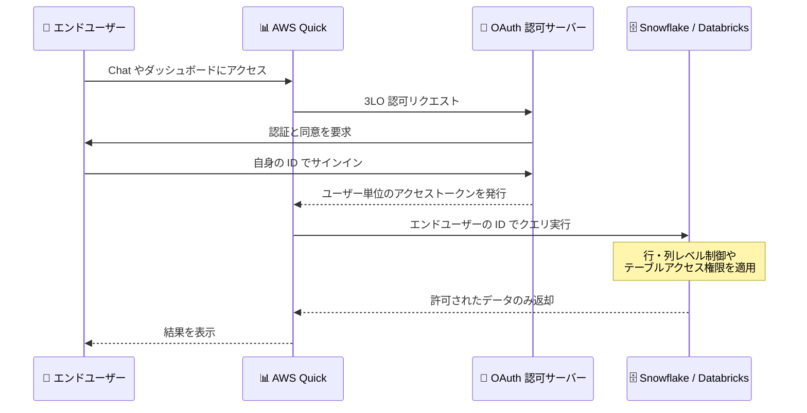

# AWS Quick - Snowflake / Databricks 向け 3LO によるアイデンティティ認識型アクセス

**リリース日**: 2026 年 11 月 23 日
**サービス**: AWS Quick
**機能**: Snowflake および Databricks 構造化データソースに対する three-legged OAuth (3LO) とエンドユーザー権限のサポート

📊 [このアップデートのインフォグラフィックを見る](https://takech9203.github.io/aws-news-summary/20261123-aws-quick-snowflake-databricks-3lo-end-user-permissions.html)

## 概要

AWS Quick が、Snowflake および Databricks の構造化データソースに対する three-legged OAuth (3LO) とエンドユーザー権限のサポートを発表しました。ユーザーが Quick の Chat、インタラクティブダッシュボード、Apps を利用する際、クエリはエンドユーザー自身の Snowflake または Databricks の ID で実行されます。

これにより、Snowflake や Databricks Unity Catalog で設定済みのガバナンスポリシー (行・列レベルの制御や、テーブル / ビューへのアクセス権限) がソースプラットフォーム側でそのまま適用されます。Quick 側で同じポリシーを再作成する必要はありません。データガバナンスを一元管理しながら、BI・分析体験を全社に展開したい組織にとって重要なアップデートです。

管理者は Quick のアカウント設定で OAuth クライアントアプリケーションを追加するだけで利用を開始できます。その後、データキュレーターが Snowflake または Databricks のデータソースを作成する際に 3LO を選択し、信頼されたアイデンティティ伝播 (Trusted Identity Propagation) を有効化することで、ユーザー ID がソースシステムに伝播されます。

**アップデート前の課題**

- 以前は、データソース接続に作成者 (作成時に設定した資格情報) の権限が埋め込まれ、ダッシュボードを閲覧するすべてのユーザーが同じ権限でデータにアクセスしていた
- Snowflake や Databricks Unity Catalog で定義済みの行・列レベルのアクセス制御を活かすことができず、Quick 側で行レベルセキュリティ (RLS) や列レベルセキュリティ (CLS) のルールを再作成・二重管理する必要があった
- ガバナンスポリシーが BI ツール側とデータプラットフォーム側に分散し、監査やコンプライアンス対応が複雑になっていた

**アップデート後の改善**

- クエリがエンドユーザー自身の Snowflake / Databricks ID で実行され、各ユーザーは自分の権限で許可されたデータのみを参照できるようになった
- Snowflake や Databricks Unity Catalog の既存ガバナンスポリシーがソースプラットフォーム側で適用されるため、Quick 側でポリシーを再作成する必要がなくなった
- Chat、インタラクティブダッシュボード、Apps のいずれの体験でも一貫してエンドユーザー権限が適用されるようになった

## アーキテクチャ図



3LO では、エンドユーザーが自身の ID で認可を行い、Quick はユーザー単位のトークンを使用してソースプラットフォームにクエリを実行します。アクセス制御はソースプラットフォーム側で適用されるため、各ユーザーには自分の権限で許可されたデータのみが表示されます。

## サービスアップデートの詳細

### 主要機能

1. **Three-legged OAuth (3LO) によるエンドユーザー認証**
   - Snowflake および Databricks のデータソース作成時に、認証方式として 3LO を選択可能
   - エンドユーザーは自身の OAuth ログインで認証し、クエリは各ユーザー自身の ID で実行される
   - Chat、インタラクティブダッシュボード、Apps のすべての利用体験で適用される

2. **信頼されたアイデンティティ伝播 (Trusted Identity Propagation)**
   - データソース作成時に Trusted Identity Propagation オプションを有効化することで、ユーザー ID がソースシステムに伝播される
   - このオプションを有効化しない場合、作成者の資格情報がデータソース接続に埋め込まれ、全ユーザーが作成者の権限を共有する点に注意が必要

3. **ソースプラットフォーム側でのガバナンス適用**
   - Snowflake のアクセス制御や Databricks Unity Catalog のアクセス制御リスト (ACL) に基づき、行・列レベルの制限やテーブル / ビューへのアクセスがソース側で適用される
   - Quick 側で RLS / CLS ルールを再作成する必要がなく、ポリシーの二重管理を解消できる

4. **OAuth クライアントアプリケーションの一元管理**
   - Quick アカウント管理者は、アカウント設定の [Manage OAuth Client Applications] で OAuth クライアントアプリケーションを登録・管理できる
   - Snowflake 用、Databricks 用のクライアントアプリケーションをそれぞれ設定可能

## 技術仕様

### 認証方式の比較 (Snowflake / Databricks 接続)

| 認証方式 | 実行 ID | 権限管理 | 主な用途 |
|------|------|------|------|
| ログイン資格情報 / PAT | 作成者の ID | Quick 側で RLS / CLS を手動管理 | シンプルな共有ダッシュボード |
| OAuth クライアント資格情報 (2LO) | サービスアカウント | Quick 側で RLS / CLS を手動管理 | マシン間通信、API 経由のデータソース作成 |
| Three-legged OAuth (3LO) | エンドユーザー自身の ID | ソースプラットフォーム側で適用 | ユーザーごとの権限を反映した分析体験 |

### OAuth クライアントアプリケーションの設定項目

| 項目 | 説明 |
|------|------|
| Config ID | 設定の識別子 |
| OAuth client application name | クライアントアプリケーション名 |
| Authentication type | 認証タイプ |
| Client ID / Client secret | OAuth クライアントの ID とシークレット |
| Token endpoint URL | トークンエンドポイント URL |
| Authorization endpoint URL | 認可エンドポイント URL |
| OAuth scopes | 要求する OAuth スコープ |
| VPC connection ARN | VPC 接続の ARN (オプション) |
| Data source type | SNOWFLAKE または DATABRICKS を選択 |

### API 変更履歴

| 日付 | サービス | 変更内容 |
|------|----------|----------|
| 2026/11/21 | [quicksight](https://awsapichanges.com/archive/changes/b75654-quicksight.html) | 26 new 17 updated api methods - Quicksight public SDK release for November 20 |

## 設定方法

### 前提条件

1. AWS Quick アカウントがあり、管理者権限を持つユーザーがアカウント設定を変更できること
2. Snowflake または Databricks 側で OAuth クライアントアプリケーション (クライアント ID、クライアントシークレット、トークン / 認可エンドポイント) が構成済みであること
3. エンドユーザーごとに Snowflake / Databricks のアカウントと適切なアクセス権限が付与されていること
4. 対象データセットが DirectQuery であること (SPICE データセットは 3LO によるエンドユーザー権限に非対応)

### 手順

#### ステップ 1: 管理者による OAuth クライアントアプリケーションの登録

1. Quick コンソールで [Manage Account] を選択する
2. [Security] の下にある [Manage OAuth Client Applications] を選択する
3. [Add OAuth client application] を選択し、Config ID、クライアント ID、クライアントシークレット、トークンエンドポイント URL、認可エンドポイント URL、OAuth スコープなどを入力する
4. Data source type で SNOWFLAKE または DATABRICKS を選択し、[Add] で保存する

管理者がクライアントアプリケーションを登録することで、作成者 (データキュレーター) が 3LO 認証のデータソースを作成できるようになります。

#### ステップ 2: 作成者による 3LO データソースの作成

1. [Create Data Source] ページに移動し、Snowflake または Databricks を選択する
2. 認証方式として [3LO] を選択する
3. 接続情報を入力する (Databricks の場合は Databricks アカウントに関連付けられたメールアドレスも入力)
4. [Trusted Identity Propagation] (信頼されたアイデンティティ伝播) のオプションを必ず選択する
5. [Create data source] を選択する

Trusted Identity Propagation を選択しない場合、作成者の資格情報が接続に埋め込まれ、すべてのユーザーが作成者の権限を共有してしまうため注意してください。

#### ステップ 3: エンドユーザーによる認証とダッシュボードの利用

1. 作成者がデータソースとダッシュボードの両方をエンドユーザーに共有する
2. エンドユーザーが Quick にサインインし、[Data Source] ページに移動する
3. エンドユーザーが自身の Snowflake / Databricks の OAuth ログインで認証し、保存する
4. エンドユーザーがダッシュボードにアクセスすると、自身の権限で許可されたデータのみが表示される

## メリット

### ビジネス面

- **ガバナンスの一元化**: 行・列レベルのアクセス制御を Snowflake / Databricks Unity Catalog 側で一元管理でき、BI ツール側との二重管理によるポリシーの不整合リスクを排除できる
- **コンプライアンス強化**: 誰がどのデータにアクセスしたかがエンドユーザー単位で記録されるため、監査対応やコンプライアンス要件への対応が容易になる
- **展開スピードの向上**: Quick 側で権限設定を再構築する必要がないため、既存のデータガバナンス体制のまま分析体験を迅速に全社展開できる

### 技術面

- **エンドユーザー単位のクエリ実行**: クエリがエンドユーザー自身の ID で実行されるため、ソースプラットフォームのアクセス制御がそのまま機能する
- **設定の簡素化**: 管理者が OAuth クライアントアプリケーションを一度登録すれば、作成者はデータソース作成時に 3LO を選択するだけで利用できる
- **既存フローとの共存**: Databricks の agentic カタログ体験は PAT と 3LO の両方の認証で動作し、3LO によるアイデンティティ強制はオプションかつ追加的な機能として利用できる

## デメリット・制約事項

### 制限事項

- 3LO によるエンドユーザー権限は DirectQuery データセットのみでサポートされ、SPICE データセットでは利用できない
- データセットを SPICE に切り替えた場合や変換を適用した場合、アイデンティティ強制は適用されない
- エンドユーザーごとに Snowflake / Databricks のアカウントが必要となる

### 考慮すべき点

- データソース作成時に Trusted Identity Propagation を有効化しないと、全ユーザーが作成者の権限を共有してしまうため、設定の確認が重要
- エンドユーザーは初回利用時にデータソースページで自身の資格情報による認証が必要となるため、利用開始手順の周知が必要
- DirectQuery での実行となるため、ソースプラットフォーム側のコンピューティングコスト (Snowflake ウェアハウス、Databricks クラスターなど) とクエリパフォーマンスを考慮する必要がある
- 3LO を利用しない場合は、従来どおり PAT などで接続し、Quick 側の RLS / CLS ルールで権限を手動管理することも引き続き可能

## ユースケース

### ユースケース 1: 部門別の売上データを単一ダッシュボードで提供

**シナリオ**: Snowflake に全社の売上データを保持し、行レベルポリシーで営業担当者が自部門のデータのみ参照できるよう制御している企業が、Quick のダッシュボードを全営業部門に展開したい。

**実装例**:
```
1. 管理者が Quick に Snowflake 用 OAuth クライアントアプリケーションを登録
2. データキュレーターが 3LO + Trusted Identity Propagation で
   Snowflake データソースと DirectQuery データセットを作成
3. 単一の売上ダッシュボードを全営業部門に共有
```

**効果**: 部門ごとにダッシュボードやデータセットを複製する必要がなく、Snowflake の行レベルポリシーに基づいて各担当者には自部門のデータのみが表示される。

### ユースケース 2: Unity Catalog のガバナンスを活かした自然言語分析

**シナリオ**: Databricks Unity Catalog で列レベルのマスキングやテーブルアクセス制御を運用している企業が、Quick の Chat 機能による自然言語でのデータ探索を安全に開放したい。

**実装例**:
```
1. 管理者が Databricks 用 OAuth クライアントアプリケーションを登録
2. 3LO 認証のデータソースを作成し、Trusted Identity Propagation を有効化
3. エンドユーザーが自身の Databricks ID で認証し、Chat でデータに質問
```

**効果**: Chat 経由のクエリも各ユーザーの Unity Catalog 権限で実行され、マスキング対象の列や権限のないテーブルが露出するリスクを排除しながら自然言語分析を提供できる。

### ユースケース 3: 機密データを扱う Apps のアクセス制御

**シナリオ**: 人事・財務などの機密データを扱う業務アプリケーションを Quick の Apps で構築し、閲覧者の役職や所属に応じたデータアクセス制御を実現したい。

**実装例**:
```
1. ソースプラットフォーム側で役職・所属に応じた行・列レベルポリシーを定義
2. 3LO 認証のデータソースを使用して Apps を構築
3. エンドユーザーは自身の ID で認証して Apps を利用
```

**効果**: アプリケーション側で複雑な権限ロジックを実装することなく、ソースプラットフォームのポリシーがそのまま適用された安全な業務アプリケーションを提供できる。

## 料金

3LO とエンドユーザー権限のサポート自体に追加料金はありません。AWS Quick の利用料金に加えて、DirectQuery の実行に伴う Snowflake / Databricks 側のコンピューティング料金が発生します。詳細は AWS Quick の料金ページを参照してください。

## 利用可能リージョン

AWS Quick が利用可能なすべてのリージョンで利用できます。最新のリージョン一覧は [Quick のリージョンに関するドキュメント](https://docs.aws.amazon.com/quick/latest/userguide/regions.html) を参照してください。

## 関連サービス・機能

- **Snowflake**: AWS パートナーのデータクラウドプラットフォーム。行・列レベルのアクセス制御を含むガバナンスポリシーが 3LO 経由でそのまま適用される
- **Databricks Unity Catalog**: Databricks の統合ガバナンスソリューション。ACL に基づくテーブルアクセスやデータフィルターが Quick のエンドユーザーに適用される
- **AWS Secrets Manager**: OAuth クライアント資格情報 (2LO) を使用する場合の資格情報の保管に利用
- **Amazon VPC**: VPC 内の Snowflake / Databricks や IdP への接続には VPC 接続 ARN を設定可能

## 参考リンク

- 📊 [インフォグラフィック](https://takech9203.github.io/aws-news-summary/20261123-aws-quick-snowflake-databricks-3lo-end-user-permissions.html)
- [公式発表 (What's New)](https://aws.amazon.com/about-aws/whats-new/2026/11/aws-quick-snowflake-databricks-3lo-end-user-permissions/)
- [ドキュメント: Using Snowflake with AWS Quick](https://docs.aws.amazon.com/quick/latest/userguide/connecting-to-snowflake.html)
- [ドキュメント: Setting up identity enforcement with Databricks 3LO](https://docs.aws.amazon.com/quick/latest/userguide/catalog-integration-databricks-3lo.html)
- [ドキュメント: Quick のリージョン](https://docs.aws.amazon.com/quick/latest/userguide/regions.html)

## まとめ

AWS Quick の 3LO サポートにより、Snowflake / Databricks Unity Catalog で定義済みのガバナンスポリシーをそのまま活かしたエンドユーザー単位のアクセス制御が実現しました。権限管理の二重化を解消しながら、Chat・ダッシュボード・Apps を安全に全社展開できます。Snowflake や Databricks をデータ基盤として利用している組織は、OAuth クライアントアプリケーションの登録と DirectQuery データセットでの 3LO 設定を検討することを推奨します。
