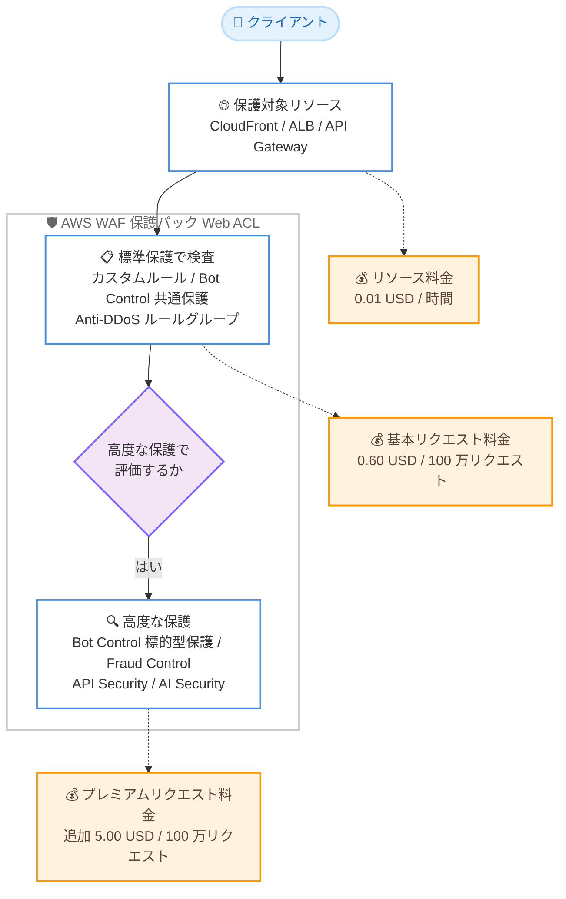

# AWS WAF - 簡素化された新料金体系の導入

**リリース日**: 2026 年 11 月 23 日
**サービス**: AWS WAF
**機能**: 簡素化された料金体系 (Simplified Pricing)

📊 [このアップデートのインフォグラフィックを見る](https://takech9203.github.io/aws-news-summary/20261123-aws-waf-introduces-simplified-pricing.html)

## 概要

AWS WAF が、料金体系を大幅に簡素化する新しい価格モデルを発表しました。新しい料金は「どのように設定するか」ではなく「何を保護するか」に基づいて課金されます。従来は Web ACL、ルール、ルールグループのサブスクリプション、キャパシティ階層ごとに個別の課金が発生していましたが、新モデルでは「リソース料金」「基本リクエスト料金」「プレミアムリクエスト料金」の 3 つのディメンションのみで構成されます。

この変更により、ルールの追加・変更・並べ替えを行っても単価が変わらなくなり、デプロイ前にコストを正確に見積もることが可能になりました。セキュリティ上の判断と課金上の判断を切り離すことで、コストを理由にセキュリティのベストプラクティス適用をためらう状況を解消することが狙いです。あわせて、新しいマネージドルールグループである API Security と AI Security が同日にリリースされ、Security analytics ダッシュボードも追加料金なしで利用できるようになりました。

**アップデート前の課題**

従来の AWS WAF の料金体系には、以下のような課題がありました。

- Web ACL、ルール、マネージドルールグループのサブスクリプションなど、課金項目が多岐にわたり、コストの見積もりが複雑だった
- 保護を追加するたびに課金が増えるため、すべてのセキュリティ上の判断が課金上の判断にもなっていた
- 新しい CVE への対応や Bot の挙動変化に応じてルールを変更すると、コストへの影響を都度計算する必要があった
- Web ACL あたりの無料キャパシティは 1,500 WCU までで、超過するとリクエスト単価が上昇した

**アップデート後の改善**

今回のアップデートにより、以下の点が改善されました。

- 課金は「保護するリソース」「検査するリクエスト」「高度な保護を適用するリクエスト」の 3 つのディメンションのみに簡素化された
- ルールの追加・変更・削除・並べ替えを行っても単価が変わらず、デプロイ前のコスト見積もりがそのまま維持される
- Bot Control の共通保護や Anti-DDoS ルールグループを追加料金なしで有効化できるようになった
- 保護パック (Web ACL) あたりの無料キャパシティが 1,500 WCU から 2,500 WCU に拡大し、超過してもリクエスト単価が上がらなくなった
- Security analytics ダッシュボード (過去 21 日間のトラフィック可視化) が追加料金なしで利用可能になった

## アーキテクチャ図



新料金体系における 3 つの課金ディメンションを示しています。保護対象リソースごとのリソース料金、WAF が検査するすべてのリクエストへの基本リクエスト料金、そして高度な保護が評価したリクエストにのみ加算されるプレミアムリクエスト料金で構成されます。

## サービスアップデートの詳細

### 主要機能

1. **3 つのディメンションによるシンプルな課金**
   - リソース料金: 保護パック (Web ACL) に関連付けられたリソースごとに時間単位で課金 (0.01 USD / 時間、月額約 7.30 USD)
   - 基本リクエスト料金: AWS WAF が検査するすべてのリクエストに適用 (0.60 USD / 100 万リクエスト)
   - プレミアムリクエスト料金: 高度な保護 (Bot Control 標的型保護、Fraud Control、API Security、AI Security) が評価したリクエストにのみ基本料金に加算して適用 (5.00 USD / 100 万リクエスト)

2. **追加料金なしで利用できる保護の拡大**
   - Bot Control 共通保護と Anti-DDoS ルールグループは、サブスクリプションや個別のリクエスト単価なしで有効化可能 (基本リクエスト料金のみ)
   - 保護パック (Web ACL) あたりの無料キャパシティが 1,500 WCU から 2,500 WCU に拡大
   - キャパシティ超過によるリクエスト単価の上昇が廃止 (2,500 WCU を超える場合はサポートケースで引き上げ申請)
   - リクエストボディの検査は、関連付けられたリソースタイプがサポートする最大サイズまで追加料金なし

3. **新しいマネージドルールグループ: API Security と AI Security**
   - 今回の発表と同日に API Security と AI Security の 2 つのマネージドルールグループがリリース
   - どちらも個別のサブスクリプションや独自料金はなく、共通のプレミアムリクエスト料金で利用可能

4. **Security analytics ダッシュボード**
   - 保護対象アプリケーションの全トラフィックメトリクスを過去 21 日間のローリングウィンドウで表示
   - 保護パック (Web ACL) が検査したリクエストとルールのアクションを確認でき、保護のチューニングやリクエスト料金の要因分析に活用可能
   - 追加料金なしで利用可能

## 技術仕様

### 新料金体系の詳細

| 料金 | 課金対象 | 単価 |
|------|----------|------|
| リソース料金 | 保護パック (Web ACL) に関連付けられた各リソース (時間按分) | 0.01 USD / 時間 (月額約 7.30 USD) |
| 基本リクエスト料金 | AWS WAF が検査する各リクエスト | 0.60 USD / 100 万リクエスト |
| プレミアムリクエスト料金 | 高度な保護が評価したリクエスト (基本料金に加算) | 5.00 USD / 100 万リクエスト |

### 課金ルールの重要ポイント

| 項目 | 詳細 |
|------|------|
| プレミアム料金の重複課金 | 1 リクエストにつき 1 回のみ。複数の高度な保護が評価しても合計 5.60 USD / 100 万リクエスト |
| 先行ルールでブロックされた場合 | 高度な保護に到達する前にブロックされたリクエストは基本リクエスト料金のみ (0.60 USD / 100 万リクエスト) |
| ブロックされたリクエスト | AWS WAF は検査したすべてのリクエスト (ブロック含む) に課金。ただし CloudFront は WAF がブロックしたリクエストに課金しない |
| 複数の保護パック通過 | CloudFront と背後の ALB の両方に保護パックがある場合、それぞれで課金 |
| 既存顧客の移行 | 2027 年 2 月 1 日に新料金へ自動移行。それまでは現行料金を維持し、対応は不要 |
| プライベートプライシング契約 | 契約の有効期限まで現行条件を維持 |
| AWS Shield Advanced | 変更なし。保護パックあたり 1,500 WCU まで WAF が含まれ、基本リクエストは月間 500 億件まで無料 |
| CloudFront 定額プラン | 変更なし。AWS WAF はプランに含まれたまま。Free プランは月間 100 万リクエスト未満で 0 USD |

## 設定方法

### 前提条件

1. AWS アカウントを保有していること
2. AWS WAF の保護パック (Web ACL) を作成済み、または作成予定であること
3. コスト見積もりのために、保護対象リソース数と月間リクエスト数を把握していること

### 手順

#### ステップ1: 保護パックとリソースの関連付けを確認する

```bash
# Web ACL の一覧を取得 (リージョナルリソース用)
aws wafv2 list-web-acls --scope REGIONAL --region ap-northeast-1

# 特定の Web ACL に関連付けられたリソースを確認
aws wafv2 list-resources-for-web-acl \
  --web-acl-arn <WEB_ACL_ARN> \
  --region ap-northeast-1
```

保護パック (Web ACL) に関連付けられたリソースの数を確認します。リソース料金はこの関連付け数に基づいて計算されるため、新料金でのコスト見積もりの出発点になります。

#### ステップ2: リクエスト数を CloudWatch メトリクスで確認する

```bash
# Web ACL が検査したリクエスト数を取得 (過去 30 日間の合計)
aws cloudwatch get-metric-statistics \
  --namespace AWS/WAFV2 \
  --metric-name CountedRequests \
  --dimensions Name=WebACL,Value=<WEB_ACL_NAME> Name=Region,Value=ap-northeast-1 Name=Rule,Value=ALL \
  --start-time 2026-10-24T00:00:00Z \
  --end-time 2026-11-23T00:00:00Z \
  --period 2592000 \
  --statistics Sum
```

AWS WAF は保護パック (Web ACL) ごと、保護対象リソースごとに CloudWatch メトリクスを発行しており、高度な保護が評価したリクエスト数も確認できます。これらの値から基本リクエスト料金とプレミアムリクエスト料金を見積もります。

#### ステップ3: Security analytics ダッシュボードでトラフィックを分析する

AWS WAF コンソールの Security analytics ダッシュボードを開き、過去 21 日間のトラフィックを確認します。独自のレポートを構築することなく、検査されたリクエスト数とルールのアクションを可視化できるため、プレミアムリクエスト料金の対象となるトラフィック量の把握や、スコープダウンステートメントによる最適化の検討に役立ちます。

## メリット

### ビジネス面

- **コストの予測可能性**: ルールの追加・変更が単価に影響しないため、デプロイ前の見積もりがそのまま維持され、予算計画が容易になる
- **セキュリティ投資の意思決定の簡素化**: 保護の追加が課金の追加に直結しなくなり、コストを理由にセキュリティ強化をためらう状況を解消できる
- **移行猶予期間の確保**: 既存顧客は 2027 年 2 月 1 日まで現行料金が維持されるため、計画的にコスト影響を評価できる

### 技術面

- **無料で利用できる保護の拡大**: Bot Control 共通保護や Anti-DDoS ルールグループを追加料金なしで有効化でき、ベースラインのセキュリティ姿勢を強化しやすい
- **キャパシティ制約の緩和**: 無料 WCU が 2,500 に拡大し、超過による単価上昇もなくなったため、複雑なルールセットを構築しやすくなった
- **可視性の向上**: Security analytics ダッシュボードにより、追加コストなしで 21 日間のトラフィック分析が可能

## デメリット・制約事項

### 制限事項

- ブロックされたリクエストを含め、AWS WAF が検査したすべてのリクエストに基本リクエスト料金が発生する
- リクエストが複数の保護パック (Web ACL) を通過する場合 (例: CloudFront と背後の ALB の両方)、それぞれの保護パックで課金される
- 2,500 WCU を超えるキャパシティが必要な場合は、AWS サポートケースによる引き上げ申請が必要
- AWS WAF 単体の無料利用枠はない (CloudFront 定額プランの Free プラン経由でのみ月間 100 万リクエスト未満を無料で利用可能)

### 考慮すべき点

- 保護対象リソース数が多い構成では、リソース料金 (1 リソースあたり月額約 7.30 USD) が支配的になる場合がある。多数のリソースを個別に保護するより、CloudFront で集約して保護する方が低コストになる可能性がある
- 高度な保護 (Bot Control 標的型保護、Fraud Control、API Security、AI Security) の対象トラフィックにはプレミアム料金が加算されるため、スコープダウンステートメントでログインやチェックアウトなど必要なパスに限定することが推奨される
- 既存のワークロードでは、2027 年 2 月 1 日の自動移行までに新旧料金でのコスト比較を実施しておくことが望ましい

## ユースケース

### ユースケース1: 単一の Application Load Balancer の保護

**シナリオ**: 月間 2,000 万リクエストを処理する 1 台の ALB を AWS WAF で保護する。

**実装例**:
```
リソース料金: 1 リソース × 0.01 USD / 時間 × 730 時間 = 7.30 USD
基本リクエスト料金: 2,000 万 × 0.60 USD / 100 万 = 12.00 USD
合計: 19.30 USD / 月
```

**効果**: ルール数やマネージドルールグループの構成に関係なく、月額約 19.30 USD で見積もりが確定する。Bot Control 共通保護や Anti-DDoS ルールグループを追加してもコストは変わらない。

### ユースケース2: 多数のリソースを持つ大規模環境

**シナリオ**: 40 のリソースで月間 1 億 5,000 万リクエストを処理する環境を保護する。

**実装例**:
```
リソース料金: 40 × 7.30 USD = 292.00 USD
基本リクエスト料金: 1 億 5,000 万 × 0.60 USD / 100 万 = 90.00 USD
合計: 382.00 USD / 月
```

**効果**: この規模ではリソース料金が支配的になる。CloudFront での集約保護や、CloudFront SaaS Manager によるマルチテナントディストリビューションへの単一保護パック適用を検討することで、コストを最適化できる。

### ユースケース3: 高度な保護を併用する EC サイト

**シナリオ**: 5 つのリソースで月間 3 億リクエストを処理し、うち 3,000 万リクエスト (ログイン・チェックアウトのパス) を高度な保護で評価する。

**実装例**:
```
リソース料金: 5 × 7.30 USD = 36.50 USD
基本リクエスト料金: 3 億 × 0.60 USD / 100 万 = 180.00 USD
プレミアムリクエスト料金: 3,000 万 × 5.00 USD / 100 万 = 150.00 USD
合計: 366.50 USD / 月
```

**効果**: スコープダウンステートメントで高度な保護の対象を必要なパスに限定することで、プレミアム料金を抑えつつ、不正ログインや Bot 攻撃への対策を実現できる。

## 料金

新料金は「リソース料金」「基本リクエスト料金」「プレミアムリクエスト料金」の 3 つで構成されます。高度な保護が評価したリクエストは基本料金とプレミアム料金の合計 5.60 USD / 100 万リクエストで課金されますが、複数の高度な保護が評価しても課金は 1 回のみです。既存顧客は 2027 年 2 月 1 日に新料金へ移行します。

### 料金例

| 使用量 | 月額料金 (概算) |
|--------|------------------|
| 1 リソース、2,000 万リクエスト | 19.30 USD |
| 40 リソース、1 億 5,000 万リクエスト | 382.00 USD |
| 5 リソース、3 億リクエスト (うち 3,000 万を高度な保護で評価) | 366.50 USD |

## 利用可能リージョン

すべての AWS 商用リージョンで本日から利用可能です (東京、大阪、バージニア北部、オレゴン、フランクフルト、シンガポール、ソウルなどを含む)。また、AWS GovCloud (US)、中国リージョン、AWS Isolated Regions でも利用できます。

## 関連サービス・機能

- **Amazon CloudFront**: 保護対象リソースの代表例。CloudFront 定額プランでは AWS WAF が引き続きプランに含まれ、Free プランは月間 100 万リクエスト未満で 0 USD。WAF がブロックしたリクエストには CloudFront 側の課金も発生しない
- **AWS Shield Advanced**: サブスクリプション料金や WAF の包含条件 (保護パックあたり 1,500 WCU、基本リクエスト月間 500 億件まで無料) に変更なし
- **AWS WAF Bot Control / Fraud Control**: Bot Control 共通保護は基本料金のみで利用可能になり、標的型保護と Fraud Control はプレミアムリクエスト料金の対象
- **API Security / AI Security マネージドルールグループ**: 本発表と同日にリリースされた新しい高度な保護。個別サブスクリプションなしでプレミアムリクエスト料金により利用可能

## 参考リンク

- 📊 [インフォグラフィック](https://takech9203.github.io/aws-news-summary/20261123-aws-waf-introduces-simplified-pricing.html)
- [公式発表 (What's New)](https://aws.amazon.com/about-aws/whats-new/2026/11/aws-waf-introduces-simplified-pricing/)
- [AWS Blog: Introducing AWS WAF simplified pricing](https://aws.amazon.com/blogs/security/introducing-aws-waf-simplified-pricing/)
- [AWS WAF Developer Guide](https://docs.aws.amazon.com/waf/)
- [AWS WAF 料金ページ](https://aws.amazon.com/waf/pricing/)

## まとめ

AWS WAF の新料金体系は、課金を「保護するリソース」「検査するリクエスト」「高度な保護を適用するリクエスト」の 3 つの測定可能なディメンションに簡素化し、セキュリティ構成の変更がコストに影響しない予測可能なモデルを実現しました。既存顧客は 2027 年 2 月 1 日に自動移行されるため、それまでに AWS WAF 料金ページの例や AWS Pricing Calculator で新旧料金のコスト比較を行い、CloudFront での集約保護やスコープダウンステートメントによる最適化を検討することを推奨します。
