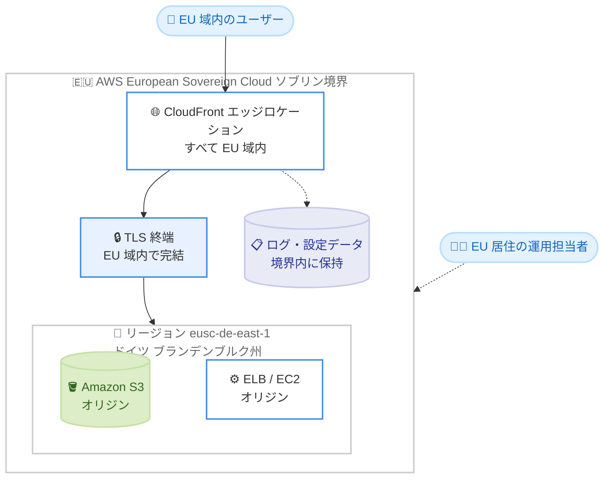

# Amazon CloudFront - AWS European Sovereign Cloud での提供開始

**リリース日**: 2026 年 11 月 23 日
**サービス**: Amazon CloudFront
**機能**: AWS European Sovereign Cloud での CloudFront 提供

📊 [このアップデートのインフォグラフィックを見る](https://takech9203.github.io/aws-news-summary/20261123-cloudfront-european-sovereign-cloud.html)

## 概要

Amazon CloudFront が AWS European Sovereign Cloud (ESC) で利用可能になりました。AWS European Sovereign Cloud は、EU の厳格なデジタル主権要件を満たすために構築された、他の AWS リージョンから物理的・論理的に分離された独立クラウドです。今回の発表により、政府機関、医療、金融サービスなどの規制業界のお客様は、ウェブサイト、アプリケーション、API の配信を完全に EU 域内で完結させながら、CloudFront のパフォーマンスを活用できるようになります。

このアップデートの重要な点は、コンテンツ配信だけでなく、TLS 終端、ログ、ディストリビューション設定などの顧客データと運用がすべてソブリン境界内に保持されることです。AWS European Sovereign Cloud は EU 居住者のみによって運用されており、EU 域外からの運用アクセスは一切ありません。また、標準の CloudFront と同じ API とコンソール操作が利用できるため、既存のデプロイメントや自動化の移行も容易です。

**アップデート前の課題**

このアップデート以前には、以下のような課題がありました。

- AWS European Sovereign Cloud には CDN サービスが存在せず、EU 域内のみでのトラフィック処理とデータ管理を必要とするお客様は、独自のコンテンツ配信や TLS 終端の仕組みを構築する必要があった
- 標準リージョンの CloudFront を利用する場合、エッジロケーションやログの取り扱いが EU 域内に限定される保証がなく、厳格な主権要件を満たせなかった
- 独自構築した配信基盤では、CloudFront が提供するスケーラビリティや運用性を得るために多大な開発・運用コストが必要だった

**アップデート後の改善**

今回のアップデートにより、以下の点が改善されました。

- コンテンツ配信、TLS 終端、ログ、設定データのすべてがソブリン境界内 (EU 域内) に保持されるようになった
- 標準の CloudFront と同じ API・コンソールで操作できるため、既存の構成や自動化を大きく変更せずに移行できるようになった
- 規制業界のお客様が、データレジデンシーと運用主権の要件を満たしながら、低レイテンシーのコンテンツ配信を実現できるようになった

## アーキテクチャ図



AWS European Sovereign Cloud における CloudFront の構成を示しています。エッジロケーション、TLS 終端、ログ、オリジンのすべてが EU 域内のソブリン境界内で完結し、運用も EU 居住者のみが行います。

## サービスアップデートの詳細

### 主要機能

1. **ソブリン境界内で完結するコンテンツ配信**
   - ウェブサイト、アプリケーション、API の配信トラフィックがすべて EU 域内で処理される
   - TLS 終端が EU 域内で行われ、暗号化通信の処理も境界外に出ない
   - アクセスログやディストリビューション設定などの顧客データもソブリン境界内に保持される

2. **標準 CloudFront と同一の API・コンソール体験**
   - 使い慣れた CloudFront の API とコンソールワークフローをそのまま利用可能
   - 既存のデプロイメントや IaC・自動化スクリプトの移行が容易
   - AWS European Sovereign Cloud アカウントにサインインし、CloudFront コンソールからディストリビューションを作成するだけで利用開始できる

3. **独立運用によるデジタル主権の担保**
   - AWS European Sovereign Cloud は他の AWS リージョンから物理的・論理的に分離されている
   - データセンターへのアクセス、テクニカルサポート、カスタマーサービスを含む日常運用は EU 居住者のみが実施
   - ドイツで設立された現地法人と専用のガバナンス構造の下で運営される

## 技術仕様

### AWS European Sovereign Cloud の概要

| 項目 | 詳細 |
|------|------|
| 最初のリージョン | ドイツ ブランデンブルク州 (リージョンコード: eusc-de-east-1) |
| 分離性 | 他の AWS リージョンから物理的・論理的に分離、EU 域外のインフラへの重要な依存なし |
| 運用体制 | EU 居住者のみが日常運用を担当 (EU 市民のみによる運用へ段階的に移行中) |
| ガバナンス | 専用の欧州親会社とドイツの現地法人 (GmbH) による運営 |
| エッジロケーション | すべて EU 域内に配置 |

### 標準 CloudFront との機能差分

AWS European Sovereign Cloud の CloudFront では、ドキュメントによると以下の機能が現時点では利用できません (一部抜粋)。

| カテゴリ | 利用できない機能 |
|------|------|
| セキュリティ | AWS WAF Web ACL の関連付け、AWS Shield Advanced、mTLS (ビューワー側・オリジン側)、セキュリティダッシュボード |
| エッジコンピューティング | Lambda@Edge |
| オリジン・ネットワーク | OAI、VPC オリジン、Origin Shield、AWS PrivateLink、Anycast 静的 IP / BYOIP、オリジンへの IPv6 接続、オリジンへの HTTP/2 |
| その他 | CloudFront SaaS Manager、継続的デプロイ (ステージングディストリビューション)、動画ストリーミング、定額料金プラン |

## 設定方法

### 前提条件

1. AWS European Sovereign Cloud のアカウントを保有していること
2. 配信するコンテンツのオリジン (Amazon S3 バケット、ELB など) が AWS European Sovereign Cloud 内に用意されていること
3. 独自ドメインで HTTPS 配信する場合は、対応する証明書を準備していること

### 手順

#### ステップ1: AWS European Sovereign Cloud アカウントにサインインする

AWS European Sovereign Cloud 専用のサインインページ (amazonaws-eusc.eu ドメイン) からアカウントにサインインします。AWS European Sovereign Cloud は標準の AWS アカウントとは独立したアカウント体系で運用されます。

#### ステップ2: CloudFront ディストリビューションを作成する

CloudFront コンソールを開き、ディストリビューションを作成します。オリジンの指定、キャッシュ動作、証明書の設定など、標準の CloudFront と同じワークフローで設定できます。

#### ステップ3: CLI で設定を確認する

```bash
# ディストリビューションの一覧を確認
aws cloudfront list-distributions

# 特定のディストリビューションの設定を確認
aws cloudfront get-distribution --id <DISTRIBUTION_ID>
```

標準の CloudFront と同じ API が利用できるため、AWS CLI でディストリビューションの一覧や設定内容を確認できます。既存の自動化スクリプトも、エンドポイントと認証情報を AWS European Sovereign Cloud 用に切り替えることで再利用できます。

## メリット

### ビジネス面

- **デジタル主権要件への適合**: データレジデンシーと運用主権の要件を満たしながら CDN を利用でき、政府機関や規制業界でのクラウド活用の障壁が下がる
- **独自構築コストの削減**: これまで必要だった独自のコンテンツ配信・TLS 終端基盤の構築・運用コストを削減できる
- **法的保護の明確化**: EU 法に従う専用のガバナンス構造の下で運営されるため、コンプライアンス説明が容易になる

### 技術面

- **移行の容易さ**: 標準の CloudFront と同じ API・コンソールが使えるため、既存の構成や IaC を大きく変更せずに移行できる
- **境界内で完結するデータ処理**: TLS 終端、ログ、設定データがすべてソブリン境界内に保持され、データフローの説明責任を果たしやすい
- **スケーラビリティ**: 自前の配信基盤では難しかった、マネージドサービスとしてのスケーラビリティと可用性を利用できる

## デメリット・制約事項

### 制限事項

- AWS WAF Web ACL の関連付けや AWS Shield Advanced が利用できず、標準リージョンと同等のエッジセキュリティ構成は組めない
- Lambda@Edge、VPC オリジン、Origin Shield、mTLS など、標準の CloudFront で利用できる多くの機能が現時点では未対応
- 動画ストリーミング (ライブ・オンデマンド) 向けの利用は想定されておらず、メディアストリーミングや大容量ワークロードは AWS 商用リージョンの利用をアカウントチームに相談することが推奨されている
- 定額料金プラン (Flat-rate pricing plans) は利用できない

### 考慮すべき点

- AWS European Sovereign Cloud は独立したアカウント・リージョン体系のため、標準リージョンの既存アカウントやリソースとは分離して管理する必要がある
- エッジロケーションがすべて EU 域内にあるため、EU 域外のユーザーへの配信パフォーマンスは標準の CloudFront のグローバルエッジ網とは異なる
- 料金はユーロ建てで設定されており、標準リージョンの CloudFront とは料金体系・単価が異なるため個別の見積もりが必要

## ユースケース

### ユースケース1: 政府機関の市民向けポータルサイト配信

**シナリオ**: EU 加盟国の政府機関が、市民向けポータルサイトを EU 域内のみでデータ処理を完結させて配信したい。

**実装例**:
```
オリジン: eusc-de-east-1 の Amazon S3 (静的コンテンツ) + ELB (動的コンテンツ)
配信: AWS European Sovereign Cloud の CloudFront ディストリビューション
ログ: 標準アクセスログをソブリン境界内に保存
```

**効果**: TLS 終端からログ保存まで全工程が EU 域内で完結し、デジタル主権要件を満たしながら低レイテンシーの配信を実現できる。

### ユースケース2: 金融・医療機関の API 配信

**シナリオ**: 規制業界の企業が、顧客向け API を主権要件を満たした環境で高速に配信したい。

**実装例**:
```
オリジン: eusc-de-east-1 上のアプリケーション (ELB 経由)
CloudFront: API パス向けにキャッシュ無効のビヘイビアを設定し、TLS 終端と接続最適化を活用
```

**効果**: データの取り扱いが EU 域内に限定されることを顧客や監督当局に説明しやすくなり、API のレイテンシーも改善できる。

### ユースケース3: 既存 CloudFront 構成のソブリン環境への移行

**シナリオ**: 標準リージョンで CloudFront を利用中の企業が、EU 向けワークロードを AWS European Sovereign Cloud に移行したい。

**実装例**:
```
1. 既存ディストリビューションの設定を get-distribution-config でエクスポート
2. 未対応機能 (Lambda@Edge、WAF 関連付けなど) の有無を確認し代替構成を検討
3. AWS European Sovereign Cloud アカウントで同等のディストリビューションを作成
```

**効果**: 同一の API とコンソール体験により、既存の IaC や自動化を流用しながら段階的に移行できる。

## 料金

AWS European Sovereign Cloud の CloudFront はユーロ建てで課金されます。エッジロケーションがすべて EU 域内にあるため、地域別の料金区分はなく単一の料金体系が適用されます。AWS オリジン (S3、EC2、ELB など) からのオリジンフェッチは無料です。

### 料金例

| 項目 | 料金 (概算) |
|--------|------------------|
| インターネットへのデータ転送 (最初の 10 TB / 月) | 0.0839 EUR/GB |
| インターネットへのデータ転送 (5 PB 超 / 月) | 0.0197 EUR/GB |
| HTTP/HTTPS リクエスト | 0.0118 EUR / 10,000 リクエスト |
| オリジンへのデータ転送 (POST/PUT など) | 0.0197 EUR/GB |
| AWS オリジンからのオリジンフェッチ | 無料 |

## 利用可能リージョン

AWS European Sovereign Cloud (最初のリージョンはドイツ ブランデンブルク州の eusc-de-east-1) で利用可能です。エッジロケーションはすべて EU 域内に配置されています。

## 関連サービス・機能

- **Amazon S3 / Elastic Load Balancing**: AWS European Sovereign Cloud 内でオリジンとして利用でき、オリジンフェッチは無料
- **AWS Certificate Manager**: 独自ドメインでの HTTPS 配信に利用する証明書の管理
- **AWS WAF**: 標準リージョンでは CloudFront と組み合わせて利用されるが、AWS European Sovereign Cloud では現時点で CloudFront への関連付けは未対応

## 参考リンク

- 📊 [インフォグラフィック](https://takech9203.github.io/aws-news-summary/20261123-cloudfront-european-sovereign-cloud.html)
- [公式発表 (What's New)](https://aws.amazon.com/about-aws/whats-new/2026/11/cloudfront-european-sovereign-cloud)
- [ドキュメント: CloudFront in the AWS European Sovereign Cloud](https://docs.aws.eu/esc/latest/userguide/cloudfront.html)
- [料金ページ (AWS European Sovereign Cloud)](https://www.aws.eu/cloudfront/pricing/)
- [AWS European Sovereign Cloud 公式サイト](https://www.aws.eu/)

## まとめ

Amazon CloudFront が AWS European Sovereign Cloud で利用可能になり、厳格な EU デジタル主権要件を持つ組織が、配信・TLS 終端・ログ・設定のすべてをソブリン境界内に保ちながら CDN を活用できるようになりました。標準の CloudFront と同じ API・コンソールで操作できる一方、WAF 関連付けや Lambda@Edge など未対応の機能も多いため、移行を検討する際はドキュメントの機能差分を確認した上で構成を設計することを推奨します。
