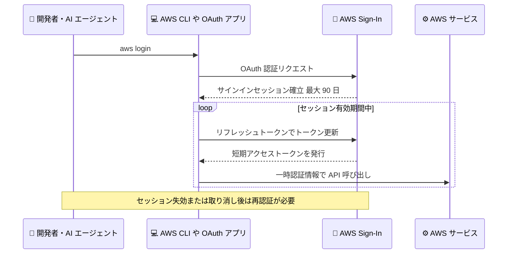

# AWS Sign-In - 最大 90 日間の設定可能なサインイン期間

**リリース日**: 2026 年 11 月 23 日
**サービス**: AWS Sign-In
**機能**: 設定可能なサインイン期間 (Configurable Sign-in duration)

📊 [このアップデートのインフォグラフィックを見る](https://takech9203.github.io/aws-news-summary/20261123-configurable-aws-sign-in-duration.html)

## 概要

AWS Sign-In に、OAuth サインインセッションの有効期間を最大 90 日間まで設定できる新しい「Sign-in duration」設定が導入されました。開発者や AI エージェントは、繰り返しサインインしたり同意プロンプトに応答したりすることなく、長期間にわたり認証状態を維持できます。管理者は、この設定を IAM ユーザーまたは IAM ロールごとに個別に構成できます。

本機能は、AWS CLI の `aws login` コマンド、AWS MCP Server、その他の OAuth 対応アプリケーションでのサインインセッションに適用されます。セッション有効期間中は、短期間のアクセストークンがリフレッシュトークンにより自動的に更新されるため、静的なアクセスキーを使用するよりも安全な代替手段となります。なお、AWS Management Console のセッションには適用されず、デフォルトの動作も変更されません (管理者が明示的に延長しない限り、既存のセッション期間の制限が維持されます)。

長時間実行されるワークフローや自律的に動作する AI エージェントを運用する組織にとって、認証の中断を減らしつつ、セキュリティ管理 (セッションの一覧表示、監視、取り消し) を維持できる重要なアップデートです。

**アップデート前の課題**

- 以前は OAuth サインインセッションのデフォルト期間 (12 時間) を超える長期間の認証維持ができず、長時間実行のワークフローでは再サインインが頻繁に必要だった
- 長期間の認証を維持するために、静的なアクセスキー (長期認証情報) に頼るケースがあり、認証情報漏えいのリスクが高かった
- AI エージェントや自動化ツールが、認証の中断や同意プロンプトにより処理を継続できない場合があった

**アップデート後の改善**

- IAM ユーザーまたはロールごとにサインインセッション期間を最大 90 日間まで設定でき、再認証なしで作業を継続できるようになった
- 短期間かつ更新可能な認証情報を利用するため、静的アクセスキーの代わりとなるより安全な認証方式を採用できるようになった
- セッションの一覧表示、詳細取得、取り消しを API で管理でき、CloudTrail によるトークン発行・更新の監視も可能になった

## アーキテクチャ図



一度のサインインでセッションが確立された後は、設定された期間内であればリフレッシュトークンにより短期アクセストークンが自動更新され、再認証なしで AWS サービスへのアクセスを継続できます。

## サービスアップデートの詳細

### 主要機能

1. **プリンシパル単位のサインイン期間設定**
   - IAM ユーザーまたは IAM ロールごとに、OAuth サインインセッションの最大期間を設定可能
   - デフォルトのセッション期間は 12 時間、最大 90 日間まで延長可能
   - 長期アクセスが必要なユーザーやロールには長いセッションを、その他のワークロードには短いセッションを設定するなど、きめ細かな制御が可能

2. **短期認証情報による安全な長期認証**
   - セッション有効期間中は、短期間の OAuth アクセストークンを使用して AWS サービスにアクセス
   - リフレッシュトークンにより、ユーザーの再認証なしでトークンを更新
   - AWS CLI では認証情報デーモン (credential daemon) を使用することで、リフレッシュトークンを暗号化して保存し、CLI や SDK からの直接アクセスを防止可能

3. **セッション管理 API**
   - `aws signin list-sessions`: IAM ユーザーまたはロールに関連付けられたアクティブなセッションを一覧表示
   - `aws signin get-session`: セッション ARN を指定して個別セッションの詳細を取得
   - `aws signin batch-revoke-sessions`: 不要になったセッションや不審なセッションを取り消し (複数セッションの一括取り消しに対応)

4. **CloudTrail によるモニタリング**
   - `CreateOAuth2Token` イベントで OAuth トークンの発行・更新を記録
   - `additionalEventData` に `SignInSessionExtended` (延長設定の有無)、`SignInDuration` (設定されたセッション期間、秒単位)、`signInSessionArn` (セッション識別子) が含まれる
   - セッション作成、トークンアクティビティ、セッション管理操作、管理設定の変更を監査可能

## 技術仕様

### サインインセッションの仕様

| 項目 | 詳細 |
|------|------|
| デフォルトセッション期間 | 12 時間 |
| 最大設定可能期間 | 90 日間 |
| 設定単位 | IAM ユーザーまたは IAM ロールごと |
| 設定方法 | IAM コンソール、AWS CLI、IAM API |
| 対象 | AWS CLI (`aws login`)、AWS MCP Server、その他の OAuth 対応アプリケーション |
| 対象外 | AWS Management Console のセッション |
| セッション取り消し | 反映まで最大 1 時間。発行済みアクセストークンは有効期限まで有効な場合がある |
| 監査 | AWS CloudTrail (`CreateOAuth2Token` イベントなど) |

### Maximum Session Duration との関係

サポートされる CLI および OAuth 認証フローでは、サインイン期間 (Sign-in duration) が既存の IAM ロールの「Maximum Session Duration」設定より優先されます。ただし、Maximum Session Duration は引き続き、個々の AWS STS 一時認証情報の有効期間を制御します。

### CloudTrail イベント例

```json
{
  "eventSource": "signin.amazonaws.com",
  "eventName": "CreateOAuth2Token",
  "additionalEventData": {
    "signInSessionArn": "arn:aws:signin:us-west-2:111122223333:session/a1b2c3d4-...",
    "SignInSessionExtended": "true",
    "grant_type": "authorization_code",
    "success": "true",
    "SignInDuration": "7775999"
  }
}
```

## 設定方法

### 前提条件

1. IAM ユーザーまたはロールの設定を変更できる IAM 権限を持つ管理者であること
2. 利用者側は `aws login` コマンドに対応したバージョンの AWS CLI、または OAuth 対応アプリケーションを使用すること
3. セッション管理操作 (一覧表示、取り消しなど) には適切な IAM 権限が必要であること

### 手順

#### ステップ 1: IAM ロールまたはユーザーのサインイン期間を設定する

1. IAM コンソールを開き、ナビゲーションペインで [ロール] または [ユーザー] を選択
2. 対象のロールまたはユーザーを選択し、サインインセッション期間の設定に移動
3. [編集] を選択し、最大 90 日間までの期間を指定して保存

設定した期間は、そのプリンシパルを使用して新しく確立されるサインインセッションに適用されます。IAM コンソールのほか、AWS CLI や IAM API からも設定できます。

#### ステップ 2: サインインしてセッションを確立する

```bash
aws login
```

認証に成功すると、AWS Sign-In が認証済みプリンシパルに関連付けられたセッションを確立します。AWS CLI は AWS サービスへアクセスするための一時認証情報を取得し、セッションが有効な間は必要に応じて自動的に認証情報を更新します。

#### ステップ 3: アクティブなセッションを管理する

```bash
# ロールに関連付けられたセッションを一覧表示
aws signin list-sessions \
  --principal-arn arn:aws:iam::123456789012:role/DeveloperRole

# セッションの詳細を取得
aws signin get-session \
  --session-arn arn:aws:signin:us-east-1:123456789012:session/my-session-id

# セッションを取り消し
aws signin batch-revoke-sessions \
  --session-arns arn:aws:signin:us-east-1:123456789012:session/my-session-id
```

セッションの一覧表示で既存の認証済みセッション (識別子、有効期限、ステータス) を確認し、不要または不審なセッションは取り消しできます。取り消し後はアクセストークンの更新が停止されます。

## メリット

### ビジネス面

- **生産性の向上**: 開発者や AI エージェントが再認証による中断なしに最大 90 日間作業を継続でき、長時間実行ワークフローの運用負荷が軽減される
- **セキュリティリスクの低減**: 静的アクセスキーの代わりに短期間かつ更新可能な認証情報を使用することで、認証情報漏えい時の影響を抑えられる
- **ガバナンスの維持**: プリンシパル単位の期間設定とセッション取り消し機能により、利便性と統制を両立できる

### 技術面

- **自動トークン更新**: リフレッシュトークンによる短期アクセストークンの自動更新で、アプリケーション側の認証情報管理が簡素化される
- **集中的なセッション管理**: セッションの一覧表示・詳細取得・取り消しを API で実行でき、管理者はアカウント全体のセッションを、ユーザーは自身のセッションを管理できる
- **監査性の確保**: CloudTrail の `CreateOAuth2Token` イベントで、延長セッションの利用状況 (`SignInSessionExtended`、`SignInDuration`) を追跡できる

## デメリット・制約事項

### 制限事項

- AWS Management Console のセッションには適用されない (コンソールセッションは既存のセッション期間設定に従う)
- セッションの取り消しが反映されるまで最大 1 時間かかる場合があり、発行済みのアクセストークンは有効期限まで有効な場合がある
- セッションの取り消しは対象セッションのみに作用し、同じ IAM ユーザーまたはロールに関連付けられた他のセッションは自動的には取り消されない

### 考慮すべき点

- セッション期間を延長するほど、端末やリフレッシュトークンが侵害された場合の影響期間が長くなるため、ワークロードごとに必要最小限の期間を設定することが望ましい
- AWS CLI で延長セッションを使用する場合は、リフレッシュトークンを暗号化して保存する認証情報デーモンの利用が推奨される
- サインイン期間は IAM ロールの Maximum Session Duration より優先されるため、既存のセッション管理ポリシーとの整合性を確認する必要がある

## ユースケース

### ユースケース 1: AI エージェントによる長時間の自律実行

**シナリオ**: AWS MCP Server を利用する AI エージェントが、数日から数週間にわたるタスク (継続的なモニタリング、定期的なリソース操作など) を自律的に実行する。

**実装例**:
```bash
# 管理者: エージェント用ロールのサインイン期間を 30 日に設定 (IAM コンソール)
# エージェント側: 一度サインインしてセッションを確立
aws login
```

**効果**: 認証の中断や同意プロンプトによるタスクの停止がなくなり、AI エージェントが長期間安定して動作する。

### ユースケース 2: 静的アクセスキーからの移行

**シナリオ**: 開発者が長期間の CLI アクセスのためにアクセスキーを使い続けており、キーのローテーションや漏えいリスクが課題となっている。

**実装例**:
```bash
# アクセスキーの代わりにサインインセッションを利用
aws login

# 認証情報デーモンでリフレッシュトークンを安全に管理
# (暗号化保存、CLI/SDK には短期認証情報のみを提供)
```

**効果**: 長期の静的認証情報を廃止し、短期間・更新可能な認証情報に移行することで、セキュリティ態勢を改善できる。

### ユースケース 3: 管理者によるセッションの集中管理と監査

**シナリオ**: セキュリティ管理者が、組織内の延長サインインセッションの利用状況を監視し、退職者や不審なアクティビティに対して迅速にアクセスを遮断したい。

**実装例**:
```bash
# 対象プリンシパルのセッションを確認
aws signin list-sessions \
  --principal-arn arn:aws:iam::123456789012:role/DeveloperRole

# 不審なセッションを取り消し
aws signin batch-revoke-sessions \
  --session-arns arn:aws:signin:us-east-1:123456789012:session/suspicious-session
```

**効果**: CloudTrail の記録と組み合わせて、延長セッションの可視性を確保しつつ、必要時に迅速なアクセス遮断が可能になる。

## 料金

公式発表に料金に関する記載はありません。AWS Sign-In のサインインセッション機能自体に追加料金は発表されていません。

## 利用可能リージョン

すべての AWS 商用リージョンで利用可能です。設定は IAM コンソール、AWS CLI、IAM API から行えます。

## 関連サービス・機能

- **AWS IAM**: サインイン期間を IAM ユーザーまたはロールごとに設定する。ロールの Maximum Session Duration は引き続き STS 一時認証情報の有効期間を制御する
- **AWS CLI (`aws login`)**: サインインセッションを利用する主要なクライアント。認証情報デーモンによるリフレッシュトークンの安全な管理に対応
- **AWS MCP Server**: AI エージェントが AWS にアクセスする際の認証にサインインセッションを利用可能
- **AWS CloudTrail**: `CreateOAuth2Token` イベントなどにより、トークン発行・更新やセッション管理操作を監査

## 参考リンク

- 📊 [インフォグラフィック](https://takech9203.github.io/aws-news-summary/20261123-configurable-aws-sign-in-duration.html)
- [公式発表 (What's New)](https://aws.amazon.com/about-aws/whats-new/2026/11/configurable-aws-sign-in-duration/)
- [ドキュメント: Sign-in session management](https://docs.aws.amazon.com/signin/latest/userguide/oauth-sign-in-session-management.html)
- [ドキュメント: Configure Sign-in duration on Role](https://docs.aws.amazon.com/IAM/latest/UserGuide/id_roles_update-role-settings.html#id_roles_update-signin-duration)
- [ドキュメント: AWS Sign-In condition keys](https://docs.aws.amazon.com/signin/latest/userguide/reference-signin-condition-keys.html#reference-signin-condition-keys-oauth)

## まとめ

AWS Sign-In のサインイン期間設定により、開発者や AI エージェントは最大 90 日間、再認証なしで AWS にアクセスできるようになり、静的アクセスキーに代わる安全な長期認証の選択肢が提供されました。長時間実行ワークフローや AI エージェントを運用している場合は、対象の IAM ユーザーまたはロールに適切なサインイン期間を設定し、認証情報デーモンや CloudTrail によるモニタリングと組み合わせて導入することを推奨します。
