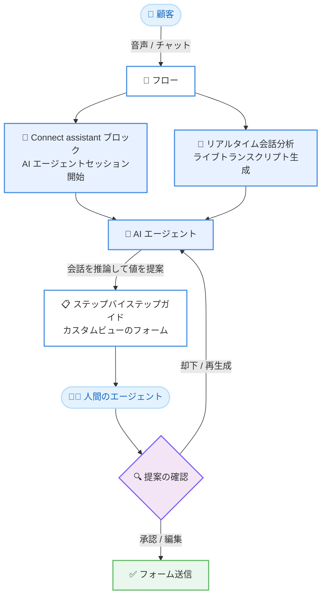

# Amazon Connect - AI エージェントによるステップバイステップガイドの自動入力

**リリース日**: 2026 年 11 月 23 日
**サービス**: Amazon Connect (Amazon Connect Customer)
**機能**: AI エージェントによるステップバイステップガイドのフィールド自動入力 (AI Assisted Autofill)

📊 [このアップデートのインフォグラフィックを見る](https://takech9203.github.io/aws-news-summary/20261123-connect-ai-agents-fill-guides.html)

## 概要

Amazon Connect Customer は、AI エージェントが顧客との対話中にステップバイステップガイドのフィールドを自動入力する機能を発表しました。ステップバイステップガイドは、旅行の再予約や請求の申請など、よくあるワークフローのためにマネージャーがフォームなどのユーザーインターフェイスを設計できる機能です。今回のアップデートにより、AI エージェントがガイドの読み込み時にフォームを事前入力し、ライブ会話中にも会話の文脈に基づいて更新を提案できるようになりました。

たとえば航空会社のフライト変更の場合、AI エージェントは会話の文脈から予約番号、旅行日程、座席の希望などの情報を提案します。人間のエージェントは各提案を確認し、個別または一括で承認・却下でき、送信前に編集することも可能です。これにより、エージェントは手動のデータ入力ではなく顧客対応に集中でき、入力時間の短縮とデータ精度の向上を実現できます。

本機能は、コンタクトセンターでステップバイステップガイドを利用している管理者およびエージェントを対象としています。

**アップデート前の課題**

このアップデート以前は、ガイドのフォーム入力はエージェントの手作業に依存していました。

- 以前はエージェントが会話を聞きながら、予約番号や日付などの情報を手動でフォームに転記する必要があった
- 以前は手動入力のため、聞き間違いや入力ミスによるデータ精度の低下が発生しやすかった
- 以前はデータ入力作業に時間を取られ、エージェントが顧客との対話に集中しづらかった

**アップデート後の改善**

今回のアップデートにより、AI エージェントがフォーム入力を支援するようになりました。

- 今回のアップデートにより、AI エージェントがガイドの読み込み時にフィールドを事前入力し、会話の進行に合わせて値を提案できるようになった
- 提案の承認・却下を個別または一括で行え、必要に応じて編集もできるため、人間による最終確認を維持しながら入力作業を削減できるようになった
- フィールドごとに AI エージェントの推論理由を確認でき、値の妥当性を素早く判断できるようになった

## アーキテクチャ図



顧客との会話をリアルタイム会話分析がトランスクリプト化し、AI エージェントが会話を推論してガイドのフィールド値を提案、人間のエージェントが確認・編集して送信する流れを示しています。

## サービスアップデートの詳細

### 主要機能

1. **会話に基づくフォームの自動入力**
   - AI エージェントがコンタクト中およびアフターコンタクトワーク (ACW) 中に会話を推論し、ビュー内のフィールド値を提案する
   - ガイドの読み込み時に事前入力し、会話の進行に合わせて提案を更新する
   - 音声およびチャットのコンタクトでサポートされる (E メールとタスクは非対応)

2. **人間のエージェントによるレビューと制御**
   - 提案を個別または一括で承認・却下でき、送信前に値を編集できる
   - [Regenerate form population] で最新の会話に基づいて再生成を依頼できる
   - [Autofill on] トグルでフォーム単位の自動入力をオン / オフできる
   - フィールドの情報アイコンから、AI エージェントが値を選んだ推論理由 (New suggestion reasoning / Applied input reasoning) を確認できる

3. **フィールド単位の柔軟な設定**
   - UI ビルダーでフォームコンポーネントごとに AI Assisted Autofill のオン / オフを設定できる
   - 最大 500 文字のフィールド定義を記述でき、具体的な定義ほど提案精度が向上する
   - [Auto accept inputs] を有効にすると、エージェントの承認を待たずに値を直接入力できる (編集は引き続き可能)

## 技術仕様

### 対応フォームコンポーネント

| 項目 | 詳細 |
|------|------|
| 対応コンポーネント | Text Input、Text Area、Dropdown、Checkbox Group、Radio Group、Date Picker、Time Picker、Toggle |
| 対応チャネル | 音声、チャット (E メール、タスクは非対応) |
| 対応タイミング | コンタクト中、アフターコンタクトワーク中 |
| フィールド定義 | 最大 500 文字でフィールドの内容を記述可能 |
| デフォルト動作 | 新規フォームコンポーネントでは自動入力がデフォルトで有効 |

### フィールドのステータス表示

| 表示 | 意味 |
|------|------|
| Generating… | AI エージェントが値を推論中 |
| Suggestion | 提案あり。Auto accept inputs がオフの場合、エージェントが承認または却下する |
| 値が入力済み | Auto accept inputs がオンのため、値が直接入力された |
| Not enough info | 会話がまだそのフィールドの内容に達していない |
| Suggested value couldn't be applied | 値がフィールドの形式に合わなかった (例: 日付形式の不一致) |
| Please confirm this field before saving | 提案を確認する前に保存しようとした |

### 必要なセキュリティプロファイル権限

| 権限 | 自動入力が有効になる範囲 |
|------|--------------------------|
| Connect assistant - View | AI エージェント支援の表示に必須 |
| Auto form population - custom views | ステップバイステップガイド |
| Auto form population - all supported applications | ステップバイステップガイドを含むサポート対象のすべてのアプリケーション |

## 設定方法

### 前提条件

1. インスタンスでエージェント支援 (AI エージェント) の初期セットアップが完了していること
2. [Show view] ブロックでエージェントに表示されるカスタムビューを含むステップバイステップガイドが作成済みであること
3. エージェントのセキュリティプロファイルに [Connect assistant - View] 権限と、[Auto form population - custom views] または [Auto form population - all supported applications] のいずれかの権限が割り当てられていること

### 手順

#### ステップ 1: ビューのフィールドで自動入力を有効化

UI ビルダーでビューを開き、フォームコンポーネントを選択します。[Customize] パネルの [Properties] タブにある [AI Assisted Autofill] で以下を設定します。

- **AI Assisted Autofill**: AI エージェントによる入力を許可する (デフォルト: オン)
- **Field definition**: フィールドの内容を最大 500 文字で記述する (例: 「顧客の注文番号、8 桁」)
- **Auto accept inputs**: エージェントの承認なしで値を直接入力する (デフォルト: オン)

各フィールドで設定を繰り返し、AI エージェントに入力させたくないフィールドはオフにして、ビューを保存・公開します。

#### ステップ 2: フローのセットアップ

自動入力には、コンタクトに AI エージェントセッションとライブトランスクリプトが必要です。コンタクトがエージェントに到達する前のフローで以下を設定します。

```text
1. フローに Connect assistant ブロックを追加し、エージェント支援用の AI エージェントを選択
2. Set recording, analytics, and processing behavior ブロックを追加し、
   対象チャネルのリアルタイム会話分析を有効化
3. フローを保存して公開
```

Connect assistant ブロックが AI エージェントセッションを開始し、リアルタイム会話分析がライブトランスクリプトを生成することで、AI エージェントが会話を推論できるようになります。

#### ステップ 3: エージェント側での利用

ガイドが開くと、ビューの上部に [AI Assisted Form Population] ヘッダーが表示されます。エージェントは提案の承認・却下・編集を行い、必要に応じて [Regenerate form population] で再生成を依頼してから、ガイドの次のステップに進みます。

## メリット

### ビジネス面

- **処理時間の短縮**: 手動のデータ入力が削減され、コンタクトあたりの処理時間 (AHT) の短縮が期待できる
- **データ精度の向上**: 会話に基づく提案とエージェントによるレビューを組み合わせることで、聞き間違いや転記ミスを減らせる
- **顧客体験の向上**: エージェントが入力作業ではなく顧客との対話に集中できる

### 技術面

- **人間による最終確認を維持**: 提案の承認・却下・編集のフローにより、AI の出力をそのまま使わずに品質を担保できる
- **フィールド単位の細かい制御**: 自動入力の対象フィールド、フィールド定義、自動承認の有無をコンポーネントごとに設定できる
- **推論理由の透明性**: 各フィールドで AI エージェントの推論理由を確認でき、提案の妥当性を判断しやすい

## デメリット・制約事項

### 制限事項

- 音声およびチャットのコンタクトのみ対応しており、E メールとタスクのコンタクトはサポートされない
- AI エージェントセッション (Connect assistant ブロック) とリアルタイム会話分析の両方がフローで設定されている必要がある
- 再生成 (Regenerate form population) は連続実行に待ち時間がある
- 提案値がフィールドの形式に合わない場合は適用されないことがある (例: 日付形式の不一致)

### 考慮すべき点

- 新規フォームコンポーネントでは自動入力がデフォルトで有効のため、AI エージェントに入力させたくないフィールド (機密情報など) は明示的にオフにする必要がある
- [Auto accept inputs] を有効にすると承認なしで値が入力されるため、重要なフィールドでは無効化してエージェントのレビューを必須にする運用が望ましい
- フィールド定義の記述の具体性が提案精度に影響するため、形式や桁数を含めた明確な定義を記述することが推奨される
- リアルタイム会話分析の有効化に伴う追加コストを考慮する必要がある

## ユースケース

### ユースケース 1: 航空会社のフライト変更対応

**シナリオ**: 顧客がフライトの変更を希望しており、エージェントがステップバイステップガイドに沿って再予約手続きを行う。

**実装例**:
```text
1. 再予約ガイドのビューで、予約番号・旅行日程・座席希望のフィールドに
   AI Assisted Autofill とフィールド定義を設定
2. 会話中、AI エージェントが文脈から各フィールドの値を提案
3. エージェントが提案を確認・編集して送信
```

**効果**: エージェントは顧客との対話に集中しながら、正確な情報で再予約手続きを完了できる。

### ユースケース 2: 保険・請求の申請受付

**シナリオ**: 顧客からの請求申請の電話で、申請フォームに多数の項目を入力する必要がある。

**実装例**:
```text
1. 請求申請ガイドの各フィールドに「契約番号、10 桁の数字」のような
   具体的なフィールド定義を設定
2. 定型的なフィールドは Auto accept inputs をオンにして直接入力
3. 金額などの重要フィールドは Auto accept inputs をオフにして
   エージェントの承認を必須化
```

**効果**: 入力作業を大幅に削減しつつ、重要項目は人間のレビューを通すことでデータ品質を担保できる。

### ユースケース 3: アフターコンタクトワークの効率化

**シナリオ**: 通話終了後のアフターコンタクトワークで、対応記録フォームへの入力に時間がかかっている。

**実装例**:
```text
1. ACW 用のガイドに問い合わせカテゴリや対応内容のフィールドを配置
2. AI エージェントが通話全体のトランスクリプトを推論して値を提案
3. エージェントは提案を一括承認し、必要な箇所のみ修正
```

**効果**: ACW の所要時間を短縮し、エージェントが次のコンタクトに早く対応できるようになる。

## 料金

本機能に関する追加料金の記載は公式発表にはありません。なお、本機能はリアルタイム会話分析と AI エージェント (エージェント支援) を前提とするため、関連機能の料金が適用される場合があります。詳細は [Amazon Connect 料金ページ](https://aws.amazon.com/connect/pricing/)を参照してください。

## 利用可能リージョン

以下の AWS リージョンで利用できます。

- 米国東部 (バージニア北部)
- 米国西部 (オレゴン)
- アジアパシフィック (ソウル)
- アジアパシフィック (シンガポール)
- アジアパシフィック (シドニー)
- アジアパシフィック (東京)
- カナダ (中部)
- 欧州 (フランクフルト)
- 欧州 (ロンドン)

## 関連サービス・機能

- **ステップバイステップガイド**: 本機能の対象となるフォーム / UI 機能。エージェントワークスペースでワークフローをガイドする
- **Amazon Connect の AI エージェント (エージェント支援)**: 会話を推論してフィールド値を提案する主体。Connect assistant ブロックでセッションを開始する
- **リアルタイム会話分析 (Contact Lens)**: ライブトランスクリプトを生成し、AI エージェントの推論の入力となる
- **セキュリティプロファイル**: 自動入力の利用可否をエージェント単位で制御する権限管理の仕組み

## 参考リンク

- 📊 [インフォグラフィック](https://takech9203.github.io/aws-news-summary/20261123-connect-ai-agents-fill-guides.html)
- [公式発表 (What's New)](https://aws.amazon.com/about-aws/whats-new/2026/11/connect-ai-agents-fill-guides/)
- [ドキュメント: AI エージェントによるステップバイステップガイドの自動入力](https://docs.aws.amazon.com/connect/latest/adminguide/autofill-guides.html)
- [ドキュメント: ステップバイステップガイドの利用](https://docs.aws.amazon.com/connect/latest/adminguide/use-step-by-step-guides.html)
- [製品ページ: Amazon Connect](https://aws.amazon.com/connect/)
- [料金ページ](https://aws.amazon.com/connect/pricing/)

## まとめ

AI エージェントがステップバイステップガイドのフォームを会話に基づいて自動入力できるようになり、エージェントの入力負荷の軽減とデータ精度の向上を両立できるようになりました。ステップバイステップガイドを利用している場合は、ビューのフィールド定義とセキュリティプロファイル権限を整備し、重要フィールドの承認フローを設計したうえで導入を検討することを推奨します。
