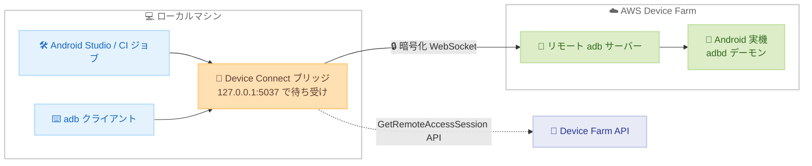

# AWS Device Farm - Device Connect によるリモート Android デバイスへのローカルアクセス

**リリース日**: 2026 年 11 月 23 日
**サービス**: AWS Device Farm
**機能**: Device Connect for AWS Device Farm

📊 [このアップデートのインフォグラフィックを見る](https://takech9203.github.io/aws-news-summary/20261123-device-farm-device-connect.html)

## 概要

AWS Device Farm は、クラウド上のリモート Android デバイスに対して、ローカルマシンから直接アクセスできる新機能「Device Connect」を発表しました。開発者や AI エージェントは、IDE やターミナルなどの使い慣れた開発環境から、あたかもラップトップに USB 接続されているかのように Device Farm 上の実機デバイスを操作できます。

Device Connect は `devicefarm-connect` という CLI クライアントとして提供され、ローカルの adb (Android Debug Bridge) サーバーの代わりとなる「ブリッジ」プロセスを起動します。これにより、Android Studio、シェルスクリプト、CI ジョブなど、ローカル adb を前提としたツールやテストフレームワークが、変更なしでそのまま Device Farm の実機に対して動作します。デバッガーのアタッチ、パフォーマンスプロファイリング、ビルドのプレビュー、adb コマンドの実行、ライブ映像とログを確認しながらの手動操作が可能です。

**アップデート前の課題**

このアップデート以前は、Device Farm のデバイスへのアクセス手段が限られていました。

- リモートアクセスセッションでのデバイス操作は Web ブラウザー経由の手動操作に限定されていた
- 自動テストは API 経由で実行する必要があり、Android Studio やターミナルなどのローカルツールからデバイスを直接操作できなかった
- adb を前提とした既存のツールチェーンやテストフレームワークをクラウド上の実機に対して利用できなかった

**アップデート後の改善**

今回のアップデートにより、ローカル開発環境とクラウド実機のギャップが解消されます。

- ローカルの adb ベースのワークフローが変更なしでそのまま Device Farm の実機に対して動作するようになった
- Android Studio からのデバッガーアタッチ、プロファイリング、アプリのインストールと実行が可能になった
- AI エージェントがローカル開発環境からリモート実機を操作するワークフローを構築できるようになった

## アーキテクチャ図



Device Connect ブリッジはローカル adb サーバーのデフォルトアドレス 127.0.0.1:5037 で待ち受け、adb クライアントからのリクエストを暗号化 WebSocket 経由で Device Farm 上のリモート adb サーバーへ中継します。

## サービスアップデートの詳細

### 主要機能

1. **ローカル adb ツールとの透過的な統合**
   - ブリッジがローカル adb サーバーの代わりとしてポート 5037 で動作するため、adb や Android Studio は設定変更なしでリモートデバイスを認識する
   - `adb install`、`adb push`、`adb pull`、`adb shell`、`adb logcat`、`adb forward` など、USB 接続デバイスと同様の操作が可能
   - Espresso テストなどの計装テストもローカルから直接実行できる

2. **セッションの自動維持と資格情報管理**
   - ブリッジは起動したシェルの AWS 認証情報を使用してリモートアクセスセッションのエンドポイントを取得し、数分ごとに自動更新する
   - デバイスがアタッチされている間はアイドル接続を 1 本維持し、コマンド間でセッションがタイムアウトしないよう保つ
   - 認証情報を保存せず、テレメトリーも送信せず、管理者権限なしで動作する

3. **診断とトラブルシューティング**
   - `devicefarm-connect doctor` コマンドで接続の問題を診断できる
   - ライブ映像、デバイスログ、テストログを確認しながら操作できる
   - ブリッジはターミナルを閉じても動作を継続し、`devicefarm-connect bridge stop` で明示的に停止する

## 技術仕様

### 動作要件

| 項目 | 詳細 |
|------|------|
| 対象デバイス | Android 9 以降のパブリックデバイス |
| 課金方式 | 従量課金 (metered) のデバイスのみ対応 |
| クライアント OS | Windows 10 以降 (x86-64)、macOS 13 以降 (ユニバーサルバイナリ)、Linux (x86-64 / ARM64) |
| adb バージョン | Android SDK Platform-Tools 29.0.0 以降 (adb 1.0.41) |
| 必要な IAM 権限 | `devicefarm:GetRemoteAccessSession` |
| 待ち受けアドレス | 127.0.0.1:5037 (デフォルト) |
| 通信方式 | 暗号化 WebSocket (adb 接続ごとに 1 本) |
| ライセンス | Apache-2.0 (クライアントは GitHub で公開) |

### 必要な IAM ポリシー例

```json
{
  "Version": "2012-10-17",
  "Statement": [
    {
      "Effect": "Allow",
      "Action": "devicefarm:GetRemoteAccessSession",
      "Resource": "*"
    }
  ]
}
```

## 設定方法

### 前提条件

1. AWS アカウントと Device Farm プロジェクトが作成済みであること
2. Android SDK Platform-Tools 29.0.0 以降 (adb 1.0.41) がインストールされていること
3. `devicefarm:GetRemoteAccessSession` を許可する AWS 認証情報が設定されていること

### 手順

#### ステップ 1: Device Connect クライアントのインストール

```bash
# macOS / Linux の場合
curl -fsSL https://raw.githubusercontent.com/aws/device-connect-devicefarm/main/install.sh | sh

# インストール確認
devicefarm-connect --version
```

インストールスクリプトが `devicefarm-connect` バイナリを `~/.local/bin` に配置します。sudo や管理者権限は不要です。Windows では PowerShell 用のインストールスクリプトを使用します。

#### ステップ 2: リモートアクセスセッションの作成

```bash
aws devicefarm create-remote-access-session \
  --project-arn "$PROJECT_ARN" \
  --device-arn "$DEVICE_ARN" \
  --region us-west-2
```

Device Farm のプロジェクトに対してリモートアクセスセッションを作成し、Android 9 以降のパブリックデバイスを確保します。出力に含まれるセッション ARN を控えておきます。コンソールからの作成も可能です。

#### ステップ 3: デバイスのアタッチと adb 操作

```bash
# セッションのデバイスをローカルにアタッチ (ブリッジが自動起動)
devicefarm-connect device add --session-arn "$SESSION_ARN"

# 通常の adb コマンドがそのまま利用可能
adb devices
adb install app-debug.apk
adb shell am instrument -w com.example.test/androidx.test.runner.AndroidJUnitRunner
```

`device add` コマンドがブリッジを起動し、リモートデバイスをローカルの adb に認識させます。以降は USB 接続デバイスと同様に adb コマンドや Android Studio から操作できます。

#### ステップ 4: クリーンアップ

```bash
# ブリッジの停止
devicefarm-connect bridge stop

# リモートアクセスセッションの停止 (課金の停止)
aws devicefarm stop-remote-access-session --arn "$SESSION_ARN" --region us-west-2
```

ブリッジを停止してもリモートアクセスセッション自体は Device Farm 側で継続し、課金も続くため、必ずセッションの停止も実行します。

## メリット

### ビジネス面

- **実機確保コストの削減**: 多様な Android 実機を社内で購入・管理することなく、必要なときだけ従量課金で利用できる
- **開発サイクルの短縮**: ブラウザー経由の手動操作と比べ、普段の開発環境から直接デバッグ・検証できるため、問題の特定と修正が高速化する
- **既存資産の活用**: adb を前提とした既存のテストスクリプトや CI ジョブを変更なしでクラウド実機に適用できる

### 技術面

- **透過的な adb 互換**: ブリッジがポート 5037 で adb サーバーとして振る舞うため、Android Studio を含むツール群が無設定で動作する
- **セキュアな通信**: adb 接続ごとに暗号化 WebSocket を使用し、エンドポイントは自動更新される。クライアントは認証情報を保存しない
- **AI エージェントとの親和性**: ターミナルから操作できるため、AI コーディングエージェントによる実機テストの自動化ワークフローに組み込みやすい

## デメリット・制約事項

### 制限事項

- 対応リージョンは米国西部 (オレゴン) のみ
- Android 9 以降のパブリックデバイスのみ対応し、課金方式は従量課金 (metered) に限定される
- セッションの最大時間は 150 分で、同時にアタッチできるデバイスは 1 台のみ
- `adb reboot` などデバイスに破壊的な影響を与えるコマンドはブロックされる
- `adb reverse` はデフォルトで無効であり、ブリッジ起動時に `--allow-adb-reverse` の指定が必要
- ポートフォワード・リバースのルールは TCP ポートのみ対応
- Android Studio のデバイスミラーリング機能は利用できない

### 考慮すべき点

- ブリッジはローカル adb サーバーと同様に adb クライアントを認証しないため、ローカルマシン上の任意のプログラムがアタッチ中のデバイスを利用できる
- ブリッジを停止してもリモートアクセスセッションは終了せず課金が継続するため、セッションの明示的な停止が必要
- ローカルとリモートの adb バージョンの一致 (1.0.41) が必要

## ユースケース

### ユースケース 1: Android Studio からの実機デバッグ

**シナリオ**: 特定の実機でのみ発生する不具合を、手元にデバイスがない状態でデバッグしたい。

**実装例**:
```bash
devicefarm-connect device add --session-arn "$SESSION_ARN"
# この後 Android Studio を起動すると、リモート実機がデバイスリストに表示される
# ブレークポイントの設定、デバッガーアタッチ、プロファイリングが可能
```

**効果**: 問題が発生する実機モデルに対して、普段のデバッグワークフローをそのまま適用でき、原因特定までの時間を短縮できる。

### ユースケース 2: CI パイプラインからの実機テスト

**シナリオ**: CI ジョブで、ビルドしたアプリの計装テストをエミュレーターではなく実機で実行したい。

**実装例**:
```bash
SESSION_ARN=$(aws devicefarm create-remote-access-session \
  --project-arn "$PROJECT_ARN" --device-arn "$DEVICE_ARN" \
  --region us-west-2 --query 'remoteAccessSession.arn' --output text)
devicefarm-connect device add --session-arn "$SESSION_ARN"
adb install app-debug.apk
adb shell am instrument -w com.example.test/androidx.test.runner.AndroidJUnitRunner
devicefarm-connect bridge stop
aws devicefarm stop-remote-access-session --arn "$SESSION_ARN" --region us-west-2
```

**効果**: 既存の adb ベースのテストスクリプトを変更せずに実機テストへ移行でき、エミュレーターでは検出できない実機固有の問題を早期に発見できる。

### ユースケース 3: AI エージェントによる実機操作の自動化

**シナリオ**: AI コーディングエージェントに、実装した機能を実機で動作確認させたい。

**実装例**:
```bash
# エージェントの実行環境でブリッジを起動しておく
devicefarm-connect device add --session-arn "$SESSION_ARN"
# エージェントは通常の adb コマンドでアプリのインストール・起動・ログ確認を実行
adb install app-debug.apk
adb shell am start -n com.example/.MainActivity
adb logcat -d | grep "com.example"
```

**効果**: エージェントがターミナル経由で実機を操作できるため、コード生成から実機検証までを一貫して自動化できる。

## 料金

Device Connect クライアント自体は追加料金なしで利用できます。デバイスの使用時間に対して、Device Farm の標準料金が適用されます。

### 料金例

| 使用量 | 料金 (概算) |
|--------|------------------|
| 従量課金のデバイス使用 | 0.17 USD / デバイス分 |
| 無料トライアル | 初回 1,000 分まで無料 (期間限定の増量、通常は 250 分) |
| 60 分のリモートセッションを月 20 回実施 | 約 204 USD / 月 |

Device Connect は従量課金 (metered) のデバイスのみ対応するため、月額制のアンメータードプランは対象外です。

## 利用可能リージョン

- 米国西部 (オレゴン): us-west-2

AWS Device Farm は us-west-2 リージョンでのみ提供されるサービスです。

## 関連サービス・機能

- **AWS Device Farm リモートアクセスセッション**: Device Connect の基盤となる機能。従来はブラウザー経由の操作のみだったが、本機能でローカル adb からの操作が可能になった
- **AWS Device Farm 自動テスト**: API 経由でテストスイートを一括実行する既存機能。Device Connect は対話的な開発・デバッグ用途を補完する
- **Android Debug Bridge (adb)**: Android 開発の標準ツール。Device Connect は adb のクライアント・サーバーモデルにおけるサーバーの役割をブリッジとして代替する

## 参考リンク

- 📊 [インフォグラフィック](https://takech9203.github.io/aws-news-summary/20261123-device-farm-device-connect.html)
- [公式発表 (What's New)](https://aws.amazon.com/about-aws/whats-new/2026/11/device-farm-device-connect/)
- [Device Connect 開発者ガイド](https://docs.aws.amazon.com/devicefarm/latest/developerguide/device-connect.html)
- [Device Connect クライアント (GitHub)](https://github.com/aws/device-connect-devicefarm)
- [AWS Device Farm 製品ページ](https://aws.amazon.com/device-farm/)
- [料金ページ](https://aws.amazon.com/device-farm/pricing/)

## まとめ

Device Connect は、クラウド上の Android 実機をローカルの adb ツールチェーンから透過的に扱えるようにする、Device Farm の大きな機能拡張です。既存の adb ベースのワークフローが変更なしで動作するため、実機デバッグや CI での実機テスト、AI エージェントによる実機検証の導入障壁が大きく下がります。Android アプリ開発で実機検証に課題を抱えているチームは、無料トライアル枠を活用して `devicefarm-connect` クライアントを試すことを推奨します。
