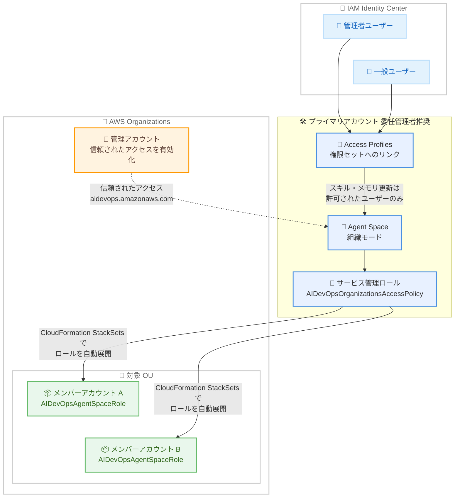

# AWS DevOps Agent - Access Profiles と AWS Organizations サポート

**リリース日**: 2026 年 11 月 23 日
**サービス**: AWS DevOps Agent
**機能**: Access Profiles / AWS Organizations サポート

📊 [このアップデートのインフォグラフィックを見る](https://takech9203.github.io/aws-news-summary/20261123-devops-agent-access-profiles-orgs.html)

## 概要

AWS DevOps Agent に、エージェントインスタンスに対するガバナンスと制御を強化する 2 つの新機能が追加されました。1 つ目の **Access Profiles** は、Agent Space 内の IAM Identity Center ユーザーを定義済みの権限セットにリンクする機能です。たとえば、スキルやメモリの作成・更新を特定のユーザーのみに限定するといった、ユーザーごとのきめ細かな権限制御が可能になります。

2 つ目の **AWS Organizations サポート**は、組織内のアカウントを Agent Space に自動的に整合させることで、AWS アカウントアクセス権限の設定を簡素化する機能です。組織単位 (OU) または組織ルートを選択するだけで、AWS DevOps Agent が対象の各メンバーアカウントにアクセスロールを自動展開し、Agent Space のセカンダリアカウントとして追加します。アカウントを 1 つずつ接続する必要はありません。

このアップデートは、複数アカウント環境で AWS DevOps Agent を運用するプラットフォームチームや、AI エージェントの利用に対して統制を求めるガバナンス担当者にとって重要な機能強化です。

**アップデート前の課題**

このアップデート以前には、以下の課題がありました。

- Agent Space の Web アプリにアクセスできる IAM Identity Center ユーザーは、ユーザー・グループ単位で追加するのみで、ユーザーごとに操作権限を細かく分けることができなかった
- スキルやメモリの作成・更新といった、エージェントの挙動に影響する操作を特定のユーザーに限定することが難しかった
- 複数の AWS アカウントを監視対象にする場合、アカウントを 1 つずつ Agent Space に接続して権限を設定する必要があり、大規模組織では運用負荷が高かった
- 組織にアカウントが追加・移動された際に、Agent Space のアカウント設定を手動で追従させる必要があった

**アップデート後の改善**

今回のアップデートにより、以下が可能になりました。

- Access Profiles により、Agent Space 内の IAM Identity Center ユーザーを特定の権限セットにリンクし、操作権限をユーザー単位で制御できるようになった
- スキルやメモリの作成・更新を、選択した一部のユーザーのみに限定できるようになった
- AWS Organizations との統合により、OU または組織ルートを指定するだけで、対象アカウントへのアクセスロール展開と Agent Space への関連付けが自動化された
- OU にアカウントが参加すると自動的にカバレッジへ追加され、OU から外れるとロールが削除されるなど、組織構造の変化に自動追従するようになった

## アーキテクチャ図



Access Profiles が IAM Identity Center ユーザーと Agent Space 内の権限セットをリンクし、AWS Organizations 統合がサービス管理ロールと CloudFormation StackSets を通じて組織内のメンバーアカウントへアクセスロールを自動展開する構成を示しています。

## サービスアップデートの詳細

### 主要機能

1. **Access Profiles によるユーザー権限制御**
   - Agent Space 内の IAM Identity Center ユーザーを、定義済みの権限セットにリンクできる
   - スキルやメモリの作成・更新といった操作を、選択した一部のユーザーに限定することが可能
   - IAM Identity Center 認証 (外部 IdP の Okta、Microsoft Entra ID、Ping Identity との連携を含む) と組み合わせて、エージェントインスタンスに対する統制を強化できる

2. **AWS Organizations サポートによるアカウントの自動整合**
   - OU または組織ルートを選択すると、AWS DevOps Agent が対象の各メンバーアカウントにアクセスロール (`AIDevOpsAgentSpaceRole-` で始まる名前) を展開し、Agent Space のセカンダリアカウントとして追加する
   - ロールの展開には CloudFormation StackSets (サービスマネージド権限) を使用し、各ロールには `AIDevOpsAgentAccessPolicy` AWS 管理ポリシーがアタッチされる
   - 1 つの関連付け (organization association) で OU 全体、または OU 配下の特定アカウントのリスト (最大 1,000 アカウント) をカバーできる

3. **組織構造の変化への自動追従**
   - OU 全体をカバーする関連付けでは、アカウントが OU に参加すると自動的にカバレッジへ追加され、OU から外れるとロールが削除される
   - AWS Organizations からの変更通知を受けて通常は数分以内に反映され、通知が遅延した場合も 6〜9 時間ごとの定期チェックで検出される
   - 組織からアカウントが離脱すると、即座に認証情報の発行が停止される

4. **委任管理者のサポート**
   - Agent Space は管理アカウントまたは委任管理者アカウント (プライマリアカウント) に作成できる
   - AWS Organizations のベストプラクティスに従い、管理アカウントの使用を最小化するため委任管理者アカウントの利用が推奨される
   - 委任管理者は `aidevops.amazonaws.com` と `member.org.stacksets.cloudformation.amazonaws.com` の両方のサービスプリンシパルへの登録が必要 (それぞれ最大 5 アカウントまで)

## 技術仕様

### AWS Organizations 統合で使用されるロール

| ロール | 配置場所 | アタッチされるポリシー | 用途 |
|------|------|------|------|
| サービス管理ロール | プライマリアカウント | `AIDevOpsOrganizationsAccessPolicy` | 組織構造の読み取りと CloudFormation スタックセットの管理 |
| メンバーアカウントロール (`AIDevOpsAgentSpaceRole-*`) | カバー対象の各メンバーアカウント | `AIDevOpsAgentAccessPolicy` + インラインポリシー `AllowCreateServiceLinkedRoles` | エージェントによるリソースの調査 (CloudTrail にセッションとして記録) |
| プライマリアカウントロール | プライマリアカウント | `AIDevOpsAgentAccessPolicy` | プライマリアカウント内のリソースへのアクセス |

### クォータ

| クォータ | 値 | 調整可否 |
|------|------|------|
| Agent Space あたりの organization association 数 | 20 | 不可 |
| Agent Space あたりの組織カバーアカウント数 | 3,000 | 不可 |
| 関連付けのアカウントリスト内のアカウント数 | 1,000 | 不可 |
| 関連付けあたりの OU 数 | 1 (OU またはルート) | 不可 |

### API変更履歴

| 日付 | サービス | 変更内容 |
|------|----------|----------|
| 2026/11/19 | [AWS DevOps Agent Service](https://awsapichanges.com/archive/changes/b8bc94-aidevops.html) | 8 updated api methods - AWS Organizations サポートの追加により、Agent Space が OU 全体のメンバーアカウントを監視できるように API を更新 |

### サービスプリンシパル

AWS Organizations 統合では、以下のサービスプリンシパルに対する信頼されたアクセスを使用します。

| サービスプリンシパル | 用途 |
|------|------|
| `aidevops.amazonaws.com` | AWS DevOps Agent のサービスプリンシパル。DevOps Agent のロールが信頼する唯一のプリンシパル |
| `member.org.stacksets.cloudformation.amazonaws.com` | CloudFormation StackSets と AWS Organizations の統合用。ロール展開に必要 |

## 設定方法

### 前提条件

1. AWS Organizations で「すべての機能」が有効になっていること (一括請求のみでは不可)
2. Agent Space を管理アカウントまたは委任管理者アカウントに作成すること (委任管理者を推奨)
3. AWS DevOps Agent と AWS CloudFormation StackSets の両方で信頼されたアクセスが有効になっていること
4. Access Profiles を使用する場合は、IAM Identity Center 認証が設定された Agent Space があること

### 手順

#### ステップ1: 信頼されたアクセスの有効化

```bash
# AWS DevOps Agent の信頼されたアクセスを有効化 (管理アカウントで実行)
aws organizations enable-aws-service-access \
    --service-principal aidevops.amazonaws.com

# CloudFormation StackSets の信頼されたアクセスをアクティブ化
aws cloudformation activate-organizations-access

# 両方が有効になったことを確認
aws organizations list-aws-service-access-for-organization
aws cloudformation describe-organizations-access
```

管理アカウントで、AWS DevOps Agent と CloudFormation StackSets の信頼されたアクセスを有効化しています。StackSets には `enable-aws-service-access` ではなく `activate-organizations-access` を使用する点に注意してください (必要なサービスリンクロールが作成されないため)。確認コマンドの出力に `aidevops.amazonaws.com` が含まれ、`Status` が `ENABLED` であれば完了です。

#### ステップ2: 委任管理者の登録 (推奨)

```bash
# AWS DevOps Agent の委任管理者を登録
aws organizations register-delegated-administrator \
    --account-id <DELEGATED_ADMIN_ACCOUNT_ID> \
    --service-principal aidevops.amazonaws.com

# CloudFormation StackSets の委任管理者も登録
aws organizations register-delegated-administrator \
    --account-id <DELEGATED_ADMIN_ACCOUNT_ID> \
    --service-principal member.org.stacksets.cloudformation.amazonaws.com
```

管理アカウントで、Agent Space を運用するアカウントを両方のサービスプリンシパルの委任管理者として登録しています。これにより、組織の管理と AWS DevOps Agent の運用を分離できます。コンソールで信頼されたアクセスを有効化した際に委任管理者を選択した場合、このステップは不要です。

#### ステップ3: 組織モードの Agent Space と organization association の作成

```bash
# 組織モードで Agent Space を作成 (プライマリアカウントで実行)
aws devops-agent create-agent-space \
    --name "MyOrgAgentSpace" \
    --aws-source-mode organization \
    --region <REGION>

# OU 全体をカバーする organization association を作成
aws devops-agent associate-service \
    --agent-space-id <AGENT_SPACE_ID> \
    --service-id aws \
    --configuration '{
      "sourceAwsOrg": {
        "accountType": "source",
        "organizationalUnit": {
          "organizationalUnitId": "<OU_ID>"
        }
      }
    }' \
    --region <REGION>

# デプロイ状況を確認
aws devops-agent get-association \
    --agent-space-id <AGENT_SPACE_ID> \
    --association-id <ASSOCIATION_ID> \
    --region <REGION>
```

組織モードの Agent Space を作成し、指定した OU 配下のすべてのアカウントをカバーする関連付けを作成しています。特定アカウントのみをカバーする場合は `organizationalUnit` に `accountIds` を追加し、組織全体をカバーする場合は `organizationalUnitId` にルート ID (`r-*`) を指定します。デプロイ中はステータスが `pending-confirmation` となり、完了すると `valid` に変わります。大規模組織ではデプロイに数時間かかる場合があります。コンソールを使用する場合は、Agent Space 作成時の **Agent scope** ページで **Organization** を選択します。

#### ステップ4: Access Profiles の設定

Agent Space の IAM Identity Center 認証を設定した上で、Agent Space 内で IAM Identity Center ユーザーを権限セットにリンクします。たとえば、スキルやメモリの作成・更新を許可するユーザーを限定するプロファイルを割り当てることで、エージェントの挙動に影響する操作を統制できます。詳細な設定手順は [AWS DevOps Agent ユーザーガイド](https://docs.aws.amazon.com/devopsagent/latest/userguide/)を参照してください。

## メリット

### ビジネス面

- **ガバナンスの強化**: スキルやメモリの変更を特定のユーザーに限定することで、AI エージェントの挙動に対する組織的な統制を確立でき、監査要件への対応が容易になる
- **運用コストの削減**: 組織内の数百〜数千のアカウントを個別に接続する作業が不要になり、マルチアカウント環境での導入・運用の工数を大幅に削減できる
- **スケーラブルな展開**: 1 つの Agent Space で最大 3,000 アカウントをカバーでき、組織全体への AI DevOps エージェントの展開が現実的になる

### 技術面

- **組織構造への自動追従**: アカウントの OU への参加・離脱を自動検出し、ロールの展開・削除を自動で行うため、構成ドリフトが発生しない
- **最小権限の原則**: メンバーアカウントのロールは AWS DevOps Agent のみが引き受け可能で、組織の関連付けでカバーされるアカウントでは読み取り専用アクションのみが使用される
- **監査可能性**: エージェントの API 呼び出しは各メンバーアカウントの CloudTrail に `AIDevOpsAgentSpaceRole-*` ロールのセッションとして記録される
- **即時のアクセス遮断手段**: 信頼されたアクセスの無効化、関連付けのスコープ変更、SCP の適用といった複数のレイヤーでアクセスを停止できる

## デメリット・制約事項

### 制限事項

- 組織の関連付けでカバーされるアカウントでは directed actions (エージェントによる書き込みアクション) を使用できない。昇格ロールを登録できないため、読み取り専用アクションのみとなる (プライマリアカウントと対応サードパーティ統合では引き続き利用可能)
- 組織モードの Agent Space には、個別に接続したセカンダリアカウントを併用できない
- Agent Space が委任管理者アカウントにある場合、管理アカウントのリソースは調査できない
- 組織モードは AWS GovCloud (US) リージョンと中国リージョンでは利用できない
- 関連付けの OU は後から変更できない。別の OU をカバーするには新しい関連付けを作成する必要がある

### 考慮すべき点

- CloudFormation StackSets の委任管理者は組織内のすべてのアカウントにデプロイできる強い権限を持つため、信頼できるアカウントのみに登録する
- デプロイ中にスタックセットやロールを手動で編集・削除すると、デプロイの遅延やアクセス断の原因になる。アクセス停止にはドキュメントに記載された正規の手段を使用する
- 大規模組織ではロール展開に数時間かかる場合がある
- クォータ (関連付け 20 件、カバーアカウント 3,000 件など) は現時点で引き上げ不可

## ユースケース

### ユースケース1: エンタープライズ全体への DevOps Agent 展開

**シナリオ**: 数百のアカウントを持つ企業が、組織全体の本番ワークロードを 1 つの Agent Space で監視・調査したい。

**実装例**:
```
1. 管理アカウントで aidevops.amazonaws.com と CloudFormation StackSets の
   信頼されたアクセスを有効化
2. 運用チームのアカウントを委任管理者として登録
3. 委任管理者アカウントに組織モードの Agent Space を作成
4. 本番ワークロード用 OU を指定して organization association を作成
```

**効果**: アカウントを個別接続することなく、OU 配下の全アカウントが自動的に監視対象となる。新規アカウントが OU に追加されても自動でカバレッジに含まれ、運用負荷を最小化できる。

### ユースケース2: スキル・メモリ管理の統制

**シナリオ**: プラットフォームチームがエージェントのスキルとメモリの品質を管理しており、一般の開発者による変更を防ぎたい。

**実装例**:
```
1. Agent Space に IAM Identity Center 認証を設定
2. Access Profiles で、プラットフォームチームのユーザーのみに
   スキル・メモリの作成・更新権限を持つプロファイルをリンク
3. 一般開発者には調査結果の閲覧やチャットなどの利用権限のみを付与
```

**効果**: エージェントの挙動を左右するスキル・メモリの変更が統制され、意図しない変更や品質低下を防止できる。一般開発者は引き続きエージェントを活用できる。

### ユースケース3: 段階的な導入と選択的なアカウントカバレッジ

**シナリオ**: まず特定の開発アカウント群で AWS DevOps Agent を評価し、その後本番 OU 全体へ展開したい。

**実装例**:
```
1. 評価フェーズ: organization association の accountIds に
   評価対象アカウントのみを指定して作成
2. 展開フェーズ: update-association で accountIds を削除し、
   OU 全体のカバレッジに切り替え
```

**効果**: 同じ Agent Space と関連付けを使ったまま、特定アカウントのリストから OU 全体へスコープを拡大でき、段階的な導入をスムーズに進められる。

## 料金

今回の What's New では、Access Profiles および AWS Organizations サポートに関する追加料金の記載はありません。AWS DevOps Agent 自体の料金体系が適用されます。なお、Organizations 統合が使用する CloudFormation StackSets によるロール展開は IAM リソースの作成であり、IAM 自体に料金は発生しません。最新の料金は AWS DevOps Agent の公式料金ページを確認してください。

## 利用可能リージョン

AWS DevOps Agent は以下のリージョンで利用可能です (2026 年 11 月時点)。

- 米国東部 (バージニア北部、オハイオ)
- 米国西部 (オレゴン)
- カナダ (中部)
- 南米 (サンパウロ)
- アジアパシフィック (ムンバイ、シンガポール、シドニー、**東京**、ソウル)
- 欧州 (フランクフルト、アイルランド、ロンドン、パリ、ストックホルム)
- AWS GovCloud (US-West)

**注意**: 組織モード (AWS Organizations サポート) は AWS GovCloud (US) リージョンと中国リージョンでは利用できません。Agent Space は作成したリージョンにデータを保存しますが、関連付けたアカウントのリソースはリージョンを問わず監視できます (クロスリージョンモニタリング)。

## 関連サービス・機能

- **AWS Organizations**: 信頼されたアクセスと委任管理者の仕組みを通じて、組織内アカウントの自動整合を実現する。OU 構造がそのままエージェントのアクセススコープになる
- **AWS IAM Identity Center**: Agent Space Web アプリへの認証基盤。Access Profiles はこの Identity Center ユーザーを権限セットにリンクする。Okta や Microsoft Entra ID などの外部 IdP とも連携可能
- **AWS CloudFormation StackSets**: サービスマネージド権限を使用して、カバー対象の各メンバーアカウントにアクセスロールを自動展開する
- **AWS CloudTrail**: メンバーアカウントでのエージェントの API 呼び出しを `AIDevOpsAgentSpaceRole-*` のセッションとして記録し、監査を可能にする

## 参考リンク

- 📊 [インフォグラフィック](https://takech9203.github.io/aws-news-summary/20261123-devops-agent-access-profiles-orgs.html)
- [公式発表 (What's New)](https://aws.amazon.com/about-aws/whats-new/2026/11/devops-agent-access-profiles-orgs/)
- [ドキュメント: AWS DevOps Agent と AWS Organizations](https://docs.aws.amazon.com/devopsagent/latest/userguide/configuring-integrations-and-knowledge-aws-devops-agent-and-aws-organizations.html)
- [ドキュメント: AWS Organization の接続](https://docs.aws.amazon.com/devopsagent/latest/userguide/configuring-integrations-and-knowledge-connecting-your-aws-organization.html)
- [ドキュメント: IAM Identity Center 認証のセットアップ](https://docs.aws.amazon.com/devopsagent/latest/userguide/aws-devops-agent-security-setting-up-iam-identity-center-authentication.html)
- [ドキュメント: サポートリージョン](https://docs.aws.amazon.com/devopsagent/latest/userguide/about-aws-devops-agent-supported-regions.html)
- [ドキュメント: リリース履歴](https://docs.aws.amazon.com/devopsagent/latest/userguide/whats-new.html)
- [API 変更履歴 (awsapichanges.com)](https://awsapichanges.com/archive/changes/b8bc94-aidevops.html)

## まとめ

今回のアップデートにより、AWS DevOps Agent はマルチアカウント環境でのスケーラブルな展開 (AWS Organizations サポート) と、ユーザー単位のきめ細かな権限統制 (Access Profiles) の両方を備え、エンタープライズでの本格導入に必要なガバナンス基盤が整いました。複数アカウントで DevOps Agent の利用を検討している場合は、まず管理アカウントで信頼されたアクセスを有効化し、委任管理者アカウントに組織モードの Agent Space を作成して評価することを推奨します。あわせて、スキルやメモリの変更権限を Access Profiles で統制する運用設計も検討してください。
