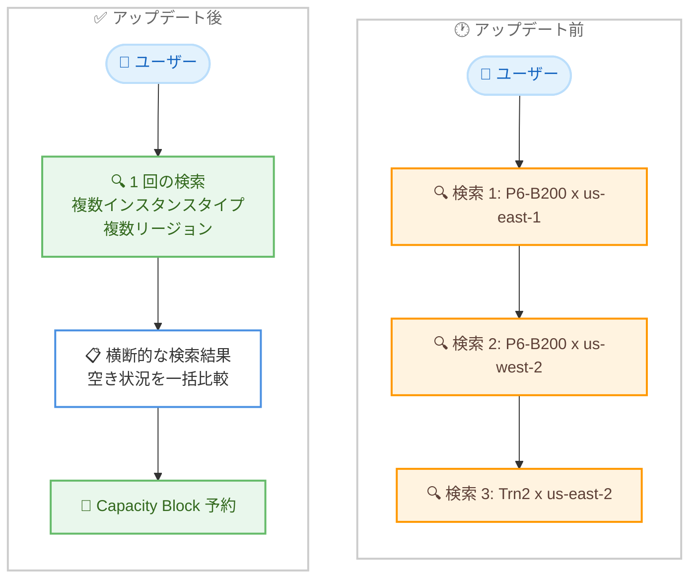

# Amazon EC2 - Capacity Blocks for ML の複数インスタンスタイプ・複数リージョン横断検索

**リリース日**: 2026 年 11 月 23 日
**サービス**: Amazon EC2 (Capacity Blocks for ML)
**機能**: 複数インスタンスタイプおよび複数 AWS リージョンにまたがるキャパシティ検索

📊 [このアップデートのインフォグラフィックを見る](https://takech9203.github.io/aws-news-summary/20261123-ec2-capacity-blocks-ml-flex-search.html)

## 概要

Amazon EC2 Capacity Blocks for ML が、複数のインスタンスタイプと複数の AWS リージョンにまたがるキャパシティ検索をサポートしました。1 回の検索で複数の組み合わせを横断的に確認できるようになり、機械学習 (ML) 向けコンピューティングキャパシティの確保が大幅に簡素化されます。

EC2 Capacity Blocks for ML は、Amazon EC2 P6-B300、P6-B200、Trn2 などのアクセラレーテッドインスタンスを、将来の開始日を指定して最大 6 か月間予約できる機能です。ML モデルのトレーニングやファインチューニングなど、GPU / アクセラレーターを一定期間だけ確実に確保したいワークロードに適しています。

今回のアップデートにより、AWS マネジメントコンソールでは複数のインスタンスタイプとリージョンの組み合わせを 1 回で検索できるようになりました。また、API では `DescribeCapacityBlockOfferings` への 1 回の呼び出しで、単一リージョン内の複数インスタンスタイプを横断して空き状況を照会できます。

**アップデート前の課題**

このアップデート以前は、キャパシティ検索の柔軟性に制限がありました。

- 以前はインスタンスタイプとリージョンの組み合わせごとに個別の検索を実行する必要があった
- 複数の候補を比較するには検索を何度も繰り返す必要があり、キャパシティ確保までに時間がかかった
- 希望のインスタンスタイプが特定リージョンで見つからない場合、代替候補を探す作業が煩雑だった

**アップデート後の改善**

今回のアップデートにより、検索作業が大幅に効率化されました。

- コンソールでの 1 回の検索で、複数のインスタンスタイプと複数のリージョンにまたがる空き状況を確認できるようになった
- 繰り返し検索することなく、必要なキャパシティを迅速に特定・予約できるようになった
- API では `DescribeCapacityBlockOfferings` の 1 回の呼び出しで、同一リージョン内の複数インスタンスタイプを照会できるようになった

## アーキテクチャ図



アップデート前は組み合わせごとに検索を繰り返す必要がありましたが、アップデート後はコンソールでの 1 回の検索で複数インスタンスタイプ・複数リージョンの空き状況を一括確認し、そのまま予約できます。

## サービスアップデートの詳細

### 主要機能

1. **複数インスタンスタイプの横断検索**
   - 1 回の検索で複数のインスタンスタイプ (例: P6-B300、P6-B200、Trn2) の空き状況を同時に確認可能
   - 希望のインスタンスタイプに空きがない場合でも、代替候補を同じ検索結果の中から比較できる
   - API (`DescribeCapacityBlockOfferings`) でも 1 回の呼び出しで複数インスタンスタイプの照会が可能

2. **複数 AWS リージョンの横断検索**
   - AWS マネジメントコンソールで、複数リージョンにまたがるキャパシティ検索が可能
   - リージョンごとに検索をやり直す必要がなくなり、グローバルにキャパシティを比較できる
   - ドキュメントによると、複数リージョンにまたがる検索はコンソールのみで利用可能で、AWS CLI / SDK / API の検索はリクエスト送信先のリージョンが対象

3. **Capacity Blocks for ML の基本機能 (変更なし)**
   - 将来の開始日 (最大 8 週間先) を指定して、最大 6 か月間のキャパシティを予約可能
   - 1 つの Capacity Block あたり最大 64 インスタンス、合計で最大 256 インスタンスまで予約可能
   - 予約したインスタンスは Amazon EC2 UltraClusters 内に近接配置され、低レイテンシーな大規模ネットワーキングを利用可能

## 技術仕様

### 検索機能の比較

| 項目 | アップデート前 | アップデート後 |
|------|----------------|----------------|
| インスタンスタイプ | 1 回の検索で 1 タイプのみ | 1 回の検索で複数タイプを横断 |
| リージョン | 1 回の検索で 1 リージョンのみ | コンソールで複数リージョンを横断 |
| API での複数タイプ照会 | 不可 | `DescribeCapacityBlockOfferings` の 1 回の呼び出しで可能 (単一リージョン内) |
| 複数リージョン検索の手段 | - | コンソールのみ (CLI / SDK / API は送信先リージョンが対象) |

### Capacity Blocks for ML の主な制約

| 項目 | 詳細 |
|------|------|
| 予約開始日 | 最大 8 週間先まで指定可能 (最短 30 分後に開始するオファリングも照会可能) |
| 予約期間 | 最大 6 か月 |
| インスタンス数 | 1 Capacity Block あたり最大 64、アカウント全体で最大 256 |
| 終了時刻 | 予約最終日の 11:30 AM UTC に終了 (11:00 AM UTC からインスタンスの終了処理が開始) |
| キャンセル | 不可 |

## 設定方法

### 前提条件

1. AWS アカウントと、EC2 Capacity Blocks の検索・購入に必要な IAM 権限があること
2. 利用したいインスタンスタイプが Capacity Blocks for ML の対象であること
3. 対象リージョンで Capacity Blocks for ML が提供されていること (対応リージョンはドキュメントを参照)

### 手順

#### ステップ 1: EC2 コンソールで Capacity Blocks の検索画面を開く

AWS マネジメントコンソールで EC2 を開き、[Capacity Blocks] から Capacity Block 予約の作成画面に進みます。

#### ステップ 2: 複数のインスタンスタイプとリージョンを指定して検索する

検索条件として、複数のインスタンスタイプと複数の AWS リージョン、必要なインスタンス数、期間、開始日の範囲を指定して検索を実行します。1 回の検索で、指定した組み合わせ全体の空き状況と料金が一覧表示されます。

#### ステップ 3: API で複数インスタンスタイプを照会する (オプション)

```bash
# 単一リージョン内で Capacity Block オファリングを照会する例
aws ec2 describe-capacity-block-offerings \
  --instance-count 4 \
  --capacity-duration-hours 336 \
  --region us-east-2
```

`DescribeCapacityBlockOfferings` API は、指定した条件に合致する Capacity Block のオファリング (開始日、期間、料金など) を返します。今回のアップデートにより、1 回の API 呼び出しで複数のインスタンスタイプを対象とした照会が可能になりました。指定方法の詳細は API リファレンスを確認してください。なお、API での検索対象はリクエストを送信したリージョンのみです。

#### ステップ 4: 検索結果から Capacity Block を購入する

検索結果から条件に合うオファリングを選択し、Capacity Block を購入します。予約開始後は、予約 ID をターゲットに指定してインスタンスを起動します。

## メリット

### ビジネス面

- **キャパシティ確保までの時間短縮**: 繰り返し検索が不要になり、希少な GPU / アクセラレーターキャパシティを迅速に特定・確保できる
- **機会損失の低減**: 複数の候補を一括で比較できるため、特定のタイプやリージョンに空きがない場合でも代替案をすぐに見つけられる
- **ML プロジェクトの計画性向上**: 複数リージョンの空き状況を俯瞰できることで、トレーニングスケジュールの立案が容易になる

### 技術面

- **運用負荷の軽減**: インスタンスタイプとリージョンの組み合わせごとの手動検索が不要になる
- **API の効率化**: `DescribeCapacityBlockOfferings` の 1 回の呼び出しで複数インスタンスタイプを照会でき、自動化スクリプトを簡素化できる
- **柔軟なワークロード配置**: リージョンをまたいだキャパシティの比較により、ワークロードに最適な配置先を選択しやすくなる

## デメリット・制約事項

### 制限事項

- 複数リージョンにまたがる検索は AWS マネジメントコンソールのみで利用可能 (AWS CLI / SDK / API はリクエスト送信先リージョンのみが対象)
- 対象は Capacity Blocks for ML が提供されているリージョンの Instance Capacity Blocks (対応リージョン・インスタンスタイプはドキュメントを参照)
- Capacity Blocks 自体の制約 (キャンセル不可、最大 64 / 256 インスタンス、開始日は最大 8 週間先までなど) は従来どおり

### 考慮すべき点

- リージョンをまたいでキャパシティを確保する場合、データ転送料金やデータセットの配置、レイテンシーへの影響を考慮する必要がある
- インスタンスタイプごとに性能特性と料金が異なるため、代替タイプを選択する際はワークロードとの適合性を検証する必要がある

## ユースケース

### ユースケース 1: 大規模モデルトレーニングのキャパシティ確保

**シナリオ**: 基盤モデルのトレーニングのために P6-B300 を第一候補としつつ、空きがなければ P6-B200 でも許容できるチームが、最速でキャパシティを確保したい。

**実装例**:
```
コンソールの Capacity Blocks 検索で、インスタンスタイプに
P6-B300 と P6-B200 の両方を指定し、候補リージョンを複数選択して検索。
最も早く開始できるオファリングを選択して予約する。
```

**効果**: 組み合わせごとの繰り返し検索が不要になり、トレーニング開始までのリードタイムを短縮できる。

### ユースケース 2: リージョンに柔軟な実験・プロトタイピング

**シナリオ**: データの所在に強い制約がない ML 実験で、コストと開始時期を優先してリージョンを選びたい。

**実装例**:
```
コンソールで複数リージョンを対象にキャパシティを横断検索し、
開始日と料金を比較して最適なリージョンの Capacity Block を予約する。
```

**効果**: 特定リージョンの空き待ちを回避し、実験のイテレーション速度を維持できる。

### ユースケース 3: キャパシティ監視の自動化

**シナリオ**: 希望条件のキャパシティが出るのを定期的にチェックし、空きが出たら通知する仕組みを構築したい。

**実装例**:
```
スケジュール実行する Lambda 関数から DescribeCapacityBlockOfferings を
呼び出し、複数インスタンスタイプのオファリングを 1 回の API 呼び出しで照会。
条件に合うオファリングが見つかったら SNS で通知する。
```

**効果**: 1 回の API 呼び出しで複数タイプをカバーできるため、監視ロジックがシンプルになり API 呼び出し回数も削減できる。

## 料金

今回のアップデート (検索機能の強化) に伴う追加料金の記載はありません。Capacity Blocks for ML の料金は従来どおりで、予約時に表示される料金を予約した期間分だけ前払いで支払う方式です。詳細は料金・請求に関するドキュメントを参照してください。

## 利用可能リージョン

EC2 Capacity Blocks for ML が提供されているすべての AWS リージョンの Instance Capacity Blocks で利用可能です。対応リージョンには米国東部 (バージニア北部、オハイオ)、米国西部 (オレゴン)、アジアパシフィック (東京) などが含まれます。最新の対応リージョン・インスタンスタイプの一覧は[公式ドキュメント](https://docs.aws.amazon.com/AWSEC2/latest/UserGuide/ec2-capacity-blocks.html#capacity-blocks-prerequisites)を参照してください。

## 関連サービス・機能

- **Amazon EC2 UltraClusters**: Capacity Block 内のインスタンスは UltraClusters 内に近接配置され、低レイテンシーかつペタビット規模のネットワーキングを利用できる
- **Amazon EC2 Auto Scaling / Amazon EKS**: Capacity Block の開始に合わせたスケジュールスケーリングが可能で、ML クラスターの起動を自動化できる
- **AWS Parallel Computing Service / AWS ParallelCluster**: Capacity Blocks と組み合わせて HPC / ML ワークフローを構築できる

## 参考リンク

- 📊 [インフォグラフィック](https://takech9203.github.io/aws-news-summary/20261123-ec2-capacity-blocks-ml-flex-search.html)
- [公式発表 (What's New)](https://aws.amazon.com/about-aws/whats-new/2026/11/ec2-capacity-blocks-ml-flex-search/)
- [ドキュメント: Capacity Blocks for ML](https://docs.aws.amazon.com/AWSEC2/latest/UserGuide/ec2-capacity-blocks.html)
- [ドキュメント: Capacity Blocks の料金と請求](https://docs.aws.amazon.com/AWSEC2/latest/UserGuide/capacity-blocks-pricing-billing.html)
- [API リファレンス: DescribeCapacityBlockOfferings](https://docs.aws.amazon.com/AWSEC2/latest/APIReference/API_DescribeCapacityBlockOfferings.html)

## まとめ

EC2 Capacity Blocks for ML の検索が複数インスタンスタイプ・複数リージョンに対応したことで、希少な ML 向けアクセラレーテッドキャパシティの確保が大幅に効率化されました。GPU / Trainium インスタンスの予約を検討しているチームは、コンソールの横断検索を活用して候補を一括比較することを推奨します。自動化が必要な場合は、`DescribeCapacityBlockOfferings` API による複数タイプ照会の活用も検討してください。
