# AWS Global Accelerator - TLS リスナー付き NLB でのクライアント IP 保持

**リリース日**: 2026 年 11 月 23 日
**サービス**: AWS Global Accelerator
**機能**: TLS リスナーを持つ Network Load Balancer エンドポイントでのクライアント IP アドレス保持

📊 [このアップデートのインフォグラフィックを見る](https://takech9203.github.io/aws-news-summary/20261123-global-accelerator-client-ip-nlb-tls.html)

## 概要

AWS Global Accelerator が、TLS リスナーを持つ Network Load Balancer (NLB) エンドポイントへトラフィックをルーティングする際に、元のクライアント IP アドレスを保持できるようになりました。これにより、NLB で TLS を終端しながら、アプリケーション側で接続元の実際のクライアント IP アドレスを確認できます。

クライアント IP アドレスを利用した制御、たとえばセキュリティグループによるアクセス制御、地理的ブロッキング、レートリミット、不正検知、監査ログ、許可リスト、コンプライアンス対応などを、実際のクライアント IP に基づいて実施できるようになります。非 HTTP の TCP プロトコルを扱うワークロード、静的 IP (Elastic IP) が必要なアプリケーション、Layer 7 ロードバランシングが適さない高スループットのユースケースなど、Layer 4 での TLS 終端を必要とするワークロードに適しています。

**アップデート前の課題**

このアップデート以前は、クライアント IP 保持と NLB の TLS リスナーを同時に利用できませんでした。

- クライアント IP 保持を有効にしたアクセラレーターには、TLS リスナーを持つ NLB をエンドポイントとして追加できなかった
- そのため「NLB での TLS 終端」と「クライアント IP の保持」のどちらか一方を選択する必要があった
- クライアント IP が保持されない場合、アプリケーションには Global Accelerator 側の IP アドレスが見えるため、IP ベースのセキュリティ制御や監査が困難だった

**アップデート後の改善**

今回のアップデートにより、両方の機能を同時に利用できるようになりました。

- NLB で TLS を終端しつつ、アプリケーション側で元のクライアント IP アドレスを確認できるようになった
- クライアント IP 保持を有効にしたアクセラレーターに、TLS リスナーを持つ NLB をそのままエンドポイントとして追加できるようになった
- 追加設定は不要で、追加料金もかからない

## アーキテクチャ図

```mermaid
flowchart TD
    subgraph Before["❌ 従来: どちらか一方を選択"]
        direction LR
        C1(["👤 クライアント"]) --> GA1["🌐 Global Accelerator<br/>クライアント IP 保持有効"]
        GA1 -.->|"追加不可"| NLB1["⚖️ NLB<br/>TLS リスナー"]
    end

    subgraph After["✅ 今回のアップデート後: 両方を利用可能"]
        direction LR
        C2(["👤 クライアント"]) -->|"ソース IP を保持"| GA2["🌐 Global Accelerator<br/>クライアント IP 保持有効"]
        GA2 --> NLB2["⚖️ NLB<br/>TLS 終端"]
        NLB2 -->|"元のクライアント IP で到達"| App["⚙️ アプリケーション<br/>IP ベース制御が可能"]
    end

    classDef user fill:#E3F2FD,stroke:#BBDEFB,stroke-width:2px,color:#1565C0
    classDef ga fill:#FFE0B2,stroke:#FFCC80,stroke-width:2px,color:#5D4037
    classDef nlb fill:#E8F1FF,stroke:#4A90E2,stroke-width:2px,color:#333333
    classDef app fill:#E9F7EC,stroke:#66BB6A,stroke-width:2px,color:#333333
    classDef error fill:#FFEBEE,stroke:#F44336,stroke-width:2px,color:#333333
    classDef layer fill:none,stroke:#CCCCCC,stroke-width:2px,color:#666666

    class C1,C2 user
    class GA1,GA2 ga
    class NLB1 error
    class NLB2 nlb
    class App app
    class Before,After layer
```



従来はクライアント IP 保持を有効にしたアクセラレーターに TLS リスナー付き NLB を追加できませんでしたが、今回のアップデートにより NLB で TLS を終端しながら元のクライアント IP をアプリケーションまで届けられるようになりました。

## サービスアップデートの詳細

### 主要機能

1. **TLS リスナー付き NLB でのクライアント IP 保持**
   - クライアント IP 保持を有効にしたアクセラレーターのエンドポイントとして、TLS リスナーを持つ NLB を追加可能になった
   - NLB で TLS を終端した後も、アプリケーションには元のクライアント IP アドレスが渡される
   - 追加設定は不要で、エンドポイントとして追加するだけで利用できる

2. **IP ベースのセキュリティ制御の実現**
   - セキュリティグループ、地理的ブロッキング、レートリミットなどを実際のクライアント IP に基づいて適用可能
   - 不正検知、監査ログ、許可リスト、コンプライアンス対応にも元のクライアント IP を利用可能

3. **Layer 4 TLS 終端ワークロードへの対応**
   - 非 HTTP の TCP プロトコルを扱うアプリケーションに対応
   - 静的 IP アドレスを必要とするアプリケーションや、Layer 7 ロードバランシングが適さない高スループットのユースケースに適合

## 技術仕様

### クライアント IP 保持の対応エンドポイント

公式ドキュメント (Global Accelerator Developer Guide) によると、標準アクセラレーターでクライアント IP 保持に対応するエンドポイントは以下のとおりです。

| エンドポイントタイプ | クライアント IP 保持 |
|------|------|
| Application Load Balancer | 対応 |
| Amazon EC2 インスタンス | 対応 |
| セキュリティグループ付き Network Load Balancer | 対応 (今回 TLS リスナーにも対応) |
| セキュリティグループなしの Network Load Balancer | 非対応 |
| Elastic IP アドレス | 非対応 |

## 設定方法

### 前提条件

1. AWS Global Accelerator の標準アクセラレーターを作成済みであること
2. クライアント IP アドレス保持を有効にしていること
3. セキュリティグループが関連付けられた NLB に TLS リスナーを設定済みであること

### 手順

#### ステップ1: NLB に TLS リスナーを作成

```bash
aws elbv2 create-listener \
  --load-balancer-arn arn:aws:elasticloadbalancing:ap-northeast-1:123456789012:loadbalancer/net/my-nlb/abcdef1234567890 \
  --protocol TLS \
  --port 443 \
  --certificates CertificateArn=arn:aws:acm:ap-northeast-1:123456789012:certificate/example \
  --default-actions Type=forward,TargetGroupArn=arn:aws:elasticloadbalancing:ap-northeast-1:123456789012:targetgroup/my-targets/1234567890abcdef
```

NLB に対して ACM 証明書を使用した TLS リスナーを作成します。TLS の終端はこの NLB で行われます。

#### ステップ2: アクセラレーターのエンドポイントとして NLB を追加

```bash
aws globalaccelerator add-endpoints \
  --endpoint-group-arn arn:aws:globalaccelerator::123456789012:accelerator/example/listener/example/endpoint-group/example \
  --endpoint-configurations EndpointId=arn:aws:elasticloadbalancing:ap-northeast-1:123456789012:loadbalancer/net/my-nlb/abcdef1234567890,ClientIPPreservationEnabled=true
```

クライアント IP 保持を有効にした状態で、TLS リスナー付きの NLB をエンドポイントグループに追加します。公式発表のとおり、これ以外の追加設定は不要です。

## メリット

### ビジネス面

- **セキュリティとコンプライアンスの強化**: 実際のクライアント IP に基づく監査ログや許可リスト管理により、コンプライアンス要件への対応が容易になる
- **不正利用対策の向上**: 不正検知やレートリミットを実際の接続元 IP に対して適用でき、サービスの健全性を維持しやすくなる
- **追加コストなし**: 追加料金なしで利用でき、既存の Global Accelerator の料金体系のまま機能を活用できる

### 技術面

- **アーキテクチャ選択の自由度向上**: TLS 終端の場所 (NLB) とクライアント IP 保持を両立でき、設計上のトレードオフが解消される
- **IP ベースの制御の実現**: セキュリティグループや地理的ブロッキングなどを、Global Accelerator 経由のトラフィックにも元のクライアント IP で適用できる
- **設定変更が不要**: エンドポイントとして追加するだけで機能し、アプリケーションやインフラの改修が不要

## デメリット・制約事項

### 制限事項

- AWS GovCloud (US) および中国リージョンでは利用できない
- クライアント IP 保持には、セキュリティグループが関連付けられた NLB が必要 (セキュリティグループなしの NLB は非対応)
- Elastic IP アドレスエンドポイントはクライアント IP 保持に非対応

### 考慮すべき点

- クライアント IP 保持を有効にすると、ターゲット側のセキュリティグループやネットワーク ACL が実際のクライアント IP に対して評価されるため、既存のルールの見直しが必要になる場合がある
- エンドポイントのクライアント IP 保持設定を変更する際は、既存接続への影響を考慮して移行手順を検討する必要がある

## ユースケース

### ユースケース1: 金融サービスの TCP ベース API での IP 許可リスト

**シナリオ**: 金融機関が非 HTTP の独自 TCP プロトコルを使用する API を提供しており、TLS による暗号化と、提携先の固定 IP のみを許可するアクセス制御の両方が必要。

**実装例**:
```
Global Accelerator (クライアント IP 保持有効)
  → NLB TLS リスナー (TLS 終端)
  → EC2 ターゲット (セキュリティグループで提携先 IP のみ許可)
```

**効果**: TLS 終端を NLB にオフロードしながら、セキュリティグループで実際の接続元 IP に基づくアクセス制御を実現できる。

### ユースケース2: グローバル配信ゲームサーバーでの不正対策

**シナリオ**: 世界中のユーザーに低レイテンシーで接続させるため Global Accelerator を利用しているゲームサービスで、不正ユーザーの IP ベースのブロックとレートリミットを実施したい。

**実装例**:
```
Global Accelerator の静的 IP でグローバル受け付け
  → 各リージョンの NLB TLS リスナー
  → アプリケーションで元のクライアント IP を基に不正検知・ブロック
```

**効果**: Global Accelerator の高速なルーティングを維持したまま、実際のクライアント IP に基づく不正検知と地理的ブロッキングが可能になる。

### ユースケース3: 高スループットなデータ取り込み基盤の監査ログ

**シナリオ**: IoT デバイスや外部システムから大量の TCP データを受け取る取り込み基盤で、Layer 7 ロードバランサーでは性能要件を満たせず、送信元ごとの監査ログが必要。

**実装例**:
```
Global Accelerator (クライアント IP 保持有効)
  → NLB TLS リスナーで暗号化通信を終端
  → バックエンドで送信元クライアント IP を監査ログに記録
```

**効果**: Layer 4 の高スループット処理と TLS 終端を両立しつつ、送信元 IP を正確に記録してコンプライアンス要件を満たせる。

## 料金

この機能は追加料金なしで利用できます。AWS Global Accelerator の標準料金 (固定料金およびデータ転送プレミアム料金) が適用されます。

## 利用可能リージョン

AWS GovCloud (US) および中国リージョンを除く、すべての AWS 商用リージョンで利用可能です。

## 関連サービス・機能

- **Network Load Balancer**: TLS リスナーによる Layer 4 での TLS 終端を提供する。今回のアップデートで Global Accelerator のクライアント IP 保持と併用可能になった
- **Application Load Balancer**: Layer 7 ワークロード向けのエンドポイント。従来からクライアント IP 保持に対応している
- **AWS Certificate Manager**: NLB の TLS リスナーで使用する証明書の発行・管理に利用する
- **セキュリティグループ**: 保持されたクライアント IP に基づくアクセス制御に利用できる

## 参考リンク

- 📊 [インフォグラフィック](https://takech9203.github.io/aws-news-summary/20261123-global-accelerator-client-ip-nlb-tls.html)
- [公式発表 (What's New)](https://aws.amazon.com/about-aws/whats-new/2026/11/global-accelerator-client-ip-nlb-tls/)
- [ドキュメント: クライアント IP アドレスの保持](https://docs.aws.amazon.com/global-accelerator/latest/dg/preserve-client-ip-address.html)
- [ドキュメント: Network Load Balancer のリスナー作成](https://docs.aws.amazon.com/elasticloadbalancing/latest/network/create-listener.html)
- [料金ページ](https://aws.amazon.com/global-accelerator/pricing/)

## まとめ

このアップデートにより、Global Accelerator のクライアント IP 保持と NLB の TLS リスナーという、従来は両立できなかった 2 つの機能を同時に利用できるようになりました。Layer 4 での TLS 終端が必要なワークロードで IP ベースのセキュリティ制御や監査を実現したい場合は、追加設定・追加料金なしで利用できるため、TLS リスナー付き NLB をエンドポイントとして追加することを検討してください。
