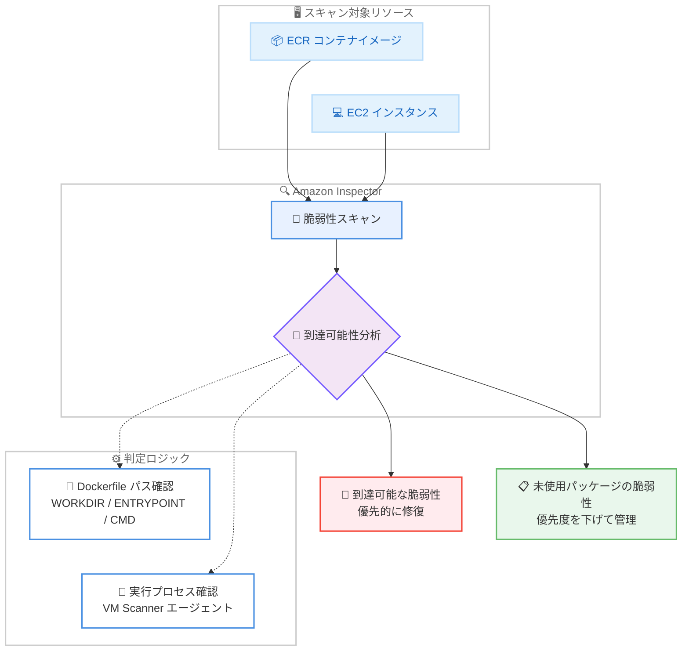

# Amazon Inspector - ECR および EC2 の検出結果に対するランタイム到達可能性分析の拡張

**リリース日**: 2026 年 11 月 23 日
**サービス**: Amazon Inspector
**機能**: ランタイム到達可能性分析 (Runtime Reachability Analysis) の ECR / EC2 検出結果への拡張

📊 [このアップデートのインフォグラフィックを見る](https://takech9203.github.io/aws-news-summary/20261123-inspector-runtime-reachability.html)

## 概要

Amazon Inspector が、Amazon ECR のコンテナイメージおよび Amazon EC2 インスタンスの脆弱性検出結果に対して、ランタイム到達可能性分析を適用するようになりました。これにより、検出された脆弱性が実際にアプリケーションから到達可能 (悪用される可能性がある) かどうかを Inspector が自動的に判定し、検出結果に反映します。

大規模なコンテナフリートや複雑なアプリケーションを運用するチームにとって、未使用の依存関係に含まれる脆弱性と、実際に到達可能な脆弱性を分離できることは、修復の優先順位付けにおいて大きな価値があります。ノイズが減少し、開発チームとセキュリティチームの効率が向上します。

**アップデート前の課題**

このアップデート以前は、以下の課題がありました。

- Inspector はリソース内のすべての脆弱性にフラグを立てており、アプリケーションが使用していないパッケージの脆弱性も同列に報告されていた
- セキュリティチームは、どの脆弱性が実際のリスクをもたらすかを手動で調査する必要があった
- 大規模環境では検出結果のノイズが多く、本当に対処すべき脆弱性の優先順位付けが困難だった

**アップデート後の改善**

今回のアップデートにより、以下が可能になりました。

- Inspector が脆弱性の到達可能性を自動判定し、潜在的に到達可能な脆弱性を識別できるようになった
- ECR コンテナイメージでは、脆弱なパッケージが Dockerfile の WORKDIR、ENTRYPOINT、CMD 命令で定義されたアプリケーションパスに含まれるかを自動チェック
- EC2 インスタンスでは、脆弱なパッケージが直近のスキャン時にプロセスとして実行されていたかを自動チェック
- 到達可能性に基づくフィルタリングにより、修復の優先順位付けが容易になった

## アーキテクチャ図



Inspector が ECR コンテナイメージと EC2 インスタンスをスキャンした後、Dockerfile のパス情報や実行プロセスの観測結果に基づいて到達可能性を判定し、脆弱性を「到達可能」と「未使用パッケージ」に分類するフローを示しています。

## サービスアップデートの詳細

### 主要機能

1. **ECR コンテナイメージの到達可能性分析**
   - 脆弱なパッケージが、Dockerfile の WORKDIR、ENTRYPOINT、CMD 命令で定義されたアプリケーションパス内に含まれるかをチェック
   - アプリケーションの実行経路に含まれないパッケージの脆弱性を区別可能
   - 大規模なコンテナフリートにおける修復優先順位付けを支援

2. **EC2 インスタンスの到達可能性分析**
   - 脆弱なパッケージが、直近のスキャン時に実行中のプロセスとして観測されたかをチェック
   - エージェントベースのスキャン (Inspector VM Scanner) が必要
   - 実際に稼働しているプロセスに関連する脆弱性を優先的に特定

3. **検出結果への自動反映とバックフィル**
   - 新規の検出結果には即座に到達可能性分析が適用される
   - 既存の検出結果にも順次バックフィルされる
   - 追加料金なしで利用可能

## 技術仕様

### 到達可能性の判定方法

| リソースタイプ | 判定方法 | 前提条件 |
|------|------|------|
| ECR コンテナイメージ | Dockerfile の WORKDIR / ENTRYPOINT / CMD で定義されたパスに脆弱なパッケージが含まれるか | ECR 拡張スキャンの有効化 |
| EC2 インスタンス | 直近のスキャン時に脆弱なパッケージがプロセスとして実行されていたか | Inspector VM Scanner によるエージェントベーススキャン |

### API変更履歴

| 日付 | サービス | 変更内容 |
|------|----------|----------|
| 2026/11/20 | [Inspector2](https://awsapichanges.com/archive/changes/e9d2b3-inspector2.html) | 6 updated api methods - 検出結果モデルの脆弱なパッケージに runtimeReachability、runtimeReachabilityReason、purl フィールドを追加。検出結果の一覧表示、抑制ルール、検出結果レポートに runtimeReachability、runtimeReachabilityReason、purlQualifier のパッケージフィルターを追加 |

### 検出結果のフィルター例

```json
{
  "filterCriteria": {
    "vulnerablePackages": [
      {
        "runtimeReachability": {
          "comparison": "EQUALS",
          "value": "REACHABLE"
        }
      }
    ]
  }
}
```

## 設定方法

### 前提条件

1. Amazon Inspector が有効化されていること
2. ECR の場合: ECR スキャンが有効化されていること
3. EC2 の場合: Inspector VM Scanner によるエージェントベースのスキャンが有効化されていること

### 手順

#### ステップ1: Inspector のスキャン状況を確認

```bash
aws inspector2 batch-get-account-status
```

アカウントで Inspector の ECR / EC2 スキャンが有効になっているかを確認します。

#### ステップ2: 到達可能性でフィルタリングして検出結果を取得

```bash
aws inspector2 list-findings \
  --filter-criteria '{
    "vulnerablePackages": [
      {
        "runtimeReachability": {
          "comparison": "EQUALS",
          "value": "REACHABLE"
        }
      }
    ]
  }'
```

runtimeReachability フィルターを使用して、到達可能と判定された脆弱性のみを一覧表示します。優先的に修復すべき検出結果を素早く特定できます。

#### ステップ3: 抑制ルールやレポートへの活用

到達可能性フィルターは抑制ルール (suppression rules) や検出結果レポートにも利用できます。未使用パッケージの脆弱性に対する抑制ルールを作成することで、検出結果のノイズを削減し、運用負荷を軽減できます。

## メリット

### ビジネス面

- **修復工数の削減**: 実際にリスクをもたらす脆弱性に集中でき、手動調査にかかる工数を削減できる
- **セキュリティ対応の迅速化**: 到達可能な脆弱性を優先することで、実リスクへの対応時間を短縮できる
- **追加コストなし**: 追加料金なしで既存の Inspector 利用環境にそのまま適用される

### 技術面

- **ノイズの削減**: 未使用の依存関係に含まれる脆弱性を分離し、アラート疲れを防止できる
- **自動化された到達可能性判定**: Dockerfile のパス情報やプロセス観測に基づく判定が自動で行われる
- **API / フィルターとの統合**: runtimeReachability フィルターにより、一覧表示・抑制ルール・レポートで一貫した優先順位付けが可能

## デメリット・制約事項

### 制限事項

- EC2 インスタンスの到達可能性分析には、Inspector VM Scanner によるエージェントベースのスキャンが必要 (エージェントレススキャンのみでは利用不可)
- ECR の判定は Dockerfile の WORKDIR、ENTRYPOINT、CMD 命令に基づくため、実行時に動的にロードされるパッケージの検出には限界がある可能性がある
- 既存の検出結果へのバックフィルは順次実施されるため、反映までに時間がかかる場合がある

### 考慮すべき点

- 「到達不可」と判定された脆弱性も、構成変更により将来到達可能になる可能性があるため、完全に無視せず管理を継続することが望ましい
- EC2 の判定は直近のスキャン時のプロセス観測に基づくため、稀にしか起動しないプロセスの脆弱性は到達可能と判定されない可能性がある

## ユースケース

### ユースケース1: 大規模コンテナフリートの脆弱性トリアージ

**シナリオ**: 数百のマイクロサービスを ECR で管理しており、ベースイメージ由来の脆弱性検出が大量に発生している。

**実装例**:
```bash
aws inspector2 list-findings \
  --filter-criteria '{
    "resourceType": [{"comparison": "EQUALS", "value": "AWS_ECR_CONTAINER_IMAGE"}],
    "vulnerablePackages": [
      {"runtimeReachability": {"comparison": "EQUALS", "value": "REACHABLE"}}
    ]
  }'
```

**効果**: アプリケーションの実行パスに含まれる脆弱性のみを抽出し、修復対象を大幅に絞り込める。

### ユースケース2: EC2 サーバー群の実行中プロセスに基づく優先修復

**シナリオ**: 多数の EC2 インスタンスで動作するレガシーアプリケーションがあり、OS パッケージの脆弱性が大量に検出されている。

**実装例**:
```bash
# Inspector VM Scanner によるエージェントベーススキャンを有効化した上で
aws inspector2 list-findings \
  --filter-criteria '{
    "resourceType": [{"comparison": "EQUALS", "value": "AWS_EC2_INSTANCE"}],
    "vulnerablePackages": [
      {"runtimeReachability": {"comparison": "EQUALS", "value": "REACHABLE"}}
    ]
  }'
```

**効果**: 実際にプロセスとして実行されていたパッケージの脆弱性を優先的に修復し、実リスクを効率的に低減できる。

### ユースケース3: 未使用パッケージの脆弱性に対する抑制ルール運用

**シナリオ**: セキュリティダッシュボードのノイズを削減したいが、検出結果自体は記録として残したい。

**実装例**:
```bash
aws inspector2 create-filter \
  --action SUPPRESS \
  --name "suppress-unreachable-findings" \
  --filter-criteria '{
    "vulnerablePackages": [
      {"runtimeReachability": {"comparison": "EQUALS", "value": "NOT_REACHABLE"}}
    ]
  }'
```

**効果**: 到達不可と判定された検出結果を抑制し、チームが対応すべきアクティブな検出結果に集中できる。

## 料金

追加料金なしで利用できます。既存の Amazon Inspector の料金体系 (スキャン対象リソースに基づく課金) の範囲内で、到達可能性分析が自動的に適用されます。

## 利用可能リージョン

Amazon Inspector が利用可能なすべての AWS リージョンで利用できます。

## 関連サービス・機能

- **Amazon ECR**: コンテナイメージのレジストリ。Inspector の拡張スキャンと連携して脆弱性を検出し、今回のアップデートで到達可能性分析が適用される
- **Amazon EC2**: Inspector VM Scanner によるエージェントベーススキャンと組み合わせることで、実行中プロセスに基づく到達可能性分析が可能
- **AWS Security Hub**: Inspector の検出結果を集約し、組織全体のセキュリティ状況を可視化できる
- **Amazon Inspector Code Security**: ソースコードレベルの脆弱性検出。到達可能性分析と合わせて多層的な脆弱性管理を実現

## 参考リンク

- 📊 [インフォグラフィック](https://takech9203.github.io/aws-news-summary/20261123-inspector-runtime-reachability.html)
- [公式発表 (What's New)](https://aws.amazon.com/about-aws/whats-new/2026/11/inspector-runtime-reachability/)
- [Amazon Inspector 製品ページ](https://aws.amazon.com/inspector/)
- [Inspector VM Scanner ドキュメント](https://docs.aws.amazon.com/inspector/latest/user/inspector-vm-scanner.html)
- [API 変更履歴 (Inspector2)](https://awsapichanges.com/archive/changes/e9d2b3-inspector2.html)

## まとめ

Amazon Inspector のランタイム到達可能性分析が ECR コンテナイメージと EC2 インスタンスに拡張され、実際にリスクをもたらす脆弱性の特定が自動化されました。追加料金なしで新規検出結果に即座に適用されるため、Inspector を利用中のチームは runtimeReachability フィルターを活用した優先順位付けと抑制ルールの整備を進めることを推奨します。EC2 で本機能を利用するには、Inspector VM Scanner によるエージェントベーススキャンの有効化を確認してください。
