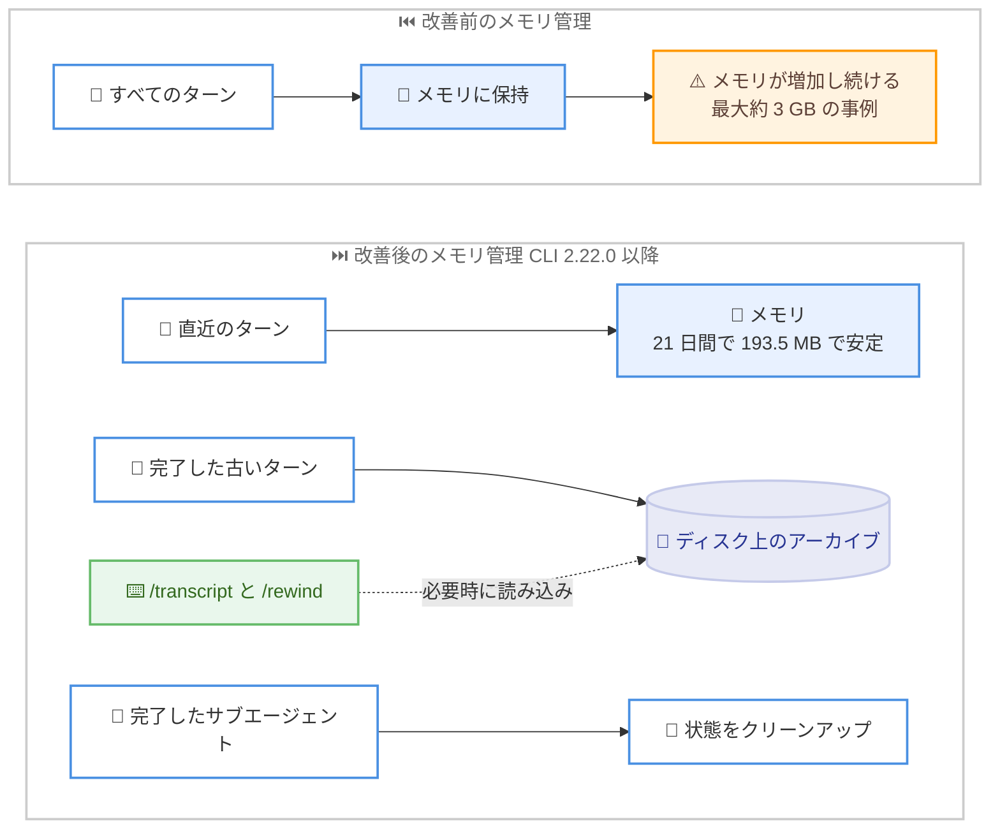

# Kiro - Kiro CLI の長時間セッション向けパフォーマンス改善

**リリース日**: 2026 年 11 月 23 日
**サービス**: Kiro (AWS が提供する AI 搭載 IDE)
**機能**: Kiro CLI のメモリ管理・入力応答性・起動時間・ダウンロードサイズの大幅改善

📊 [このアップデートのインフォグラフィックを見る](https://takech9203.github.io/aws-news-summary/20261123-kiro-agents-run-for-days.html)

## 概要

Kiro は、数日から数週間にわたって開き続ける長時間エージェントセッションに対応するため、Kiro CLI の大規模なパフォーマンス改善を発表しました。モデルの長時間タスク処理能力の向上や `/goal` のような機能により、エージェントセッションは以前よりはるかに長く実行されるようになっており、CLI 自体の性能が開発体験を左右するようになっています。

今回の改善は、(1) 長時間セッションでもメモリ使用量が増え続けない新しいメモリ管理、(2) 長い応答の後でも入力が即座に反映されるタイピング応答性、(3) ダウンロード・インストールサイズの大幅削減、(4) 起動時間の短縮、という 4 つの領域にわたります。21 日間の利用をシミュレートしたワークロードでは、メモリ使用量が従来の 370.5 MB から 193.5 MB に減少し、さらに増加が止まってフラットに推移するようになりました。

対象ユーザーは、Kiro CLI で複数の長時間エージェントセッションを並行して実行する開発者や、CI/CD・プルリクエストレビューなどの自動化環境で Kiro を利用するチームです。

**アップデート前の課題**

このアップデート以前は、長時間セッションにおいて以下の課題がありました。

- 長時間実行セッションでメモリ使用量が増加し続け、Bun プロセスが約 3 GB に達する事例もあった (最後の 1 週間で 1 日あたり約 10 MB ずつ増加)
- macOS の署名プロセスで組み込み Bun ランタイムの JIT エンタイトルメントが除去されており、JavaScript の実行が本来より大幅に遅く、長い応答の後にタイピングが遅延していた
- macOS のダウンロードサイズは約 960 MB、インストール後は約 1.8 GB と大きく、CI/CD 環境などで待ち時間が発生していた
- 起動時に約 1.55 GB の実行ファイル 2 つを読み込んでハッシュ計算しており、それだけで 5.77 秒かかっていた (ウォームスタートの中央値は 6.785 秒)
- メモリを確保するために有用なセッションを閉じる「セッションのやりくり」が必要になることがあった

**アップデート後の改善**

今回のアップデートにより、以下が実現されました。

- 直近のターンのみをメモリに保持し、完了した古いターンはディスク上のアーカイブへ移動するメモリ管理に変更。21 日間のシミュレーションでメモリは 193.5 MB で安定し、増加が停止 (Kiro CLI 2.22.0 以降)
- JIT エンタイトルメントの復元により、p95 の再描画時間が 276.9 ミリ秒から 35.4 ミリ秒へ約 7.8 倍高速化 (Kiro CLI 2.16.1)。さらに 1,118 行の履歴表示中でもキー入力が p95 で 2.32 ミリ秒で反映 (Kiro CLI 2.25.0)
- macOS ユニバーサル DMG はダウンロード 358.2 MB (約 63% 削減)、インストール後 654.6 MB (約 64% 削減)。Linux ARM64 はダウンロード 154.5 MB (約 77% 削減)、インストール後 272.1 MB (約 75% 削減)
- ウォームスタートの中央値が 6.785 秒から 0.414 秒へ短縮され、0.5 秒未満という p95 目標を達成
- 24 GB の MacBook Pro 上で 15 個の長時間セッションを、メモリ回収のための再起動なしで同時に維持可能に

## アーキテクチャ図



改善後は直近のターンのみをメモリに保持し、完了した古いターンはディスク上のアーカイブへ移動します。`/transcript` や `/rewind` は必要時にアーカイブを読み込むため、会話全体は失われません。

## サービスアップデートの詳細

### 主要機能

1. **メモリ使用量の安定化 (Kiro CLI 2.22.0 以降)**
   - 直近のターンのみメモリに保持し、完了した古いターンはディスク上のアーカイブへ移動
   - タスクを完了したサブエージェントが状態を残さないように改善
   - `/transcript` と `/rewind` はアーカイブから読み込むため、会話全体を保持したままメモリ使用量を削減
   - 21 日間の利用をシミュレートしたワークロードで、メモリは従来の 370.5 MB に対し 193.5 MB で安定。従来は最後の 1 週間で 1 日約 10 MB 増加していたが、増加が停止
   - 672 ターン・10,752 回のサブエージェント呼び出しを含む 4 週間の高負荷テストでも、ピーク 270.0 MB、終了時 174.9 MB

2. **タイピング応答性の改善 (Kiro CLI 2.16.1 / 2.25.0)**
   - macOS の署名プロセスが組み込み Bun ランタイムから JIT エンタイトルメントを除去していた問題を修正 (2.16.1)
   - 1,118 行の応答を再生して同じ 20 キーストロークを入力する比較テストで、p95 の再描画時間が 276.9 ミリ秒から 35.4 ミリ秒へ約 7.8 倍高速化
   - キーストロークごとの処理をさらに削減し、1,118 行の履歴を表示した状態でもキー入力が p95 で 2.32 ミリ秒で画面に反映 (2.25.0、10 回実行の中央値。全実行が 2.30〜2.55 ミリ秒の範囲)

3. **ダウンロード・インストールサイズの削減**
   - macOS ユニバーサル DMG: ダウンロード約 960 MB → 358.2 MB (約 63% 削減)、インストール後約 1.8 GB → 654.6 MB (約 64% 削減)
   - Linux ARM64: ダウンロード約 674 MB → 154.5 MB (約 77% 削減)、インストール後約 1.1 GB → 272.1 MB (約 75% 削減)
   - 組み込みランタイムと TUI の圧縮に加え、起動時に約 1.55 GB の実行ファイル 2 つを読み込んでハッシュ計算していた問題 (5.77 秒) を解消

4. **起動時間の短縮**
   - 起動から入力可能になるまでのウォームスタート中央値が 6.785 秒から 0.414 秒に短縮
   - 0.5 秒未満という p95 目標を達成
   - 起動時の重複処理を削除し、残りの読み込みをバックグラウンドで実行しながら入力を開始できるように変更

5. **複数セッションの同時実行**
   - 24 GB の MacBook Pro 上で 15 個の長時間セッションを、クローズや再起動なしで同時に維持
   - 20 個の CLI プロセスがそれぞれ 1 日分の作業をシミュレートしたテストでは、メモリ使用量の中央値は 251.6 MB、最大 261.1 MB
   - 計画上の目安はセッションあたり 500 MB (CLI 300 MB + 背後のエージェントサーバー 200 MB) で、15 セッションでも 7.5 GB に収まる

## 技術仕様

### パフォーマンス改善の数値まとめ

| 項目 | 改善前 | 改善後 | 対象バージョン |
|------|--------|--------|----------------|
| メモリ使用量 (21 日間シミュレーション) | 370.5 MB、1 日約 10 MB 増加 | 193.5 MB、増加なし | 2.22.0 以降 |
| 4 週間高負荷テスト (672 ターン、10,752 サブエージェント呼び出し) | - | ピーク 270.0 MB、終了時 174.9 MB | 2.22.0 以降 |
| p95 再描画時間 (1,118 行応答 + 20 キーストローク) | 276.9 ミリ秒 | 35.4 ミリ秒 (約 7.8 倍高速) | 2.16.1 |
| キー入力の p95 表示時間 (1,118 行履歴表示中) | - | 2.32 ミリ秒 | 2.25.0 |
| macOS ダウンロードサイズ | 約 960 MB | 358.2 MB (約 63% 削減) | 最新版 |
| macOS インストールサイズ | 約 1.8 GB | 654.6 MB (約 64% 削減) | 最新版 |
| Linux ARM64 ダウンロードサイズ | 約 674 MB | 154.5 MB (約 77% 削減) | 最新版 |
| Linux ARM64 インストールサイズ | 約 1.1 GB | 272.1 MB (約 75% 削減) | 最新版 |
| ウォームスタート中央値 | 6.785 秒 | 0.414 秒 | 最新版 |

### メモリ管理の仕組み

| 要素 | 動作 |
|------|------|
| 直近のターン | メモリに保持 |
| 完了した古いターン | ディスク上のアーカイブへ移動 |
| 完了したサブエージェント | 状態を残さずクリーンアップ |
| `/transcript` / `/rewind` | 必要時にアーカイブから読み込み (会話全体を保持) |

## 設定方法

### 前提条件

1. Kiro CLI を利用できる環境 (macOS または Linux)
2. メモリ改善の恩恵を受けるには Kiro CLI 2.22.0 以降、タイピング応答性の最新改善には 2.25.0 以降

### 手順

#### ステップ 1: Kiro CLI のインストールまたはアップデート

```bash
# 新規インストールの場合は kiro.dev のダウンロードページから取得
# 既存ユーザーは CLI 内でアップデートを実行
kiro-cli update
```

既存の Kiro CLI を最新バージョンにアップデートします。今回の改善は特別な設定なしで有効になります。

#### ステップ 2: バージョンの確認

```bash
kiro-cli --version
```

インストールされているバージョンを確認します。2.22.0 以降であればメモリ管理の改善が、2.25.0 以降であれば最新のタイピング応答性改善が含まれています。

#### ステップ 3: 長時間セッションでの利用

```bash
# ワークスペースで Kiro CLI を起動
kiro-cli

# 過去の会話はアーカイブから参照可能
/transcript
```

セッションを長期間開いたままでも、メモリ使用量は安定します。過去のターンは `/transcript` や `/rewind` で必要時に参照できます。

## メリット

### ビジネス面

- **開発者の生産性向上**: セッションの再起動やメモリ管理のための「セッションのやりくり」が不要になり、エージェントによる長時間タスクを中断せずに継続できる
- **CI/CD の高速化**: ダウンロードサイズが約 63〜77% 削減され、CI/CD やプルリクエストレビューなどの自動化環境でセットアップ時間が短縮される
- **ハードウェアコストの抑制**: 24 GB のラップトップで 15 の長時間セッションを同時維持でき、追加のマシンリソースなしで並行作業を拡大できる

### 技術面

- **メモリ増加の根本的解決**: 単に初期メモリを減らすのではなく、時間経過による増加自体を停止させるアーカイブ型のメモリ管理を採用
- **会話履歴の完全保持**: 古いターンはディスクに退避されるだけで、`/transcript` や `/rewind` からは引き続き全履歴にアクセス可能
- **即応性のある入力体験**: 長い応答の表示後でもキー入力が p95 で 2.32 ミリ秒で反映され、体感的な遅延がない
- **高速な起動**: ウォームスタートが 0.414 秒となり、バックグラウンド読み込み中でも入力を開始できる

## デメリット・制約事項

### 制限事項

- メモリ管理の改善は Kiro CLI 2.22.0 以降、タイピング応答性の最新数値は 2.25.0 以降が対象で、古いバージョンでは恩恵を受けられない
- 記事中の「3 GB のセッション」は一例であり、すべてのセッションで同じ削減率が得られるわけではない
- 旧ビルドの正確なサイズ記録が残っていないため、サイズ削減率は概数に基づく

### 考慮すべき点

- セッションあたりの計画メモリの目安は 500 MB (CLI 300 MB + エージェントサーバー 200 MB) であり、同時セッション数の設計時はこの値を基準にするとよい
- 数十のセッションを同時に実行したい場合は、ローカルではなくクラウドセッションの利用が推奨されている
- 測定値はビルドやワークロードにより異なるため、起動時間の改善幅は「時間経過による進歩」として解釈する必要がある

## ユースケース

### ユースケース 1: 複数の長時間エージェントセッションの並行実行

**シナリオ**: 複数のリポジトリやタスクに対して、それぞれ専用の Kiro CLI セッションを数日間開いたままにして、エージェントに長時間タスクを任せたい。

**実装例**:
```bash
# 各ワークスペースでセッションを起動し、開いたまま維持
cd ~/projects/service-a && kiro-cli
cd ~/projects/service-b && kiro-cli
# /goal でエージェントに目標を与え、長時間の反復作業を実行
```

**効果**: セッションあたり 500 MB の計画値で 15 セッションが 7.5 GB に収まり、24 GB のラップトップでもエディタやブラウザと併用しながら複数セッションを維持できる。

### ユースケース 2: CI/CD やプルリクエストレビューの自動化

**シナリオ**: CI/CD パイプラインやプルリクエストレビューの自動化で Kiro CLI を毎回ダウンロード・インストールしており、セットアップ時間を短縮したい。

**実装例**:
```bash
# CI ジョブ内で Kiro CLI を取得 (Linux ARM64 の例)
# ダウンロードサイズ: 約 674 MB → 154.5 MB
# インストールサイズ: 約 1.1 GB → 272.1 MB
```

**効果**: ダウンロードが約 77% 小さくなり、ジョブごとのセットアップ待ち時間が大幅に短縮される。起動も 0.414 秒 (中央値) と高速なため、自動化タスクがすぐに開始できる。

### ユースケース 3: 長い応答を扱うインタラクティブな開発

**シナリオ**: エージェントが 1,000 行を超える長い応答を生成した後も、続けてコマンドや指示を快適に入力したい。

**実装例**:
```bash
# 長い応答の後もそのまま入力を継続
# 過去の内容が必要になったらアーカイブから参照
/transcript
/rewind
```

**効果**: 1,118 行の履歴を表示した状態でもキー入力が p95 で 2.32 ミリ秒で反映され、入力遅延なく作業を継続できる。

## 利用可能リージョン

グローバル (Kiro はグローバルに提供されるサービスです)

## 関連サービス・機能

- **Kiro IDE**: Kiro CLI と同じエージェント基盤を持つ AI 搭載 IDE。CLI はワークスペースの skills、AGENTS.md、ドキュメント、チームナレッジを活用する
- **Kiro クラウドセッション**: 数十のセッションを同時に実行したい場合に適した、クラウド上でエージェントを実行する機能
- **`/goal` コマンド**: エージェントが目標に向かって反復し、レビュー前に進捗を自己検証できる機能。長時間セッションの主要な利用パターン

## 参考リンク

- 📊 [インフォグラフィック](https://takech9203.github.io/aws-news-summary/20261123-kiro-agents-run-for-days.html)
- [公式ブログ: Your agents run for days: now Kiro CLI keeps up](https://kiro.dev/blog/agents-run-for-days/)
- [Kiro Changelog](https://kiro.dev/changelog/)

## まとめ

Kiro CLI は、メモリ管理・タイピング応答性・ダウンロードサイズ・起動時間の 4 領域で大幅なパフォーマンス改善を実現し、数日から数週間にわたる長時間エージェントセッションを安心して開き続けられるようになりました。メモリ増加の停止 (2.22.0 以降) と 0.5 秒未満の起動により、1 台のラップトップで 15 の並行セッションも現実的になっています。Kiro CLI を利用中の場合は、最新バージョン (2.25.0 以降) へのアップデートを推奨します。
