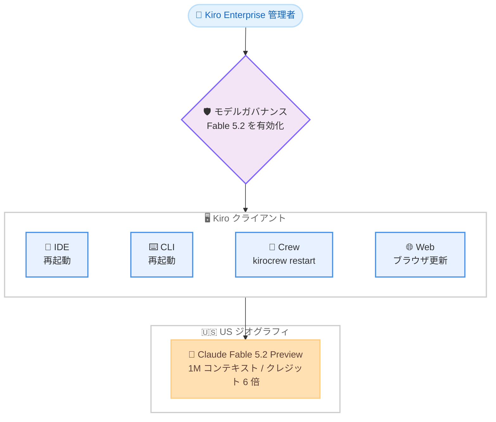

# Kiro - Claude Fable 5.2 Preview が Kiro Enterprise 向けに提供開始

**リリース日**: 2026 年 11 月 23 日
**サービス**: Kiro
**機能**: Claude Fable 5.2 Preview の Kiro Enterprise 組織向けロールアウト

📊 [このアップデートのインフォグラフィックを見る](https://takech9203.github.io/aws-news-summary/20261123-kiro-changelog-2026-11-23.html)

## 概要

Anthropic の Claude Fable 5.2 が、Kiro Enterprise 組織向けに Preview として Kiro の各クライアント (IDE、CLI、Crew、Web) でロールアウトを開始しました。Fable 5.2 は、難易度の高い技術的タスクに向けた Anthropic の最上位モデルで、複数リポジトリにまたがる大規模で定義の曖昧な問題に取り組み、作業しながら自身の成果物をテストし、長時間の実行においてサブエージェントを調整できます。

モデルは 1M (100 万) トークンのコンテキストウィンドウを持ち、クレジット倍率は 6 倍です。推論は US ジオグラフィのみで実行されます。Preview 期間中はアクセスが制限されており、アクセス権を持つ組織はモデルガバナンスを通じて Fable 5.2 を有効化できます。最新のモデルリストを読み込むには、IDE または CLI の再起動、Crew では `kirocrew restart` の実行、Web ではブラウザの更新が必要です。

なお、Fable 5.2 のすべてのトラフィックは、自動化されたオフラインの不正利用検出のために最大 30 日間保持されます (法令で別途要求される場合を除く)。分類器によってフラグ付けされたトラフィックは、AWS による人間のレビューの対象となる可能性があります。

**アップデート前の課題**

- 以前は Kiro 上で Claude Fable 5.2 を利用できず、複数リポジトリにまたがる大規模で定義の曖昧な問題には、より小規模なコンテキストや能力のモデルで対応する必要があった
- 以前は長時間実行のタスクで、自己テストやサブエージェントの調整を高い水準でこなすモデルの選択肢が限られていた

**アップデート後の改善**

- 今回のアップデートにより、Kiro Enterprise 組織は Anthropic の最上位モデルである Fable 5.2 を Preview として利用できるようになった
- 今回のアップデートにより、1M トークンのコンテキストウィンドウを活用して、リポジトリ横断の大規模なタスクを 1 つのセッションで扱えるようになった
- 今回のアップデートにより、モデルガバナンスを通じて組織単位で利用可否を制御しながら、新モデルを段階的に導入できるようになった

## アーキテクチャ図



Kiro Enterprise の管理者がモデルガバナンスで Fable 5.2 を有効化すると、IDE、CLI、Crew、Web の各クライアントからモデルを利用できます。推論は US ジオグラフィのみで実行されます。

## サービスアップデートの詳細

### 主要機能

1. **Claude Fable 5.2 の Preview 提供**
   - Anthropic の難易度の高い技術的タスク向け最上位モデルが、Kiro Enterprise 組織向けに Preview として提供開始
   - 複数リポジトリにまたがる大規模で定義の曖昧な問題への取り組みが可能
   - 作業の進行に合わせて自身の成果物をテストし、長時間実行ではサブエージェントを調整できる

2. **1M トークンのコンテキストウィンドウ**
   - 100 万トークンのコンテキストウィンドウにより、大規模なコードベースや複数リポジトリの情報を 1 つのセッションで扱える
   - クレジット倍率は 6 倍に設定されている

3. **モデルガバナンスによる組織単位の制御**
   - Preview 期間中はアクセスが制限されており、アクセス権を持つ組織のみが利用できる
   - 組織の管理者はモデルガバナンスを通じて Fable 5.2 の有効化を制御できる

4. **各クライアントでのモデルリスト更新**
   - IDE または CLI は再起動、Crew は `kirocrew restart` の実行、Web はブラウザの更新で最新のモデルリストを読み込む

## 技術仕様

### Claude Fable 5.2 Preview の仕様

| 項目 | 詳細 |
|------|------|
| モデル | Claude Fable 5.2 (Anthropic) |
| 提供状態 | Preview (アクセス制限あり) |
| 対象 | Kiro Enterprise 組織 |
| 対応クライアント | IDE、CLI、Crew、Web |
| コンテキストウィンドウ | 1M (100 万) トークン |
| クレジット倍率 | 6 倍 |
| 推論実行場所 | US ジオグラフィのみ |
| 有効化方法 | モデルガバナンス |
| トラフィック保持 | 最大 30 日間 (自動化されたオフラインの不正利用検出のため) |

## 設定方法

### 前提条件

1. Kiro Enterprise 組織であること
2. Preview 期間中の Fable 5.2 へのアクセス権が組織に付与されていること
3. モデルガバナンスを操作できる管理者権限があること

### 手順

#### ステップ 1: モデルガバナンスで Fable 5.2 を有効化する

アクセス権を持つ組織の管理者が、モデルガバナンスの設定で Claude Fable 5.2 を有効化します。これにより、組織内のユーザーがモデルを選択できるようになります。

#### ステップ 2: 各クライアントで最新のモデルリストを読み込む

```bash
# Crew の場合
kirocrew restart
```

Crew では上記コマンドでエージェントを再起動し、最新のモデルリストを読み込みます。IDE と CLI はアプリケーションの再起動、Web はブラウザの更新で反映されます。

#### ステップ 3: モデルセレクタで Fable 5.2 を選択する

各クライアントのモデルセレクタから Claude Fable 5.2 を選択し、タスクを実行します。

## メリット

### ビジネス面

- **最上位モデルの早期活用**: Anthropic の最上位モデルを Preview 段階から業務に適用し、複雑な開発タスクの生産性向上を先行して検証できる
- **ガバナンスとの両立**: モデルガバナンスにより、組織のポリシーに沿った形で新モデルの利用可否を制御できる
- **データ所在の明確化**: 推論が US ジオグラフィのみで実行されることが明示されており、コンプライアンス要件の評価がしやすい

### 技術面

- **大規模コンテキスト**: 1M トークンのコンテキストウィンドウにより、リポジトリ横断の大規模なリファクタリングや調査を 1 セッションで実行できる
- **自己テストとサブエージェント調整**: 作業しながら成果物をテストし、長時間実行でサブエージェントを調整するため、エージェンティックな長時間タスクに適している
- **全クライアント対応**: IDE、CLI、Crew、Web のいずれからも同じモデルを利用できる

## デメリット・制約事項

### 制限事項

- Preview 期間中はアクセスが制限されており、すべての Kiro Enterprise 組織が即時に利用できるわけではない
- 推論は US ジオグラフィのみで実行されるため、US 以外での推論を要件とする組織は利用できない
- クレジット倍率が 6 倍と高く、他モデルと比較してクレジット消費が大きい
- Kiro Enterprise 組織のみが対象で、個人プランでは利用できない

### 考慮すべき点

- Fable 5.2 のすべてのトラフィックは、自動化されたオフラインの不正利用検出のために最大 30 日間保持される (法令で別途要求される場合を除く)
- 分類器によってフラグ付けされたトラフィックは、AWS による人間のレビューの対象となる可能性がある
- クレジット消費が大きいため、定型的なタスクには他のモデルを使い、難易度の高いタスクに限定して利用するなどの使い分けが望ましい

## ユースケース

### ユースケース 1: リポジトリ横断の大規模リファクタリング

**シナリオ**: マイクロサービス構成の複数リポジトリにまたがる共通ライブラリの破壊的変更を、依存するすべてのサービスに適用したい。

**実装例**:
```text
1. モデルガバナンスで Fable 5.2 を有効化
2. 1M コンテキストを活用して関連リポジトリのコードを読み込ませる
3. 変更方針の提示から各リポジトリの修正、テスト実行までを 1 セッションで実行
```

**効果**: 大規模なコンテキストと自己テスト能力により、リポジトリ横断の変更を一貫した方針で完了できる。

### ユースケース 2: 定義の曖昧な問題の調査と解決

**シナリオ**: 「特定条件でパフォーマンスが劣化する」といった原因箇所が不明確な問題を、コードベース全体から調査して修正したい。

**実装例**:
```text
1. 症状と再現条件を Fable 5.2 に提示
2. モデルがコードベースを横断的に調査し、仮説の検証とテストを繰り返す
3. 根本原因の特定と修正、回帰テストの追加までを実行
```

**効果**: 定義の曖昧な問題に対しても、自律的な調査と自己テストにより高い精度で解決に到達できる。

### ユースケース 3: サブエージェントを使った長時間タスクの実行

**シナリオ**: 技術的負債の解消やテストカバレッジの向上など、長時間かかるタスクを Kiro Crew で夜間に実行したい。

**実装例**:
```text
1. kirocrew restart で最新のモデルリストを読み込む
2. Fable 5.2 を指定して長時間タスクを開始
3. モデルがサブエージェントを調整しながらタスクを分担して進行
```

**効果**: 長時間の実行でもサブエージェントの調整により作業を並行して進められ、大きなタスクを完遂しやすくなる。

## 料金

Fable 5.2 のクレジット倍率は 6 倍です。同じトークン量の処理でも他モデルより多くのクレジットを消費するため、タスクの難易度に応じたモデルの使い分けが推奨されます。詳細は [Kiro の料金ページ](https://kiro.dev/pricing/) を参照してください。

## 利用可能リージョン

Kiro はグローバルに利用可能ですが、Fable 5.2 の推論は US ジオグラフィのみで実行されます。

## 関連サービス・機能

- **Kiro Enterprise**: 今回の Preview の対象となるエンタープライズ向けプランで、モデルガバナンスなどの組織管理機能を提供
- **モデルガバナンス**: 組織単位で利用可能なモデルを制御する機能。Fable 5.2 の有効化に使用
- **Kiro Crew**: 長時間実行のエージェントタスクを担うクライアント。`kirocrew restart` でモデルリストを更新

## 参考リンク

- 📊 [インフォグラフィック](https://takech9203.github.io/aws-news-summary/20261123-kiro-changelog-2026-11-23.html)
- [Kiro Changelog: Claude Fable 5.2 for Enterprise](https://kiro.dev/changelog/models/claude-fable-5-2-for-enterprise/)
- [Kiro Changelog](https://kiro.dev/changelog/)
- [ドキュメント: 利用可能なモデル Claude Fable 5.2](https://kiro.dev/docs/models/available-models/#claude-fable-52)

## まとめ

Kiro Enterprise 組織向けに、Anthropic の最上位モデル Claude Fable 5.2 の Preview 提供が始まりました。1M トークンのコンテキストウィンドウ、自己テスト、サブエージェントの調整といった特徴により、リポジトリ横断の大規模で難易度の高いタスクに適しています。クレジット倍率 6 倍と US ジオグラフィ限定の推論、トラフィック保持ポリシーを考慮したうえで、アクセス権のある組織はモデルガバナンスで有効化し、難易度の高いタスクでの効果を検証することを推奨します。
