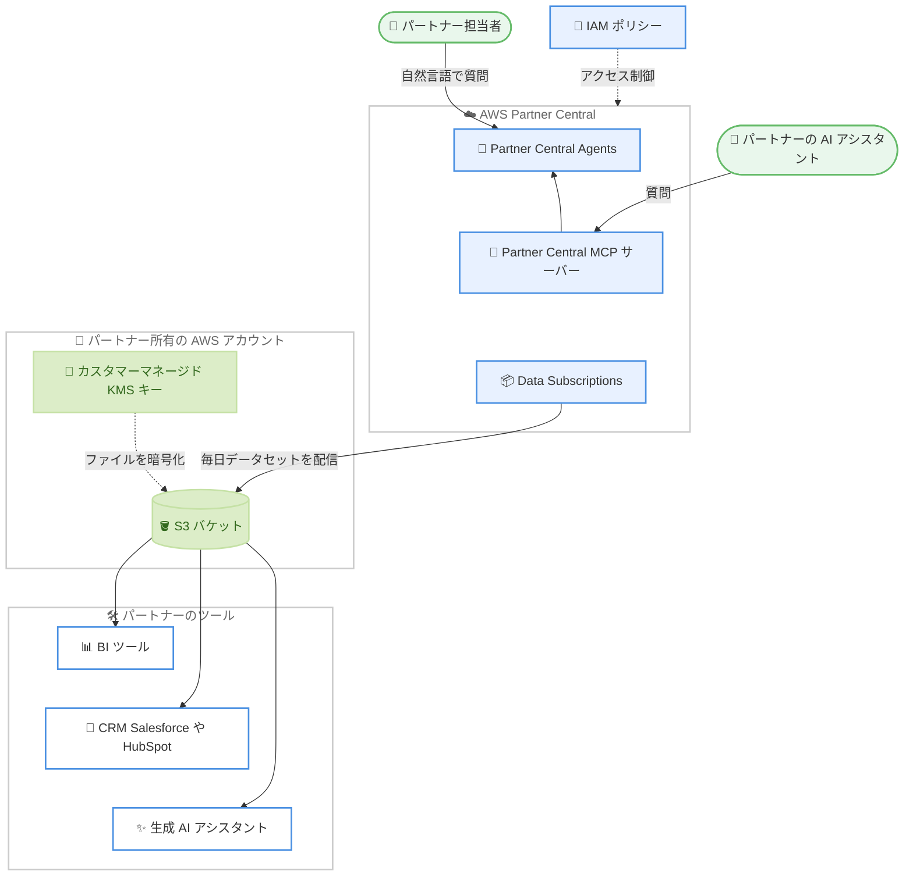

# AWS Partner Central - Partner Central Agents と Data Subscriptions による分析データアクセスの拡張

**リリース日**: 2026 年 11 月 23 日
**サービス**: AWS Partner Central
**機能**: Partner Central Agents による分析データへの自然言語アクセスと Data Subscriptions による S3 へのデータセット配信

📊 [このアップデートのインフォグラフィックを見る](https://takech9203.github.io/aws-news-summary/20261123-partner-analytics-agent-s3.html)

## 概要

AWS Partner Central に、分析データへアクセスする 2 つの新しい方法が追加されました。1 つ目は **Partner Central Agents** で、リード、マーケティングキャンペーン、商談 (Opportunity) とパイプライン、ファンディングに関する質問を自然言語で行い、ダッシュボードの操作やスプレッドシートへのエクスポートなしに回答を得られます。AWS Marketplace の出品者は、利用状況 (Usage)、契約 (Agreements)、更新 (Renewals)、請求、回収、支払いに関する質問も可能です。同じ機能は Partner Central の Model Context Protocol (MCP) サーバー経由で、パートナー自身の AI アシスタントからも利用できます。

2 つ目は **Data Subscriptions** で、すぐに利用可能なデータセットがパートナー所有の Amazon S3 バケットに毎日配信されます。対象データセットには、リード、マーケティングキャンペーン、パートナーアカウント関係、商談とパイプライン、Marketplace の利用状況・契約・更新が含まれます。データはパートナー自身のバケットに配置されるため、BI ツール、Salesforce や HubSpot などの CRM、生成 AI アシスタントと連携したカスタムレポーティングに活用できます。

いずれの機能も既存の IAM ポリシーに基づいて動作するため、パートナーは既に閲覧を許可されているデータのみにアクセスでき、エクスポートされたデータは自身の AWS アカウント内に保持されます。AWS パートナーおよび AWS Marketplace 出品者のアライアンス、オペレーション、分析チームにとって重要なアップデートです。

**アップデート前の課題**

- 以前は分析データを確認するために Partner Central のダッシュボードを操作するか、スプレッドシートに手動でエクスポートする必要があった
- パイプラインやリードのデータを BI ツールや CRM に取り込むには、独自のエクスポートパイプラインを構築・維持する必要があった
- Marketplace の利用状況や請求などのデータを横断的に照会するには、複数の画面やレポートを確認する必要があった

**アップデート後の改善**

- Partner Central Agents に自然言語で質問するだけで、リード、キャンペーン、パイプライン、ファンディングなどの分析情報を即座に取得できるようになった
- Data Subscriptions により、独自のエクスポートパイプラインを構築せずに、データセットが毎日自動的に自社の S3 バケットへ配信されるようになった
- Partner Central MCP サーバーを通じて、パートナー自身の AI アシスタントやツールから同じ分析機能を利用できるようになった

## アーキテクチャ図



Partner Central Agents は自然言語の質問に直接回答し、Data Subscriptions はデータセットをパートナー所有の S3 バケットに毎日配信して BI ツール、CRM、生成 AI アシスタントとの連携を可能にします。

## サービスアップデートの詳細

### 主要機能

1. **Partner Central Agents による自然言語での分析**
   - リード、マーケティングキャンペーン、商談とパイプライン、ファンディングに関する質問に自然言語で回答
   - AWS Marketplace 出品者は、利用状況、契約、更新、請求、回収、支払いについても質問可能
   - ダッシュボードの操作やスプレッドシートへのエクスポートが不要
   - 例: 「今四半期の上位の商談は何か?」といった質問を Partner Central にサインインして実行

2. **Partner Central MCP サーバー経由のアクセス**
   - Partner Central Agents と同じ分析機能を、パートナー自身の AI アシスタントから利用可能
   - Model Context Protocol (MCP) に対応したツールと連携し、既存のワークフローに組み込める

3. **Data Subscriptions による S3 へのデータセット配信**
   - すぐに利用可能なデータセットを、パートナー所有の Amazon S3 バケットへ毎日配信
   - 対象データセット: リード、マーケティングキャンペーン、パートナーアカウント関係、商談とパイプライン、Marketplace の利用状況・契約・更新
   - 1 つのサブスクリプションが 1 つのデータセットを 1 つのバケットに配信し、複数のサブスクリプションで同じバケットを共有することも可能
   - 配信されるファイルはパートナーが指定するカスタマーマネージド AWS KMS キーで暗号化

4. **既存の IAM ポリシーに基づくアクセス制御**
   - 両機能とも既存の IAM ポリシーを利用するため、閲覧が許可されているデータのみにアクセス可能
   - エクスポートされたデータはパートナー自身の AWS アカウント内に保持される
   - AWS Partner Central はバケットへの書き込みのみを行い、オブジェクトの読み取り、一覧表示、削除は行わない

## 技術仕様

### Data Subscriptions の仕様

| 項目 | 詳細 |
|------|------|
| 配信頻度 | 毎日 |
| 配信先 | パートナー所有の Amazon S3 バケット |
| 暗号化 | カスタマーマネージド AWS KMS キー (AWS 所有キーや他アカウントのキーは不可、エイリアス ARN は不可) |
| バケット要件 | AWS KMS キーと同一リージョン。オプトインリージョンは非対応 |
| サブスクリプション単位 | 1 サブスクリプション = 1 データセット × 1 バケット |
| 変更 | 作成後の変更は不可。変更する場合はキャンセルして再作成 |
| Partner Central の権限 | `s3:PutObject` のみ (読み取り・一覧表示・削除の権限は付与しない) |

### 主なパートナーデータセット

| データセット | バケット内フォルダ | 内容 |
|------|------|------|
| ACE Opportunity Pipeline | `opportunity_pipeline` | 商談のライフサイクルデータ (ステージ、MRR/ARR、勝敗、所有者、地域・セグメント・業種) |
| ACE Leads | `leads` | ACE Lead Tool のリードデータ (AWS 共有・パートナーインポート、承認、確度ステージ、商談への転換) |
| Partner Marketing Campaigns | `marketing_campaigns` | キャンペーンごとのリードフロー、商談アトリビューション、パイプラインメトリクス |
| Partner Discount Business Report | `discount_business_report` | チャネル・リセールパートナー向けの詳細請求レポート (当月と過去 6 か月) |
| Partner Account Relationships | `account_relationships` | ディストリビューション販売者と請求移管関係にあるエンドカスタマーアカウント情報 |

### バケットポリシーの例

AWS Partner Central がパートナーのアカウントに代わってファイルを書き込めるようにするには、以下のステートメントをバケットポリシーに追加します。

```json
{
    "Version": "2012-10-17",
    "Statement": [
        {
            "Sid": "AllowAWSDataSubscriptionsPutObject",
            "Effect": "Allow",
            "Principal": {
                "Service": "datasubscriptions.partnercentral.amazonaws.com"
            },
            "Action": "s3:PutObject",
            "Resource": "arn:aws:s3:::amzn-s3-demo-bucket/*",
            "Condition": {
                "StringEquals": {
                    "aws:SourceAccount": "111122223333"
                }
            }
        }
    ]
}
```

あわせて、KMS キーポリシーには `kms:GenerateDataKey` を許可するステートメント (`kms:ViaService` 条件で S3 経由に限定) を追加します。Partner Central にデータの復号権限を付与する必要はありません。

## 設定方法

### 前提条件

1. AWS Partner Central アカウントにリンクされた AWS アカウントを保有していること
2. AWS KMS キーと同一リージョンに Amazon S3 バケットを作成済みであること (オプトインリージョンは非対応)
3. 同一アカウント内にカスタマーマネージド AWS KMS キーを作成済みであること
4. バケットポリシーと KMS キーポリシーを編集できる権限、および Data Subscriptions 操作に必要な IAM 権限があること

### 手順

#### ステップ 1: Partner Central Agents に質問する

1. AWS Partner Central にサインイン
2. エージェントに自然言語で質問する (例: 「What are my top opportunities this quarter?」)

サインインするだけで利用でき、既存の IAM ポリシーで許可された範囲のデータに基づいて回答が返されます。

#### ステップ 2: S3 バケットと KMS キーを準備する

```bash
# S3 バケットを作成 (KMS キーと同一リージョン)
aws s3api create-bucket --bucket amzn-s3-demo-bucket --region us-east-1

# カスタマーマネージド KMS キーを作成
aws kms create-key --description "Partner Central Data Subscriptions"
```

配信先となる S3 バケットと、配信ファイルの暗号化に使用するカスタマーマネージド KMS キーを作成します。その後、前述のバケットポリシーとキーポリシーを適用します。

#### ステップ 3: Data Subscriptions を作成する

1. AWS Partner Central にサインイン
2. [Settings] から [Data Subscriptions] に移動
3. 配信するデータセット、配信先バケット、KMS キーの ARN を指定してサブスクリプションを作成

作成後、指定したデータセットが毎日 S3 バケットの対応するフォルダに配信されます。サブスクリプションは作成後に変更できないため、設定を変更する場合はキャンセルして再作成します。

## メリット

### ビジネス面

- **意思決定の迅速化**: ダッシュボード操作やエクスポート作業なしに、自然言語の質問でパイプラインやリードの状況を即座に把握できる
- **運用負荷の削減**: 独自のエクスポートパイプラインの構築・保守が不要になり、アライアンスチームや分析チームの工数を削減できる
- **既存ツールの活用**: データが自社の S3 バケットに配信されるため、既存の BI ツールや CRM (Salesforce、HubSpot など) をそのまま活用できる

### 技術面

- **MCP 対応による拡張性**: Partner Central MCP サーバー経由で、自社の AI アシスタントやエージェントワークフローに分析機能を組み込める
- **セキュアなデータ配信**: カスタマーマネージド KMS キーによる暗号化と最小権限のバケットポリシー (`s3:PutObject` のみ) により、データの管理権をパートナー側が保持できる
- **一貫したアクセス制御**: 既存の IAM ポリシーに基づいて動作するため、新たな権限モデルを設計する必要がない

## デメリット・制約事項

### 制限事項

- Data Subscriptions は作成後に変更できず、データセット・バケット・キーを変更するにはキャンセルして再作成する必要がある
- S3 バケットは KMS キーと同一リージョンに配置する必要があり、オプトインリージョンはサポートされない
- 暗号化にはカスタマーマネージド KMS キーが必須で、AWS 所有キーや他アカウントのキー、エイリアス ARN は使用できない

### 考慮すべき点

- 配信されたデータへのアクセス権は、バケットポリシー、IAM ポリシー、KMS キーポリシーで決まるため、サブスクリプション作成前および運用中も継続的にアクセス権のレビューが必要
- バケットポリシーの `Resource` にプレフィックスのみを指定すると配信がブロックされる可能性があるため、ドキュメントどおり `/*` を指定する必要がある
- KMS キーの利用に伴う AWS KMS の料金や、S3 のストレージ料金が自社アカウント側に発生する点を考慮する

## ユースケース

### ユースケース 1: アライアンスチームによるパイプラインの即時把握

**シナリオ**: アライアンス担当者が、四半期レビューの前に主要な商談の状況やリードの転換状況を素早く確認したい。

**実装例**:
```
Partner Central にサインインし、エージェントに質問する。
「What are my top opportunities this quarter?」
「先月のキャンペーン経由で創出されたリードの件数は?」
```

**効果**: ダッシュボードを行き来したりスプレッドシートを加工したりすることなく、数秒で必要な分析結果を取得できる。

### ユースケース 2: 自社 BI 基盤・CRM への自動データ連携

**シナリオ**: パートナー企業が、ACE の商談パイプラインデータを自社のデータウェアハウスに毎日取り込み、Salesforce のダッシュボードと組み合わせて co-sell の状況を可視化したい。

**実装例**:
```
1. S3 バケットとカスタマーマネージド KMS キーを用意し、ポリシーを適用
2. Data Subscriptions で ACE Opportunity Pipeline データセットを購読
3. S3 イベント通知や ETL ジョブで opportunity_pipeline フォルダの
   新着ファイルをデータウェアハウスにロードし、BI/CRM と連携
```

**効果**: エクスポートパイプラインを自作することなく、毎日最新のパイプラインデータを自社の分析基盤に取り込める。

### ユースケース 3: 自社 AI アシスタントからの co-sell 支援

**シナリオ**: パートナー企業が社内で利用している AI アシスタントから、Partner Central の分析データを直接参照し、営業チームの co-sell 活動を支援したい。

**実装例**:
```
1. 自社の AI アシスタントを Partner Central MCP サーバーに接続
2. 営業担当者がアシスタント経由で商談やファンディングの状況を質問
3. 回答は既存の IAM ポリシーで許可された範囲のデータに限定される
```

**効果**: 営業担当者が普段使用しているツールを離れることなく、Partner Central の分析情報を活用した co-sell 活動を実現できる。

## 料金

公式発表に料金に関する記載はありません。なお、Data Subscriptions の利用では、配信先の S3 バケットのストレージ料金やカスタマーマネージド KMS キーに関する AWS KMS の料金が、パートナー自身の AWS アカウントに発生する点に留意してください。

## 利用可能リージョン

AWS Partner Central が利用可能なすべての AWS リージョンで利用できます。ただし、Data Subscriptions の配信先 S3 バケットと KMS キーは同一リージョンに配置する必要があり、オプトインリージョンはサポートされません。

## 関連サービス・機能

- **Amazon S3**: Data Subscriptions のデータセット配信先。パートナーがバケットの管理権を保持し、Partner Central は書き込みのみを行う
- **AWS KMS**: 配信ファイルの暗号化に使用するカスタマーマネージドキーを提供。`kms:GenerateDataKey` のみを Partner Central に許可する
- **AWS IAM**: Partner Central Agents と Data Subscriptions の両方で、既存の IAM ポリシーに基づくアクセス制御を実施
- **AWS Marketplace**: 出品者は利用状況、契約、更新、請求、回収、支払いに関するデータへのアクセスが可能
- **Model Context Protocol (MCP)**: Partner Central MCP サーバーを通じて、パートナー自身の AI アシスタントから分析機能を利用可能

## 参考リンク

- 📊 [インフォグラフィック](https://takech9203.github.io/aws-news-summary/20261123-partner-analytics-agent-s3.html)
- [公式発表 (What's New)](https://aws.amazon.com/about-aws/whats-new/2026/11/partner-analytics-agent-s3/)
- [AWS Blog: Reach more customers, close deals faster with new AI-powered capabilities in AWS Partner Central](https://aws.amazon.com/blogs/apn/new-ai-powered-capabilities-in-aws-partner-central/)
- [ドキュメント: Delivering partner data to your account with data subscriptions](https://docs.aws.amazon.com/partner-central/latest/getting-started/data-subscriptions.html)
- [ドキュメント: Delivering seller reporting data to your account with data subscriptions (AWS Marketplace Seller Guide)](https://docs.aws.amazon.com/marketplace/latest/userguide/data-subscriptions.html)

## まとめ

AWS Partner Central の Partner Central Agents と Data Subscriptions により、パートナーは自然言語での即時の分析と、自社 S3 バケットへの毎日のデータセット配信という 2 つの方法で分析データを活用できるようになりました。ダッシュボード操作や独自パイプラインの構築が不要になるため、AWS パートナーや Marketplace 出品者は、まず Partner Central Agents で質問を試し、継続的なデータ活用が必要な場合は Data Subscriptions のセットアップ (S3 バケット、KMS キー、ポリシー設定) を進めることを推奨します。
