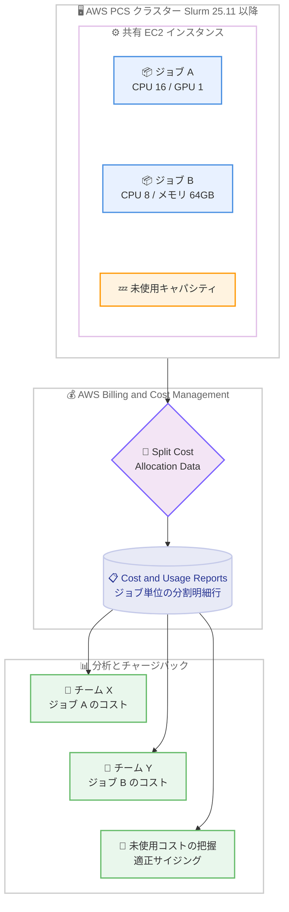

# AWS Parallel Computing Service - Split Cost Allocation Data 対応

**リリース日**: 2026 年 11 月 23 日
**サービス**: AWS Parallel Computing Service (PCS)
**機能**: Split Cost Allocation Data (分割コスト配分データ) による Slurm ジョブ単位のコスト可視化

📊 [このアップデートのインフォグラフィックを見る](https://takech9203.github.io/aws-news-summary/20261123-pcs-supports-split-cost-data.html)

## 概要

AWS Parallel Computing Service (PCS) が、AWS Cost and Usage Reports (CUR) における Split Cost Allocation Data (分割コスト配分データ) に対応しました。これにより、PCS クラスター上で実行される Slurm ジョブ単位での詳細なコスト可視化が可能になり、ジョブごとのコスト分析、最適化、チャージバック (費用の按分請求) を実現できます。

Split Cost Allocation Data は、共有リソースのコストをそれを利用するワークロードに分割して配分する CUR の機能です。PCS では Slurm ジョブが分割対象のサブリソース、EC2 インスタンスが親リソースとなり、各ジョブがインスタンス上で要求した CPU、メモリ、GPU リソースに基づいてジョブレベルのコストが生成されます。コストはジョブ、ユーザー、Slurm アカウント、キュー、コンピュートノードグループ、ノード、クラスターの各単位で集計できます。

HPC クラスターは複数のチームやプロジェクトで共有されることが一般的であり、本アップデートは研究機関や製造業など、共有クラスターの利用部門ごとに正確なコスト配分を求める組織にとって重要な機能強化です。

**アップデート前の課題**

- CUR では EC2 インスタンスレベルのコストしか把握できず、同一インスタンス上で実行される複数の Slurm ジョブへのコスト配分ができなかった
- 共有 HPC クラスターのコストをチームやプロジェクト単位でチャージバックするには、Slurm のアカウンティングデータと AWS の請求データを突き合わせる独自の仕組みを構築する必要があった
- アイドル状態のコアやノードなど、どのジョブにも割り当てられていない未使用キャパシティのコストを定量的に把握することが困難だった

**アップデート後の改善**

- Slurm ジョブが要求した CPU、メモリ、GPU リソースに基づき、ジョブ単位のコストが CUR に自動的に記録されるようになった
- ジョブ、ユーザー、Slurm アカウント、キュー、コンピュートノードグループ、ノード、クラスターの各単位でコストを集計し、チームやプロジェクトへのチャージバックが可能になった
- 作業待ちのアイドルコアやノードなどの未配分キャパシティを特定でき、クラスターの適正サイジングと非効率の削減に活用できるようになった

## アーキテクチャ図



共有 EC2 インスタンス上で実行される各 Slurm ジョブの要求リソース (CPU、メモリ、GPU) に基づき、インスタンスのコストがジョブ単位の明細行として CUR に分割記録され、チームごとのチャージバックや未使用コストの分析に利用できます。

## サービスアップデートの詳細

### 主要機能

1. **ジョブレベルのコスト可視化**
   - 各 Slurm ジョブが要求した EC2 の CPU、メモリ、GPU リソースに基づいてコストを配分
   - インスタンスの償却コストとジョブのリソース要求割合からジョブ単位のコストを算出
   - ジョブ、ユーザー、Slurm アカウント、キュー、コンピュートノードグループ、ノード、クラスターの各単位で集計可能

2. **コスト配分タグの自動有効化**
   - オプトインすると、PCS が Slurm ジョブの属性をコスト配分タグとして自動的に有効化
   - タグはデフォルトで有効化され、CUR での分析にそのまま利用可能 (過去に無効化したタグキーがある場合はその設定が維持される)

3. **未使用キャパシティの特定**
   - どのジョブにも配分されなかったコスト (アイドルコアや作業待ちのノードなど) を未使用コストとして記録
   - クラスターの適正サイジングや非効率の削減に活用可能

4. **GPU を含むアクセラレーテッドコンピューティング対応**
   - ジョブが `gpu` ジェネリックリソース (GRES) として要求した GPU のコストを配分
   - GPU 搭載インスタンスではアクセラレーター、CPU、メモリの 3 種類の使用レコードを時間単位で生成

## 技術仕様

### 自動有効化されるコスト配分タグ

| タグキー | 内容 |
|------|------|
| `aws:pcs:cluster-name` | AWS PCS クラスターの ID |
| `aws:pcs:slurm-account` | ジョブを実行した Slurm アカウント (組織、グループ、プロジェクトなど。AWS アカウントではない) |
| `aws:pcs:slurm-job-id` | Slurm ジョブ ID |
| `aws:pcs:username` | ジョブを送信したユーザー |
| `aws:pcs:queue` | ジョブを実行したキュー (Slurm パーティション) |
| `aws:pcs:compute-node-group` | インスタンスを提供したコンピュートノードグループ |
| `aws:pcs:node-name` | ジョブを実行した Slurm ノード名 |

### コストデータの挙動

| 項目 | 詳細 |
|------|------|
| コスト算出基準 | ジョブが**要求した**リソースに基づく (`splitLineItem/ActualUsage` 列は PCS では空) |
| サスペンド時間 | ジョブのサスペンド中の時間は課金対象外 |
| 対象期間 | 2026 年 11 月 17 日以降の使用分をカバー (それ以前から実行中のジョブは同日から課金記録) |
| 最小ジョブ時間 | 最小ジョブ実行時間の制限なし |
| 明細行の増加量 | ジョブごと・インスタンスごとに 1 時間あたり 2 レコード (GPU 等のアクセラレーテッドインスタンスでは 3 レコード) を追加 |

### CUR 明細行数の見積もり式

```text
# 通常のインスタンスの場合 (1 日あたり)
(ジョブ数 × ジョブあたり平均インスタンス数 × 平均ジョブ実行時間 × 2) × 24

# アクセラレーテッドコンピューティングインスタンスの場合 (1 日あたり)
(ジョブ数 × ジョブあたり平均インスタンス数 × 平均ジョブ実行時間 × 3) × 24
```

## 設定方法

### 前提条件

1. AWS PCS クラスターが Slurm バージョン 25.11 以降で稼働していること
2. AWS Billing and Cost Management へのアクセス権限があること
3. CUR (レガシー CUR または CUR 2.0 エクスポート) を利用できること

### 手順

#### ステップ1: Split Cost Allocation Data へのオプトイン

Billing and Cost Management コンソールの [Cost Management preferences] で、AWS PCS の Split Cost Allocation Data を有効化します。詳細は [Enabling split cost allocation data](https://docs.aws.amazon.com/cur/latest/userguide/enabling-split-cost-allocation-data.html) を参照してください。

#### ステップ2: CUR への分割コスト配分データの追加

新規または既存の CUR レポート (またはデータエクスポート) の設定で、Split Cost Allocation Data を含めるように構成します。これにより、ジョブ単位の分割明細行がレポートに出力されるようになります。

#### ステップ3: レポートの確認と分析

出力された CUR で `splitLineItem` 列と `aws:pcs:*` タグを使用してジョブ単位のコストを分析します。列の定義は [Split line item details](https://docs.aws.amazon.com/cur/latest/userguide/split-line-item-columns.html) を参照してください。Amazon Athena や Amazon QuickSight と組み合わせることで、チームやプロジェクト単位のダッシュボードを構築できます。

## メリット

### ビジネス面

- **正確なチャージバック**: 共有 HPC クラスターのコストを、実際のリソース要求量に基づいてチームやプロジェクトに公平に配分できる
- **コスト最適化の推進**: 未使用キャパシティのコストが定量化されるため、クラスターの適正サイジングの判断材料になる
- **説明責任の向上**: ユーザーや Slurm アカウント単位でコストを可視化することで、利用部門のコスト意識を高められる

### 技術面

- **独自ツールが不要**: Slurm アカウンティングと AWS 請求データを突き合わせる独自のコスト配分システムを構築・運用する必要がなくなる
- **タグの自動有効化**: オプトインするだけで 7 種類の Slurm ジョブ属性タグが自動的に有効化され、追加の設定なしで分析に利用できる
- **GPU コストの配分**: `gpu` GRES として要求された GPU のコストもジョブ単位で配分され、AI/ML や計算集約型ワークロードのコスト追跡が可能

## デメリット・制約事項

### 制限事項

以下の状況では、該当インスタンスのその時間帯の分割コスト配分データは生成されず、EC2 インスタンスのコストがジョブ単位に分割されずにそのまま CUR に記録されます。

- ジョブ実行中にコンピュートノードグループの `MemSpecLimit`、`CpuSpecList`、`RealMemory` を変更した場合
- サスペンドされたジョブが、他のジョブが使用中の CPU 上で再開された場合
- `OverSubscribe=YES` の Slurm パーティションで `--oversubscribe` オプションを使用したジョブがインスタンスの保有量を超えるリソースを要求した場合 (オーバーサブスクリプションは `OverSubscribe=FORCE` のパーティションのみサポート)

また、以下の GPU 構成では分割コスト配分データ自体は生成されますが、GPU コストは未使用コストとして記録されます。

- Multi-Instance GPU (MIG) は未サポート。いずれかの GPU で MIG が有効なインスタンスでは、そのインスタンスの全 GPU コストが未使用コストとして表示される
- GPU 共有は未サポート。Slurm の `shard` や `mps` リソースで共有される GPU は未使用コストとして表示される

### 考慮すべき点

- Slurm 25.11 以降が必須のため、既存クラスターではスケジューラーのバージョンアップが必要になる場合がある
- コストは実際の使用量ではなく**要求量**ベースで配分されるため、ジョブのリソース要求が過大な場合はそのままコストに反映される (リソース要求の適正化が重要)
- ジョブ数が多い大規模クラスターでは CUR の明細行数が大幅に増加するため、Athena などでのクエリコストやデータ量に留意が必要
- AWS GovCloud (US) リージョンでは利用不可

## ユースケース

### ユースケース1: 研究部門ごとのチャージバック

**シナリオ**: 複数の研究チームが共有する PCS クラスターで、各チームの実際のリソース消費に応じてコストを配分したい。

**実装例**:
```sql
-- Athena での CUR クエリ例: Slurm アカウント別の月次コスト集計
SELECT
  resource_tags['aws:pcs:slurm-account'] AS slurm_account,
  SUM(CAST(split_line_item_split_cost AS DOUBLE)) AS allocated_cost
FROM cur_table
WHERE bill_billing_period_start_date = DATE '2026-12-01'
  AND split_line_item_split_cost IS NOT NULL
GROUP BY resource_tags['aws:pcs:slurm-account']
ORDER BY allocated_cost DESC;
```

**効果**: Slurm アカウント (研究チーム) 単位の正確なコストを自動的に算出でき、手作業による按分計算が不要になる。

### ユースケース2: GPU ワークロードのコスト追跡

**シナリオ**: AI/ML トレーニングジョブが GPU インスタンスをどの程度効率的に使用しているかを把握し、高額な GPU コストを最適化したい。

**実装例**:
```bash
# ジョブ送信時に GPU を GRES として明示的に要求する
# 分割コスト配分の対象にするには gpu GRES としての要求が必要
sbatch --gres=gpu:4 --partition=gpu-queue train_model.sh
```

**効果**: ジョブ単位の GPU コストと未使用 GPU コストが可視化され、GPU 要求数の適正化やキュー設計の見直しに役立つ。

### ユースケース3: クラスターの適正サイジング

**シナリオ**: 静的なコンピュートノードグループを運用しており、アイドルリソースによる無駄なコストを削減したい。

**実装例**:
```sql
-- Athena での CUR クエリ例: ノードグループ別の未使用コスト集計
SELECT
  resource_tags['aws:pcs:compute-node-group'] AS node_group,
  SUM(CAST(split_line_item_unused_cost AS DOUBLE)) AS unused_cost
FROM cur_table
WHERE bill_billing_period_start_date = DATE '2026-12-01'
GROUP BY resource_tags['aws:pcs:compute-node-group']
ORDER BY unused_cost DESC;
```

**効果**: 未使用コストが大きいノードグループを特定し、スケーリング設定やインスタンスサイズの見直しによってクラスター全体の費用対効果を改善できる。

## 料金

公式発表に Split Cost Allocation Data の有効化に伴う追加料金の記載はありません。CUR 自体の利用では、レポートを保存する Amazon S3 のストレージ料金が発生します。なお、分割コスト配分データを有効にするとジョブ数に応じて CUR の明細行数が増加するため、Athena クエリなど下流の分析コストへの影響を考慮してください。

## 利用可能リージョン

AWS PCS が利用可能なすべての AWS 商用リージョンで利用できます。ただし、AWS GovCloud (US) リージョンは対象外です。PCS の利用可能リージョンは [Service endpoints](https://docs.aws.amazon.com/pcs/latest/userguide/service-endpoints-quotas.html) を参照してください。

## 関連サービス・機能

- **AWS Cost and Usage Reports (CUR)**: 分割コスト配分データの出力先。レガシー CUR と CUR 2.0 エクスポートの両方に対応
- **Amazon ECS / Amazon EKS**: 同じ Split Cost Allocation Data の仕組みで、タスク単位・ポッド単位のコスト配分に対応済み。PCS はこれに続く対応
- **Amazon Athena / Amazon QuickSight**: CUR データのクエリと可視化に利用し、チャージバックレポートやダッシュボードを構築可能
- **AWS Billing and Cost Management**: Cost Management preferences からのオプトインと、コスト配分タグの管理を実施

## 参考リンク

- 📊 [インフォグラフィック](https://takech9203.github.io/aws-news-summary/20261123-pcs-supports-split-cost-data.html)
- [公式発表 (What's New)](https://aws.amazon.com/about-aws/whats-new/2026/11/pcs-supports-split-cost-data/)
- [AWS PCS User Guide - View costs by job with split cost allocation data](https://docs.aws.amazon.com/pcs/latest/userguide/monitoring-cost-allocation.html)
- [AWS CUR User Guide - Understanding split cost allocation data](https://docs.aws.amazon.com/cur/latest/userguide/split-cost-allocation-data.html)
- [AWS CUR User Guide - Enabling split cost allocation data](https://docs.aws.amazon.com/cur/latest/userguide/enabling-split-cost-allocation-data.html)
- [AWS Cost and Usage Reports](https://aws.amazon.com/aws-cost-management/aws-cost-and-usage-reporting/)

## まとめ

AWS PCS の Split Cost Allocation Data 対応により、共有 HPC クラスターのコストを Slurm ジョブ単位で可視化し、チームやプロジェクトへの正確なチャージバックと未使用キャパシティの特定が可能になりました。複数部門で PCS クラスターを共有している組織は、Slurm 25.11 以降へのアップグレードを確認のうえ、Cost Management preferences でのオプトインと CUR への分割コスト配分データの追加を検討することを推奨します。
