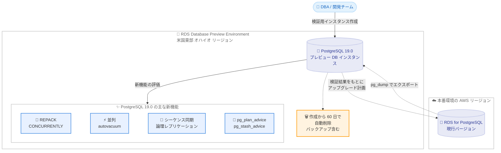

# Amazon RDS for PostgreSQL - RDS Database Preview Environment での PostgreSQL 19.0 サポート

**リリース日**: 2026 年 11 月 23 日
**サービス**: Amazon RDS for PostgreSQL
**機能**: Amazon RDS Database Preview Environment における PostgreSQL 19.0 の提供

📊 [このアップデートのインフォグラフィックを見る](https://takech9203.github.io/aws-news-summary/20261123-postgresql-19-amazon-rds-database-preview-environment.html)

## 概要

Amazon RDS for PostgreSQL が、Amazon RDS Database Preview Environment で PostgreSQL 19.0 の評価をサポートしました。Database Preview Environment は、PostgreSQL コミュニティの新バージョンを本番採用前にマネージド環境で試せる専用のプレビュー環境であり、RDS の運用体験をそのままに新バージョンの機能検証や互換性テストを実施できます。

PostgreSQL 19.0 では、最小限のロックでテーブルとインデックスの肥大化 (ブロート) を解消する CONCURRENTLY オプション付きの新しい REPACK コマンド、インデックス vacuum を高速化する並列 autovacuum、シーケンス値をサブスクライバーに同期できる論理レプリケーションの強化、クエリプランナーの判断を誘導する新しい拡張機能 pg_plan_advice / pg_stash_advice が導入されています。

本アップデートの対象は、PostgreSQL の新メジャーバージョンへのアップグレードを計画しているデータベース管理者や、自社アプリケーション・拡張機能の互換性を早期に検証したい開発チームです。プレビュー環境の DB インスタンスは作成から最大 60 日で自動削除されるため、本番利用ではなく評価・検証用途に位置付けられています。

**アップデート前の課題**

- PostgreSQL 19.0 の新機能をマネージドな RDS 環境で試す手段がなく、検証にはセルフマネージドな環境を自前で構築する必要があった
- テーブル・インデックスの肥大化解消には VACUUM FULL などによる強いロックを伴う操作が必要で、本番ワークロードへの影響が大きかった
- autovacuum によるインデックス vacuum は並列化されておらず、大規模テーブルではメンテナンスに時間がかかっていた
- 論理レプリケーションではシーケンス値がサブスクライバーに同期されず、フェイルオーバーや移行時にシーケンスの再設定が必要だった

**アップデート後の改善**

- RDS Database Preview Environment で PostgreSQL 19.0 の DB インスタンスを作成し、新機能をマネージド環境で評価できるようになった
- REPACK コマンドの CONCURRENTLY オプションにより、最小限のロックでテーブルとインデックスの肥大化を解消する手法を事前に検証できるようになった
- 並列 autovacuum によるインデックス vacuum の高速化を実ワークロードに近い構成で確認できるようになった
- シーケンス値を同期する論理レプリケーションや、pg_plan_advice / pg_stash_advice によるプランナー誘導を本番採用前にテストできるようになった

## アーキテクチャ図



本番環境のデータを pg_dump / pg_restore でプレビュー環境に取り込み、PostgreSQL 19.0 の新機能と互換性を検証したうえで、本番のアップグレード計画に反映する流れを示しています。

## サービスアップデートの詳細

### 主要機能

1. **REPACK コマンドの CONCURRENTLY オプション**
   - テーブルとインデックスの肥大化を最小限のロックで解消できる新コマンド
   - 従来の VACUUM FULL のような長時間の排他ロックを避けながら、ストレージの再編成が可能
   - オンラインでのメンテナンスを前提とした運用設計を検証できる

2. **並列 autovacuum**
   - autovacuum によるインデックス vacuum が並列実行に対応し、処理が高速化
   - 多数のインデックスを持つ大規模テーブルでのメンテナンス時間短縮が期待できる

3. **シーケンス値を同期する論理レプリケーション**
   - 論理レプリケーションでシーケンス値をサブスクライバーに同期可能
   - レプリケーションを利用した移行やフェイルオーバー時に、シーケンスの手動調整が不要になる

4. **pg_plan_advice / pg_stash_advice 拡張機能**
   - クエリプランナーの判断を誘導するための新しい拡張機能
   - 実行計画の安定化やチューニングの新しい選択肢として評価できる

5. **Database Preview Environment での提供**
   - RDS のマネージド環境で PostgreSQL 19.0 を評価可能
   - DB インスタンスは作成から最大 60 日間保持され、その後バックアップ・スナップショットとともに自動削除される
   - pg_dump / pg_restore などの標準機能でデータベースの持ち込み・持ち出しが可能

## 技術仕様

### Database Preview Environment の仕様

| 項目 | 詳細 |
|------|------|
| 提供リージョン | 米国東部 (オハイオ) リージョン |
| 保持期間 | DB インスタンス作成から最大 60 日 (以降はバックアップ・スナップショットとともに自動削除) |
| スナップショット | 本番環境へのコピー不可、クロスリージョンコピー非対応 |
| リードレプリカ | クロスリージョンリードレプリカ非対応 |
| ネットワーク | Amazon VPC 内での作成のみ |
| ストレージ | 汎用 SSD、プロビジョンド IOPS SSD のみ |
| デプロイ構成 | シングル AZ / マルチ AZ の両方に対応 |
| サポート | AWS Support 対象外 (AWS re:Post での質問が可能) |
| データ移行 | PostgreSQL 標準の dump / load 機能を使用 |

### PostgreSQL 19.0 の主な新機能

| 機能 | 概要 |
|------|------|
| REPACK + CONCURRENTLY | 最小限のロックでテーブル・インデックスの肥大化を解消 |
| 並列 autovacuum | インデックス vacuum の並列化による高速化 |
| 論理レプリケーションの強化 | シーケンス値をサブスクライバーに同期 |
| pg_plan_advice / pg_stash_advice | クエリプランナーの判断を誘導する新しい拡張機能 |

## 設定方法

### 前提条件

1. AWS アカウントを保有していること
2. 米国東部 (オハイオ) リージョンに VPC が構成されていること
3. 評価目的であること (本番利用は不可)

### 手順

#### ステップ 1: Database Preview Environment コンソールへアクセス

```text
https://console.aws.amazon.com/rds-preview/
```

通常の RDS コンソールとは別の、Database Preview Environment 専用コンソールにアクセスします。

#### ステップ 2: PostgreSQL 19.0 の DB インスタンスを作成

コンソールで [データベースの作成] を選択し、エンジンバージョンとして PostgreSQL 19.0 を指定します。VPC、インスタンスクラス、ストレージタイプ (汎用 SSD またはプロビジョンド IOPS SSD) を選択して作成します。

#### ステップ 3: 既存データベースの取り込みと検証

```bash
# 既存環境からデータベースをエクスポート
pg_dump -h <既存の DB エンドポイント> -U <ユーザー名> -Fc -d mydb > mydb.dump

# プレビュー環境のインスタンスへインポート
pg_restore -h <プレビュー DB エンドポイント> -U <ユーザー名> -d mydb mydb.dump
```

pg_dump で既存データベースのバックアップを取得し、pg_restore でプレビュー環境の PostgreSQL 19.0 インスタンスに復元しています。復元後、アプリケーションの互換性テストや新機能 (REPACK CONCURRENTLY、並列 autovacuum など) の評価を実施します。

## メリット

### ビジネス面

- **アップグレードリスクの低減**: 本番採用前に PostgreSQL 19.0 との互換性を検証でき、メジャーバージョンアップに伴う障害リスクを減らせる
- **検証環境構築コストの削減**: セルフマネージドな検証環境を構築・運用することなく、マネージドな RDS 環境で新バージョンを評価できる
- **早期のアップグレード計画立案**: 新機能の効果を事前に把握し、アップグレードの投資対効果を見積もったうえで計画を立てられる

### 技術面

- **オンラインメンテナンスの検証**: REPACK CONCURRENTLY により、ロック影響を最小化した肥大化解消の運用手順を事前に確立できる
- **メンテナンス時間の短縮効果の確認**: 並列 autovacuum によるインデックス vacuum の高速化を、自社ワークロードに近い構成で測定できる
- **移行設計の簡素化**: シーケンス値を同期する論理レプリケーションにより、移行・フェイルオーバー手順からシーケンス再設定の工程を省ける見込みを検証できる

## デメリット・制約事項

### 制限事項

- DB インスタンスは作成から 60 日後にバックアップ・スナップショットとともに自動削除される
- プレビュー環境で作成したスナップショットは本番環境へコピーできない
- クロスリージョンスナップショットコピーとクロスリージョンリードレプリカは利用できない
- AWS Support のサポート対象外 (質問は AWS re:Post を利用)
- 本番ワークロードでの利用は不可

### 考慮すべき点

- PostgreSQL 19.0 はプレビュー提供であり、GA 版では機能や挙動が変更される可能性がある
- データの持ち込み・持ち出しは PostgreSQL 標準の dump / load 機能に限られるため、大規模データの検証では転送時間を考慮する必要がある
- 利用した分の料金は通常の RDS for PostgreSQL と同様に発生するため、検証完了後は速やかにインスタンスを削除することが望ましい

## ユースケース

### ユースケース 1: メジャーバージョンアップ前の互換性検証

**シナリオ**: RDS for PostgreSQL の既存バージョンを利用中のチームが、PostgreSQL 19 へのアップグレードに向けてアプリケーションと拡張機能の互換性を確認したい。

**実装例**:
```bash
# 本番データのサブセットをプレビュー環境へ投入
pg_dump -h prod-db.xxxx.ap-northeast-1.rds.amazonaws.com -Fc -d appdb > appdb.dump
pg_restore -h preview-db.xxxx.us-east-2.rds.amazonaws.com -d appdb appdb.dump

# アプリケーションの回帰テストを実行
```

**効果**: 本番アップグレード前に非互換の SQL や拡張機能の問題を発見でき、アップグレード計画の精度が向上する。

### ユースケース 2: REPACK CONCURRENTLY による肥大化解消の運用検証

**シナリオ**: 更新頻度の高い大規模テーブルの肥大化に悩むチームが、VACUUM FULL に代わるオンラインの肥大化解消手段を検討している。

**実装例**:
```sql
-- 肥大化したテーブルを最小限のロックで再編成
REPACK TABLE orders CONCURRENTLY;
```

**効果**: サービス停止やロック競合を最小限に抑えた肥大化解消手順を確立でき、本番採用後のメンテナンス運用を改善できる。

### ユースケース 3: 論理レプリケーションを使った移行手順の簡素化

**シナリオ**: 論理レプリケーションによるデータベース移行で、切り替え時のシーケンス再設定作業を省きたい。

**実装例**:
```sql
-- シーケンスを含むパブリケーションを作成し、同期の挙動を検証
CREATE PUBLICATION mig_pub FOR ALL TABLES;
-- サブスクライバー側でシーケンス値が同期されることを確認
```

**効果**: 切り替え時のシーケンス手動調整が不要になることを事前に確認でき、移行手順の簡素化とヒューマンエラーの削減につながる。

## 料金

Database Preview Environment で作成した DB クラスターは、米国東部 (オハイオ) リージョンの Amazon RDS for PostgreSQL の料金に従って課金されます。プレビュー専用の追加料金はありません。

詳細は [Amazon RDS for PostgreSQL 料金ページ](https://aws.amazon.com/rds/postgresql/pricing/) を参照してください。

## 利用可能リージョン

Amazon RDS Database Preview Environment は米国東部 (オハイオ) リージョンで提供されます。

## 関連サービス・機能

- **Amazon RDS for PostgreSQL**: 本プレビューの対象エンジン。GA 版で PostgreSQL 19 がサポートされた際の移行先となる
- **Amazon Aurora PostgreSQL 互換エディション**: PostgreSQL 互換のマネージドデータベース。PostgreSQL 新バージョンの動向はバージョン計画に影響する
- **AWS Database Migration Service (DMS)**: 本番環境への移行時に、dump / load 以外の移行手段として利用できる

## 参考リンク

- 📊 [インフォグラフィック](https://takech9203.github.io/aws-news-summary/20261123-postgresql-19-amazon-rds-database-preview-environment.html)
- [公式発表 (What's New)](https://aws.amazon.com/about-aws/whats-new/2026/11/postgresql-19-amazon-rds-database-preview-environment/)
- [ドキュメント: Working with the Database Preview environment](https://docs.aws.amazon.com/AmazonRDS/latest/UserGuide/working-with-the-database-preview-environment.html)
- [PostgreSQL コミュニティ: Beta Information](https://www.postgresql.org/developer/beta/)
- [料金ページ: Amazon RDS for PostgreSQL](https://aws.amazon.com/rds/postgresql/pricing/)

## まとめ

PostgreSQL 19.0 が Amazon RDS Database Preview Environment で評価可能になり、REPACK CONCURRENTLY や並列 autovacuum といった運用改善に直結する新機能をマネージド環境で事前検証できるようになりました。PostgreSQL 19 へのアップグレードを見据えるチームは、プレビュー環境で互換性テストと新機能の効果測定を早期に開始することを推奨します。なお、インスタンスは 60 日で自動削除されるため、検証は計画的に実施してください。
