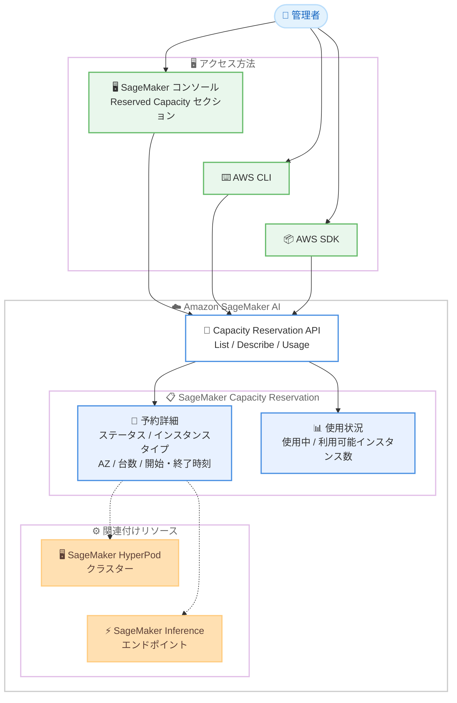

# Amazon SageMaker AI - SageMaker Capacity Reservations の閲覧サポート

**リリース日**: 2026 年 11 月 23 日
**サービス**: Amazon SageMaker AI
**機能**: SageMaker Capacity Reservations の閲覧 (コンソール、AWS CLI、AWS SDK)

📊 [このアップデートのインフォグラフィックを見る](https://takech9203.github.io/aws-news-summary/20261123-sagemaker-capacity-reservations.html)

## 概要

Amazon SageMaker AI で、SageMaker Capacity Reservations (予約済みキャパシティ) を SageMaker コンソール、AWS CLI、AWS SDK から閲覧できるようになりました。SageMaker Capacity Reservation は、On-Demand Capacity Reservation を通じて SageMaker AI がアカウント向けに確保するコンピュートキャパシティであり、SageMaker AI でキャパシティを予約しているエンタープライズのお客様が対象です。

管理者は、ステータス、インスタンスタイプ、アベイラビリティーゾーン、インスタンス数、開始時刻・終了時刻とともに予約を一覧表示できます。さらに、各予約の詳細ページでは、その予約を利用できる SageMaker AI リソース (SageMaker HyperPod クラスターや SageMaker Inference エンドポイント) と、それぞれの関連付けステータス、使用中・利用可能なインスタンス数も確認できます。

GPU キャパシティの計画が重要になる大規模な基盤モデルのトレーニングや推論を運用する組織にとって、予約状況をセルフサービスで即座に把握できることは、ワークロード計画の迅速化とキャパシティの有効活用に直結するアップデートです。

**アップデート前の課題**

このアップデート以前は、予約済みキャパシティの状況を自分で確認する手段がありませんでした。

- 予約済みキャパシティの期間やインスタンスの可用性をセルフサービスで確認する方法がなかった
- ワークロードを計画する際、予約情報の確認のために AWS Support への問い合わせが必要だった
- どの SageMaker AI リソースが予約を利用しているか、何台が使用中かを把握しにくかった

**アップデート後の改善**

今回のアップデートにより、予約の可視性が大幅に向上しました。

- SageMaker コンソール、AWS CLI、AWS SDK から予約の一覧と詳細をセルフサービスで確認できるようになった
- ステータス、インスタンスタイプ、AZ、インスタンス数、開始・終了時刻を即座に把握できるようになった
- 予約に関連付けられた HyperPod クラスターや推論エンドポイント、インスタンスの使用状況まで確認できるようになった

## アーキテクチャ図



管理者がコンソール、CLI、SDK のいずれかから Capacity Reservation API を呼び出し、予約の詳細、使用状況、関連付けられた HyperPod クラスターや推論エンドポイントを確認する流れを示しています。

## サービスアップデートの詳細

### 主要機能

1. **予約の一覧表示**
   - SageMaker コンソールの Reserved Capacity セクションで、アカウント内の SageMaker Capacity Reservations を一覧表示できる
   - 各予約について、ステータス、インスタンスタイプ、アベイラビリティーゾーン、インスタンス数、開始時刻・終了時刻を確認できる
   - AWS CLI や AWS SDK からも同じ情報をプログラムで取得できる

2. **予約詳細の確認**
   - 個々の予約を開くと、予約の ARN を含む詳細情報を確認できる
   - 予約が SageMaker Inference に関連付けられている場合、SageMaker Inference エンドポイント設定で使用する ML reservation ARN も表示される
   - ステータスは開始・終了時刻に基づいて自動的に設定される (開始前: Scheduled、期間中: Active、終了後: Expired)

3. **リソース関連付けの可視化**
   - 予約を利用できる SageMaker AI リソース (SageMaker HyperPod クラスター、SageMaker Inference エンドポイント) と、それぞれの関連付けステータスを確認できる
   - 関連付けステータスは、サービスが予約を利用できる状態であれば Active、それ以外は Pending または Inactive となる

4. **使用状況のモニタリング**
   - 予約ごとに、使用中のインスタンス数と利用可能なインスタンス数をリソースタイプ別に確認できる
   - エンドポイントが稼働しているインスタンス、または HyperPod クラスターに組み込まれているインスタンス (ワークロード未実行でも) が「使用中」としてカウントされる
   - 使用状況は定期的に更新され、コンソールには最終更新時刻が表示される (API では LastRefreshTime として返却)

## 技術仕様

### 予約詳細に含まれる情報

| 項目 | 詳細 |
|------|------|
| インスタンスタイプ | 予約済みインスタンスの SageMaker AI インスタンスタイプ (例: ml.p5.48xlarge) |
| アベイラビリティーゾーン / AZ ID | 予約済みインスタンスの配置場所。AZ ID (例: use1-az1) はアカウント間で同一のゾーンを示す |
| 合計インスタンス数 | 予約に含まれるインスタンスの数 |
| 開始時刻 / 終了時刻 | 予約済みインスタンスが利用可能な期間。終了時刻のない予約も存在する |
| ステータス | Scheduled (開始前)、Active (期間中)、Expired (終了後) |
| ARN | `arn:aws:sagemaker:{region}:{account-id}:sm-capacity-reservation/{smcr-id}` 形式 |

### API変更履歴

| 日付 | サービス | 変更内容 |
|------|----------|----------|
| 2026/11/21 | [Amazon SageMaker Service](https://awsapichanges.com/archive/changes/b75654-api.sagemaker.html) | 4 new 1 updated api methods - キャパシティ予約とその使用状況を閲覧する API を追加 |

追加・更新された API は以下のとおりです。

| API | 種別 | 説明 |
|-----|------|------|
| ListCapacityReservations | 新規 | SageMaker Capacity Reservations の一覧を取得 |
| DescribeCapacityReservation | 新規 | 個別の予約の詳細を取得 |
| GetCapacityReservationUsage | 新規 | 予約の使用状況 (使用中・利用可能インスタンス数) を取得 |
| DescribeResourceAssociations | 新規 | 予約に関連付けられた HyperPod クラスターやエンドポイントの関連付け情報を取得 |
| DescribeCluster | 更新 | HyperPod クラスターの詳細取得 API が更新 |

## 設定方法

### 前提条件

1. SageMaker AI でキャパシティを予約していること (SageMaker Capacity Reservations はキャパシティを予約しているエンタープライズのお客様が対象)
2. SageMaker の該当 API (ListCapacityReservations など) を呼び出す IAM 権限があること
3. AWS CLI を使用する場合は、新 API に対応したバージョンへ更新しておくこと

### 手順

#### ステップ1: 予約の一覧を表示する

```bash
aws sagemaker list-capacity-reservations \
  --region us-east-1
```

アカウント内の SageMaker Capacity Reservations を一覧表示します。各予約のステータス、インスタンスタイプ、アベイラビリティーゾーン、インスタンス数、開始・終了時刻を確認できます。

#### ステップ2: 予約の詳細を確認する

```bash
aws sagemaker describe-capacity-reservation \
  --sm-capacity-reservation-arn arn:aws:sagemaker:us-east-1:123456789012:sm-capacity-reservation/smcr-xxxxxxxx
```

指定した予約の詳細を取得します。SageMaker Inference に関連付けられた予約の場合は、エンドポイント設定で使用する ML reservation ARN も確認できます。

#### ステップ3: 使用状況とリソース関連付けを確認する

```bash
# 使用中・利用可能インスタンス数の確認
aws sagemaker get-capacity-reservation-usage \
  --sm-capacity-reservation-arn arn:aws:sagemaker:us-east-1:123456789012:sm-capacity-reservation/smcr-xxxxxxxx

# 関連付けられたリソースの確認
aws sagemaker describe-resource-associations \
  --sm-capacity-reservation-arn arn:aws:sagemaker:us-east-1:123456789012:sm-capacity-reservation/smcr-xxxxxxxx
```

前者は予約のインスタンス使用状況 (使用中・利用可能) をリソースタイプ別に返し、更新時刻は LastRefreshTime で確認できます。後者は予約に関連付けられた HyperPod クラスターや推論エンドポイントと、それぞれの関連付けステータス (Active / Pending / Inactive) を返します。

コンソールの場合は、SageMaker AI コンソールの Reserved Capacity セクションから同じ情報を GUI で確認できます。

## メリット

### ビジネス面

- **キャパシティ計画の迅速化**: 予約の期間や空き状況を即座に確認できるため、トレーニングや推論ワークロードの計画を AWS Support への問い合わせを待たずに進められる
- **予約キャパシティの有効活用**: 使用中・利用可能インスタンス数を把握できるため、確保済みの高価な GPU キャパシティの遊休を減らし、投資対効果を高められる
- **運用負荷の削減**: セルフサービス化により、AWS Support とのやり取りに費やしていた時間と工数を削減できる

### 技術面

- **API によるプログラマブルな可視化**: ListCapacityReservations などの新 API により、予約情報を社内のダッシュボードや自動化ワークフローに組み込める
- **リソース関連付けの透明性**: 予約がどの HyperPod クラスターや推論エンドポイントに利用されているかをステータス付きで追跡できる
- **AZ ID による正確な配置確認**: アカウント間で共通の AZ ID が表示されるため、他リソースとの AZ 整合性を正確に確認できる

## デメリット・制約事項

### 制限事項

- SageMaker Capacity Reservations は、SageMaker AI でキャパシティを予約しているエンタープライズのお客様向けの機能である
- 本アップデートは閲覧 (表示) 機能の提供であり、予約の作成・変更をセルフサービスで行う機能ではない
- 利用可能リージョンは Amazon SageMaker HyperPod が利用可能なリージョンに限られる

### 考慮すべき点

- 使用状況のカウントは定期更新であり、リアルタイムの値ではないため、LastRefreshTime (コンソールでは最終更新時刻) を確認して判断する必要がある
- HyperPod クラスターに組み込まれたインスタンスは、ワークロードを実行していなくても「使用中」としてカウントされる点に注意が必要
- 新 API を利用するには、AWS CLI / SDK を対応バージョンへ更新する必要がある

## ユースケース

### ユースケース1: 大規模トレーニングジョブの実行計画

**シナリオ**: ML プラットフォームチームが、予約済みの ml.p5.48xlarge キャパシティを使って基盤モデルのトレーニングを計画しており、予約期間と空きインスタンス数を確認したい。

**実装例**:
```bash
aws sagemaker list-capacity-reservations

aws sagemaker get-capacity-reservation-usage \
  --sm-capacity-reservation-arn <予約の ARN>
```

**効果**: 予約の開始・終了時刻と利用可能インスタンス数を即座に確認し、AWS Support への問い合わせなしでトレーニングのスケジュールを確定できる。

### ユースケース2: 推論エンドポイントへの予約キャパシティの割り当て確認

**シナリオ**: 推論基盤の管理者が、SageMaker Inference エンドポイントの設定で使用する ML reservation ARN を確認し、予約済みキャパシティ上でエンドポイントを稼働させたい。

**実装例**:
```bash
aws sagemaker describe-resource-associations \
  --sm-capacity-reservation-arn <予約の ARN>
```

コンソールの場合は、Reserved Capacity セクションで予約を開き、詳細ページに表示される ML reservation ARN をエンドポイント設定に使用します。

**効果**: 予約と推論エンドポイントの関連付け状況 (Active / Pending / Inactive) を確認しながら、予約済みキャパシティを確実に推論に割り当てられる。

### ユースケース3: 予約キャパシティの遊休監視ダッシュボード

**シナリオ**: FinOps チームが、確保済み GPU キャパシティの使用率を定期的に監視し、遊休が発生している予約を検出して各チームに利用を促したい。

**実装例**:
```python
import boto3

sm = boto3.client("sagemaker")

reservations = sm.list_capacity_reservations()
for r in reservations["SMCapacityReservations"]:
    usage = sm.get_capacity_reservation_usage(
        SMCapacityReservationArn=r["SMCapacityReservationArn"]
    )
    # 使用中 / 利用可能インスタンス数を集計してダッシュボードへ送信
```

**効果**: 予約ごとの使用状況を自動収集し、遊休キャパシティの早期発見とコスト効率の改善につなげられる。

## 料金

閲覧機能自体に関する追加料金の記載はありません。SageMaker Capacity Reservations は、SageMaker AI とのキャパシティ予約契約に基づくもので、料金の詳細は Amazon SageMaker AI の料金ページおよび契約内容を確認してください。

## 利用可能リージョン

Amazon SageMaker HyperPod が利用可能なすべての AWS リージョンで利用できます。対象リージョンの一覧は [SageMaker HyperPod のドキュメント](https://docs.aws.amazon.com/sagemaker/latest/dg/sagemaker-hyperpod.html#sagemaker-hyperpod-available-regions)を参照してください。

## 関連サービス・機能

- **Amazon SageMaker HyperPod**: 予約済みキャパシティを利用できるリソースの 1 つ。クラスターに組み込まれたインスタンスが予約の使用分としてカウントされる
- **Amazon SageMaker Inference**: 予約に関連付けられた ML reservation ARN をエンドポイント設定で指定することで、予約済みキャパシティ上で推論エンドポイントを稼働できる
- **Amazon EC2 On-Demand Capacity Reservations**: SageMaker Capacity Reservation の基盤となる仕組み。SageMaker AI がアカウント向けにキャパシティを確保する際に使用される

## 参考リンク

- 📊 [インフォグラフィック](https://takech9203.github.io/aws-news-summary/20261123-sagemaker-capacity-reservations.html)
- [公式発表 (What's New)](https://aws.amazon.com/about-aws/whats-new/2026/11/sagemaker-capacity-reservations/)
- [ドキュメント: SageMaker Capacity Reservations](https://docs.aws.amazon.com/sagemaker/latest/dg/sm-capacity-reservations.html)
- [ドキュメント: SageMaker HyperPod 利用可能リージョン](https://docs.aws.amazon.com/sagemaker/latest/dg/sagemaker-hyperpod.html#sagemaker-hyperpod-available-regions)
- [API 変更履歴 (awsapichanges.com)](https://awsapichanges.com/archive/changes/b75654-api.sagemaker.html)
- [Amazon SageMaker AI 料金ページ](https://aws.amazon.com/sagemaker-ai/pricing/)

## まとめ

これまで AWS Support への問い合わせが必要だった SageMaker の予約済みキャパシティの確認が、コンソール、AWS CLI、AWS SDK からセルフサービスで行えるようになりました。予約キャパシティを利用しているエンタープライズのお客様は、新しい API (ListCapacityReservations、GetCapacityReservationUsage など) を活用して、キャパシティ計画の迅速化と遊休キャパシティの監視を始めることを推奨します。
