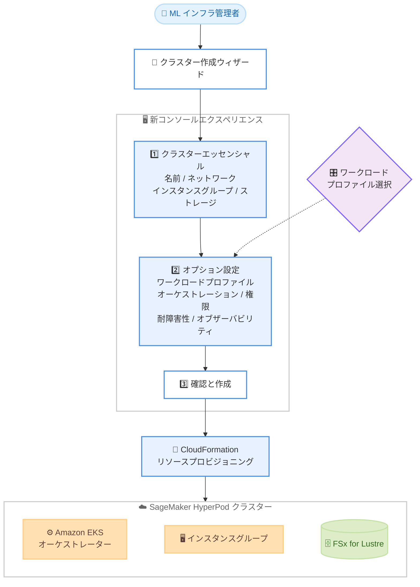

# Amazon SageMaker HyperPod - Amazon EKS オーケストレーションクラスター作成の再設計されたコンソールエクスペリエンス

**リリース日**: 2026 年 11 月 23 日
**サービス**: Amazon SageMaker HyperPod
**機能**: Amazon EKS オーケストレーションクラスター作成の新コンソールエクスペリエンス

📊 [このアップデートのインフォグラフィックを見る](https://takech9203.github.io/aws-news-summary/20261123-sagemaker-hyperpod-console-eks.html)

## 概要

Amazon SageMaker HyperPod は、Amazon EKS をオーケストレーターとして使用するクラスターを作成するための、再設計された AWS マネジメントコンソールエクスペリエンスを発表しました。新しいガイド付きワークフローにより、ML インフラストラクチャ管理者やプラットフォームチームは、ネットワーク、インスタンスグループ、ストレージ、権限、耐障害性、オブザーバビリティ、ライフサイクルスクリプト、タグといった設定を、順を追って効率的に構成できます。

新しいエクスペリエンスでは、必須設定とオプション設定が明確に分離されており、クラスター作成に最低限必要な項目だけを入力すればデプロイでき、追加機能は後から段階的に有効化できます。また、スマートデフォルトから開始するか、クラスターの用途に合わせた「ワークロードプロファイル」を選択することで、オートスケーラー、オペレーター、オブザーバビリティメトリクス、階層型ストレージ、タスクガバナンスなどの推奨設定を一括で適用できます。個別設定や高度な設定も引き続き調整可能なため、繰り返しの設定作業を削減しながら、完全なコントロールを維持できます。

**アップデート前の課題**

従来の EKS オーケストレーションクラスター作成では、以下の課題がありました。

- 必須設定とオプション設定が混在しており、クラスター作成に最低限必要な項目を見極めにくかった
- ネットワーク、オペレーター、オブザーバビリティなど多数のコンポーネントを個別に設定する必要があり、繰り返しの設定作業が発生していた
- ワークロードの用途 (トレーニング / 推論) に応じた推奨構成を適用する仕組みがなく、アドオン選定の知識が求められた

**アップデート後の改善**

今回のアップデートにより、以下が可能になりました。

- 必須設定 (クラスターエッセンシャル) とオプション設定が分離され、必要な項目だけ入力してクラスターを作成できるようになった
- 「All add-ons」「Training」「Inference」「No add-ons」のワークロードプロファイルを選択することで、用途に合わせた一貫性のある推奨設定を一括適用できるようになった
- スマートデフォルトにより繰り返しの設定作業が削減され、個別設定や高度な設定の調整も引き続き可能で、柔軟性を損なわない

## アーキテクチャ図



新しいコンソールエクスペリエンスでは、「クラスターエッセンシャル」「オプション設定」「確認と作成」の 3 ステップ構成のウィザードでクラスターを設計し、CloudFormation が EKS オーケストレーションの HyperPod クラスターをプロビジョニングします。

## サービスアップデートの詳細

### 主要機能

1. **ガイド付きワークフロー**
   - 「Configure cluster essentials」「Optional settings」「Review and create」の明確な 3 ステップ構成
   - ネットワーク、インスタンスグループ、ストレージ、権限、耐障害性、オブザーバビリティ、ライフサイクルスクリプト、タグを順を追って設定
   - 検証エラーが見つかった場合、該当するステップとセクションが自動的に開くため、修正箇所を迷わない

2. **必須設定とオプション設定の分離**
   - クラスター作成に必要な項目 (名前、ネットワーク、インスタンスグループ、ストレージ) のみ入力すればデプロイ可能
   - オペレーター、オートスケーリング、オブザーバビリティなどの追加機能は後から段階的に有効化できる
   - クォータ検証が組み込まれており、インスタンス数がクォータを超過する可能性がある場合は警告が表示される

3. **ワークロードプロファイル**
   - 「All add-ons」「Training」「Inference」「No add-ons」の 4 プロファイルから選択
   - 各プロファイルは、オートスケーラー (Karpenter)、HyperPod オペレーター、オブザーバビリティメトリクス、階層型ストレージ、タスクガバナンスの推奨構成を一括適用
   - プロファイル適用後も、すべての設定を個別に編集可能

4. **EKS クラスターのインライン作成**
   - EKS コンソールを開かずに、ウィザード内から新しい Amazon EKS クラスターを作成可能
   - Kubernetes バージョンの選択、デフォルト Helm チャートとアドオンのインストール、有効化するオペレーターの選択に対応

5. **デプロイ方法の選択**
   - コンソールから直接クラスターを作成する方法に加え、CloudFormation テンプレートパラメータ (JSON) をダウンロードして AWS CLI からデプロイすることも可能
   - ダウンロードしたパラメータファイルを編集して IaC ワークフローに組み込める

## 技術仕様

### ウィザードの設定項目

| セクション | 設定内容 |
|------|------|
| General settings | クラスター名 (作成後の変更不可、デフォルト名を事前入力) |
| Networking | VPC (新規作成がデフォルト / 既存 VPC も選択可)、CIDR、アベイラビリティーゾーン、セキュリティグループ |
| Instance groups | Standard / Restricted Instance Group、キャパシティ (Flexible Training Plan / On-Demand・Reserved)、インスタンスタイプ、数量、追加 EBS ボリューム (デフォルト 500 GB)、GPU パーティション (MIG) |
| Storage | FSx for Lustre (既存 / 新規 / なし)、スループット、容量 (新規は 1.2 TiB)、LZ4 圧縮 |
| Workload profile | All add-ons / Training / Inference / No add-ons |
| Orchestration | EKS クラスター (新規 / 既存)、Kubernetes バージョン、Helm チャートとオペレーター |
| Permissions | HyperPod 用 IAM ロールの選択または作成 |
| Resiliency | 自動インスタンスリカバリ (ヘルスモニタリングエージェントと deep health checks は全クラスターに導入) |
| Observability | HyperPod オブザーバビリティアドオン (IAM Identity Center の organization インスタンスが必要) |
| Lifecycle scripts | デフォルトスクリプト / S3 バケット上のカスタムスクリプト |
| Governance and access | タスクガバナンスによる優先度設定とチーム間のコンピューティング割り当て |

## 設定方法

### 前提条件

1. AWS アカウントと SageMaker AI コンソールへのアクセス権限
2. 使用するインスタンスタイプに対する十分な SageMaker HyperPod クォータ
3. 既存 VPC を使用する場合は、SageMaker AI からアクセス可能な VPC (EKS 用サブネットはプライベートである必要あり)

### 手順

#### ステップ 1: ウィザードの起動

1. [SageMaker AI コンソール](https://console.aws.amazon.com/sagemaker/) を開く
2. 左ナビゲーションの [HyperPod Clusters] から [Cluster Management] を選択
3. [Create HyperPod cluster] のドロップダウンで [Orchestrated by Amazon EKS] を選択

2 つの設定ステップと確認ページで構成されるウィザードが開きます。

#### ステップ 2: クラスターエッセンシャルの設定

クラスター名、ネットワーク (VPC / AZ / セキュリティグループ)、インスタンスグループ (タイプ、数量、追加 EBS ボリュームなど)、ストレージ (FSx for Lustre) を設定します。インスタンスグループは最低 1 つ必要で、複数のインスタンスタイプを組み合わせたヘテロジニアスクラスターも構成できます。

#### ステップ 3: オプション設定とデプロイ

ワークロードプロファイルを選択して推奨アドオンセットを適用し、必要に応じてオーケストレーション、権限、耐障害性、オブザーバビリティなどを調整します。[Review and create] で内容を確認し、[Create cluster] を選択するか、CloudFormation テンプレートパラメータをダウンロードして CLI からデプロイします。

```bash
# CloudFormation パラメータをダウンロードした場合のデプロイ例
aws cloudformation create-stack \
  --stack-name my-hyperpod-cluster \
  --template-url <テンプレート URL> \
  --parameters file://downloaded-parameters.json \
  --capabilities CAPABILITY_NAMED_IAM
```

ダウンロードしたパラメータ JSON ファイルを指定して CloudFormation スタックを作成し、クラスターリソースをプロビジョニングします。

## メリット

### ビジネス面

- **セットアップ時間の短縮**: スマートデフォルトとワークロードプロファイルにより、繰り返しの設定作業が削減され、ML インフラの立ち上げが迅速になる
- **専門知識への依存低減**: アドオンやオペレーターの推奨構成が用途別に提供されるため、Kubernetes や HyperPod エコシステムの深い知識がなくても適切な構成でクラスターを作成できる
- **設定ミスの削減**: 組み込みのクォータ検証とエラー箇所への自動ナビゲーションにより、デプロイ失敗の手戻りを防げる

### 技術面

- **段階的な機能有効化**: 必須項目のみでクラスターを作成し、オブザーバビリティやオートスケーリングなどを後から追加できる柔軟な運用が可能
- **EKS クラスターのインライン作成**: EKS コンソールへの移動が不要になり、オーケストレーター込みのクラスター構築がワンストップで完結する
- **IaC との連携**: CloudFormation テンプレートパラメータのダウンロードに対応し、コンソールで設計した構成を CI/CD パイプラインに組み込める

## デメリット・制約事項

### 制限事項

- クラスター名は作成後に変更できない
- オブザーバビリティアドオンには、該当リージョンの IAM Identity Center の organization インスタンスが必要
- Karpenter によるオートスケーリングは、Standard インスタンスグループが 1 つ以上ある場合のみ有効化できる
- 新規 EKS クラスター作成時は、HyperPod 用の VPC サブネットがプライベートである必要がある

### 考慮すべき点

- 本アップデートはコンソールエクスペリエンスの改善であり、API や CLI のクラスター作成フローは対象外
- クラスターインスタンス、FSx for Lustre、EBS ボリュームなど、作成されるリソースには料金が発生する
- インスタンスタイプごとのクォータと未割り当て IP アドレスを事前に確認する必要がある

## ユースケース

### ユースケース 1: トレーニング用クラスターの迅速な立ち上げ

**シナリオ**: 基盤モデルの分散トレーニング環境を新規に構築したいが、Kubernetes アドオンの選定に時間をかけたくない。

**実装例**:
```
1. ウィザードで [Orchestrated by Amazon EKS] を選択
2. インスタンスグループに GPU インスタンスを追加
3. ワークロードプロファイルで [Training] を選択
   → HyperPod トレーニングオペレーター、オブザーバビリティなどの推奨構成が一括適用
4. [Create cluster] でデプロイ
```

**効果**: トレーニングに最適化されたアドオン構成が自動適用され、環境構築のリードタイムを大幅に短縮できる。

### ユースケース 2: 最小構成から始める段階的な本番化

**シナリオ**: まず最小構成で PoC 用クラスターを作成し、本番化の段階でオブザーバビリティやタスクガバナンスを追加したい。

**実装例**:
```
1. クラスターエッセンシャル (名前 / ネットワーク / インスタンスグループ / ストレージ) のみ設定
2. ワークロードプロファイルは [No add-ons] を選択してデプロイ
3. 本番化のタイミングで、オブザーバビリティアドオンや
   タスクガバナンスを後から有効化
```

**効果**: 必要最小限の設定で素早く検証を開始し、要件の確定に合わせて機能を段階的に追加できる。

### ユースケース 3: コンソール設計 + IaC デプロイのハイブリッド運用

**シナリオ**: プラットフォームチームがコンソールで構成を設計し、デプロイは CI/CD パイプライン経由で統制したい。

**実装例**:
```
1. ウィザードでクラスター構成を設計
2. [Review and create] で [Download CloudFormation template parameters] を選択
3. パラメータ JSON をリポジトリで管理し、
   パイプラインから aws cloudformation create-stack を実行
```

**効果**: コンソールの使いやすさと IaC の再現性・統制を両立し、複数環境への展開を標準化できる。

## 料金

コンソールエクスペリエンス自体に追加料金はありません。クラスターを構成する SageMaker HyperPod インスタンス、FSx for Lustre ファイルシステム、Amazon EBS ボリュームなどのリソースには、通常の利用料金が発生します。詳細は [SageMaker AI 料金ページ](https://aws.amazon.com/sagemaker/pricing/) を参照してください。

## 利用可能リージョン

Amazon SageMaker HyperPod が利用可能なすべての AWS リージョンで提供されます。

## 関連サービス・機能

- **Amazon EKS**: HyperPod クラスターのオーケストレーターとして機能し、ウィザード内から新規作成も可能
- **AWS CloudFormation**: クラスターリソースのプロビジョニングに使用され、テンプレートパラメータのダウンロードによる CLI デプロイにも対応
- **Amazon FSx for Lustre**: クラスターの高性能共有ストレージとして、ウィザードから新規作成または既存ファイルシステムの選択が可能
- **Karpenter**: ワークロードプロファイルまたは個別設定で有効化できるノードオートスケーリング
- **AWS IAM Identity Center**: オブザーバビリティアドオンの利用に必要な organization インスタンスを提供

## 参考リンク

- 📊 [インフォグラフィック](https://takech9203.github.io/aws-news-summary/20261123-sagemaker-hyperpod-console-eks.html)
- [公式発表 (What's New)](https://aws.amazon.com/about-aws/whats-new/2026/11/sagemaker-hyperpod-console-eks/)
- [ドキュメント: Creating a SageMaker HyperPod cluster with Amazon EKS orchestration](https://docs.aws.amazon.com/sagemaker/latest/dg/sagemaker-hyperpod-eks-operate-console-ui-create-cluster.html)
- [料金ページ](https://aws.amazon.com/sagemaker/pricing/)

## まとめ

Amazon SageMaker HyperPod の EKS オーケストレーションクラスター作成が、必須設定とオプション設定を分離したガイド付きウィザードに刷新され、ワークロードプロファイルによる推奨構成の一括適用が可能になりました。ML インフラの構築を担当するチームは、新しいコンソールエクスペリエンスを活用することで、設定作業の負荷を抑えつつ、用途に最適化された HyperPod クラスターを迅速にデプロイできます。まずは検証環境で Training または Inference プロファイルを試し、自チームの標準構成を確立することを推奨します。
