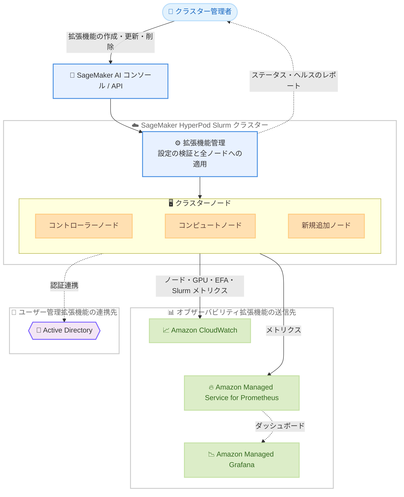

# Amazon SageMaker HyperPod - Slurm クラスター向けマネージド拡張機能 (オブザーバビリティ・ユーザー管理)

**リリース日**: 2026 年 11 月 23 日
**サービス**: Amazon SageMaker HyperPod
**機能**: Slurm クラスター向けマネージドクラスター拡張機能 (Cluster Extensions)

📊 [このアップデートのインフォグラフィックを見る](https://takech9203.github.io/aws-news-summary/20261123-sagemaker-hyperpod-extensions.html)

## 概要

Amazon SageMaker HyperPod が、Slurm オーケストレーションを使用するクラスター向けに、AWS が構築・保守するマネージドクラスター拡張機能 (Cluster Extensions) の提供を開始しました。SageMaker AI コンソールまたは API から、マネージド機能のインストール、設定、更新、削除を実行できます。第一弾として、オブザーバビリティ拡張機能とユーザー管理拡張機能の 2 つが提供されます。

各拡張機能では、ユーザーが設定を宣言すると HyperPod がその内容を検証し、後から追加されるノードや HyperPod が置き換えたノードも含むすべてのノードに適用します。さらに、拡張機能のステータスとノード単位のヘルス状態をレポートするため、クラスター全体で設定の一貫性を容易に維持できます。大規模な基盤モデルのトレーニングを Slurm クラスターで運用する ML インフラチームや管理者が主な対象です。

**アップデート前の課題**

- オブザーバビリティやユーザー管理の変更には、ライフサイクルスクリプトの編集と、ノードの置き換えまたは再実行が必要だった
- メトリクス収集エージェントやユーザー・グループ設定を全ノードで一貫して維持する作業は、利用者自身がスクリプトで管理する必要があった
- 後から追加されたノードへの設定適用や、設定漏れ・不整合の検知が難しかった

**アップデート後の改善**

- オブザーバビリティとユーザー管理を、コンソールまたは API の 1 回の操作でインストール・設定・更新・削除できるようになった
- HyperPod が設定を検証し、後から追加されるノードを含むすべてのノードに自動適用するため、クラスター全体の一貫性が保たれるようになった
- 拡張機能のステータスとノード単位のヘルスがレポートされ、問題の検知と対処が容易になった
- ライフサイクルスクリプトとカスタム AMI は引き続き利用でき、組織独自のソフトウェア導入と共存できる

## アーキテクチャ図



管理者が API で拡張機能の設定を宣言すると、HyperPod が検証のうえ全ノード (後から追加されるノードを含む) に適用し、ステータスとノード単位のヘルスをレポートします。

## サービスアップデートの詳細

### 主要機能

1. **マネージドクラスター拡張機能の基盤**
   - AWS が構築・保守するソフトウェアパッケージを、SageMaker AI コンソールまたは API の 1 回の呼び出しでインストール可能
   - HyperPod が設定を検証し、後から追加されるノードや置き換えられたノードを含む全ノードに適用
   - 拡張機能のステータス (Creating / Active / Updating / Degraded など) とノード単位のヘルスをレポート
   - ライフサイクルスクリプトやカスタム AMI と共存可能 (拡張機能が管理するソフトウェアをライフサイクルスクリプトで重複管理しないことが前提)

2. **オブザーバビリティ拡張機能 (sagemaker-observability)**
   - ノード、GPU、Elastic Fabric Adapter (EFA)、Slurm ジョブ、Slurm クラスターのメトリクスを収集
   - オプションで NVIDIA Collective Communications Library (NCCL) メトリクスの収集にも対応
   - 収集したメトリクスを Amazon CloudWatch または Amazon Managed Service for Prometheus に送信
   - オプションで Amazon Managed Grafana のダッシュボードをサポート

3. **ユーザー管理拡張機能 (sagemaker-user-management)**
   - すべてのノードで同一の ID を持つ POSIX ユーザーとグループを作成
   - ノードタイプごとに SSH サインインと sudo 権限をグループ単位で制御
   - ローカルユーザー、Active Directory、またはその両方をサポート
   - ユーザーを Slurm アカウンティングに登録

## 技術仕様

### 拡張機能の管理モデル

| 項目 | 詳細 |
|------|------|
| 対象クラスター | 継続的プロビジョニングを使用する Slurm オーケストレーションの HyperPod クラスター |
| 管理方法 | SageMaker AI コンソールまたは API (`list-cluster-extension-versions`、`update-cluster-extension`、`delete-cluster-extension`、`DescribeClusterExtension` など) |
| バージョン管理 | 各拡張機能に 1 つ以上のバージョンが存在。バージョン未指定時は最新をインストール。新しいバージョンへの更新は可能だが、ダウングレードは削除後の再作成が必要 |
| 設定の更新 | JSON マージパッチ (RFC 7386) 方式。変更したい設定のみ送信し、`null` を指定するとデフォルト値に戻る。リストは全体が置き換えられる |
| 適用範囲 | クラスター内の全ノード。各ノードタイプに関連するコンポーネントのみ実行 (例: Slurm コントローラーメトリクスはコントローラーノードのみ) |
| 新規ノードへの適用 | ノード起動後数分以内に現在のバージョンと設定を適用 |
| 制約 | 同名の拡張機能はクラスターあたり 1 つ。削除して再作成すると新しい ARN が割り当てられる |

### 拡張機能のステータス

| ステータス | 説明 |
|------|------|
| Creating / Updating / Deleting | インストール・更新・削除の実行中 |
| Active | 全ノードに現在のバージョンと設定が適用され、問題の報告がない状態 |
| Degraded | 一部のノードで未適用、または少なくとも 1 つのノードが異常を報告している状態 |
| CreateFailed / UpdateFailed / DeleteFailed | いずれのノードでも操作が完了できなかった状態 |

`DescribeClusterExtension` はノードサマリー (`ActiveCount` / `TotalCount`) と、問題発生時には原因別にグループ化された `Health` 情報 (`InvalidConfiguration`、`ConfigurationConflict`、`AccessDenied`、`DependencyUnreachable` など) を返します。

## 設定方法

### 前提条件

1. Slurm オーケストレーションかつ継続的プロビジョニングを使用する SageMaker HyperPod クラスター
2. 拡張機能の操作に必要な IAM 権限と、メトリクス送信やシークレット読み取りなどを許可する実行ロール
3. 拡張機能が管理する機能をライフサイクルスクリプトで重複管理していないこと (例: オブザーバビリティ拡張機能を使うクラスターで `enable_observability` を設定しない、ユーザー管理拡張機能を使うクラスターで `add_users.sh` や `enable_sssd` を使用しない)

### 手順

#### ステップ 1: 利用可能な拡張機能バージョンの確認

```bash
aws sagemaker list-cluster-extension-versions \
  --extension-name sagemaker-observability
```

指定した拡張機能についてインストール可能なバージョンの一覧を取得します。バージョンを指定しない場合は最新バージョンがインストールされます。

#### ステップ 2: 拡張機能のインストールと設定

SageMaker AI コンソールまたは API から、対象クラスターに拡張機能を作成し、設定を宣言します。HyperPod が設定を検証し、不明な設定や無効な値はリクエスト時点で拒否されます。省略した設定にはデフォルト値が使用されます。

#### ステップ 3: ステータスとヘルスの確認

```bash
aws sagemaker describe-cluster-extension \
  --cluster-name my-hyperpod-cluster \
  --extension-name sagemaker-observability
```

拡張機能のステータス、ノードサマリー (`ActiveCount` / `TotalCount`)、問題発生時の `Health` 情報を確認します。`ActiveCount` が `TotalCount` と一致すれば、変更が全ノードに適用されています。

#### ステップ 4: 設定の更新

```bash
aws sagemaker update-cluster-extension \
  --cluster-name my-hyperpod-cluster \
  --extension-name sagemaker-observability \
  --configuration '{...変更したい設定のみ...}'
```

変更したい設定のみを送信すると、JSON マージパッチ方式で現在の設定にマージされます。インストールや更新に失敗したノードは、原因を修正したうえでバージョンと設定を変えずに同コマンドを実行すると再試行されます。

## メリット

### ビジネス面

- **運用負荷の削減**: ライフサイクルスクリプトの作成・保守やノードの置き換え作業が不要になり、ML インフラチームの運用工数を削減できる
- **追加料金なし**: 拡張機能自体は追加料金なしで利用でき、消費した基盤リソース分のみの支払いで済む
- **ガバナンスの向上**: ノードタイプごとの SSH・sudo 権限制御や Active Directory 連携により、大規模クラスターのアクセス管理を標準化できる

### 技術面

- **クラスター全体の一貫性**: 後から追加されるノードや置き換えられたノードにも自動的に同じバージョンと設定が適用される
- **宣言的な設定管理**: 設定は API で宣言し、HyperPod が検証・適用・ヘルスレポートまで担うため、設定の不整合を検知しやすい
- **既存手法との共存**: ライフサイクルスクリプトとカスタム AMI は引き続き利用でき、組織独自のソフトウェア導入を妨げない

## デメリット・制約事項

### 制限事項

- 対象は Slurm オーケストレーションかつ継続的プロビジョニングを使用するクラスターに限られる
- 同名の拡張機能はクラスターあたり 1 つのみ。削除して再作成すると ARN が変わるため、古い ARN に依存するスクリプトや IAM ポリシーは動作しなくなる
- 以前のバージョンへのダウングレードは直接行えず、削除と再作成が必要
- `Health` に表示される問題は最大 20 件で、ノードのインスタンス ID は含まれない (特定には拡張機能ヘルスログの参照が必要)

### 考慮すべき点

- 拡張機能が管理するソフトウェアをライフサイクルスクリプトで重複管理すると競合の原因になる (例: UID やポートの重複による `ConfigurationConflict`)
- 新規ノードは拡張機能の適用完了前に Slurm に参加してジョブの実行を開始する場合があり、拡張機能はジョブスケジューリングを保留しない
- ノード上で手動で変更・削除されたコンポーネントを拡張機能は自動修復しないため、再適用には `update-cluster-extension` の実行が必要

## ユースケース

### ユースケース 1: 大規模トレーニングクラスターの GPU・ネットワーク監視の標準化

**シナリオ**: 数百ノード規模の HyperPod Slurm クラスターで基盤モデルをトレーニングしており、GPU 使用率や EFA のネットワークメトリクス、Slurm ジョブの状態を一元的に監視したい。

**実装例**:
```
オブザーバビリティ拡張機能 sagemaker-observability をインストールし、
送信先に Amazon Managed Service for Prometheus を指定。
Amazon Managed Grafana のダッシュボードで可視化し、
必要に応じて NCCL メトリクスの収集も有効化。
```

**効果**: エージェントの導入・保守スクリプトなしで、ノード追加時も含めてクラスター全体のメトリクス収集が自動的に維持され、学習ジョブの性能問題や障害の検知が迅速になる。

### ユースケース 2: Active Directory と連携したマルチユーザークラスターの運用

**シナリオ**: 複数の研究チームが共有する HyperPod クラスターで、社内の Active Directory を使用した認証と、チームごとのアクセス権限管理を行いたい。

**実装例**:
```
ユーザー管理拡張機能 sagemaker-user-management をインストールし、
ユーザーソースに Active Directory を指定。
グループとノードタイプごとに SSH サインインと sudo 権限を設定し、
ユーザーを Slurm アカウンティングに登録。
```

**効果**: 全ノードで一貫したユーザー・グループ ID が維持され、`add_users.sh` や `enable_sssd` といったスクリプト運用が不要になる。チームごとの利用実績も Slurm アカウンティングで追跡できる。

### ユースケース 3: ノードの自動置き換えに強い設定管理

**シナリオ**: ハードウェア障害時に HyperPod がノードを自動置き換えする環境で、置き換え後のノードにも監視エージェントとユーザー設定を確実に適用したい。

**実装例**:
```
オブザーバビリティ拡張機能とユーザー管理拡張機能の両方をインストール。
DescribeClusterExtension の ActiveCount / TotalCount を定期的に確認し、
Degraded 時は Health の issue code に応じて対処。
```

**効果**: 置き換えられたノードにも数分以内に現在のバージョンと設定が適用され、設定漏れによる監視の空白やログイン不能が発生しない。

## 料金

マネージドクラスター拡張機能自体は追加料金なしで利用できます。拡張機能が消費する基盤の AWS リソース (Amazon CloudWatch、Amazon Managed Service for Prometheus、Amazon Managed Grafana など) に対してのみ料金が発生します。

## 利用可能リージョン

Amazon SageMaker HyperPod が利用可能なすべての AWS リージョンで利用できます。

## 関連サービス・機能

- **Amazon CloudWatch**: オブザーバビリティ拡張機能のメトリクス送信先の 1 つ
- **Amazon Managed Service for Prometheus**: オブザーバビリティ拡張機能のメトリクス送信先の 1 つ
- **Amazon Managed Grafana**: 収集したメトリクスのダッシュボード可視化 (オプション)
- **Elastic Fabric Adapter (EFA)**: 拡張機能が収集するネットワークメトリクスの対象
- **AWS Directory Service / Active Directory**: ユーザー管理拡張機能の認証連携先
- **SageMaker HyperPod ライフサイクルスクリプト**: 拡張機能の対象外ソフトウェアのインストールに引き続き使用可能

## 参考リンク

- 📊 [インフォグラフィック](https://takech9203.github.io/aws-news-summary/20261123-sagemaker-hyperpod-extensions.html)
- [公式発表 (What's New)](https://aws.amazon.com/about-aws/whats-new/2026/11/sagemaker-hyperpod-extensions/)
- [AWS Blog: Introducing managed cluster extensions for observability and user management in Amazon SageMaker HyperPod Slurm](https://aws.amazon.com/blogs/machine-learning/introducing-managed-cluster-extensions-for-observability-and-user-management-in-amazon-sagemaker-hyperpod-slurm/)
- [ドキュメント: Cluster extensions for SageMaker HyperPod Slurm clusters](https://docs.aws.amazon.com/sagemaker/latest/dg/sagemaker-hyperpod-slurm-extensions.html)
- [製品ページ: Amazon SageMaker HyperPod](https://aws.amazon.com/sagemaker/ai/hyperpod/)

## まとめ

SageMaker HyperPod の Slurm クラスターで、これまでライフサイクルスクリプトとノード置き換えが必要だったオブザーバビリティとユーザー管理を、API 1 回の操作で宣言的に管理できるようになりました。追加料金なしで利用できるため、HyperPod Slurm クラスターを運用しているチームは、該当機能のライフサイクルスクリプトからマネージド拡張機能への移行を検討することを推奨します。
