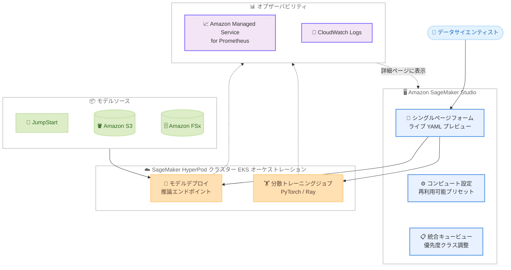

# Amazon SageMaker Studio - SageMaker HyperPod クラスター向けトレーニングジョブ送信とモデルデプロイのサポート

**リリース日**: 2026 年 11 月 23 日
**サービス**: Amazon SageMaker Studio / Amazon SageMaker HyperPod
**機能**: SageMaker Studio からの HyperPod クラスター向けトレーニングジョブ送信、モデルデプロイ、ワークロードモニタリング

📊 [このアップデートのインフォグラフィックを見る](https://takech9203.github.io/aws-news-summary/20261123-sagemaker-studio-hyperpod.html)

## 概要

Amazon SageMaker Studio が、Amazon SageMaker HyperPod クラスター向けのネイティブな開発者エクスペリエンスを提供するようになりました。データサイエンティストは、EKS オーケストレーションの HyperPod クラスター上で、分散トレーニングジョブの送信、モデルのデプロイ、ワークロードのビジュアルなモニタリングを Studio の UI から直接実行できます。

SageMaker HyperPod は、基盤モデルの大規模な分散トレーニングやファインチューニングのために構築された専用インフラストラクチャです。これまで HyperPod を利用するには kubectl の知識や Kubernetes マニフェストの記述が必要であり、インタラクティブな環境を好むデータサイエンティストにとって大きな負担となっていました。今回のアップデートにより、Kubernetes の専門知識がなくても、使い慣れた Studio の画面から HyperPod のワークロードを管理できるようになります。

**アップデート前の課題**

- HyperPod クラスターでジョブを実行するには kubectl の操作スキルと Kubernetes マニフェスト (YAML) の記述が必要だった
- コンピュート設定を毎回手動で入力する必要があり、ジョブ送信の手間が大きかった
- メトリクスやログの確認に複数のツールを行き来する必要があり、問題の診断に時間がかかっていた

**アップデート後の改善**

- ライブ YAML プレビュー付きのシングルページフォームから、分散 PyTorch ジョブや Ray ジョブを送信できるようになった
- JumpStart、Amazon S3、Amazon FSx からのモデルデプロイが Studio の UI で完結するようになった
- 再利用可能なリソースプリセット (コンピュート設定) により、手動でのコンピュート入力が不要になった
- メトリクスとログが詳細ページに統合され、その場で問題を診断できるようになった

## アーキテクチャ図



SageMaker Studio のフォームから HyperPod クラスターへジョブ送信・モデルデプロイを行い、Prometheus と CloudWatch によるメトリクス・ログを Studio の詳細ページで確認できる構成を示しています。

## サービスアップデートの詳細

### 主要機能

1. **分散トレーニングジョブの送信**
   - 分散 PyTorch ジョブおよび Ray ジョブを Studio の UI から送信可能
   - ライブ YAML プレビュー付きのシングルページフォームで設定内容を確認しながら作成できる
   - kubectl や Kubernetes マニフェストの手書きが不要

2. **モデルデプロイ**
   - SageMaker JumpStart、Amazon S3、Amazon FSx をソースとしたモデルデプロイに対応
   - トレーニングと同様にシングルページフォームで設定が完結

3. **コンピュート設定 (再利用可能なリソースプリセット)**
   - コンピュートリソースの設定をプリセットとして保存・再利用できる
   - ジョブ送信のたびに手動でコンピュート情報を入力する必要がなくなる

4. **統合されたオブザーバビリティ**
   - メトリクスとログがジョブやデプロイの詳細ページに表示される
   - HyperPod Observability と Amazon Managed Service for Prometheus が基盤
   - Kubernetes のコンディション・イベント、CloudWatch ログ、埋め込みメトリクスをその場で確認し、ツールを切り替えずに診断が可能

5. **タスクガバナンスの統合キュービュー**
   - トレーニングと推論をまたいだ保留中タスクを一元的に表示
   - タスクの優先度クラスを Studio から調整可能

## 技術仕様

### 対応ワークロードとソース

| 項目 | 詳細 |
|------|------|
| クラスタータイプ | EKS オーケストレーションの SageMaker HyperPod クラスター |
| トレーニングフレームワーク | 分散 PyTorch、Ray |
| モデルデプロイのソース | SageMaker JumpStart、Amazon S3、Amazon FSx |
| ジョブ設定方法 | シングルページフォーム + ライブ YAML プレビュー |
| モニタリング基盤 | HyperPod Observability、Amazon Managed Service for Prometheus、Amazon CloudWatch |
| タスクガバナンス | 統合キュービュー、優先度クラスの調整 |

## 設定方法

### 前提条件

1. EKS オーケストレーションの SageMaker HyperPod クラスターが作成済みであること
2. Amazon SageMaker Studio のドメインとユーザープロファイルが設定済みであること
3. メトリクス・ログ表示を利用する場合、HyperPod Observability が有効化されていること

### 手順

#### ステップ 1: SageMaker Studio にアクセスする

SageMaker コンソールから Studio を起動し、HyperPod クラスターのビューに移動します。EKS オーケストレーションのクラスターが一覧に表示されます。

#### ステップ 2: トレーニングジョブを送信する

シングルページフォームで分散 PyTorch または Ray ジョブの設定を入力します。保存済みのコンピュート設定 (プリセット) を選択でき、ライブ YAML プレビューで生成されるマニフェストを確認しながら送信できます。

#### ステップ 3: モデルをデプロイする

JumpStart、Amazon S3、Amazon FSx のいずれかをモデルソースとして選択し、フォームからデプロイを実行します。

#### ステップ 4: ワークロードをモニタリングする

ジョブやデプロイの詳細ページで、Kubernetes のコンディション・イベント、CloudWatch ログ、メトリクスを確認します。タスクガバナンスを利用している場合は、統合キュービューで保留中タスクの状況を確認し、必要に応じて優先度クラスを調整します。

詳細な手順は [公式ドキュメント](https://docs.aws.amazon.com/sagemaker/latest/dg/sagemaker-hyperpod-studio.html) を参照してください。

## メリット

### ビジネス面

- **生産性の向上**: データサイエンティストが Kubernetes の学習コストなしに HyperPod を活用でき、モデル開発のリードタイムが短縮される
- **チームの裾野拡大**: kubectl を扱えないメンバーも大規模な分散トレーニング基盤を利用可能になり、組織全体の AI 開発力が向上する
- **運用負荷の軽減**: プラットフォームチームがデータサイエンティスト向けに個別のジョブ送信手順を整備する負担が減る

### 技術面

- **YAML プレビューによる透明性**: フォーム入力から生成される YAML をリアルタイムで確認でき、学習用途や高度なカスタマイズへの橋渡しになる
- **リソースプリセットの再利用**: コンピュート設定を標準化し、設定ミスを防止できる
- **統合された診断体験**: Kubernetes イベント、CloudWatch ログ、Prometheus メトリクスを 1 つの画面で確認でき、トラブルシューティングが高速化する

## デメリット・制約事項

### 制限事項

- EKS オーケストレーションの HyperPod クラスターのみが対象 (Slurm オーケストレーションのクラスターは対象外)
- トレーニングジョブは分散 PyTorch と Ray に対応しており、その他のフレームワークはフォームからの送信対象として言及されていない

### 考慮すべき点

- メトリクス・ログの統合表示には HyperPod Observability と Amazon Managed Service for Prometheus の構成が前提となる
- 高度な Kubernetes 設定が必要なワークロードでは、引き続き kubectl やマニフェストによる直接操作が必要になる場合がある

## ユースケース

### ユースケース 1: データサイエンティストによる基盤モデルのファインチューニング

**シナリオ**: Kubernetes の経験がないデータサイエンティストが、HyperPod クラスター上で LLM のファインチューニングを実行したい。

**実装例**:
```text
1. Studio の HyperPod ビューでトレーニングジョブ作成フォームを開く
2. 分散 PyTorch を選択し、コンテナイメージとスクリプトを指定
3. 保存済みのコンピュート設定プリセット (例: GPU ノード 8 台) を選択
4. ライブ YAML プレビューを確認してジョブを送信
```

**効果**: kubectl やマニフェスト作成なしで分散トレーニングを開始でき、開発着手までの時間を大幅に短縮できる。

### ユースケース 2: JumpStart モデルの HyperPod クラスターへのデプロイ

**シナリオ**: 評価済みの公開基盤モデルを、自社の HyperPod クラスター上の推論環境として迅速に展開したい。

**実装例**:
```text
1. Studio のデプロイフォームでモデルソースに JumpStart を選択
2. デプロイ先の HyperPod クラスターとコンピュート設定を指定
3. フォームからデプロイを実行し、詳細ページでステータスとログを確認
```

**効果**: モデル取得からデプロイ、モニタリングまでを Studio 内で完結でき、推論環境の立ち上げが迅速になる。

### ユースケース 3: タスクガバナンスによるクラスターリソースの優先度管理

**シナリオ**: 複数チームが共有する HyperPod クラスターで、緊急度の高いトレーニングジョブを優先的に実行したい。

**実装例**:
```text
1. Studio の統合キュービューでトレーニングと推論をまたぐ保留中タスクを確認
2. 緊急度の高いタスクの優先度クラスを引き上げる
3. キューの消化状況を詳細ページのメトリクスで監視
```

**効果**: クラスター管理者に依頼することなく、ビジネス優先度に応じたリソース配分の調整が可能になる。

## 料金

今回のアップデートによる Studio の機能自体に追加料金はありません。SageMaker HyperPod クラスターのインスタンス利用料金、および Amazon Managed Service for Prometheus や CloudWatch などのオブザーバビリティ関連サービスの利用料金が通常どおり発生します。詳細は [Amazon SageMaker の料金ページ](https://aws.amazon.com/sagemaker/pricing/) を参照してください。

## 利用可能リージョン

Amazon SageMaker HyperPod と Amazon SageMaker Studio の両方がサポートされているすべての AWS リージョンで、EKS オーケストレーションの HyperPod クラスター向けに利用可能です。

## 関連サービス・機能

- **Amazon SageMaker HyperPod**: 基盤モデルの大規模な分散トレーニング・ファインチューニング向けの専用インフラストラクチャ。本アップデートの操作対象
- **Amazon EKS**: HyperPod クラスターのオーケストレーション基盤。Studio が生成するジョブは Kubernetes ワークロードとして実行される
- **SageMaker JumpStart**: モデルデプロイのソースとして選択可能な事前学習済みモデルのカタログ
- **Amazon Managed Service for Prometheus / Amazon CloudWatch**: Studio の詳細ページに表示されるメトリクス・ログの基盤
- **HyperPod タスクガバナンス**: 統合キュービューと優先度クラス調整の基盤となるリソース管理機能

## 参考リンク

- 📊 [インフォグラフィック](https://takech9203.github.io/aws-news-summary/20261123-sagemaker-studio-hyperpod.html)
- [公式発表 (What's New)](https://aws.amazon.com/about-aws/whats-new/2026/11/sagemaker-studio-hyperpod/)
- [ドキュメント: Amazon SageMaker HyperPod in Studio](https://docs.aws.amazon.com/sagemaker/latest/dg/sagemaker-hyperpod-studio.html)
- [料金ページ](https://aws.amazon.com/sagemaker/pricing/)

## まとめ

本アップデートにより、SageMaker HyperPod の強力な分散トレーニング・推論基盤を、Kubernetes の専門知識なしに SageMaker Studio から活用できるようになりました。kubectl 中心の運用がデータサイエンティストの障壁となっていた組織にとって、導入ハードルを大きく下げる重要な改善です。EKS オーケストレーションの HyperPod クラスターを運用しているチームは、Studio からのジョブ送信とモニタリング体験をぜひ試してみてください。
