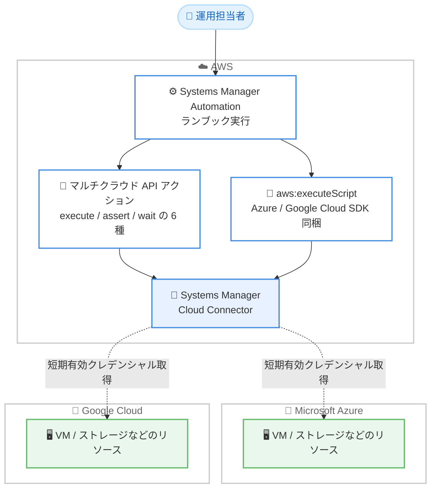

# AWS Systems Manager - Automation によるマルチクラウド運用タスクの自動化

**リリース日**: 2026年11月23日
**サービス**: AWS Systems Manager
**機能**: Automation のマルチクラウド対応 (Microsoft Azure / Google Cloud)

📊 [このアップデートのインフォグラフィックを見る](https://takech9203.github.io/aws-news-summary/20261123-systems-manager-multicloud-automation.html)

## 概要

AWS Systems Manager Automation が、Microsoft Azure および Google Cloud 上のリソースに対する運用タスクの自動化に対応しました。これにより、設定ミスの修復やアイドルリソースのクリーンアップといった定型的な運用ワークフロー (ランブック) を、AWS・Azure・Google Cloud をまたいで単一のツールから実行できます。

Automation は Systems Manager Cloud Connector を通じて Web アイデンティティトークンを短期有効な Azure / Google Cloud クレデンシャルに交換するため、AWS 側に他クラウドの認証情報を保存する必要はありません。バッチ単位での段階的なデプロイ、承認待ちによる一時停止、エラーがしきい値を超えた場合の自動停止といった安全性の制御機能も、マルチクラウドのランブックで利用できます。

複数のクラウドを運用するエンタープライズの運用チームや、クラウド横断でガバナンスを統一したい組織にとって、ツールと認証情報の管理を一元化できる重要なアップデートです。

**アップデート前の課題**

- クラウドごとに個別の自動化ツール (Azure Automation、Google Cloud Workflows など) を維持する必要があった
- クラウドごとに認証情報を個別に管理・保管する必要があり、シークレット管理の負担とリスクが大きかった
- Azure や Google Cloud の API を呼び出すには、カスタムコードの開発と認証処理の実装が必要だった

**アップデート後の改善**

- 6 つの新しいランブックアクションにより、カスタムコードなしで Azure / Google Cloud の API 呼び出し、リソース状態の検証、処理完了の待機が可能になった
- `aws:executeScript` アクションに Azure / Google Cloud の Python SDK が同梱され、Cloud Connector から短期有効クレデンシャルを自動取得するため、ランブック内にシークレットを保存する必要がなくなった
- Azure はサブスクリプション・リージョン・リソースグループ・リソースタイプ・タグで、Google Cloud はプロジェクト・ゾーン・アセットタイプ・ラベルでターゲットを柔軟に指定できるようになった

## アーキテクチャ図



Automation のランブックは Cloud Connector を経由して短期有効クレデンシャルを取得し、Azure や Google Cloud の API を直接呼び出してリソースを操作します。AWS 側に他クラウドのシークレットを保存する必要はありません。

## サービスアップデートの詳細

### 主要機能

1. **6 つの新しいランブックアクション**
   - Azure 向け: `aws:executeAzureApi` (API 呼び出し)、`aws:assertAzureResourceProperty` (リソース状態の検証)、`aws:waitForAzureResourceProperty` (プロパティ値の待機)
   - Google Cloud 向け: `aws:executeGcpApi`、`aws:assertGcpResourceProperty`、`aws:waitForGcpResourceProperty`
   - 各アクションは `CloudConnector` 入力と、使用する SDK パッケージを指定する `Package` 入力を受け取り、カスタムコードなしで API を呼び出せる

2. **`aws:executeScript` での Azure / Google Cloud SDK サポート**
   - Azure SDK for Python (`azure.mgmt.compute` など) と Google Cloud クライアントライブラリ (`google.cloud.compute_v1` など) が同梱され、ライブラリのインストールが不要
   - Automation が `AZURE_ACCESS_TOKEN` または `GCP_ACCESS_TOKEN` 環境変数にアクセストークンを設定するため、スクリプト内でクレデンシャルを保管する必要がない
   - 複数の API 呼び出し、ループ、独自ロジックを 1 ステップにまとめたい場合に有効

3. **柔軟なターゲット指定とレート制御**
   - Azure: サブスクリプション、リージョン、リソースグループ、リソースタイプ、タグでフィルタリング
   - Google Cloud: プロジェクト、ゾーン、アセットタイプ、ラベルでフィルタリング
   - Cloud Connector ターゲットで条件に一致するリソースごとに子オートメーションを実行し、バッチ制御・承認・エラーしきい値による停止が可能

4. **AWS 提供のランブック**
   - Azure / Google Cloud の VM に SSM Agent や Amazon Inspector エージェントをインストールする AWS 提供のランブックが利用可能
   - 独自のワークフローをカスタムランブックとして作成することも可能

## 技術仕様

### 実行方式

| 実行方式 | 詳細 |
|------|------|
| Cloud Connector ターゲット + レート制御 | コネクタとフィルタ条件に一致するリソースごとにランブックを実行。多数の VM への一括実行に適する |
| Parameter Values + レート制御 | 最大 50 台まで VM の ID を直接指定して実行 |
| Simple / Manual 実行 | Cloud Connector 入力を持つランブックに対し、リソース ID を指定して 1 回実行 |
| API アクション / スクリプト | ランブックのステップ内で Azure / Google Cloud API を呼び出す。VM への SSM Agent インストールは不要 |

### クレデンシャルの仕組み

| 項目 | 詳細 |
|------|------|
| 認証フロー | Automation がコネクタの IAM フェデレーションロールを引き受け、Web アイデンティティトークンを短期有効な Azure / Google Cloud クレデンシャルに交換 |
| シークレット保管 | 不要 (AWS 側に Azure / Google Cloud の認証情報を保存しない) |
| スクリプト用トークン | `AZURE_ACCESS_TOKEN` / `GCP_ACCESS_TOKEN` 環境変数で提供。トークンのリフレッシュは不可 |
| 実行時間制限 | `aws:executeScript` ステップは最大 600 秒 |

### API変更履歴

| 日付 | サービス | 変更内容 |
|------|----------|----------|
| 2026/11/20 | [ssm](https://awsapichanges.com/archive/changes/e9d2b3-ssm.html) | 5 updated api methods - SSM ドキュメントに `CloudProviders` フィールドを追加。`CreateDocument` / `UpdateDocument` でドキュメントが実行可能なクラウドプロバイダー (AWS、Azure、GCP) を指定し、`DescribeDocument` / `ListDocuments` / `ListDocumentVersions` で参照、`ListDocuments` でフィルタリングが可能 |

### ランブック例 (Google Cloud VM の起動と状態待機)

```yaml
mainSteps:
  - name: startInstance
    action: aws:executeGcpApi
    inputs:
      Service: compute
      Api: Instances.Start
      Package: gcp_202610
      CloudConnector: '{{ CloudConnector }}'
      project: '{{ parseInstanceId.Project }}'
      zone: '{{ parseInstanceId.Zone }}'
      instance: '{{ parseInstanceId.InstanceName }}'
  - name: waitForRunning
    action: aws:waitForGcpResourceProperty
    timeoutSeconds: 600
    inputs:
      Service: compute
      Api: Instances.Get
      Package: gcp_202610
      CloudConnector: '{{ CloudConnector }}'
      project: '{{ parseInstanceId.Project }}'
      zone: '{{ parseInstanceId.Zone }}'
      instance: '{{ parseInstanceId.InstanceName }}'
      PropertySelector: $.status
      DesiredValues:
        - RUNNING
```

## 設定方法

### 前提条件

1. Systems Manager Cloud Connector を作成する (Azure 用または Google Cloud 用)
2. コネクタのオートメーション引き受けロールを用意する (コネクタのノード管理を有効化した際にデフォルトで作成される)
3. リソース ID を受け取る入力を持つランブックを用意する (リソースタイプ入力、または `allowedPattern` で ID 形式を許可する `String` 入力)

### 手順

#### ステップ1: Cloud Connector の確認

```bash
# Systems Manager コンソールで Cloud Connector を作成済みであることを確認
# コネクタは作成した AWS リージョンに属するため、同じリージョンでオートメーションを開始する
```

Cloud Connector は作成したリージョンに紐づくため、オートメーションは必ず同じリージョンで開始します。別リージョンからはコネクタを読み取れません。

#### ステップ2: ランブックの作成とクラウドプロバイダーの指定

```bash
aws ssm create-document \
  --name "StartGcpInstance" \
  --document-type "Automation" \
  --document-format YAML \
  --content file://runbook.yaml
```

ランブックを Systems Manager ドキュメントとして登録します。ドキュメントのクラウドプロバイダーを `Azure` または `GCP` に設定すると、Automation コンソールの「Hybrid and multicloud」フィルタに表示され、Cloud Connector ターゲットが選択可能になります。

#### ステップ3: オートメーションの実行

```bash
aws ssm start-automation-execution \
  --document-name "StartGcpInstance" \
  --parameters "AutomationAssumeRole=arn:aws:iam::123456789012:role/AutomationCloudConnectorRole,CloudConnector=cc-0123456789abcdef0"
```

Cloud Connector ターゲットを使用したレート制御実行では、フィルタ条件に一致するリソースごとに子オートメーションが実行されます。実行結果は Automation コンソールの「Show child automations」で確認できます。

## メリット

### ビジネス面

- **運用ツールの一元化**: クラウドごとに別々の自動化ツールを維持する必要がなくなり、運用コストと学習コストを削減できる
- **セキュリティリスクの低減**: 他クラウドの認証情報を AWS 側に保存せず、短期有効クレデンシャルを都度取得するため、シークレット漏えいのリスクを低減できる
- **ガバナンスの統一**: 設定ミスの修復やポリシー違反リソースの是正を、マルチクラウド全体で統一された手順として標準化できる

### 技術面

- **コード不要の API 呼び出し**: 6 つの新アクションにより、1 回の API 呼び出し・状態検証・完了待機をカスタムコードなしで記述できる
- **SDK 同梱のスクリプト実行**: `aws:executeScript` で Azure / Google Cloud の Python SDK をインストール不要で利用でき、複雑なロジックも実装可能
- **安全な大規模実行**: バッチ制御、承認による一時停止、エラーしきい値による自動停止で、大規模な変更を安全に展開できる

## デメリット・制約事項

### 制限事項

- Cloud Connector は作成した AWS リージョンに属するため、オートメーションは同じリージョンで開始する必要がある
- マルチアカウント・マルチリージョン実行モードでは Cloud Connector ターゲットを使用できない
- Parameter Values でのリソース ID 直接指定は最大 50 台まで (それ以上は Cloud Connector ターゲットを使用)
- API アクションのレスポンスは最大 358,400 文字 (セレクタ適用前)
- `aws:executeScript` の `Package` 入力は PowerShell ランタイムでは未サポート (REST API を `Invoke-RestMethod` で直接呼び出す)
- アクセストークンはリフレッシュ不可で、`aws:executeScript` ステップの実行時間は最大 600 秒

### 考慮すべき点

- コネクタのサービスアカウント / アイデンティティに付与された権限の範囲でのみ操作可能。例えば Google Cloud でインスタンスを起動するには `compute.instances.start` を含むロールの追加付与が必要
- Azure のトークンは Azure Resource Manager (管理プレーン) 専用で、`azure.storage.blob` などのデータプレーンライブラリには別のトークンが必要
- `azure.identity` の `DefaultAzureCredential` や `google.auth.default()` は使用できず、環境変数のトークンからクレデンシャルを構築する必要がある
- 長時間実行オペレーションは完了を待たずに返るため、`aws:waitForAzureResourceProperty` / `aws:waitForGcpResourceProperty` で完了待機を組み合わせる設計が必要

## ユースケース

### ユースケース1: 営業時間外の開発用 VM の自動停止

**シナリオ**: Azure と Google Cloud に散在する開発用 VM を、コスト削減のため営業時間外に自動停止したい。

**実装例**:
```
1. 開発用 VM にタグ (Azure) / ラベル (Google Cloud) を付与
2. VM を停止するランブックを作成し、クラウドプロバイダーを設定
3. Cloud Connector ターゲットでタグ / ラベルをフィルタ条件に指定
4. EventBridge スケジューラから夜間に自動実行
```

**効果**: クラウドごとのスクリプトやスケジューラを維持することなく、マルチクラウド全体のアイドルリソースによるコストを削減できる。

### ユースケース2: セキュリティポリシーに違反するストレージの是正

**シナリオ**: Google Cloud のストレージバケットや Azure のストレージアカウントで、組織のセキュリティポリシーに違反する設定 (パブリックアクセスなど) を検出し、自動是正したい。

**実装例**:
```
1. aws:executeGcpApi / aws:executeAzureApi で設定を取得
2. aws:assertAzureResourceProperty などで状態を検証
3. 違反時は API 呼び出しで設定を修正し、承認ステップを挟んで段階的に適用
4. エラーしきい値を設定し、想定外の失敗が続いた場合は自動停止
```

**効果**: マルチクラウド全体のコンプライアンス是正を単一のワークフローで安全に自動化できる。

### ユースケース3: Azure / Google Cloud VM への管理エージェント一括導入

**シナリオ**: Azure と Google Cloud の VM を Systems Manager のマネージドノードとして管理し、Amazon Inspector による脆弱性評価も行いたい。

**実装例**:
```
1. AWS 提供のランブック (SSM Agent / Inspector エージェントのインストール) を選択
2. Cloud Connector ターゲットでサブスクリプション / プロジェクト単位に対象を指定
3. レート制御 (バッチサイズ・エラーしきい値) を設定して段階的に展開
```

**効果**: マルチクラウドの VM 群に対する管理基盤の導入を、手作業なしで安全に展開できる。

## 料金

今回の発表には料金に関する記載はありません。Systems Manager Automation の既存の料金体系が適用されると考えられます。詳細は料金ページを確認してください。

## 利用可能リージョン

Systems Manager Cloud Connector を作成できるすべての AWS リージョンで利用可能です。

なお、Cloud Connector は作成したリージョンに属するため、オートメーションは同じリージョンで開始する必要があります。

## 関連サービス・機能

- **Systems Manager Cloud Connector**: Azure / Google Cloud への接続と短期有効クレデンシャルの発行を担う。今回の機能の前提となるコンポーネント
- **Systems Manager Automation**: ランブックによる運用タスク自動化の実行基盤。レート制御・承認・エラーしきい値などの安全機構を提供
- **Amazon Inspector**: AWS 提供のランブックで Azure / Google Cloud の VM にエージェントを導入し、脆弱性評価をマルチクラウドに拡張可能
- **AWS IAM**: コネクタのフェデレーションロールとオートメーション引き受けロールによる認証・認可を提供

## 参考リンク

- 📊 [インフォグラフィック](https://takech9203.github.io/aws-news-summary/20261123-systems-manager-multicloud-automation.html)
- [公式発表 (What's New)](https://aws.amazon.com/about-aws/whats-new/2026/11/systems-manager-multicloud-automation/)
- [ドキュメント: Run automations on multicloud resources](https://docs.aws.amazon.com/systems-manager/latest/userguide/running-automations-cloud-connector.html)
- [ドキュメント: Create runbooks that call Azure and Google Cloud APIs](https://docs.aws.amazon.com/systems-manager/latest/userguide/automation-multicloud-runbooks.html)
- [AWS Systems Manager 製品ページ](https://aws.amazon.com/systems-manager/)
- [料金ページ](https://aws.amazon.com/systems-manager/pricing/)

## まとめ

AWS Systems Manager Automation のマルチクラウド対応により、Azure と Google Cloud の運用タスクを AWS 上の単一のワークフローで安全に自動化できるようになりました。クラウドごとのツールとシークレット管理が不要になるため、マルチクラウド環境を運用する組織はまず Cloud Connector をセットアップし、AWS 提供のランブックから試すことを推奨します。
