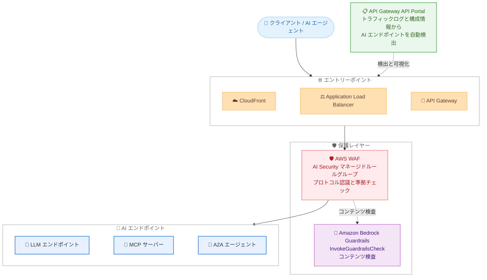

# AWS WAF - LLM、MCP、A2A エンドポイントの自動検出と保護 (Amazon Bedrock Guardrails 連携)

**リリース日**: 2026 年 11 月 23 日
**サービス**: AWS WAF、Amazon API Gateway、Amazon Bedrock Guardrails
**機能**: AI エンドポイントの自動検出と AI Security マネージドルールグループによる保護

📊 [このアップデートのインフォグラフィックを見る](https://takech9203.github.io/aws-news-summary/20261123-waf-ai-endpoint-discovery-protection.html)

## 概要

AWS WAF が、大規模言語モデル (LLM)、Model Context Protocol (MCP)、Agent2Agent (A2A) の各エンドポイントを自動的に検出し、保護する機能の一般提供を発表しました。Amazon API Gateway、Application Load Balancer、Amazon CloudFront の背後にある AI エンドポイントを AWS Organizations 全体から検出し、AWS WAF の新しい AI Security マネージドルールグループで保護できます。

検出は新しい API Gateway API Portal が担当し、トラフィックログとサービス構成情報から AI エンドポイントを自動的に特定します。エージェントのデプロイやログの転送は不要です。保護は AI Security マネージドルールグループが担当し、プロトコル認識と準拠チェックにより不正な形式の MCP / A2A メッセージをブロックします。さらにコンテンツ検査を有効にすると、Amazon Bedrock Guardrails の `InvokeGuardrailsCheck` API を呼び出し、プロンプトインジェクションやジェイルブレイクなどの AI 特有の脅威を検出できます。

生成 AI アプリケーションや AI エージェントを本番環境で運用する組織、特に「シャドー API」として公開されている可能性のある MCP サーバーのガバナンスに課題を持つセキュリティチームにとって重要なアップデートです。

**アップデート前の課題**

- 組織内のどこに LLM / MCP / A2A エンドポイントが公開されているかを把握する統一的な手段がなく、文書化されていない公開 MCP サーバーがシャドー API として残存するリスクがあった
- プロンプトインジェクションやジェイルブレイクなど AI 特有の攻撃を WAF レイヤーで防ぐには、カスタムルールの作成やアプリケーション側での個別実装が必要だった
- MCP や A2A といった新しいプロトコルのメッセージ形式を検証する仕組みを独自に構築する必要があった

**アップデート後の改善**

- API Portal がトラフィックログと構成情報から AI エンドポイントを自動検出し、AWS Organizations 全体の可視化が可能になった
- AI Security マネージドルールグループを Web ACL に追加するだけで、カスタムルールを書かずに MCP / A2A メッセージのプロトコル検証が可能になった
- Bedrock Guardrails との連携により、プロンプトインジェクション、ジェイルブレイク、有害コンテンツ、レスポンス内の機密データを WAF レイヤーで検査できるようになった

## アーキテクチャ図



API Portal が CloudFront、ALB、API Gateway 配下の AI エンドポイントを自動検出し、AWS WAF の AI Security マネージドルールグループがプロトコル検証を実施します。コンテンツ検査を有効にすると、Bedrock Guardrails の `InvokeGuardrailsCheck` API でプロンプトインジェクションなどの脅威を検査します。

## サービスアップデートの詳細

### 主要機能

1. **API Gateway API Portal による自動検出**
   - トラフィックログとサービス構成情報から LLM / MCP / A2A エンドポイントを自動的に特定
   - エージェントのデプロイやログの転送は不要
   - AWS Organizations 全体を対象とした検出に対応
   - 文書化されていない公開 MCP サーバーをシャドー API として可視化

2. **AI Security マネージドルールグループ**
   - AWS WAF の新しいマネージドルールグループとして提供
   - プロトコル認識と準拠チェックにより、不正な形式の MCP / A2A メッセージをブロック
   - 他の AWS マネージドルールやカスタムルールと併用可能
   - カスタムルールの作成は不要

3. **Amazon Bedrock Guardrails によるコンテンツ検査**
   - コンテンツ検査を有効にすると、Bedrock Guardrails の `InvokeGuardrailsCheck` API を呼び出して検査を実施
   - プロンプトインジェクション、ジェイルブレイクを検出
   - リクエスト内の有害コンテンツを検出
   - レスポンス内の機密データを検出

4. **AI Security イベントの可視化 API**
   - `ListEvents` / `ListEventsByWebACL`: イベントの一覧取得
   - `GetEvent`: タイムラインを含むイベント詳細の取得
   - `ListEventActors` / `GetEventActor`: イベントに関連付けられたクライアントの確認

## 技術仕様

### 保護対象エンドポイント

| 項目 | 詳細 |
|------|------|
| 対象エンドポイント | LLM エンドポイント、MCP サーバー、A2A エージェント |
| 対応リソース | Amazon API Gateway、Application Load Balancer、Amazon CloudFront |
| 検出方法 | トラフィックログとサービス構成情報の分析 (API Portal) |
| プロトコル検証 | MCP / A2A メッセージのプロトコル認識と準拠チェック |
| コンテンツ検査 | Bedrock Guardrails の `InvokeGuardrailsCheck` API を使用 (オプション) |
| 検出範囲 | AWS Organizations 全体 |

### API 変更履歴

| 日付 | サービス | 変更内容 |
|------|----------|----------|
| 2026/11/20 | [wafv2](https://awsapichanges.com/archive/changes/e9d2b3-wafv2.html) | 5 new 8 updated api methods - AI Security マネージドルールグループの設定と、AI Security イベント用の読み取り専用 API (`ListEvents`、`ListEventsByWebACL`、`GetEvent`、`ListEventActors`、`GetEventActor`) を追加 |

## 設定方法

### 前提条件

1. AWS WAF の Web ACL が作成済みであること (または新規作成すること)
2. 保護対象の AI エンドポイントが API Gateway、ALB、CloudFront のいずれかの背後にあること
3. コンテンツ検査を使用する場合は、Amazon Bedrock Guardrails のガードレールが設定済みであること

### 手順

#### ステップ 1: API Portal で AI エンドポイントを検出する

API Gateway コンソールから API Portal を開き、組織内の AI エンドポイントの検出結果を確認します。トラフィックログと構成情報に基づいて、LLM / MCP / A2A エンドポイントが自動的に一覧表示されます。文書化されていない公開 MCP サーバーがシャドー API として表示されるため、保護が必要なエンドポイントを特定できます。

#### ステップ 2: AI Security マネージドルールグループを Web ACL に追加する

AWS WAF コンソールで対象の Web ACL を開き、ルールの追加から AI Security マネージドルールグループを選択します。既存の AWS マネージドルールやカスタムルールと併用できます。

```bash
# 現在の Web ACL 設定を確認
aws wafv2 get-web-acl \
  --name my-web-acl \
  --scope REGIONAL \
  --id <web-acl-id>
```

上記コマンドは、既存の Web ACL の設定内容を取得します。AI Security マネージドルールグループを追加する際のベースとなる現在のルール構成と `LockToken` を確認できます。

#### ステップ 3: コンテンツ検査を有効化する

AI Security マネージドルールグループの設定でコンテンツ検査を有効にし、使用する Bedrock Guardrails のガードレールを関連付けます。これにより、WAF が `InvokeGuardrailsCheck` API を呼び出してプロンプトインジェクションやジェイルブレイクなどを検査するようになります。設定パラメータの詳細は [AWS WAF AI Security 開発者ガイド](https://docs.aws.amazon.com/waf/latest/developerguide/waf-ai-security.html)を参照してください。

#### ステップ 4: AI Security イベントを確認する

```bash
# Web ACL に関連付けられた AI Security イベントの一覧を取得
aws wafv2 list-events-by-web-acl \
  --web-acl-arn <web-acl-arn>
```

上記コマンドは、指定した Web ACL で検出された AI Security イベントの一覧を取得します。`GetEvent` でタイムラインを含む詳細を、`ListEventActors` でイベントに関連付けられたクライアントを確認できます。

## メリット

### ビジネス面

- **シャドー API リスクの低減**: 文書化されていない公開 MCP サーバーを組織全体から自動検出し、ガバナンスの抜け漏れを防止できる
- **運用負荷の削減**: エージェントのデプロイやログ転送、カスタムルールの作成が不要で、セキュリティチームの作業を大幅に削減できる
- **AI 活用の加速**: AI 特有の脅威への対策を AWS マネージドサービスに任せることで、安心して生成 AI アプリケーションを本番展開できる

### 技術面

- **プロトコルレベルの検証**: MCP / A2A という新しいプロトコルの準拠チェックをマネージドルールとして利用でき、不正な形式のメッセージをエッジでブロックできる
- **Bedrock Guardrails との統合**: プロンプトインジェクション、ジェイルブレイク、有害コンテンツ、機密データ漏えいの検査を WAF レイヤーで一元化できる
- **既存構成との親和性**: 既存の AWS マネージドルールやカスタムルールと併用でき、段階的な導入が可能

## デメリット・制約事項

### 制限事項

- AI Security マネージドルールグループが利用できるリージョンは 7 リージョンに限定される (下記「利用可能リージョン」参照)
- 保護対象は API Gateway、ALB、CloudFront の背後にあるエンドポイントに限られる
- コンテンツ検査には Amazon Bedrock Guardrails のガードレール設定が別途必要

### 考慮すべき点

- AI Security マネージドルールグループには追加料金が発生し、コンテンツ検査の `InvokeGuardrailsCheck` 呼び出しには Amazon Bedrock が別途課金する
- コンテンツ検査は外部 API 呼び出しを伴うため、レイテンシーへの影響を事前に検証することが望ましい
- ガードレールのポリシー設定 (ブロック対象のトピックや機密情報の種類) は、アプリケーションの特性に合わせたチューニングが必要

## ユースケース

### ユースケース 1: 組織全体のシャドー MCP サーバーの棚卸し

**シナリオ**: 複数の開発チームが独自に MCP サーバーを構築して公開しており、セキュリティチームが全体像を把握できていない。

**実装例**:
```
1. API Portal を有効化し、AWS Organizations 全体の検出を構成
2. トラフィックログと構成情報から検出された AI エンドポイントの一覧を確認
3. 文書化されていない公開 MCP サーバーを特定し、所有チームへ連絡
4. 必要なエンドポイントに AI Security マネージドルールグループを適用
```

**効果**: エージェントのデプロイなしで組織全体の AI エンドポイントを可視化し、シャドー API によるセキュリティリスクを低減できる。

### ユースケース 2: 公開 LLM チャットアプリのプロンプトインジェクション対策

**シナリオ**: API Gateway 経由で公開している LLM ベースのチャットアプリケーションに対し、プロンプトインジェクションやジェイルブレイクの試行が懸念される。

**実装例**:
```
1. Bedrock Guardrails でプロンプト攻撃フィルタと機密情報フィルタを設定
2. Web ACL に AI Security マネージドルールグループを追加
3. コンテンツ検査を有効化し、ガードレールを関連付け
4. ListEventsByWebACL / GetEvent で検出イベントを定期的にレビュー
```

**効果**: アプリケーションコードを変更せずに、悪意のあるプロンプトをエッジでブロックし、レスポンス内の機密データ漏えいも検査できる。

### ユースケース 3: A2A 連携する AI エージェント基盤の保護

**シナリオ**: 複数の AI エージェントが A2A プロトコルで連携する基盤を ALB の背後で運用しており、不正な形式のメッセージによる攻撃を防ぎたい。

**実装例**:
```
1. ALB に関連付けた Web ACL に AI Security マネージドルールグループを追加
2. プロトコル認識と準拠チェックにより、不正な形式の A2A メッセージを自動ブロック
3. 既存の AWS マネージドルール (例: Core rule set) と併用して多層防御を構成
```

**効果**: カスタムルールを書くことなく A2A プロトコルレベルの検証を実現し、エージェント基盤への攻撃面を縮小できる。

## 料金

AI Security マネージドルールグループの利用には追加料金が発生します。また、コンテンツ検査における `InvokeGuardrailsCheck` の呼び出しに対して、Amazon Bedrock が別途課金します。詳細は [AWS WAF 料金ページ](https://aws.amazon.com/waf/pricing/)および [Amazon Bedrock 料金ページ](https://aws.amazon.com/bedrock/pricing/)を参照してください。

## 利用可能リージョン

- **API Portal**: 32 の AWS リージョン (詳細は [Amazon API Gateway FAQ](https://aws.amazon.com/api-gateway/faqs/) を参照)
- **AI Security マネージドルールグループ**: 以下の 7 リージョン
  - 米国東部 (バージニア北部)
  - 米国東部 (オハイオ)
  - 米国西部 (オレゴン)
  - 欧州 (ロンドン)
  - 欧州 (ストックホルム)
  - アジアパシフィック (東京)
  - アジアパシフィック (シドニー)

## 関連サービス・機能

- **Amazon API Gateway**: 新しい API Portal が AI エンドポイントの検出を担当し、組織全体の API を可視化する
- **Amazon Bedrock Guardrails**: `InvokeGuardrailsCheck` API によるコンテンツ検査で、プロンプトインジェクションや機密データ漏えいを検出する
- **AWS Organizations**: 組織全体を対象とした AI エンドポイントの検出に利用される
- **Amazon CloudFront / Application Load Balancer**: API Gateway とともに、検出および保護の対象となるエントリーポイント

## 参考リンク

- 📊 [インフォグラフィック](https://takech9203.github.io/aws-news-summary/20261123-waf-ai-endpoint-discovery-protection.html)
- [公式発表 (What's New)](https://aws.amazon.com/about-aws/whats-new/2026/11/waf-ai-endpoint-discovery-protection/)
- [AWS Blog: Introducing API and AI security on AWS, from discovery to protection](https://aws.amazon.com/blogs/security/introducing-api-and-ai-security-on-aws-from-discovery-to-protection/)
- [AWS WAF AI Security 製品ページ](https://aws.amazon.com/waf/features/ai-security/)
- [AWS WAF AI Security 開発者ガイド](https://docs.aws.amazon.com/waf/latest/developerguide/waf-ai-security.html)
- [API Portal 開発者ガイド](https://docs.aws.amazon.com/apigateway/latest/developerguide/apiportal.html)
- [AWS WAF 料金ページ](https://aws.amazon.com/waf/pricing/)

## まとめ

AWS WAF の AI Security マネージドルールグループと API Gateway API Portal により、LLM / MCP / A2A エンドポイントの「検出から保護まで」をマネージドサービスで完結できるようになりました。生成 AI アプリケーションや AI エージェントを公開している組織は、まず API Portal でエンドポイントの棚卸しを行い、東京リージョンを含む対応リージョンで AI Security マネージドルールグループの適用を検討することを推奨します。
